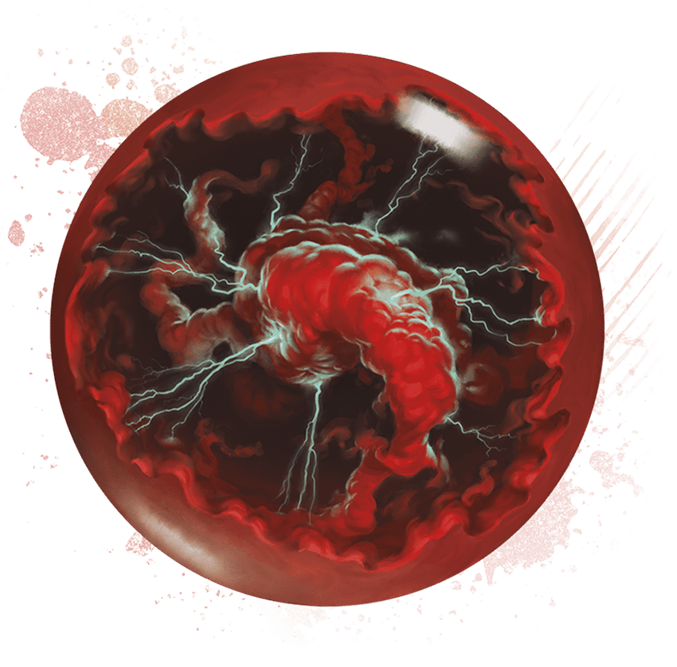
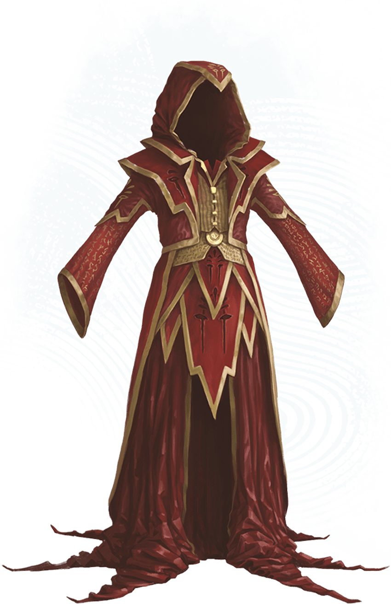
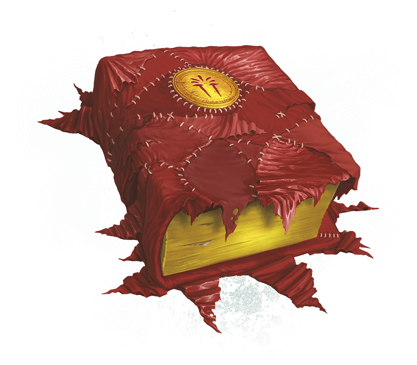
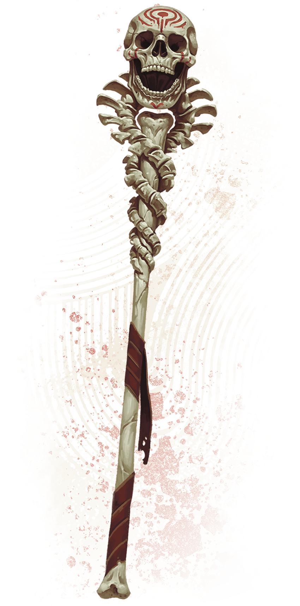
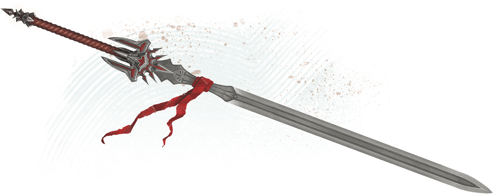

<!-- Notes MJ : contenu fourni par l’utilisateur, non destiné au partage public. -->

# Appendix A: Magic Items

APPENDIX A

# MAGIC ITEMS

The magic item descriptions that follow are presented in alphabetical order.

---

## [Crystal Ball of Ominous Portent](https://www.dndbeyond.com/magic-items/11914525-crystal-ball-of-ominous-portent)

*Wondrous Item, Legendary (Requires Attunement)*

Black-and-scarlet clouds of ominous magic swirl inside this crystal orb. While touching the orb, you can cast [Hex](https://www.dndbeyond.com/spells/2618988-hex) or [Scrying](https://www.dndbeyond.com/spells/2619007-scrying) (save DC 17) with it.

In addition, when a creature you can see within 60 feet succeeds on a [D20 Test](https://www.dndbeyond.com/sources/dnd/free-rules/rules-glossary#D20Test), you can take a Reaction to turn the roll into a 1. Once used, this property can’t be used again until the next dawn.

Wade Acuff

Crystal Ball of Ominous Portent

---

## [Eyes of Deceit](https://www.dndbeyond.com/magic-items/11914526-eyes-of-deceit)

*Wondrous Item, Uncommon*

These tinted crystal lenses shroud your eyes. While wearing them, you gain a +5 bonus to Charisma ([Deception](https://www.dndbeyond.com/sources/dnd/free-rules/playing-the-game#Skills)) checks.

---

## [Life-Sapping Blade](https://www.dndbeyond.com/magic-items/11914527-life-sapping-blade)

*Weapon (Any Melee Weapon with the Finesse Property), Rare (Requires Attunement)*

This thin, black, iron blade is popular among Thayan assassins and spies.

You gain a +1 bonus to attack rolls and damage rolls made with this magic weapon. When you hit with an attack roll using this weapon, the target takes an extra 2d4 Necrotic damage, and it can’t regain Hit Points until the end of its next turn. If a creature is reduced to 0 Hit Points by an attack using this weapon, the creature immediately dies and can be restored to life only by a [Resurrection](https://www.dndbeyond.com/spells/2618953-resurrection) or [True Resurrection](https://www.dndbeyond.com/spells/2619199-true-resurrection) spell.

---

## [Masquerader’s Brooch](https://www.dndbeyond.com/magic-items/11914533-masqueraders-brooch)

*Wondrous Item, Rare (Requires Attunement)*

A Masquerader’s Brooch comes in various shapes and sizes but always looks slightly tarnished.

You gain the following benefits while wearing the brooch.

***Illusory Fashion.*** As a Bonus Action while wearing or holding the brooch, you can project a magical illusion over your clothing, armor, weapons, equipment, and other belongings on your person. The illusion lasts for 1 hour and ends early if the brooch is removed. Each time you use this benefit, you determine the extent and nature of the illusion. It could be as minor as changing the color of your garments or as extensive as making a suit of armor appear as an evening gown and a sheathed weapon appear as a satin sash.

The changes wrought by this illusion fail to hold up to physical inspection. A creature that takes the [Study](https://www.dndbeyond.com/sources/dnd/free-rules/rules-glossary#StudyAction) action to examine your appearance discerns the illusion with a successful DC 13 Intelligence ([Investigation](https://www.dndbeyond.com/sources/dnd/free-rules/playing-the-game#Skills)) check.

***Shifting Guise.*** As a [Magic](https://www.dndbeyond.com/sources/dnd/free-rules/rules-glossary#MagicAction) action while wearing or holding the brooch, you can cast [Alter Self](https://www.dndbeyond.com/spells/2618846-alter-self) from it (Change Appearance option only; no [Concentration](https://www.dndbeyond.com/sources/dnd/free-rules/rules-glossary#Concentration) required).

---

Wade Acuff

Robe of Thayan Arcana

## [Ring of Candor](https://www.dndbeyond.com/magic-items/11914534-ring-of-candor)

*Ring, Uncommon*

While wearing this simple metal band, you gain a +5 bonus to Wisdom ([Insight](https://www.dndbeyond.com/sources/dnd/free-rules/playing-the-game#Skills)) checks. In addition, you can cast [Zone of Truth](https://www.dndbeyond.com/spells/2619221-zone-of-truth) (save DC 13) from the ring. You can’t cast *Zone of Truth* in this way again until the next dawn.

---

## [Robe of Thayan Arcana](https://www.dndbeyond.com/magic-items/11914535-robe-of-thayan-arcana)

*Wondrous Item, Very Rare (Requires Attunement by a Sorcerer, Warlock, or Wizard)*

Mysterious symbols decorate this deep-red robe. You gain the following benefits while wearing the robe.

***Combat Mage.*** Your spell save DC and spell attack bonus each increase by 1.

***Empowered Magic.*** When you roll damage for a spell, you can treat any 1 on a damage die as a 2.

***Spellcasting Focus.*** You can use the robe as a Spellcasting Focus for your spells.

---

## [Scarlet Spellbook](https://www.dndbeyond.com/magic-items/11914536-scarlet-spellbook)

*Wondrous Item, Rare (Requires Attunement by a Wizard)*

Irregular scraps of red cloth cover this weathered tome. While attuned to this item, you can use it as a Spellbook and an [Arcane Focus](https://www.dndbeyond.com/equipment/544-arcane-focus).

***Arcane Stamina.*** When you use your Arcane Recovery feature, you also regain Hit Points equal to 2d6 plus half your Wizard level (round down).

***Improved Spell Recall.*** When you use your Memorize Spell feature, you can replace an additional level 1+ Wizard spell you have prepared for your Spellcasting feature with another level 1+ spell inscribed in this book.

Wade Acuff

Scarlet Spellbook

---

## [Sniper’s Bracelet](https://www.dndbeyond.com/magic-items/11914537-snipers-bracelet)

*Weapon (Heavy Crossbow, Light Crossbow, Longbow, Musket, Pistol, or Shortbow), Common (Requires Attunement)*

As a [Magic](https://www.dndbeyond.com/sources/dnd/free-rules/rules-glossary#MagicAction) action while touching this weapon, you can transform it into a bracelet or back into its weapon form. While in bracelet form, it can’t be used to make attacks.

If the weapon lacks ammunition while in its weapon form, it produces its own, automatically creating one piece of magic ammunition when you make a ranged attack roll with it. The ammunition vanishes the instant after it hits or misses a target.

---

## [Spell-Fueling Armor](https://www.dndbeyond.com/magic-items/11914544-spell-fueling-armor)

*Armor (Any Light, Medium, or Heavy), Very Rare (Requires Attunement by a Spellcaster)*

Channels bearing arcane runes intersect across this armor, which is favored by spellcasting Thayan knights.

***Potent Spellcasting.*** When you roll damage for a spell while wearing this armor, you can treat any 1 on a damage die as a 2.

***Resurgent Power.*** When you finish a Short Rest while wearing this armor, you can choose a number of expended spell slots to recover. The spell slots’ levels must have a combined total equal to 3 or less. For example, you can recover one level 3 spell slot or three level 1 spell slots. Once used, this property can’t be used again until the next dawn.

---

## [Spirit-Binding Censer](https://www.dndbeyond.com/magic-items/11914557-spirit-binding-censer)

*Wondrous Item, Artifact (Requires Attunement)*

This brass censer is comfortingly warm to the touch.

***Spellcasting.*** The censer has 10 charges and regains 1d6 charges daily at dawn. While holding the censer, you can cast a spell on the Censer Spells table from it (save DC 18). The table indicates how many charges you must expend to cast the spell.

#### Censer Spells

| Spell | Charge Cost |
| --- | --- |
| [Banishment](https://www.dndbeyond.com/spells/2618906-banishment) | 4 |
| [Bless](https://www.dndbeyond.com/spells/2618933-bless) | 1 |
| [Circle of Power](https://www.dndbeyond.com/spells/2618970-circle-of-power) | 5 |
| [Dispel Magic](https://www.dndbeyond.com/spells/2619103-dispel-magic) | 3 |
| [Remove Curse](https://www.dndbeyond.com/spells/2618943-remove-curse) | 3 |

***Protective Incense.*** As a [Magic](https://www.dndbeyond.com/sources/dnd/free-rules/rules-glossary#MagicAction) action while holding the censer, you can cause magical smoke to billow from the censer, filling a 30-foot [Emanation](https://www.dndbeyond.com/sources/dnd/free-rules/rules-glossary#EmanationAreaofEffect) originating from the censer for 1 hour or until you end it (no action required). The area of the Emanation is [Lightly Obscured](https://www.dndbeyond.com/sources/dnd/free-rules/rules-glossary#LightlyObscured), and creatures of your choice (including yourself) gain the benefits of the [Protection from Evil and Good](https://www.dndbeyond.com/spells/2618912-protection-from-evil-and-good) spell while within the Emanation. Once used, this property can’t be used again until the next dawn.

***Spirit Imprisonment.*** When a creature dies within 30 feet of you while you’re holding the censer, you can siphon the creature’s soul into the censer, trapping it within.

While a creature’s soul is trapped within the censer, that creature can’t be restored to life. If the creature had a trait that would allow it to revive, such as a [Barbed Devil](https://www.dndbeyond.com/monsters/5194917-barbed-devil)’s Diabolical Restoration trait or a [Lich](https://www.dndbeyond.com/monsters/5195106-lich)’s Spirit Jar trait, that trait doesn’t function while the creature’s soul is trapped. The censer can contain only one soul at a time. A creature’s soul remains trapped within the censer for 100 years, until you take a Magic action to release the soul, or until the censer is destroyed (see “Destroying the Censer” below).

***Random Properties.*** The censer has the following random properties (see the [Dungeon Master’s Guide](https://www.dndbeyond.com/sources/dnd/dmg-2024)):

1 minor beneficial property

1 major beneficial property

***Destroying the Censer.*** If it doesn’t contain a soul, the censer is destroyed after being submerged in the River Styx for 1 year.

---

## [Staff of the Spirit Aegis](https://www.dndbeyond.com/magic-items/11914558-staff-of-the-spirit-aegis)

*Staff, Legendary (Requires Attunement)*

Alejandro Pacheco

Staff of the Spirit Aegis

This weathered bone staff is topped with a skull and decorated with vertebrae. It can be wielded as a magic Quarterstaff that grants a +3 bonus to attack rolls and damage rolls made with it. While holding the staff, you have Resistance to Necrotic damage.

***Aura of Haunted Power.*** As a [Magic](https://www.dndbeyond.com/sources/dnd/free-rules/rules-glossary#MagicAction) action while holding the staff, you can cause it to radiate supernatural power that fills a 30-foot [Emanation](https://www.dndbeyond.com/sources/dnd/free-rules/rules-glossary#EmanationAreaofEffect) originating from you. Creatures of your choice in this Emanation (including yourself) gain the following benefits:

- **Undead Deterrent.** Undead have [Disadvantage](https://www.dndbeyond.com/sources/dnd/free-rules/rules-glossary#Disadvantage) on attack rolls against the creatures.
- **Unholy Protection.** The creatures have Resistance to Cold, Necrotic, and Psychic damage, and they have [Advantage](https://www.dndbeyond.com/sources/dnd/free-rules/rules-glossary#Advantage) on saving throws to avoid or end the [Frightened](https://www.dndbeyond.com/sources/dnd/free-rules/rules-glossary#FrightenedCondition) condition.

The [Emanation](https://www.dndbeyond.com/sources/dnd/free-rules/rules-glossary#EmanationAreaofEffect) lasts for 1 hour or until you end it (no action required). Once used, this property can’t be used again until the next dawn.

***Illuminating Sight.*** As a Bonus Action while holding the staff, you can cause the eye sockets of the skull atop the staff to emit an unearthly glow; this glow lasts until you stop it (no action required). While the staff glows, it sheds [Bright Light](https://www.dndbeyond.com/sources/dnd/free-rules/rules-glossary#BrightLight) in a 15-foot radius and [Dim Light](https://www.dndbeyond.com/sources/dnd/free-rules/rules-glossary#DimLight) for an additional 15 feet. [Invisible](https://www.dndbeyond.com/sources/dnd/free-rules/rules-glossary#InvisibleCondition) creatures and objects are visible as long as they are in the staff’s Bright Light or Dim Light.

---

## [Thayan Sword](https://www.dndbeyond.com/magic-items/11914562-thayan-sword)

*Weapon (Greatsword, Longsword, or Scimitar), Rare (Requires Attunement)*

*Thayan Swords* are often awarded to premier Thayan knights when they complete their training.

You gain a +1 bonus to attack rolls and damage rolls made with this magic weapon.

***Knight of the Arcane.*** The sword has 4 charges and regains 1d4 charges daily at dawn. While holding the sword, you can expend 1 charge to cast one of the following spells (save DC 15):

- [Searing Smite](https://www.dndbeyond.com/spells/2619009-searing-smite)
- [Thunderous Smite](https://www.dndbeyond.com/spells/2619182-thunderous-smite)
- [Wrathful Smite](https://www.dndbeyond.com/spells/2619220-wrathful-smite)

***Resurgent Warrior.*** If you’re reduced to 0 Hit Points but not killed outright while holding this sword, you can drop to 1 Hit Point instead. Once used, this property can’t be used again until the next dawn.

Wade Acuff

Thayan Sword

---

## [Trick Weapon](https://www.dndbeyond.com/magic-items/11914593-trick-weapon)

*Weapon (Any Simple or Martial Melee Weapon), Common*

As a [Magic](https://www.dndbeyond.com/sources/dnd/free-rules/rules-glossary#MagicAction) action while touching this weapon, you can transform it into a mundane item or back into its weapon form. It can’t be used to make attacks while transformed into a mundane item.

Different *Trick Weapons* transform into different items. The DM chooses the mundane item or determines it randomly by rolling on the following table.

| 1d10 | The Weapon Transforms Into A … |
| --- | --- |
| 1 | Bracelet |
| 2 | Comb |
| 3 | Crutch |
| 4 | Fake coin |
| 5 | Hairpin |
| 6 | Jingle bell |
| 7 | Pendant necklace |
| 8 | Playing card |
| 9 | Quill pen |
| 10 | Spoon |

---

## [Wand of Enthralling](https://www.dndbeyond.com/magic-items/11914595-wand-of-enthralling)

*Wand, Uncommon (Requires Attunement by a Spellcaster)*

This wand has 4 charges and regains 1d4 expended charges daily at dawn. While holding it, you can expend 1 charge to cast [Enthrall](https://www.dndbeyond.com/spells/2619192-enthrall) (save DC 15) from it.
