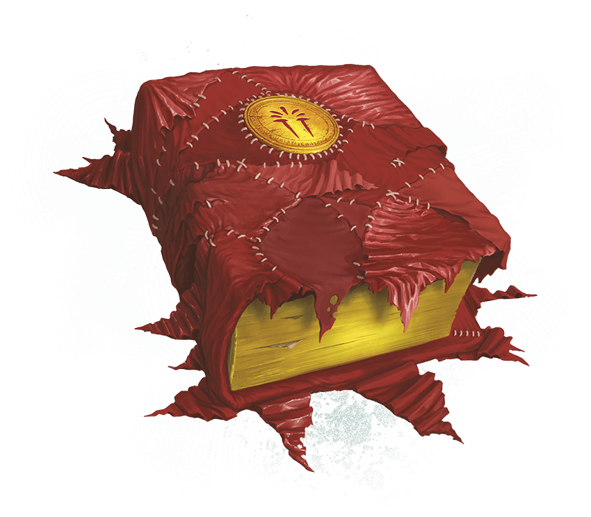

<!-- Notes MJ : contenu fourni par l’utilisateur, non destiné au partage public. -->

## [Scarlet Spellbook](https://www.dndbeyond.com/magic-items/11914536-scarlet-spellbook)

*Wondrous Item, Rare (Requires Attunement by a Wizard)*

Irregular scraps of red cloth cover this weathered tome. While attuned to this item, you can use it as a Spellbook and an [Arcane Focus](https://www.dndbeyond.com/equipment/544-arcane-focus).

***Arcane Stamina.*** When you use your Arcane Recovery feature, you also regain Hit Points equal to 2d6 plus half your Wizard level (round down).

***Improved Spell Recall.*** When you use your Memorize Spell feature, you can replace an additional level 1+ Wizard spell you have prepared for your Spellcasting feature with another level 1+ spell inscribed in this book.

Wade Acuff

Scarlet Spellbook

---
