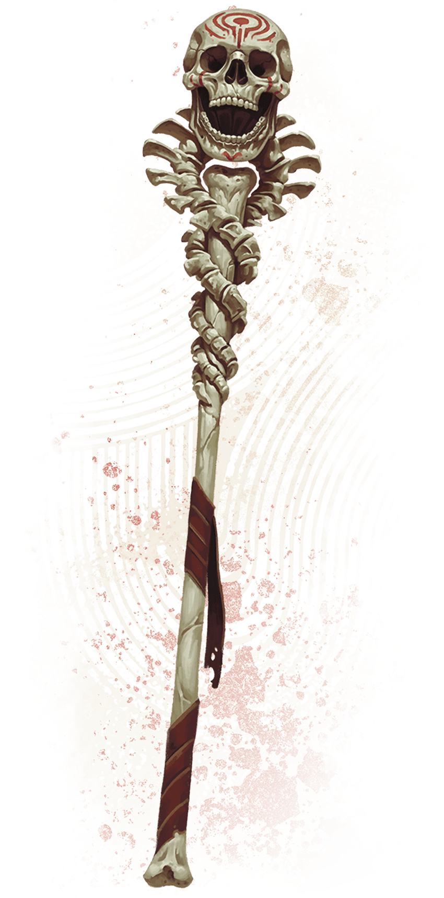

<!-- Notes MJ : contenu fourni par l’utilisateur, non destiné au partage public. -->

## [Staff of the Spirit Aegis](https://www.dndbeyond.com/magic-items/11914558-staff-of-the-spirit-aegis)

*Staff, Legendary (Requires Attunement)*

Alejandro Pacheco

Staff of the Spirit Aegis

This weathered bone staff is topped with a skull and decorated with vertebrae. It can be wielded as a magic Quarterstaff that grants a +3 bonus to attack rolls and damage rolls made with it. While holding the staff, you have Resistance to Necrotic damage.

***Aura of Haunted Power.*** As a [Magic](https://www.dndbeyond.com/sources/dnd/free-rules/rules-glossary#MagicAction) action while holding the staff, you can cause it to radiate supernatural power that fills a 30-foot [Emanation](https://www.dndbeyond.com/sources/dnd/free-rules/rules-glossary#EmanationAreaofEffect) originating from you. Creatures of your choice in this Emanation (including yourself) gain the following benefits:

- **Undead Deterrent.** Undead have [Disadvantage](https://www.dndbeyond.com/sources/dnd/free-rules/rules-glossary#Disadvantage) on attack rolls against the creatures.
- **Unholy Protection.** The creatures have Resistance to Cold, Necrotic, and Psychic damage, and they have [Advantage](https://www.dndbeyond.com/sources/dnd/free-rules/rules-glossary#Advantage) on saving throws to avoid or end the [Frightened](https://www.dndbeyond.com/sources/dnd/free-rules/rules-glossary#FrightenedCondition) condition.

The [Emanation](https://www.dndbeyond.com/sources/dnd/free-rules/rules-glossary#EmanationAreaofEffect) lasts for 1 hour or until you end it (no action required). Once used, this property can’t be used again until the next dawn.

***Illuminating Sight.*** As a Bonus Action while holding the staff, you can cause the eye sockets of the skull atop the staff to emit an unearthly glow; this glow lasts until you stop it (no action required). While the staff glows, it sheds [Bright Light](https://www.dndbeyond.com/sources/dnd/free-rules/rules-glossary#BrightLight) in a 15-foot radius and [Dim Light](https://www.dndbeyond.com/sources/dnd/free-rules/rules-glossary#DimLight) for an additional 15 feet. [Invisible](https://www.dndbeyond.com/sources/dnd/free-rules/rules-glossary#InvisibleCondition) creatures and objects are visible as long as they are in the staff’s Bright Light or Dim Light.

---
