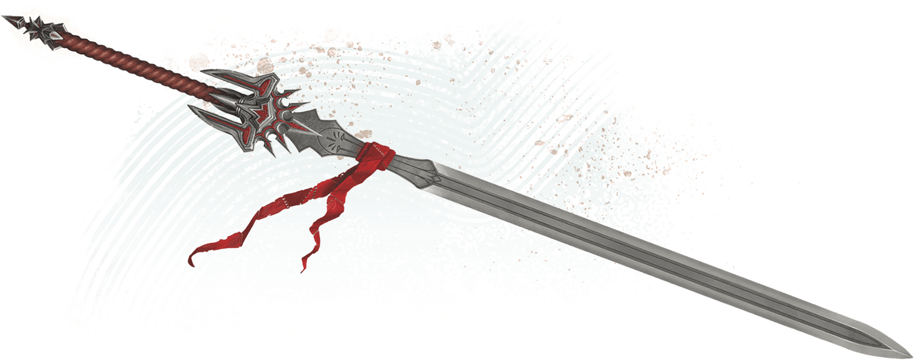

<!-- Notes MJ : contenu fourni par l’utilisateur, non destiné au partage public. -->

## [Thayan Sword](https://www.dndbeyond.com/magic-items/11914562-thayan-sword)

*Weapon (Greatsword, Longsword, or Scimitar), Rare (Requires Attunement)*

*Thayan Swords* are often awarded to premier Thayan knights when they complete their training.

You gain a +1 bonus to attack rolls and damage rolls made with this magic weapon.

***Knight of the Arcane.*** The sword has 4 charges and regains 1d4 charges daily at dawn. While holding the sword, you can expend 1 charge to cast one of the following spells (save DC 15):

- [Searing Smite](https://www.dndbeyond.com/spells/2619009-searing-smite)
- [Thunderous Smite](https://www.dndbeyond.com/spells/2619182-thunderous-smite)
- [Wrathful Smite](https://www.dndbeyond.com/spells/2619220-wrathful-smite)

***Resurgent Warrior.*** If you’re reduced to 0 Hit Points but not killed outright while holding this sword, you can drop to 1 Hit Point instead. Once used, this property can’t be used again until the next dawn.

Wade Acuff

Thayan Sword

---
