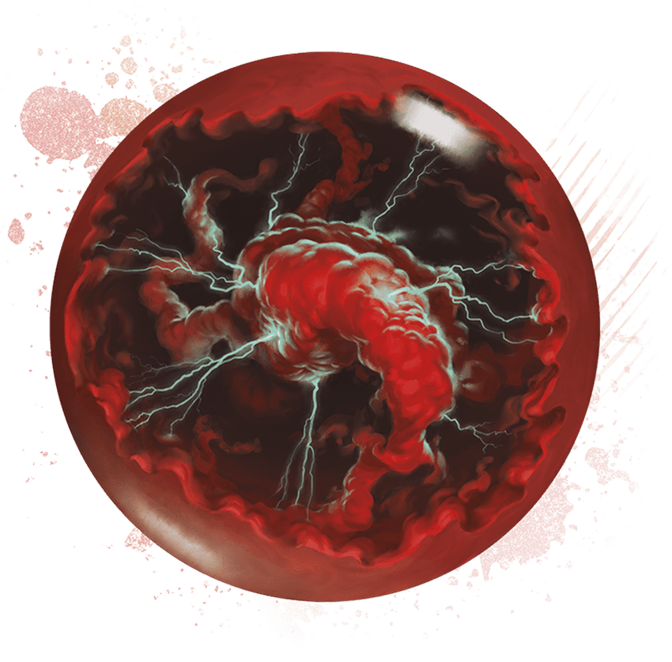

<!-- Notes MJ : contenu fourni par l’utilisateur, non destiné au partage public. -->

# Appendix A: Magic Items

APPENDIX A

# MAGIC ITEMS

The magic item descriptions that follow are presented in alphabetical order.

---

## [Crystal Ball of Ominous Portent](https://www.dndbeyond.com/magic-items/11914525-crystal-ball-of-ominous-portent)

*Wondrous Item, Legendary (Requires Attunement)*

Black-and-scarlet clouds of ominous magic swirl inside this crystal orb. While touching the orb, you can cast [Hex](https://www.dndbeyond.com/spells/2618988-hex) or [Scrying](https://www.dndbeyond.com/spells/2619007-scrying) (save DC 17) with it.

In addition, when a creature you can see within 60 feet succeeds on a [D20 Test](https://www.dndbeyond.com/sources/dnd/free-rules/rules-glossary#D20Test), you can take a Reaction to turn the roll into a 1. Once used, this property can’t be used again until the next dawn.

Wade Acuff

Crystal Ball of Ominous Portent

---
