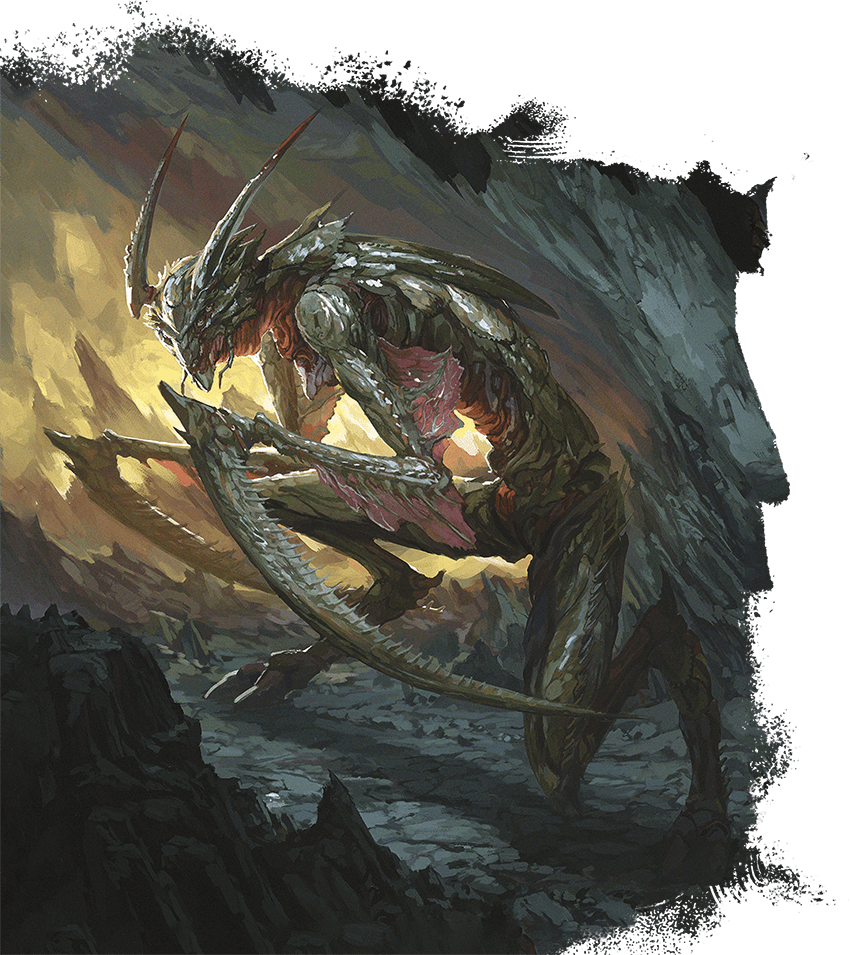
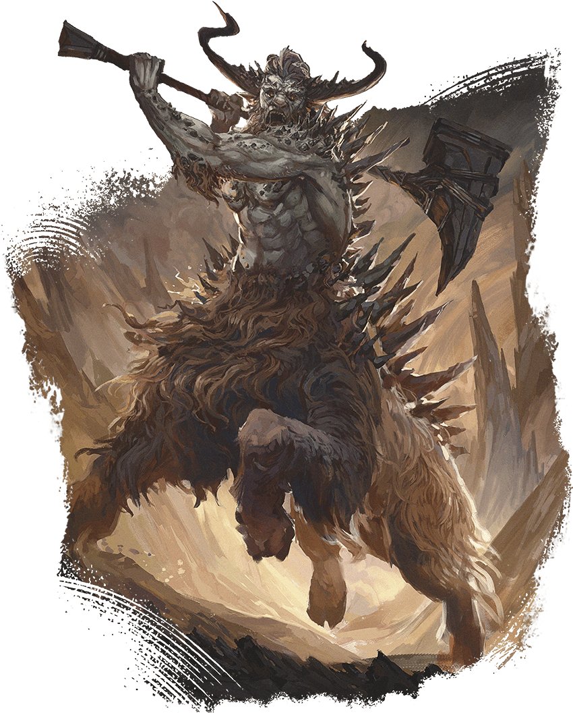
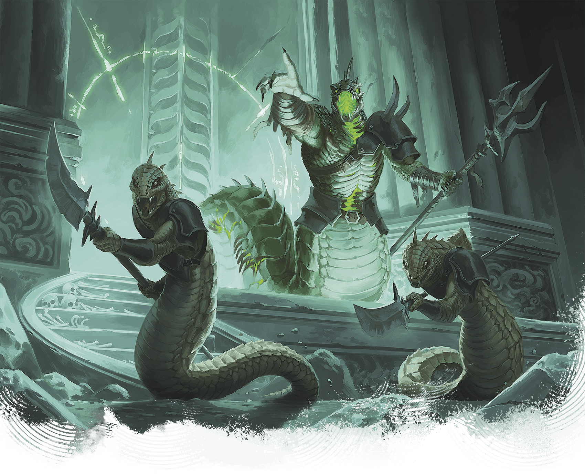
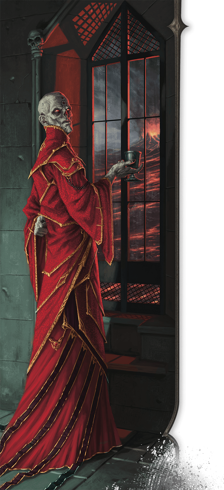
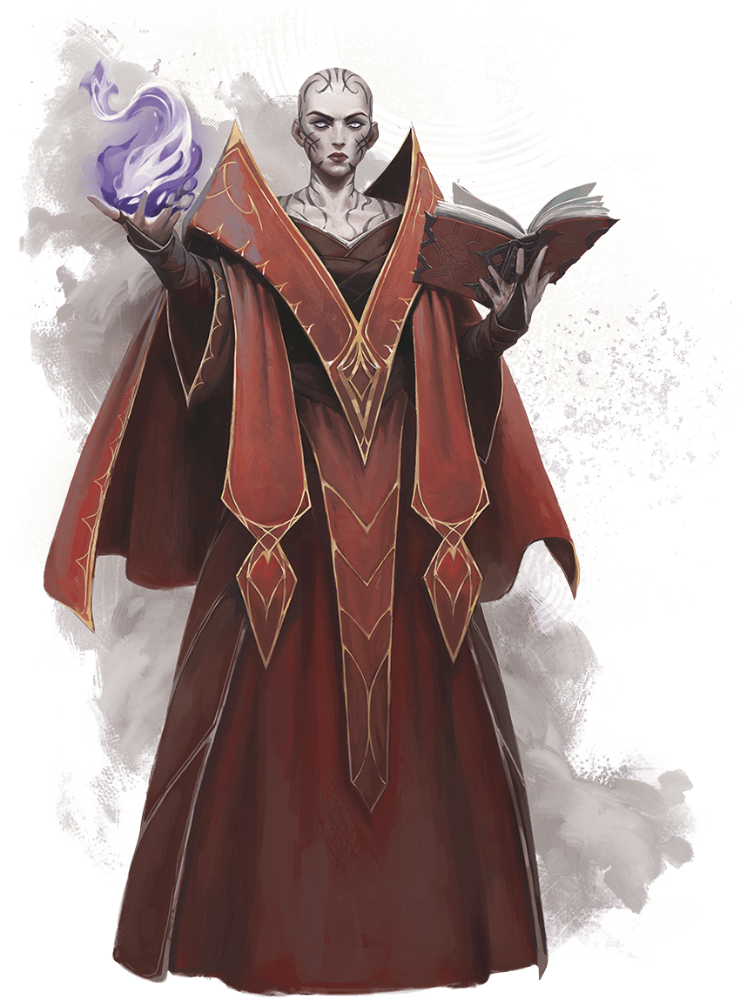

<!-- Notes MJ : contenu fourni par l’utilisateur, non destiné au partage public. -->

# BESTIARY

The following creatures appear in this book’s campaign and are presented in alphabetical order. The introduction of the [Monster Manual](https://www.dndbeyond.com/sources/dnd/mm-2024/how-to-use-a-monster) explains how to read a creature’s stat block.

---

## Abveku

*Demon of Assassination*

**Habitat:** Planar (Abyss); **Treasure:** None

Kent Davis

Abvekus are demons that embody assassins’ sadistic professionalism. Patient killers, they prefer to stalk targets from afar before striking. These targets might be the abvekus’ enemies or the enemies of demon lords or powerful villains the abvekus serve.

Abvekus are bipedal, insectile demons whose arms end in scythe-like claws. They take pride in their kills and sometimes wear or otherwise display grisly trophies taken from the bodies of their victims.

### [Abveku](https://www.dndbeyond.com/monsters/6719629-abveku)

Medium Fiend (Demon), Chaotic Evil

**AC** 17 **Initiative** +11 (21)

**HP** 209 (22d8 + 110)

**Speed** 40 ft.

|  |  | Mod | Save |
| --- | --- | --- | --- |
| Str | 16 | +3 | +8 |
| Dex | 22 | +6 | +11 |
| Con | 20 | +5 | +5 |

|  |  | Mod | Save |
| --- | --- | --- | --- |
| Int | 17 | +3 | +8 |
| Wis | 18 | +4 | +9 |
| Cha | 15 | +2 | +2 |

**Skills** [Acrobatics](https://www.dndbeyond.com/sources/dnd/free-rules/playing-the-game#Skills) +11, [Perception](https://www.dndbeyond.com/sources/dnd/free-rules/playing-the-game#Skills) +9, [Stealth](https://www.dndbeyond.com/sources/dnd/free-rules/playing-the-game#Skills) +16

**Resistances** Cold, Fire, Lightning

**Immunities** Poison; [Exhaustion](https://www.dndbeyond.com/sources/dnd/free-rules/rules-glossary#ExhaustionCondition), [Poisoned](https://www.dndbeyond.com/sources/dnd/free-rules/rules-glossary#PoisonedCondition)

**Senses** [Truesight](https://www.dndbeyond.com/sources/dnd/free-rules/rules-glossary#Truesight) 120 ft.;Passive Perception 19

**Languages** Abyssal; telepathy 120 ft.

**CR** 14 (XP 11,500; PB +5)

Traits

***Demonic Restoration.*** If the abveku dies outside the Abyss, its body dissolves into ichor, and it gains a new body instantly, reviving with all its Hit Points somewhere in the Abyss.

***Magic Resistance.*** The abveku has [Advantage](https://www.dndbeyond.com/sources/dnd/free-rules/rules-glossary#Advantage) on saving throws against spells and other magical effects.

Actions

***Multiattack.*** The abveku makes four Scything Claw attacks and uses Mesmerizing Dance if available.

***Scything Claw.** Melee Attack Roll:* +11, reach 10 ft. *Hit:* 19 (3d8 + 6) Slashing damage.

***Mesmerizing Dance (Recharge 5–6).** Wisdom Saving Throw:* DC 18, each creature within a 20-foot [Emanation](https://www.dndbeyond.com/sources/dnd/free-rules/rules-glossary#EmanationAreaofEffect) originating from the abveku. *Failure:* The target has the [Paralyzed](https://www.dndbeyond.com/sources/dnd/free-rules/rules-glossary#ParalyzedCondition) condition and repeats the save at the end of each of its turns, ending the effect on itself on a success. After 1 minute, it succeeds automatically.

Bonus Actions

***Shadow Stealth.*** While in [Dim Light](https://www.dndbeyond.com/sources/dnd/free-rules/rules-glossary#DimLight) or [Darkness](https://www.dndbeyond.com/sources/dnd/free-rules/rules-glossary#Darkness), the abveku takes the [Hide](https://www.dndbeyond.com/sources/dnd/free-rules/rules-glossary#HideAction) action.

Reactions

***Parry.** Trigger:* The abveku is hit by a melee attack roll. *Response:* Abveku adds 5 to its AC against that attack, possibly causing it to miss.

## Rendelith

*Demon of Destruction and Sieges*

**Habitat:** Planar (Abyss); **Treasure:** [Armaments](https://www.dndbeyond.com/sources/dnd/dmg-2024/random-magic-items#ArmamentsTables)

Rendeliths are hulking demons that lead armies in destroying enemy castles, strongholds, and other fortifications. They delight in toppling defenses so demonic hordes can rush into the fray.

Rendeliths have the upper bodies of humanoids but the lower bodies of oxen, with stony spikes along their backs. These cruel demons are masters of strategy that delight in magically producing walls and ditches to drive enemy armies into ambushes. Such ambushes often involve hordes of armanites—similar-looking but weaker demons driven by unrestrained bloodlust.

Most rendeliths have fought for so long in the Blood War, a raging conflict between demons and devils, that they think only in terms of combat. Each wall they collapse brings them grim satisfaction, but their unquenchable drive for the next battle pushes them ever onward.

Kent Davis

### [Rendelith](https://www.dndbeyond.com/monsters/6719631-rendelith)

Large Fiend (Demon), Chaotic Evil

**AC** 20 **Initiative** +7 (17)

**HP** 294 (31d10 + 124)

**Speed** 50 ft.

|  |  | Mod | Save |
| --- | --- | --- | --- |
| Str | 25 | +7 | +13 |
| Dex | 12 | +1 | +7 |
| Con | 19 | +4 | +10 |

|  |  | Mod | Save |
| --- | --- | --- | --- |
| Int | 20 | +5 | +5 |
| Wis | 17 | +3 | +9 |
| Cha | 18 | +4 | +4 |

**Resistances** Cold, Fire, Lightning

**Immunities** Poison; [Poisoned](https://www.dndbeyond.com/sources/dnd/free-rules/rules-glossary#PoisonedCondition)

**Senses** Passive Perception 19

**Languages** Abyssal; telepathy 120 ft.

**CR** 18 (XP 20,000; PB +6)

Traits

***Demonic Restoration.*** If the rendelith dies outside the Abyss, its body dissolves into gravel, and it gains a new body instantly, reviving with all its Hit Points somewhere in the Abyss.

***Magic Resistance.*** The rendelith has [Advantage](https://www.dndbeyond.com/sources/dnd/free-rules/rules-glossary#Advantage) on saving throws against spells and other magical effects.

***Siege Monster.*** The rendelith deals double damage to objects and structures.

Actions

***Multiattack.*** The rendelith makes two Stone Hammer attacks and uses Spellcasting to cast [Shatter](https://www.dndbeyond.com/spells/2619017-shatter) (level 6 version).

***Stone Hammer.** Melee or Ranged Attack Roll:* +13, reach 10 ft. or range 120 ft. *Hit:* 21 (4d6 + 7) Bludgeoning damage. If the target is a Large or smaller creature, it has the [Prone](https://www.dndbeyond.com/sources/dnd/free-rules/rules-glossary#ProneCondition) condition. If the target already has the Prone condition, it instead takes an extra 7 (2d6) Bludgeoning damage. *Hit or Miss:* The hammer magically returns to the rendelith’s hand immediately after a ranged attack.

***Spellcasting.*** The rendelith casts one of the following spells, requiring no Material components and using Intelligence as the spellcasting ability (spell save DC 19):

**At Will:** [Move Earth](https://www.dndbeyond.com/spells/2619120-move-earth), [Passwall](https://www.dndbeyond.com/spells/2618852-passwall), [Shatter](https://www.dndbeyond.com/spells/2619017-shatter) (level 6 version), [Wall of Stone](https://www.dndbeyond.com/spells/2619200-wall-of-stone)

Bonus Actions

***Quick Fortifications (Recharge 5–6).*** The rendelith uses Spellcasting to cast [Move Earth](https://www.dndbeyond.com/spells/2619120-move-earth) or [Wall of Stone](https://www.dndbeyond.com/spells/2619200-wall-of-stone).

## Sarrukhs

*Wicked Serpentine Oppressors*

**Habitat:** Underdark; **Treasure:** [Relics](https://www.dndbeyond.com/sources/dnd/dmg-2024/random-magic-items#RelicsTables)

Powerful and magical, sarrukhs once commanded a wicked empire that spanned Faerûn, but it fell tens of thousands of years ago. In the millennia that followed, the many species sarrukhs created drove them nearly to extinction. Only a small number of sarrukhs remain in isolated enclaves, including a small community beneath the Citadel at the heart of Thaymount.

Sarrukhs have snakelike lower bodies and heads but torsos that resemble those of humanoids. Their gleaming eyes are alight with inner fire. Sarrukhs can live for up to a millennium, and most expect to see their empire rise again.

### Sarrukh Tyrant

Most remaining sarrukhs are tyrants who fervently believe the sarrukh empire’s resurgence is inevitable. Tyrants live in clans with other sarrukhs, roaming ruins and subjugating creatures that live nearby. They command only a small portion of the magical power their former empire’s leaders held.

### [Sarrukh Tyrant](https://www.dndbeyond.com/monsters/6719632-sarrukh-tyrant)

Medium Monstrosity, Neutral Evil

**AC** 19 **Initiative** +8 (18)

**HP** 256 (27d8 + 135)

**Speed** 40 ft.

|  |  | Mod | Save |
| --- | --- | --- | --- |
| Str | 22 | +6 | +6 |
| Dex | 15 | +2 | +8 |
| Con | 20 | +5 | +5 |

|  |  | Mod | Save |
| --- | --- | --- | --- |
| Int | 23 | +6 | +12 |
| Wis | 19 | +4 | +10 |
| Cha | 18 | +4 | +10 |

**Skills** [Arcana](https://www.dndbeyond.com/sources/dnd/free-rules/playing-the-game#Skills) +12, [Perception](https://www.dndbeyond.com/sources/dnd/free-rules/playing-the-game#Skills) +10

**Immunities** Fire; [Charmed](https://www.dndbeyond.com/sources/dnd/free-rules/rules-glossary#CharmedCondition), [Frightened](https://www.dndbeyond.com/sources/dnd/free-rules/rules-glossary#FrightenedCondition)

**Senses** [Truesight](https://www.dndbeyond.com/sources/dnd/free-rules/rules-glossary#Truesight) 120 ft.;Passive Perception 20

**Languages** Common, Draconic; telepathy 120 ft.

**CR** 17 (XP 18,000; PB +6)

Traits

***Legendary Resistance (3/Day)***. If the sarrukh fails a saving throw, it can choose to succeed instead.

***Magic Resistance.*** The sarrukh has [Advantage](https://www.dndbeyond.com/sources/dnd/free-rules/rules-glossary#Advantage) on saving throws against spells and other magical effects.

Actions

***Multiattack.*** The sarrukh makes two attacks, using Bite or Fearsome Fauchard in any combination.

***Bite.** Melee Attack Roll:* +12, reach 5 ft. *Hit:* 13 (2d6 + 6) Piercing damage plus 13 (3d8) Poison damage.

***Fearsome Fauchard.** Melee or Ranged Attack Roll:* +12, reach 5 ft. or range 20/60 ft. *Hit:* 17 (2d10 + 6) Piercing damage. If the target is a creature, it has the [Frightened](https://www.dndbeyond.com/sources/dnd/free-rules/rules-glossary#FrightenedCondition) condition. If the target already has the Frightened condition, it takes an additional 10 (3d6) Psychic damage. *Hit or Miss:* The fauchard magically returns to the sarrukh’s hand immediately after a ranged attack.

***Spellcasting.*** The sarrukh casts one of the following spells, requiring no Material components and using Intelligence as the spellcasting ability (spell save DC 20):

**At Will:** [Detect Magic](https://www.dndbeyond.com/spells/2619097-detect-magic), [Invisibility](https://www.dndbeyond.com/spells/2619116-invisibility), [Polymorph](https://www.dndbeyond.com/spells/2618876-polymorph)   
 **2/Day Each:** [Fireball](https://www.dndbeyond.com/spells/2618887-fireball) (level 5 version), [Scrying](https://www.dndbeyond.com/spells/2619007-scrying), [Teleport](https://www.dndbeyond.com/spells/2619163-teleport), [Wall of Force](https://www.dndbeyond.com/spells/2619194-wall-of-force)

Reactions

***Shape Control.** Trigger:* A creature the sarrukh can see shape-shifts. *Response:* The sarrukh chooses the resulting form from among the options available to the shape-shifting creature or prevents the creature from shape-shifting.

Legendary Actions

Legendary Action Uses: 3. Immediately after another creature’s turn, the sarrukh can expend a use to take one of the following actions. The sarrukh regains all expended uses at the start of each of its turns.

***Fearsome Glance.** Wisdom Saving Throw:* DC 20, one creature the sarrukh can see within 30 feet. *Failure:* 18 (4d8) Psychic damage, and the target has the [Frightened](https://www.dndbeyond.com/sources/dnd/free-rules/rules-glossary#FrightenedCondition) condition. *Success:* Half damage only.

***Slither.*** The sarrukh moves up to half its Speed without provoking [Opportunity Attacks](https://www.dndbeyond.com/sources/dnd/free-rules/rules-glossary#OpportunityAttack), and it makes one Bite attack.

***Twisted Transformation.*** The sarrukh uses Spellcasting to cast Polymorph, and if the target fails its saving throw, the target also has the [Stunned](https://www.dndbeyond.com/sources/dnd/free-rules/rules-glossary#StunnedCondition) condition until the end of its next turn. The sarrukh can’t take this action again until the start of its next turn.

### Arisen Sarrukh

Brian Valeza

An arisen sarrukh commands two sarrukh tyrants.

The most powerful sarrukhs are arisen: horrific creatures that have subverted death. While arisen sarrukhs have lost their ability to cast spells, their unliving flesh is unnaturally strong.

### [Arisen Sarrukh](https://www.dndbeyond.com/monsters/6719630-arisen-sarrukh)

Medium Undead, Neutral Evil

**AC** 18 **Initiative** +9 (19)

**HP** 273 (26d8 + 156)

**Speed** 40 ft.

|  |  | Mod | Save |
| --- | --- | --- | --- |
| Str | 23 | +6 | +12 |
| Dex | 17 | +3 | +9 |
| Con | 22 | +6 | +12 |

|  |  | Mod | Save |
| --- | --- | --- | --- |
| Int | 18 | +4 | +4 |
| Wis | 17 | +3 | +9 |
| Cha | 18 | +4 | +4 |

**Skills** [Perception](https://www.dndbeyond.com/sources/dnd/free-rules/playing-the-game#Skills) +9, [Stealth](https://www.dndbeyond.com/sources/dnd/free-rules/playing-the-game#Skills) +12

**Immunities** Fire, Necrotic, Poison; [Charmed](https://www.dndbeyond.com/sources/dnd/free-rules/rules-glossary#CharmedCondition), [Exhaustion](https://www.dndbeyond.com/sources/dnd/free-rules/rules-glossary#ExhaustionCondition), [Frightened](https://www.dndbeyond.com/sources/dnd/free-rules/rules-glossary#FrightenedCondition), [Poisoned](https://www.dndbeyond.com/sources/dnd/free-rules/rules-glossary#PoisonedCondition)

**Gear** [Trident](https://www.dndbeyond.com/equipment/31-trident)

**Senses** [Truesight](https://www.dndbeyond.com/sources/dnd/free-rules/rules-glossary#Truesight) 120 ft.;Passive Perception 19

**Languages** Common, Draconic; telepathy 120 ft.

**CR** 18 (XP 20,000; PB +6)

Traits

***Legendary Resistance (3/Day).*** If the sarrukh fails a saving throw, it can choose to succeed instead.

***Magic Resistance.*** The sarrukh has [Advantage](https://www.dndbeyond.com/sources/dnd/free-rules/rules-glossary#Advantage) on saving throws against spells and other magical effects.

Actions

***Multiattack.*** The sarrukh makes three attacks, using Trident or Necrotic Spit in any combination.

***Trident.** Melee Attack Roll:* +12, reach 10 ft. *Hit:* 33 (6d8 + 6) Piercing damage.

***Necrotic Spit.** Ranged Attack Roll:* +12, range 90 ft. *Hit:* 11 (2d10) Poison damage plus 22 (4d10) Necrotic damage.

Bonus Actions

***Venomous Teleport (Recharge 5–6).*** The sarrukh teleports up to 120 feet to an occupied space it can see, and each creature within 10 feet of the space the sarrukh leaves or arrives in (sarrukh’s choice) is subjected to the following effect. *Constitution Saving Throw:* DC 20. *Failure:* 22 (4d10) Poison damage. *Success:* Half damage.

Reactions

***Shape Control.** Trigger:* A creature the sarrukh can see shape-shifts. *Response:* The sarrukh chooses the resulting form from among the options available to the shape-shifting creature or prevents the creature from shape-shifting.

## Szass Tam

Once the undisputed regent of Thay, Szass Tam is an old and powerful lich who plots to regain control over the nation. Although he still wields great power as the zulkir of necromancy and the tharchion of Thaymount (see chapter 1), Szass Tam believes it’s his destiny to rule Thay and use its living people as fodder for his undead armies.

### History

Bubble Cat Studio

An eloquent and inventive wizard, Szass Tam rose through the ranks of the Red Wizards to become the zulkir of necromancy more than three centuries ago and became a lich not long afterward.

#### Regency

Over a century ago, Szass Tam turned against the other zulkirs and claimed rulership over Thay. On winning the ensuing civil war, he declared himself regent and turned his rivals into undead servants. Under his rule, necromancers dominated Thay, and all paid fealty to him.

#### Pursuit of Godhood

Eventually Szass Tam craved more than ruling Thay. Obsessed with gaining more power, he began a ritual to ascend to godhood. When this ritual failed spectacularly a few decades ago, civil unrest in Thay prompted him to reestablish the zulkir council with members loyal to him. He relinquished his title of regent, though in reality, the new zulkirs reported to him. These zulkirs dealt with the details of government, leaving him free to pursue new approaches to attaining godhood.

While Szass Tam remained distracted with finding a different way to attain godhood, new rivals systematically overthrew his sycophant zulkirs. Suddenly he was again part of a zulkir council with Red Wizards who saw themselves as his equals and refused to bow to him as the nation’s ruler.

#### Returning Tyrant

While Szass Tam still aspires to godhood, he can’t bear the loss of political power to rivals he views as inferiors. After years of plotting, he again moves to subdue Thay with undead before crushing the zulkirs who oppose him. If successful, he’ll return Thay to the undead-dominated land it was under his rule.

### Personality

Szass Tam takes the long view in his many plots, some of which span lifetimes. He is quick to pivot to contingencies when necessary.

While he enjoys commanding fear in his Thayan subjects, he also wields diplomacy to maintain foreign allies and is skilled at keeping foes off balance. Those who cross Szass Tam might evoke one of his legendary rages or might earn a nod of appreciation, as of someone witnessing a clever move in a game of strategy.

### Szass Tam’s Lair

Szass Tam’s lair is the Citadel, a fortress in the mountainous region of Thaymount. Here he plans his evil schemes and issues commands to his underlings.

Szass Tam extends his presence into the region he inhabits, creating the following effects:

- **Soul Siphon.** Whenever a Humanoid dies within the lair, its soul is immediately consumed by Szass Tam. A Humanoid whose soul is consumed in this way can be brought back to life only by a [True Resurrection](https://www.dndbeyond.com/spells/2619199-true-resurrection) or [Wish](https://www.dndbeyond.com/spells/2619213-wish) spell.
- **Whispers of Necromancy.** Whenever a creature within 1 mile of the lair casts a Necromancy spell, Szass Tam knows the spell and the identity of the creature that cast it.

If Szass Tam is destroyed or moves his lair elsewhere, these effects end immediately. These effects resume if Szass Tam gains a new body (see his Spirit Jar trait).

### [Szass Tam](https://www.dndbeyond.com/monsters/6719633-szass-tam)

Medium Undead (Wizard), Lawful Evil

**AC** 20 **Initiative** +16 (26)

**HP** 397 (53d8 + 159)

**Speed** 30 ft., Fly 30 ft.

|  |  | Mod | Save |
| --- | --- | --- | --- |
| Str | 12 | +1 | +1 |
| Dex | 14 | +2 | +9 |
| Con | 16 | +3 | +10 |

|  |  | Mod | Save |
| --- | --- | --- | --- |
| Int | 23 | +6 | +13 |
| Wis | 18 | +4 | +11 |
| Cha | 19 | +4 | +4 |

**Skills** [Arcana](https://www.dndbeyond.com/sources/dnd/free-rules/playing-the-game#Skills) +20, [Insight](https://www.dndbeyond.com/sources/dnd/free-rules/playing-the-game#Skills) +11, [Investigation](https://www.dndbeyond.com/sources/dnd/free-rules/playing-the-game#Skills) +13, [Perception](https://www.dndbeyond.com/sources/dnd/free-rules/playing-the-game#Skills) +11

**Resistances** Cold, Lightning

**Immunities** Necrotic, Poison; [Charmed](https://www.dndbeyond.com/sources/dnd/free-rules/rules-glossary#CharmedCondition), [Exhaustion](https://www.dndbeyond.com/sources/dnd/free-rules/rules-glossary#ExhaustionCondition), [Frightened](https://www.dndbeyond.com/sources/dnd/free-rules/rules-glossary#FrightenedCondition), [Paralyzed](https://www.dndbeyond.com/sources/dnd/free-rules/rules-glossary#ParalyzedCondition), [Poisoned](https://www.dndbeyond.com/sources/dnd/free-rules/rules-glossary#PoisonedCondition)

**Gear** [Component Pouch](https://www.dndbeyond.com/equipment/538-component-pouch)

**Senses** [Truesight](https://www.dndbeyond.com/sources/dnd/free-rules/rules-glossary#Truesight) 120 ft.;Passive Perception 21

**Languages** All

**CR** 23 (XP 50,000, or 62,000 in lair; PB +7)

Traits

***Legendary Resistance (4/Day, or 5/Day in Lair).*** If Szass Tam fails a saving throw, he can choose to succeed instead.

***Spirit Jar.*** If destroyed, Szass Tam re-forms in 1d10 days if he has a spirit jar, reviving with all his Hit Points. The new body appears in an unoccupied space within Szass Tam’s lair.

Actions

***Multiattack.*** Szass Tam makes three attacks, using Paralyzing Touch or Soul-Draining Ray in any combination. He can replace two attacks with a use of Spellcasting to cast [Finger of Death](https://www.dndbeyond.com/spells/2618885-finger-of-death).

***Paralyzing Touch.** Melee Attack Roll:* +13, reach 5 ft. *Hit:* 16 (3d6 + 6) Cold damage, and the target has the [Paralyzed](https://www.dndbeyond.com/sources/dnd/free-rules/rules-glossary#ParalyzedCondition) condition until the start of Szass Tam’s next turn.

***Soul-Draining Ray.** Ranged Attack Roll:* +13, range 120 ft. *Hit:* 25 (3d12 + 6) Necrotic damage, and the target has [Disadvantage](https://www.dndbeyond.com/sources/dnd/free-rules/rules-glossary#Disadvantage) on attack rolls and saving throws until the end of its next turn.

***Spellcasting.*** Szass Tam casts one of the following spells, using Intelligence as the spellcasting ability (spell save DC 21, +13 to hit with spell attacks):

**At Will:** [Detect Magic](https://www.dndbeyond.com/spells/2619097-detect-magic), [Detect Thoughts](https://www.dndbeyond.com/spells/2619099-detect-thoughts), [Finger of Death](https://www.dndbeyond.com/spells/2618885-finger-of-death), [Fireball](https://www.dndbeyond.com/spells/2618887-fireball) (level 8 version), [Lightning Bolt](https://www.dndbeyond.com/spells/2618999-lightning-bolt) (level 8 version), [Mage Hand](https://www.dndbeyond.com/spells/2619008-mage-hand), [Prestidigitation](https://www.dndbeyond.com/spells/2618893-prestidigitation)  
**2/Day Each:** [Animate Dead](https://www.dndbeyond.com/spells/2618853-animate-dead), [Dimension Door](https://www.dndbeyond.com/spells/2619100-dimension-door), [Plane Shift](https://www.dndbeyond.com/spells/2618867-plane-shift)  
**1/Day Each:** [Power Word Kill](https://www.dndbeyond.com/spells/2618886-power-word-kill), [Project Image](https://www.dndbeyond.com/spells/2618903-project-image), [Scrying](https://www.dndbeyond.com/spells/2619007-scrying), [Sending](https://www.dndbeyond.com/spells/2619015-sending)

Reactions

***Protective Magic.*** Szass Tam casts [Counterspell](https://www.dndbeyond.com/spells/2619072-counterspell) or [Shield](https://www.dndbeyond.com/spells/2619019-shield) in response to the spell’s trigger, using the same spellcasting ability as Spellcasting.

Legendary Actions

Legendary Action Uses: 3 (4 in Lair). Immediately after another creature’s turn, Szass Tam can expend a use to take one of the following actions. He regains all expended uses at the start of each of his turns.

***Deathly Teleport.*** Szass Tam teleports up to 60 feet to an unoccupied space he can see, and each creature within 10 feet of the space he left takes 13 (3d8) Necrotic damage.

***Disrupt Life.*** *Constitution Saving Throw:* DC 21, each creature that isn’t an Undead in a 20-foot [Emanation](https://www.dndbeyond.com/sources/dnd/free-rules/rules-glossary#EmanationAreaofEffect) originating from Szass Tam. *Failure:* 14 (4d6) Necrotic damage and the creature's Hit Point maximum decreases by an amount equal to the damage taken. *Success:* Half damage only. *Failure or Success:* Szass Tam can’t take this action again until the start of his next turn.

***Withering Magic.*** Szass Tam cast [Blight](https://www.dndbeyond.com/spells/2618934-blight) or [Dispel Magic](https://www.dndbeyond.com/spells/2619103-dispel-magic), using the same spellcasting ability as Spellcasting.

## Xelnene Thrul

Xelnene Thrul is the zulkir of evocation. With the exception of Szass Tam, she is the most powerful mage on the Council of Zulkirs. She hates tyranny and wants Szass Tam destroyed. To her, the only good tyrant is a dead one.

### History

Xelnene Thrul is the scion of a powerful family. Her ancestor, Aznar Thrul, was zulkir of evocation a century ago. He murdered countless Thayans and conscripted vast armies in failed attempts to conquer Rashemen. Xelnene hates Aznar’s deeds but trades on her family’s fearsome reputation when needed.

As a youth, Thrul was apprenticed to a Red Wizard named Sabeine who cultivated Thrul’s sense of justice and encouraged Thrul to foster goodness among the Red Wizards. Szass Tam later executed Sabeine for treason. Ever since, Thrul has kept her desire for reform secret.

### Personality

Thrul is shrewd and pragmatic. She exudes physical, political, and magical might but avoids showing emotion lest her enemies find her weak. She commands a network of spies, allies, and political operatives who advance her goal of creating a better future for Thay’s populace.

Alexandre Honoré

### [Xelnene Thrul](https://www.dndbeyond.com/monsters/6719634-xelnene-thrul)

Medium Humanoid (Wizard), Neutral Good

**AC** 17 **Initiative** +10 (20)

**HP** 208 (32d8 + 64)

**Speed** 30 ft.

|  |  | Mod | Save |
| --- | --- | --- | --- |
| Str | 10 | +0 | +0 |
| Dex | 18 | +4 | +4 |
| Con | 15 | +2 | +8 |

|  |  | Mod | Save |
| --- | --- | --- | --- |
| Int | 21 | +5 | +11 |
| Wis | 16 | +3 | +9 |
| Cha | 19 | +4 | +4 |

**Skills** [Arcana](https://www.dndbeyond.com/sources/dnd/free-rules/playing-the-game#Skills) +17, [History](https://www.dndbeyond.com/sources/dnd/free-rules/playing-the-game#Skills) +11, [Perception](https://www.dndbeyond.com/sources/dnd/free-rules/playing-the-game#Skills) +9, [Persuasion](https://www.dndbeyond.com/sources/dnd/free-rules/playing-the-game#Skills) +10

**Gear** [Orb](https://www.dndbeyond.com/equipment/526-orb)

**Senses** Passive Perception 19

**Languages** Celestial, Common, Draconic, Infernal

**CR** 17 (XP 18,000; PB +6)

Traits

***Evocation Sculptor.*** When Thrul casts a spell that creates an area of effect, she can choose herself and up to five other creatures she can see, sculpting the spell’s energy around them. A chosen creature automatically succeeds on its saving throw against the spell, and it takes no damage if it would normally take half damage on a successful save.

***Magic Resistance.*** Thrul has [Advantage](https://www.dndbeyond.com/sources/dnd/free-rules/rules-glossary#Advantage) on saving throws against spells and other magical effects.

Actions

***Multiattack.*** Thrul makes four Arcane Burst attacks. She can replace two attacks with a use of Spellcasting to cast [Fireball](https://www.dndbeyond.com/spells/2618887-fireball) (level 5 version) or [Lightning Bolt](https://www.dndbeyond.com/spells/2618999-lightning-bolt) (level 5 version).

***Arcane Burst.** Melee or Ranged Attack Roll:* +11, reach 5 ft. or range 120 ft. *Hit:* 32 (5d10 + 5) Force damage.

***Spellcasting.*** Thrul casts one of the following spells, using Intelligence as the spellcasting ability (spell save DC 19):

**At Will:** [Alter Self](https://www.dndbeyond.com/spells/2618846-alter-self), [Detect Magic](https://www.dndbeyond.com/spells/2619097-detect-magic), [Fireball](https://www.dndbeyond.com/spells/2618887-fireball) (level 5 version), [Illusory Script](https://www.dndbeyond.com/spells/2619173-illusory-script), [Lightning Bolt](https://www.dndbeyond.com/spells/2618999-lightning-bolt) (level 5 version), [Mage Armor](https://www.dndbeyond.com/spells/2619006-mage-armor) (included in AC), [Mage Hand](https://www.dndbeyond.com/spells/2619008-mage-hand), [Prestidigitation](https://www.dndbeyond.com/spells/2618893-prestidigitation)  
**2/Day Each:** [Demiplane](https://www.dndbeyond.com/spells/2619088-demiplane), [Modify Memory](https://www.dndbeyond.com/spells/2619109-modify-memory), [Scrying](https://www.dndbeyond.com/spells/2619007-scrying), [Sending](https://www.dndbeyond.com/spells/2619015-sending), [Teleport](https://www.dndbeyond.com/spells/2619163-teleport)  
**1/Day Each:** [Chain Lightning](https://www.dndbeyond.com/spells/2618960-chain-lightning), [Sunburst](https://www.dndbeyond.com/spells/2619123-sunburst)

Reactions

***Protective Magic (3/Day).*** Thrul casts [Counterspell](https://www.dndbeyond.com/spells/2619072-counterspell) or [Shield](https://www.dndbeyond.com/spells/2619019-shield) in response to the spell’s trigger, using the same spellcasting ability as Spellcasting.
