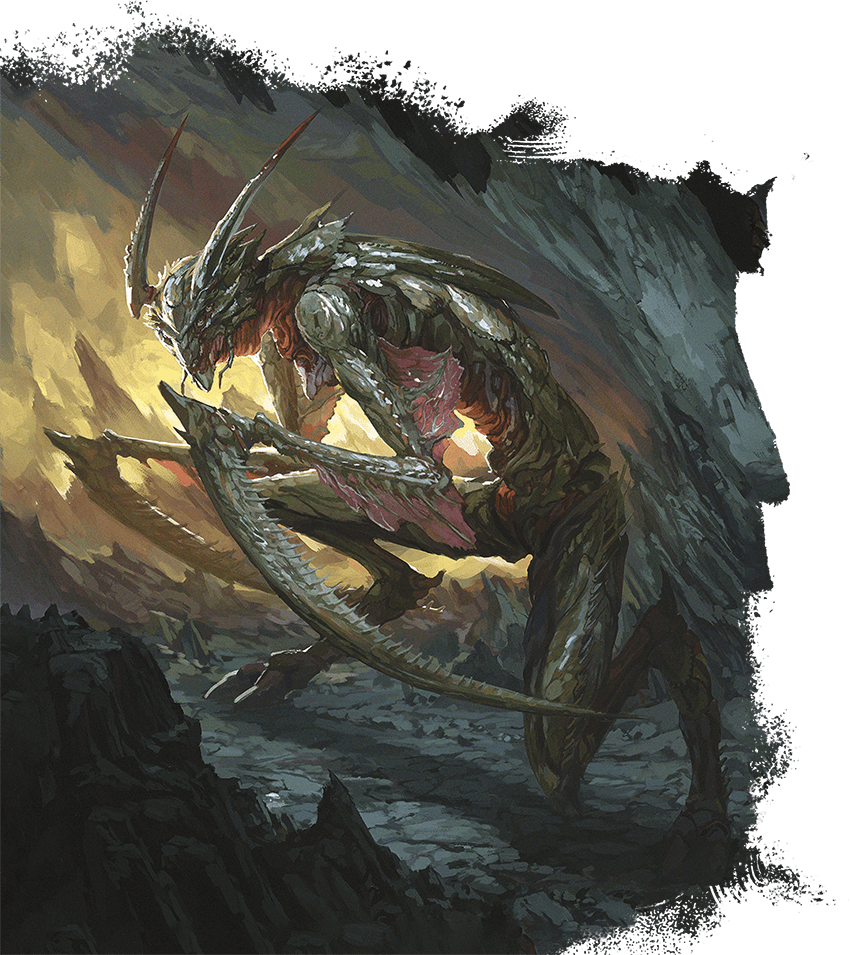

<!-- Notes MJ : contenu fourni par l’utilisateur, non destiné au partage public. -->

## Abveku

*Demon of Assassination*

**Habitat:** Planar (Abyss); **Treasure:** None

Kent Davis

Abvekus are demons that embody assassins’ sadistic professionalism. Patient killers, they prefer to stalk targets from afar before striking. These targets might be the abvekus’ enemies or the enemies of demon lords or powerful villains the abvekus serve.

Abvekus are bipedal, insectile demons whose arms end in scythe-like claws. They take pride in their kills and sometimes wear or otherwise display grisly trophies taken from the bodies of their victims.

### [Abveku](https://www.dndbeyond.com/monsters/6719629-abveku)

Medium Fiend (Demon), Chaotic Evil

**AC** 17 **Initiative** +11 (21)

**HP** 209 (22d8 + 110)

**Speed** 40 ft.

|  |  | Mod | Save |
| --- | --- | --- | --- |
| Str | 16 | +3 | +8 |
| Dex | 22 | +6 | +11 |
| Con | 20 | +5 | +5 |

|  |  | Mod | Save |
| --- | --- | --- | --- |
| Int | 17 | +3 | +8 |
| Wis | 18 | +4 | +9 |
| Cha | 15 | +2 | +2 |

**Skills** [Acrobatics](https://www.dndbeyond.com/sources/dnd/free-rules/playing-the-game#Skills) +11, [Perception](https://www.dndbeyond.com/sources/dnd/free-rules/playing-the-game#Skills) +9, [Stealth](https://www.dndbeyond.com/sources/dnd/free-rules/playing-the-game#Skills) +16

**Resistances** Cold, Fire, Lightning

**Immunities** Poison; [Exhaustion](https://www.dndbeyond.com/sources/dnd/free-rules/rules-glossary#ExhaustionCondition), [Poisoned](https://www.dndbeyond.com/sources/dnd/free-rules/rules-glossary#PoisonedCondition)

**Senses** [Truesight](https://www.dndbeyond.com/sources/dnd/free-rules/rules-glossary#Truesight) 120 ft.;Passive Perception 19

**Languages** Abyssal; telepathy 120 ft.

**CR** 14 (XP 11,500; PB +5)

Traits

***Demonic Restoration.*** If the abveku dies outside the Abyss, its body dissolves into ichor, and it gains a new body instantly, reviving with all its Hit Points somewhere in the Abyss.

***Magic Resistance.*** The abveku has [Advantage](https://www.dndbeyond.com/sources/dnd/free-rules/rules-glossary#Advantage) on saving throws against spells and other magical effects.

Actions

***Multiattack.*** The abveku makes four Scything Claw attacks and uses Mesmerizing Dance if available.

***Scything Claw.** Melee Attack Roll:* +11, reach 10 ft. *Hit:* 19 (3d8 + 6) Slashing damage.

***Mesmerizing Dance (Recharge 5–6).** Wisdom Saving Throw:* DC 18, each creature within a 20-foot [Emanation](https://www.dndbeyond.com/sources/dnd/free-rules/rules-glossary#EmanationAreaofEffect) originating from the abveku. *Failure:* The target has the [Paralyzed](https://www.dndbeyond.com/sources/dnd/free-rules/rules-glossary#ParalyzedCondition) condition and repeats the save at the end of each of its turns, ending the effect on itself on a success. After 1 minute, it succeeds automatically.

Bonus Actions

***Shadow Stealth.*** While in [Dim Light](https://www.dndbeyond.com/sources/dnd/free-rules/rules-glossary#DimLight) or [Darkness](https://www.dndbeyond.com/sources/dnd/free-rules/rules-glossary#Darkness), the abveku takes the [Hide](https://www.dndbeyond.com/sources/dnd/free-rules/rules-glossary#HideAction) action.

Reactions

***Parry.** Trigger:* The abveku is hit by a melee attack roll. *Response:* Abveku adds 5 to its AC against that attack, possibly causing it to miss.
