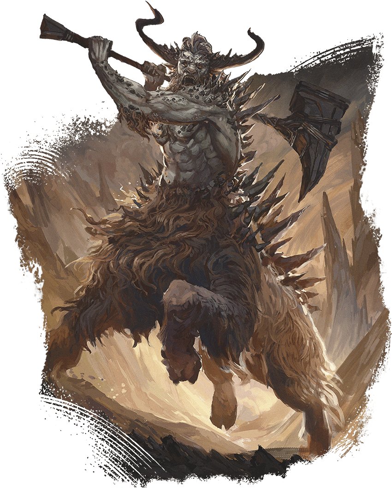

<!-- Notes MJ : contenu fourni par l’utilisateur, non destiné au partage public. -->

## Rendelith

*Demon of Destruction and Sieges*

**Habitat:** Planar (Abyss); **Treasure:** [Armaments](https://www.dndbeyond.com/sources/dnd/dmg-2024/random-magic-items#ArmamentsTables)

Rendeliths are hulking demons that lead armies in destroying enemy castles, strongholds, and other fortifications. They delight in toppling defenses so demonic hordes can rush into the fray.

Rendeliths have the upper bodies of humanoids but the lower bodies of oxen, with stony spikes along their backs. These cruel demons are masters of strategy that delight in magically producing walls and ditches to drive enemy armies into ambushes. Such ambushes often involve hordes of armanites—similar-looking but weaker demons driven by unrestrained bloodlust.

Most rendeliths have fought for so long in the Blood War, a raging conflict between demons and devils, that they think only in terms of combat. Each wall they collapse brings them grim satisfaction, but their unquenchable drive for the next battle pushes them ever onward.

Kent Davis

### [Rendelith](https://www.dndbeyond.com/monsters/6719631-rendelith)

Large Fiend (Demon), Chaotic Evil

**AC** 20 **Initiative** +7 (17)

**HP** 294 (31d10 + 124)

**Speed** 50 ft.

|  |  | Mod | Save |
| --- | --- | --- | --- |
| Str | 25 | +7 | +13 |
| Dex | 12 | +1 | +7 |
| Con | 19 | +4 | +10 |

|  |  | Mod | Save |
| --- | --- | --- | --- |
| Int | 20 | +5 | +5 |
| Wis | 17 | +3 | +9 |
| Cha | 18 | +4 | +4 |

**Resistances** Cold, Fire, Lightning

**Immunities** Poison; [Poisoned](https://www.dndbeyond.com/sources/dnd/free-rules/rules-glossary#PoisonedCondition)

**Senses** Passive Perception 19

**Languages** Abyssal; telepathy 120 ft.

**CR** 18 (XP 20,000; PB +6)

Traits

***Demonic Restoration.*** If the rendelith dies outside the Abyss, its body dissolves into gravel, and it gains a new body instantly, reviving with all its Hit Points somewhere in the Abyss.

***Magic Resistance.*** The rendelith has [Advantage](https://www.dndbeyond.com/sources/dnd/free-rules/rules-glossary#Advantage) on saving throws against spells and other magical effects.

***Siege Monster.*** The rendelith deals double damage to objects and structures.

Actions

***Multiattack.*** The rendelith makes two Stone Hammer attacks and uses Spellcasting to cast [Shatter](https://www.dndbeyond.com/spells/2619017-shatter) (level 6 version).

***Stone Hammer.** Melee or Ranged Attack Roll:* +13, reach 10 ft. or range 120 ft. *Hit:* 21 (4d6 + 7) Bludgeoning damage. If the target is a Large or smaller creature, it has the [Prone](https://www.dndbeyond.com/sources/dnd/free-rules/rules-glossary#ProneCondition) condition. If the target already has the Prone condition, it instead takes an extra 7 (2d6) Bludgeoning damage. *Hit or Miss:* The hammer magically returns to the rendelith’s hand immediately after a ranged attack.

***Spellcasting.*** The rendelith casts one of the following spells, requiring no Material components and using Intelligence as the spellcasting ability (spell save DC 19):

**At Will:** [Move Earth](https://www.dndbeyond.com/spells/2619120-move-earth), [Passwall](https://www.dndbeyond.com/spells/2618852-passwall), [Shatter](https://www.dndbeyond.com/spells/2619017-shatter) (level 6 version), [Wall of Stone](https://www.dndbeyond.com/spells/2619200-wall-of-stone)

Bonus Actions

***Quick Fortifications (Recharge 5–6).*** The rendelith uses Spellcasting to cast [Move Earth](https://www.dndbeyond.com/spells/2619120-move-earth) or [Wall of Stone](https://www.dndbeyond.com/spells/2619200-wall-of-stone).
