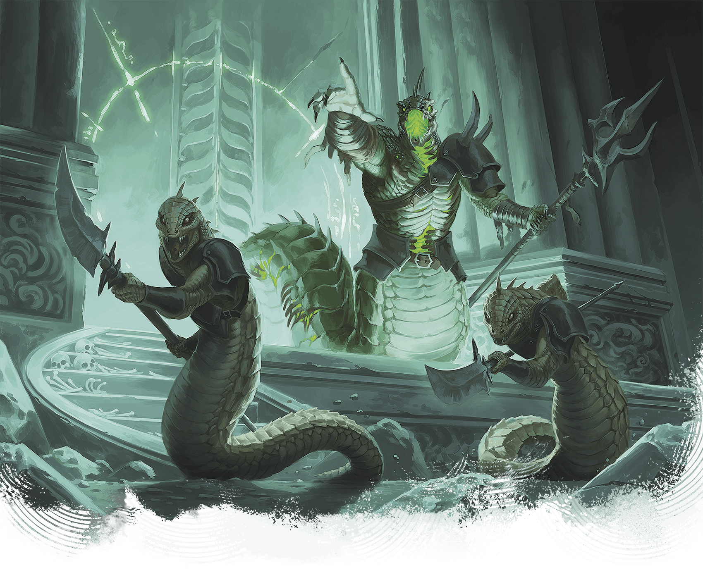

<!-- Notes MJ : contenu fourni par l’utilisateur, non destiné au partage public. -->

## Sarrukhs

*Wicked Serpentine Oppressors*

**Habitat:** Underdark; **Treasure:** [Relics](https://www.dndbeyond.com/sources/dnd/dmg-2024/random-magic-items#RelicsTables)

Powerful and magical, sarrukhs once commanded a wicked empire that spanned Faerûn, but it fell tens of thousands of years ago. In the millennia that followed, the many species sarrukhs created drove them nearly to extinction. Only a small number of sarrukhs remain in isolated enclaves, including a small community beneath the Citadel at the heart of Thaymount.

Sarrukhs have snakelike lower bodies and heads but torsos that resemble those of humanoids. Their gleaming eyes are alight with inner fire. Sarrukhs can live for up to a millennium, and most expect to see their empire rise again.

### Sarrukh Tyrant

Most remaining sarrukhs are tyrants who fervently believe the sarrukh empire’s resurgence is inevitable. Tyrants live in clans with other sarrukhs, roaming ruins and subjugating creatures that live nearby. They command only a small portion of the magical power their former empire’s leaders held.

### [Sarrukh Tyrant](https://www.dndbeyond.com/monsters/6719632-sarrukh-tyrant)

Medium Monstrosity, Neutral Evil

**AC** 19 **Initiative** +8 (18)

**HP** 256 (27d8 + 135)

**Speed** 40 ft.

|  |  | Mod | Save |
| --- | --- | --- | --- |
| Str | 22 | +6 | +6 |
| Dex | 15 | +2 | +8 |
| Con | 20 | +5 | +5 |

|  |  | Mod | Save |
| --- | --- | --- | --- |
| Int | 23 | +6 | +12 |
| Wis | 19 | +4 | +10 |
| Cha | 18 | +4 | +10 |

**Skills** [Arcana](https://www.dndbeyond.com/sources/dnd/free-rules/playing-the-game#Skills) +12, [Perception](https://www.dndbeyond.com/sources/dnd/free-rules/playing-the-game#Skills) +10

**Immunities** Fire; [Charmed](https://www.dndbeyond.com/sources/dnd/free-rules/rules-glossary#CharmedCondition), [Frightened](https://www.dndbeyond.com/sources/dnd/free-rules/rules-glossary#FrightenedCondition)

**Senses** [Truesight](https://www.dndbeyond.com/sources/dnd/free-rules/rules-glossary#Truesight) 120 ft.;Passive Perception 20

**Languages** Common, Draconic; telepathy 120 ft.

**CR** 17 (XP 18,000; PB +6)

Traits

***Legendary Resistance (3/Day)***. If the sarrukh fails a saving throw, it can choose to succeed instead.

***Magic Resistance.*** The sarrukh has [Advantage](https://www.dndbeyond.com/sources/dnd/free-rules/rules-glossary#Advantage) on saving throws against spells and other magical effects.

Actions

***Multiattack.*** The sarrukh makes two attacks, using Bite or Fearsome Fauchard in any combination.

***Bite.** Melee Attack Roll:* +12, reach 5 ft. *Hit:* 13 (2d6 + 6) Piercing damage plus 13 (3d8) Poison damage.

***Fearsome Fauchard.** Melee or Ranged Attack Roll:* +12, reach 5 ft. or range 20/60 ft. *Hit:* 17 (2d10 + 6) Piercing damage. If the target is a creature, it has the [Frightened](https://www.dndbeyond.com/sources/dnd/free-rules/rules-glossary#FrightenedCondition) condition. If the target already has the Frightened condition, it takes an additional 10 (3d6) Psychic damage. *Hit or Miss:* The fauchard magically returns to the sarrukh’s hand immediately after a ranged attack.

***Spellcasting.*** The sarrukh casts one of the following spells, requiring no Material components and using Intelligence as the spellcasting ability (spell save DC 20):

**At Will:** [Detect Magic](https://www.dndbeyond.com/spells/2619097-detect-magic), [Invisibility](https://www.dndbeyond.com/spells/2619116-invisibility), [Polymorph](https://www.dndbeyond.com/spells/2618876-polymorph)   
 **2/Day Each:** [Fireball](https://www.dndbeyond.com/spells/2618887-fireball) (level 5 version), [Scrying](https://www.dndbeyond.com/spells/2619007-scrying), [Teleport](https://www.dndbeyond.com/spells/2619163-teleport), [Wall of Force](https://www.dndbeyond.com/spells/2619194-wall-of-force)

Reactions

***Shape Control.** Trigger:* A creature the sarrukh can see shape-shifts. *Response:* The sarrukh chooses the resulting form from among the options available to the shape-shifting creature or prevents the creature from shape-shifting.

Legendary Actions

Legendary Action Uses: 3. Immediately after another creature’s turn, the sarrukh can expend a use to take one of the following actions. The sarrukh regains all expended uses at the start of each of its turns.

***Fearsome Glance.** Wisdom Saving Throw:* DC 20, one creature the sarrukh can see within 30 feet. *Failure:* 18 (4d8) Psychic damage, and the target has the [Frightened](https://www.dndbeyond.com/sources/dnd/free-rules/rules-glossary#FrightenedCondition) condition. *Success:* Half damage only.

***Slither.*** The sarrukh moves up to half its Speed without provoking [Opportunity Attacks](https://www.dndbeyond.com/sources/dnd/free-rules/rules-glossary#OpportunityAttack), and it makes one Bite attack.

***Twisted Transformation.*** The sarrukh uses Spellcasting to cast Polymorph, and if the target fails its saving throw, the target also has the [Stunned](https://www.dndbeyond.com/sources/dnd/free-rules/rules-glossary#StunnedCondition) condition until the end of its next turn. The sarrukh can’t take this action again until the start of its next turn.

### Arisen Sarrukh

Brian Valeza

An arisen sarrukh commands two sarrukh tyrants.

The most powerful sarrukhs are arisen: horrific creatures that have subverted death. While arisen sarrukhs have lost their ability to cast spells, their unliving flesh is unnaturally strong.

### [Arisen Sarrukh](https://www.dndbeyond.com/monsters/6719630-arisen-sarrukh)

Medium Undead, Neutral Evil

**AC** 18 **Initiative** +9 (19)

**HP** 273 (26d8 + 156)

**Speed** 40 ft.

|  |  | Mod | Save |
| --- | --- | --- | --- |
| Str | 23 | +6 | +12 |
| Dex | 17 | +3 | +9 |
| Con | 22 | +6 | +12 |

|  |  | Mod | Save |
| --- | --- | --- | --- |
| Int | 18 | +4 | +4 |
| Wis | 17 | +3 | +9 |
| Cha | 18 | +4 | +4 |

**Skills** [Perception](https://www.dndbeyond.com/sources/dnd/free-rules/playing-the-game#Skills) +9, [Stealth](https://www.dndbeyond.com/sources/dnd/free-rules/playing-the-game#Skills) +12

**Immunities** Fire, Necrotic, Poison; [Charmed](https://www.dndbeyond.com/sources/dnd/free-rules/rules-glossary#CharmedCondition), [Exhaustion](https://www.dndbeyond.com/sources/dnd/free-rules/rules-glossary#ExhaustionCondition), [Frightened](https://www.dndbeyond.com/sources/dnd/free-rules/rules-glossary#FrightenedCondition), [Poisoned](https://www.dndbeyond.com/sources/dnd/free-rules/rules-glossary#PoisonedCondition)

**Gear** [Trident](https://www.dndbeyond.com/equipment/31-trident)

**Senses** [Truesight](https://www.dndbeyond.com/sources/dnd/free-rules/rules-glossary#Truesight) 120 ft.;Passive Perception 19

**Languages** Common, Draconic; telepathy 120 ft.

**CR** 18 (XP 20,000; PB +6)

Traits

***Legendary Resistance (3/Day).*** If the sarrukh fails a saving throw, it can choose to succeed instead.

***Magic Resistance.*** The sarrukh has [Advantage](https://www.dndbeyond.com/sources/dnd/free-rules/rules-glossary#Advantage) on saving throws against spells and other magical effects.

Actions

***Multiattack.*** The sarrukh makes three attacks, using Trident or Necrotic Spit in any combination.

***Trident.** Melee Attack Roll:* +12, reach 10 ft. *Hit:* 33 (6d8 + 6) Piercing damage.

***Necrotic Spit.** Ranged Attack Roll:* +12, range 90 ft. *Hit:* 11 (2d10) Poison damage plus 22 (4d10) Necrotic damage.

Bonus Actions

***Venomous Teleport (Recharge 5–6).*** The sarrukh teleports up to 120 feet to an occupied space it can see, and each creature within 10 feet of the space the sarrukh leaves or arrives in (sarrukh’s choice) is subjected to the following effect. *Constitution Saving Throw:* DC 20. *Failure:* 22 (4d10) Poison damage. *Success:* Half damage.

Reactions

***Shape Control.** Trigger:* A creature the sarrukh can see shape-shifts. *Response:* The sarrukh chooses the resulting form from among the options available to the shape-shifting creature or prevents the creature from shape-shifting.
