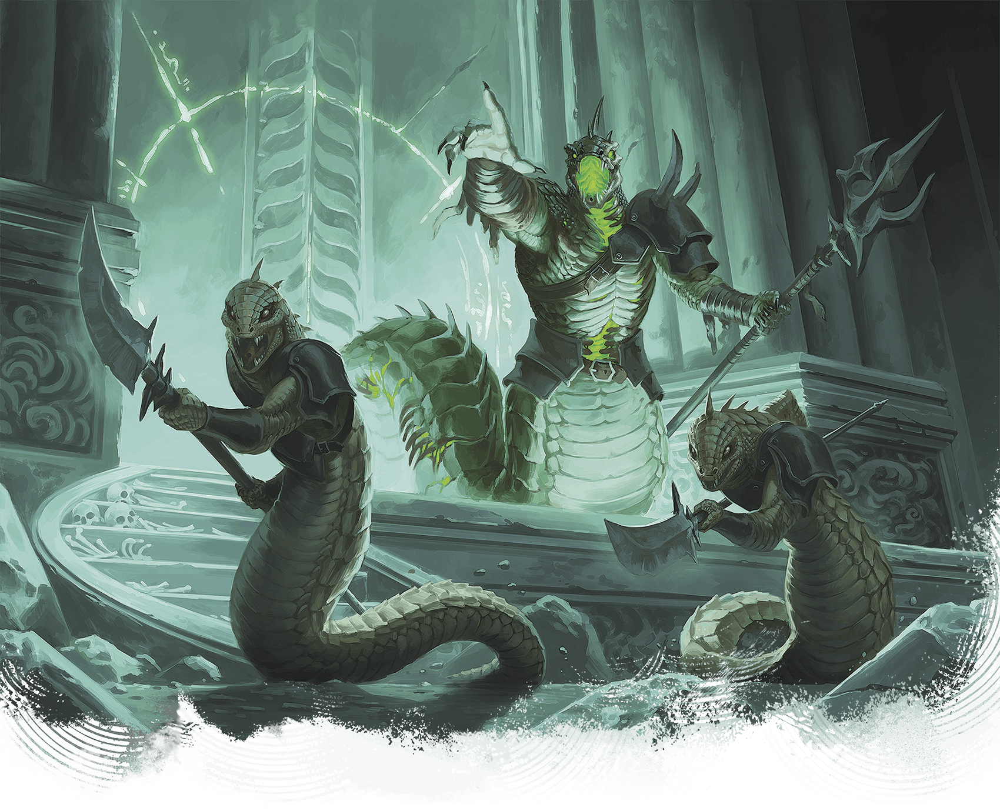

<!-- Notes MJ : contenu fourni par l’utilisateur, non destiné au partage public. -->

### Arisen Sarrukh

Brian Valeza

An arisen sarrukh commands two sarrukh tyrants.

The most powerful sarrukhs are arisen: horrific creatures that have subverted death. While arisen sarrukhs have lost their ability to cast spells, their unliving flesh is unnaturally strong.

### [Arisen Sarrukh](https://www.dndbeyond.com/monsters/6719630-arisen-sarrukh)

Medium Undead, Neutral Evil

**AC** 18 **Initiative** +9 (19)

**HP** 273 (26d8 + 156)

**Speed** 40 ft.

|  |  | Mod | Save |
| --- | --- | --- | --- |
| Str | 23 | +6 | +12 |
| Dex | 17 | +3 | +9 |
| Con | 22 | +6 | +12 |

|  |  | Mod | Save |
| --- | --- | --- | --- |
| Int | 18 | +4 | +4 |
| Wis | 17 | +3 | +9 |
| Cha | 18 | +4 | +4 |

**Skills** [Perception](https://www.dndbeyond.com/sources/dnd/free-rules/playing-the-game#Skills) +9, [Stealth](https://www.dndbeyond.com/sources/dnd/free-rules/playing-the-game#Skills) +12

**Immunities** Fire, Necrotic, Poison; [Charmed](https://www.dndbeyond.com/sources/dnd/free-rules/rules-glossary#CharmedCondition), [Exhaustion](https://www.dndbeyond.com/sources/dnd/free-rules/rules-glossary#ExhaustionCondition), [Frightened](https://www.dndbeyond.com/sources/dnd/free-rules/rules-glossary#FrightenedCondition), [Poisoned](https://www.dndbeyond.com/sources/dnd/free-rules/rules-glossary#PoisonedCondition)

**Gear** [Trident](https://www.dndbeyond.com/equipment/31-trident)

**Senses** [Truesight](https://www.dndbeyond.com/sources/dnd/free-rules/rules-glossary#Truesight) 120 ft.;Passive Perception 19

**Languages** Common, Draconic; telepathy 120 ft.

**CR** 18 (XP 20,000; PB +6)

Traits

***Legendary Resistance (3/Day).*** If the sarrukh fails a saving throw, it can choose to succeed instead.

***Magic Resistance.*** The sarrukh has [Advantage](https://www.dndbeyond.com/sources/dnd/free-rules/rules-glossary#Advantage) on saving throws against spells and other magical effects.

Actions

***Multiattack.*** The sarrukh makes three attacks, using Trident or Necrotic Spit in any combination.

***Trident.** Melee Attack Roll:* +12, reach 10 ft. *Hit:* 33 (6d8 + 6) Piercing damage.

***Necrotic Spit.** Ranged Attack Roll:* +12, range 90 ft. *Hit:* 11 (2d10) Poison damage plus 22 (4d10) Necrotic damage.

Bonus Actions

***Venomous Teleport (Recharge 5–6).*** The sarrukh teleports up to 120 feet to an occupied space it can see, and each creature within 10 feet of the space the sarrukh leaves or arrives in (sarrukh’s choice) is subjected to the following effect. *Constitution Saving Throw:* DC 20. *Failure:* 22 (4d10) Poison damage. *Success:* Half damage.

Reactions

***Shape Control.** Trigger:* A creature the sarrukh can see shape-shifts. *Response:* The sarrukh chooses the resulting form from among the options available to the shape-shifting creature or prevents the creature from shape-shifting.
