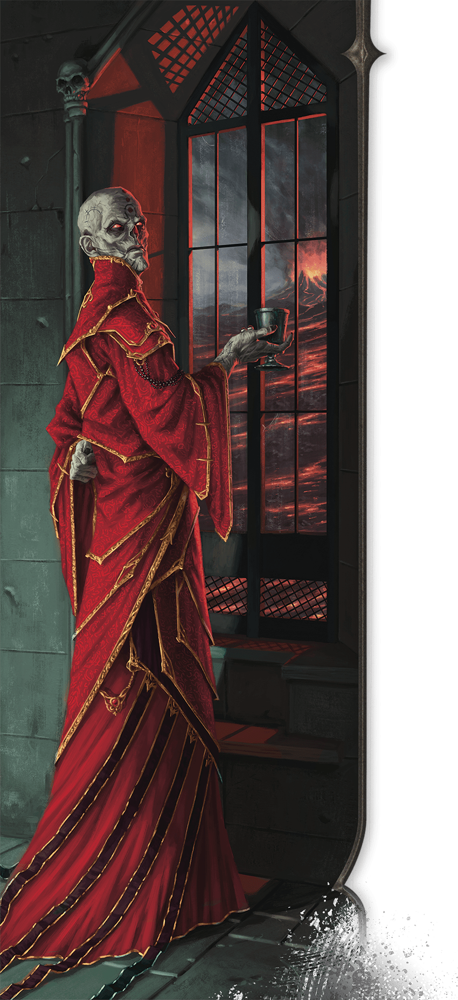

<!-- Notes MJ : contenu fourni par l’utilisateur, non destiné au partage public. -->

## Szass Tam

Once the undisputed regent of Thay, Szass Tam is an old and powerful lich who plots to regain control over the nation. Although he still wields great power as the zulkir of necromancy and the tharchion of Thaymount (see chapter 1), Szass Tam believes it’s his destiny to rule Thay and use its living people as fodder for his undead armies.

### History

Bubble Cat Studio

An eloquent and inventive wizard, Szass Tam rose through the ranks of the Red Wizards to become the zulkir of necromancy more than three centuries ago and became a lich not long afterward.

#### Regency

Over a century ago, Szass Tam turned against the other zulkirs and claimed rulership over Thay. On winning the ensuing civil war, he declared himself regent and turned his rivals into undead servants. Under his rule, necromancers dominated Thay, and all paid fealty to him.

#### Pursuit of Godhood

Eventually Szass Tam craved more than ruling Thay. Obsessed with gaining more power, he began a ritual to ascend to godhood. When this ritual failed spectacularly a few decades ago, civil unrest in Thay prompted him to reestablish the zulkir council with members loyal to him. He relinquished his title of regent, though in reality, the new zulkirs reported to him. These zulkirs dealt with the details of government, leaving him free to pursue new approaches to attaining godhood.

While Szass Tam remained distracted with finding a different way to attain godhood, new rivals systematically overthrew his sycophant zulkirs. Suddenly he was again part of a zulkir council with Red Wizards who saw themselves as his equals and refused to bow to him as the nation’s ruler.

#### Returning Tyrant

While Szass Tam still aspires to godhood, he can’t bear the loss of political power to rivals he views as inferiors. After years of plotting, he again moves to subdue Thay with undead before crushing the zulkirs who oppose him. If successful, he’ll return Thay to the undead-dominated land it was under his rule.

### Personality

Szass Tam takes the long view in his many plots, some of which span lifetimes. He is quick to pivot to contingencies when necessary.

While he enjoys commanding fear in his Thayan subjects, he also wields diplomacy to maintain foreign allies and is skilled at keeping foes off balance. Those who cross Szass Tam might evoke one of his legendary rages or might earn a nod of appreciation, as of someone witnessing a clever move in a game of strategy.

### Szass Tam’s Lair

Szass Tam’s lair is the Citadel, a fortress in the mountainous region of Thaymount. Here he plans his evil schemes and issues commands to his underlings.

Szass Tam extends his presence into the region he inhabits, creating the following effects:

- **Soul Siphon.** Whenever a Humanoid dies within the lair, its soul is immediately consumed by Szass Tam. A Humanoid whose soul is consumed in this way can be brought back to life only by a [True Resurrection](https://www.dndbeyond.com/spells/2619199-true-resurrection) or [Wish](https://www.dndbeyond.com/spells/2619213-wish) spell.
- **Whispers of Necromancy.** Whenever a creature within 1 mile of the lair casts a Necromancy spell, Szass Tam knows the spell and the identity of the creature that cast it.

If Szass Tam is destroyed or moves his lair elsewhere, these effects end immediately. These effects resume if Szass Tam gains a new body (see his Spirit Jar trait).

### [Szass Tam](https://www.dndbeyond.com/monsters/6719633-szass-tam)

Medium Undead (Wizard), Lawful Evil

**AC** 20 **Initiative** +16 (26)

**HP** 397 (53d8 + 159)

**Speed** 30 ft., Fly 30 ft.

|  |  | Mod | Save |
| --- | --- | --- | --- |
| Str | 12 | +1 | +1 |
| Dex | 14 | +2 | +9 |
| Con | 16 | +3 | +10 |

|  |  | Mod | Save |
| --- | --- | --- | --- |
| Int | 23 | +6 | +13 |
| Wis | 18 | +4 | +11 |
| Cha | 19 | +4 | +4 |

**Skills** [Arcana](https://www.dndbeyond.com/sources/dnd/free-rules/playing-the-game#Skills) +20, [Insight](https://www.dndbeyond.com/sources/dnd/free-rules/playing-the-game#Skills) +11, [Investigation](https://www.dndbeyond.com/sources/dnd/free-rules/playing-the-game#Skills) +13, [Perception](https://www.dndbeyond.com/sources/dnd/free-rules/playing-the-game#Skills) +11

**Resistances** Cold, Lightning

**Immunities** Necrotic, Poison; [Charmed](https://www.dndbeyond.com/sources/dnd/free-rules/rules-glossary#CharmedCondition), [Exhaustion](https://www.dndbeyond.com/sources/dnd/free-rules/rules-glossary#ExhaustionCondition), [Frightened](https://www.dndbeyond.com/sources/dnd/free-rules/rules-glossary#FrightenedCondition), [Paralyzed](https://www.dndbeyond.com/sources/dnd/free-rules/rules-glossary#ParalyzedCondition), [Poisoned](https://www.dndbeyond.com/sources/dnd/free-rules/rules-glossary#PoisonedCondition)

**Gear** [Component Pouch](https://www.dndbeyond.com/equipment/538-component-pouch)

**Senses** [Truesight](https://www.dndbeyond.com/sources/dnd/free-rules/rules-glossary#Truesight) 120 ft.;Passive Perception 21

**Languages** All

**CR** 23 (XP 50,000, or 62,000 in lair; PB +7)

Traits

***Legendary Resistance (4/Day, or 5/Day in Lair).*** If Szass Tam fails a saving throw, he can choose to succeed instead.

***Spirit Jar.*** If destroyed, Szass Tam re-forms in 1d10 days if he has a spirit jar, reviving with all his Hit Points. The new body appears in an unoccupied space within Szass Tam’s lair.

Actions

***Multiattack.*** Szass Tam makes three attacks, using Paralyzing Touch or Soul-Draining Ray in any combination. He can replace two attacks with a use of Spellcasting to cast [Finger of Death](https://www.dndbeyond.com/spells/2618885-finger-of-death).

***Paralyzing Touch.** Melee Attack Roll:* +13, reach 5 ft. *Hit:* 16 (3d6 + 6) Cold damage, and the target has the [Paralyzed](https://www.dndbeyond.com/sources/dnd/free-rules/rules-glossary#ParalyzedCondition) condition until the start of Szass Tam’s next turn.

***Soul-Draining Ray.** Ranged Attack Roll:* +13, range 120 ft. *Hit:* 25 (3d12 + 6) Necrotic damage, and the target has [Disadvantage](https://www.dndbeyond.com/sources/dnd/free-rules/rules-glossary#Disadvantage) on attack rolls and saving throws until the end of its next turn.

***Spellcasting.*** Szass Tam casts one of the following spells, using Intelligence as the spellcasting ability (spell save DC 21, +13 to hit with spell attacks):

**At Will:** [Detect Magic](https://www.dndbeyond.com/spells/2619097-detect-magic), [Detect Thoughts](https://www.dndbeyond.com/spells/2619099-detect-thoughts), [Finger of Death](https://www.dndbeyond.com/spells/2618885-finger-of-death), [Fireball](https://www.dndbeyond.com/spells/2618887-fireball) (level 8 version), [Lightning Bolt](https://www.dndbeyond.com/spells/2618999-lightning-bolt) (level 8 version), [Mage Hand](https://www.dndbeyond.com/spells/2619008-mage-hand), [Prestidigitation](https://www.dndbeyond.com/spells/2618893-prestidigitation)  
**2/Day Each:** [Animate Dead](https://www.dndbeyond.com/spells/2618853-animate-dead), [Dimension Door](https://www.dndbeyond.com/spells/2619100-dimension-door), [Plane Shift](https://www.dndbeyond.com/spells/2618867-plane-shift)  
**1/Day Each:** [Power Word Kill](https://www.dndbeyond.com/spells/2618886-power-word-kill), [Project Image](https://www.dndbeyond.com/spells/2618903-project-image), [Scrying](https://www.dndbeyond.com/spells/2619007-scrying), [Sending](https://www.dndbeyond.com/spells/2619015-sending)

Reactions

***Protective Magic.*** Szass Tam casts [Counterspell](https://www.dndbeyond.com/spells/2619072-counterspell) or [Shield](https://www.dndbeyond.com/spells/2619019-shield) in response to the spell’s trigger, using the same spellcasting ability as Spellcasting.

Legendary Actions

Legendary Action Uses: 3 (4 in Lair). Immediately after another creature’s turn, Szass Tam can expend a use to take one of the following actions. He regains all expended uses at the start of each of his turns.

***Deathly Teleport.*** Szass Tam teleports up to 60 feet to an unoccupied space he can see, and each creature within 10 feet of the space he left takes 13 (3d8) Necrotic damage.

***Disrupt Life.*** *Constitution Saving Throw:* DC 21, each creature that isn’t an Undead in a 20-foot [Emanation](https://www.dndbeyond.com/sources/dnd/free-rules/rules-glossary#EmanationAreaofEffect) originating from Szass Tam. *Failure:* 14 (4d6) Necrotic damage and the creature's Hit Point maximum decreases by an amount equal to the damage taken. *Success:* Half damage only. *Failure or Success:* Szass Tam can’t take this action again until the start of his next turn.

***Withering Magic.*** Szass Tam cast [Blight](https://www.dndbeyond.com/spells/2618934-blight) or [Dispel Magic](https://www.dndbeyond.com/spells/2619103-dispel-magic), using the same spellcasting ability as Spellcasting.
