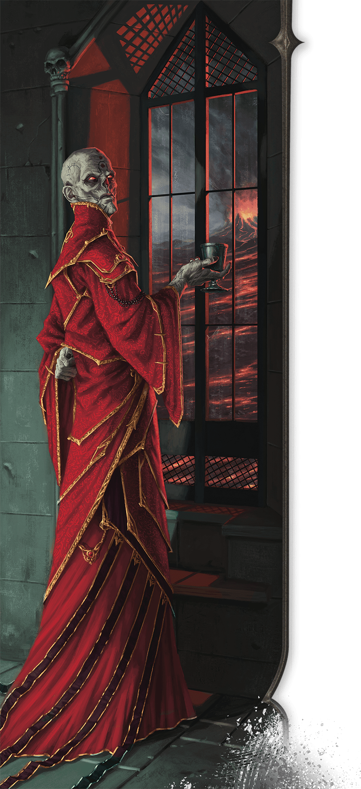

<!-- Notes MJ : contenu fourni par l’utilisateur, non destiné au partage public. -->

### History

Bubble Cat Studio

An eloquent and inventive wizard, Szass Tam rose through the ranks of the Red Wizards to become the zulkir of necromancy more than three centuries ago and became a lich not long afterward.

#### Regency

Over a century ago, Szass Tam turned against the other zulkirs and claimed rulership over Thay. On winning the ensuing civil war, he declared himself regent and turned his rivals into undead servants. Under his rule, necromancers dominated Thay, and all paid fealty to him.

#### Pursuit of Godhood

Eventually Szass Tam craved more than ruling Thay. Obsessed with gaining more power, he began a ritual to ascend to godhood. When this ritual failed spectacularly a few decades ago, civil unrest in Thay prompted him to reestablish the zulkir council with members loyal to him. He relinquished his title of regent, though in reality, the new zulkirs reported to him. These zulkirs dealt with the details of government, leaving him free to pursue new approaches to attaining godhood.

While Szass Tam remained distracted with finding a different way to attain godhood, new rivals systematically overthrew his sycophant zulkirs. Suddenly he was again part of a zulkir council with Red Wizards who saw themselves as his equals and refused to bow to him as the nation’s ruler.

#### Returning Tyrant

While Szass Tam still aspires to godhood, he can’t bear the loss of political power to rivals he views as inferiors. After years of plotting, he again moves to subdue Thay with undead before crushing the zulkirs who oppose him. If successful, he’ll return Thay to the undead-dominated land it was under his rule.
