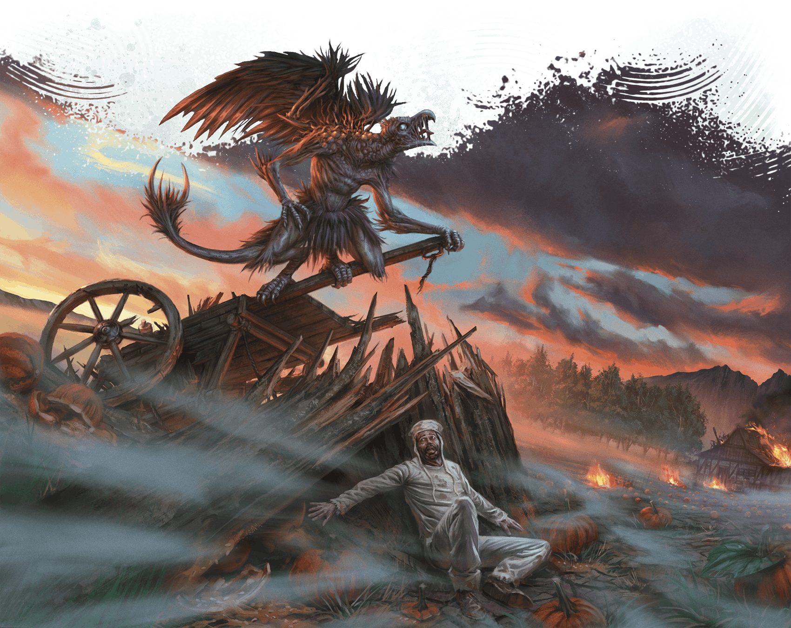

<!-- Notes MJ : contenu fourni par l’utilisateur, non destiné au partage public. -->

### Delhumide

Although it held Thay’s provincial capital during Mulhorandi rule, the tharch of Delhumide is now rural, consisting of farmland and ranges for cattle herds. Monsters lurk in Mulhorandi ruins, and lingering fiendish magic from the era of Mulhorandi rule attracts demons to the area.

ÁLVARO CALVO ESCUDERO

A vrock terrorizes a farmer in Delhumide.

#### Ruins of Delhumide

Once a great city, Delhumide’s eponymous provincial capital was razed in Thay’s earliest bid for independence and has never been rebuilt. Ghosts and lingering, malevolent magical effects haunt the countryside for miles around the ruins and surrounding abandoned estates.

Numerous Red Wizard necromancers have delved into the ruins to study its ancient crypts. The few who have returned claim a terrible Mulhorandi curse protects these sites.

#### Umratharos

A small city at a bend of the River Thay, Umratharos is Delhumide’s capital. In the city’s center stands the Old Thay Inn, an ideal place for adventurers to rest when not exploring the tharch’s ruins. The inn’s halfling proprietor, Brenna Arthan (Small [Scout Captain](https://www.dndbeyond.com/monsters/5195197-scout-captain)), is a retired adventurer who buys magic items found in the ruins and sells them to her Red Wizard contacts.

Tharchion Meskie Kudd levies heavy fees on those who explore ruins. Kudd funnels this money to the zulkirs in hopes of being reassigned to a more cosmopolitan tharch.
