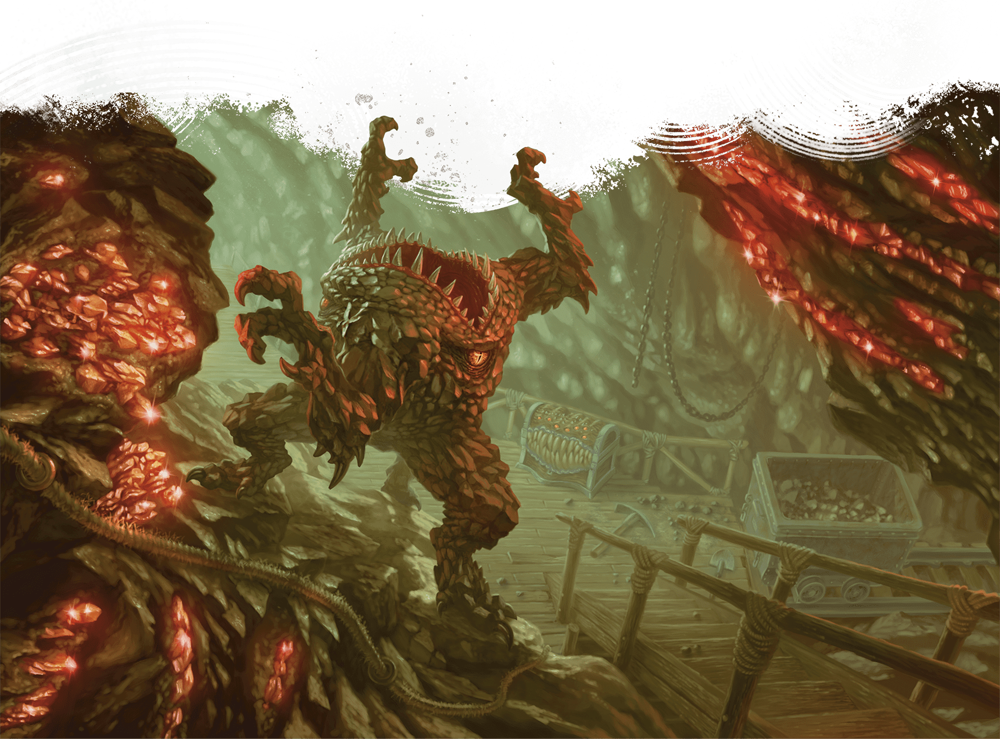

<!-- Notes MJ : contenu fourni par l’utilisateur, non destiné au partage public. -->

### Pyarados

The towering peaks of the nearby Sunrise Mountains are visible from every plain in the tharch of Pyarados. The foothills are dotted with mines, which many Red Wizards of Eltabbar and Bezantur have invested in.

Monster attacks are uncommon in the wilds here. However, the mines are full of monsters, including strange creatures from the Elemental Plane of Earth, such as xorns.

Most Red Wizards who back mining operations here are unscrupulous, working the locals until they die—and then raising them as undead to continue their work. Many workers in Pyarados sign over their lives (and unlives) to the Red Wizards, working in the mines in exchange for the Red Wizards’ promises to provide for their families.

LOÏC CANAVAGGIA

A xorn wanders through a mine in Pyarados.

#### City of Pyarados

The largest city on the Thazarim River is Pyarados, the tharch’s capital. Tharchion Mevik Sasvar, who resides here, encourages Red Wizards to invest in mines and work their laborers as hard as they wish. Many Red Wizard investors spend significant time and money in the city, which boasts the best gambling houses in the nation. To free their time for gambling, these Red Wizards often hire adventurers to scout new mining locations or investigate troubled operations.
