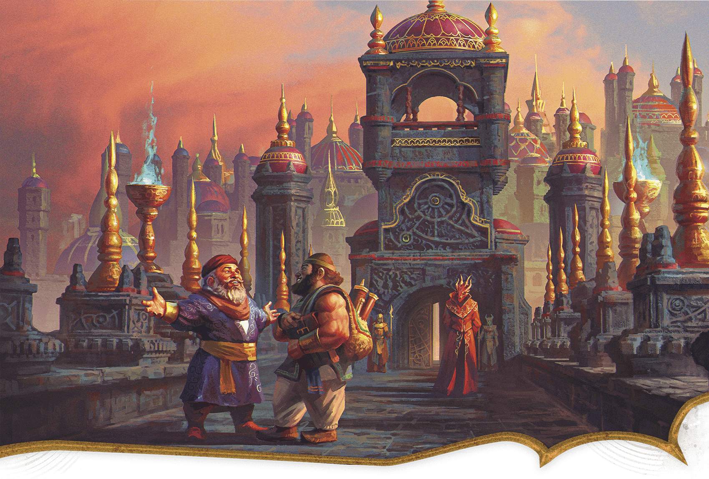

<!-- Notes MJ : contenu fourni par l’utilisateur, non destiné au partage public. -->

### Thazalhar

Andrey Kuzinskiy

Two Mulhorandi merchants on the Thay Crossing bridge chat while a Red Wizard looks on.

In Thay’s earliest days, its second smallest tharch, Thazalhar, served as a bulwark against incursions from Mulhorand. Now, Thazalhar’s liveliest feature is the road that trade caravans use to travel between the two nations. Just inside Thay’s border, a bridge known as Thay Crossing serves as a checkpoint where Red Wizards inspect the cargo of passing merchants. Mulhorandi traders are taxed heavily, though the cost is worthwhile for merchants traveling to bustling Bezantur.

#### Thazalhar Station

Just a few miles from Thay’s border lies Thazalhar Station, a former tax station converted into a governance building. The station also serves as border control, meticulously checking the paperwork of all non-Thayans passing through.

Tharchion Jynnril, a veteran of many border conflicts, steers Thazalhar’s government with a steady hand. The deeply patriotic tharchion keeps a small army garrisoned at the station. Most of these soldiers are borrowed from more powerful tharchs; experience under Jynnril’s command is considered a badge of honor throughout Thay due to her rigor.
