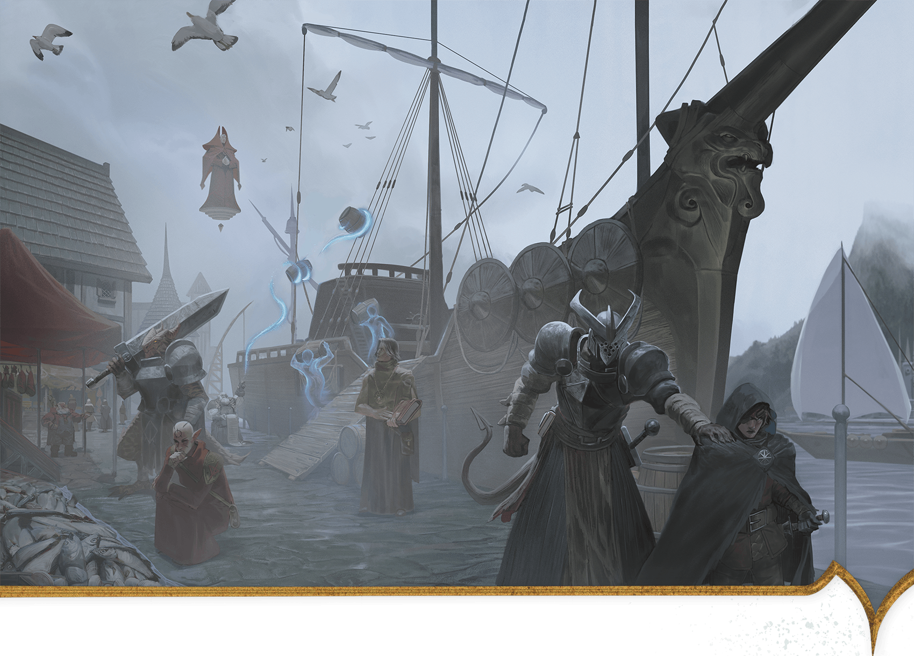

<!-- Notes MJ : contenu fourni par l’utilisateur, non destiné au partage public. -->

### The Alaor

Kevin Glint, Álvaro Calvo Escudero

Merchants in Ala Harbor unload their cargo while a Red Wizard looks on.

Off the southern coast of Thay lie two rocky islands, Alaor Major and Alaor Minor. These make up Thay’s smallest tharch, the Alaor. Despite the tharch’s size, the extensive shipyard here makes it one of the nation’s most strategically important.

#### Tharchions of Thay

| Tharchion | Tharch | Stat Block | Tharchion Details |
| --- | --- | --- | --- |
| Bavak Inkander | The Alaor | [Noble Prodigy](https://www.dndbeyond.com/monsters/5195144-noble-prodigy) (Medium, Lawful Neutral) | Human shipbuilding and naval genius |
| Bulgor Ograzep | Tyraturos | [Bandit Crime Lord](https://www.dndbeyond.com/monsters/5194913-bandit-crime-lord) (Medium, Lawful Evil) | Human highway thief turned politician |
| Jynnril | Thazalhar | [Questing Knight](https://www.dndbeyond.com/monsters/5195177-questing-knight) (Small) | Human veteran of border conflicts |
| Keliza Vyrizek | Lapendrar | [Spy Master](https://www.dndbeyond.com/monsters/5195216-spy-master) (Medium, Neutral Evil) | Human international espionage mastermind |
| Meskie Kudd | Delhumide | [Spy Master](https://www.dndbeyond.com/monsters/5195216-spy-master) (Medium, Chaotic Neutral) | Human cattle rancher and spy for the zulkirs |
| Mevik Sasvar | Pyarados | [Performer Legend](https://www.dndbeyond.com/monsters/5195154-performer-legend) (Medium, Lawful Evil) | Silver-tongued tiefling tyrant |
| Ozgund Gar | Gauros | [Warrior Commander](https://www.dndbeyond.com/monsters/5195258-warrior-commander) (Medium, Lawful Evil) | Short-tempered orc military veteran |
| Szass Tam | Thaymount | [See appendix B](https://www.dndbeyond.com/monsters/6719633-szass-tam) (Medium, Lawful Evil) | Lich zulkir of necromancy |
| Vederax Skarsk | Surthay | [Warrior Commander](https://www.dndbeyond.com/monsters/5195258-warrior-commander) (Medium, Chaotic Evil) | Dragonborn and militant Thayan patriot |
| Xelnene Thrul | Priador | [See appendix B](https://www.dndbeyond.com/monsters/6719634-xelnene-thrul) (Medium, Neutral Good) | Human zulkir of evocation |
| Zedivek Mazradash | Eltabbar | [Vampire Umbral Lord](https://www.dndbeyond.com/monsters/5195250-vampire-umbral-lord) (Medium) | Former elf who serves the zulkir of illusion |

#### Alaor Major

Alaor Major is the largest of the two islands that make up the Alaor. The island is dotted with small settlements and family homes, most tied to the extensive navy that harbors at Ala City.

On the shores of a deepwater bay lies the Alaor’s capital, Ala City. This city also contains the tharch’s principal harbor, Ala Harbor. Dozens of naval and merchant ships dock here; all are built in the extensive shipyards nearby. Stationed in the city are approximately 1,000 members of the Thayan navy, ready to deploy against pirates or enemy ships.

Ala City is home to tharchion Bavak Inkander, who owns the shipyards and commands the Alaor’s navy. A no-nonsense naval genius, Inkander is conservative with the fleet. He often declines merchants’ requests for protection, suggesting they hire adventurers for protection.

#### Alaor Minor

Sea caves and rocky shorelines surround Alaor Minor, making it an undesirable place for settlements but an inviting place for pirate crews to lair. The treacherous reefs and menacing sea monsters in the coastal waters mean Thayan forces rarely bother to pursue pirates here.
