<!-- Notes MJ : contenu fourni par l’utilisateur, non destiné au partage public. -->

# Thay, Dominion of Red Wizards

Joshua Raphael
[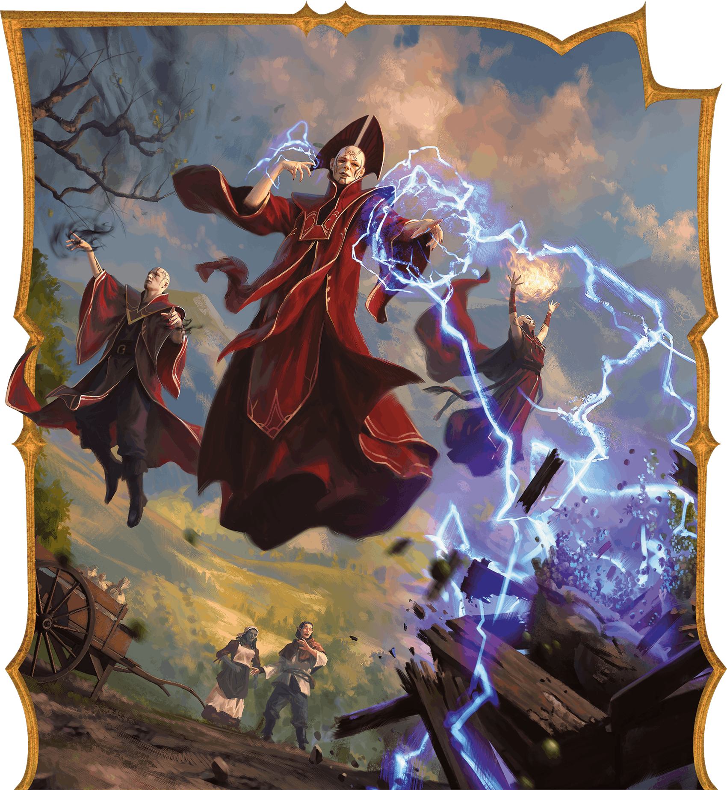](../assets/illustrations/01-001.ch-1-splash.png)

Red Wizards rain ruin on those who dare defy them.

In the sinister land of Thay, scheming mages called Red Wizards dominate a society steeped in magic and deceit. Those without magical or economic power are at the mercy of these fascist mages, who harshly punish any who defy them.

Yet the lich [Szass Tam’s](https://www.dndbeyond.com/sources/dnd/dmg-2024/lore-glossary#SzassTam) scheming threatens to make the situation even worse. He plots to raise an unstoppable army of undead, killing thousands and crushing all opposition, as he did over a century ago. The lich envisions a Thay where loyal necromancers prop up his rule and the populace is merely fodder from which to raise his terrifying hordes.

This chapter is for Dungeon Masters who want to set games in or learn more about Thay, and it includes the following:

- **[Red Wizards.](../chapter.md#RedWizards)** This section describes Thay’s ruling mages and provides details about the highest-ranking Red Wizards.
- **[Thay Details.](../chapter.md#ThayDetails)** This gazetteer includes information about Thayan government, wealth, and military, as well as daily life. Thay’s eleven provinces, including their climate, geography, and key locations are described in detail, along with ideas to support adventures set in Thay.
- **[Eltabbar, Thay’s Capital.](../chapter.md#EltabbarThaysCapital)** This gazetteer focuses on the city of Eltabbar and its ten wards.

This chapter supports the campaign Operation Deadfall, which is set in Thay—particularly in Eltabbar—and unfolds in chapters 3–7.

## Important Terms

The following terms are important for understanding Thay:

- **Red Wizard:** A mage whose word is law in Thay
- **Tharch:** A province in Thay
- **Tharchion:** The governor of a tharch
- **Zulkir:** A Red Wizard who’s the most powerful Thayan spellcaster of one of the eight schools of magic
- **Council of Zulkirs:** Rules Thay and commands the tharchions

## Red Wizards

Thay is governed by Red Wizards: ambitious mages who believe their destiny is to rule the world and subjugate it to their whims.

### Who Are Red Wizards?

Red Wizards are mighty mages who command fear from those less powerful than them. They are granted broad leeway to act however they see fit to promote Thay’s economic and military power.

Red Wizards populate the upper echelons of Thayan society. They are heads of wealthy families, estate owners and operators, political players serving zulkirs, foremost magic scholars, and business magnates. No achievement is out of bounds for a Red Wizard.

### Red Wizard Axioms

Red Wizards are the most notorious and recognizable people in Thay. The general public understands certain defining facts about these mages. Common folk conduct themselves accordingly, hoping to avoid the mages’ wrath.

Swatches Studio
[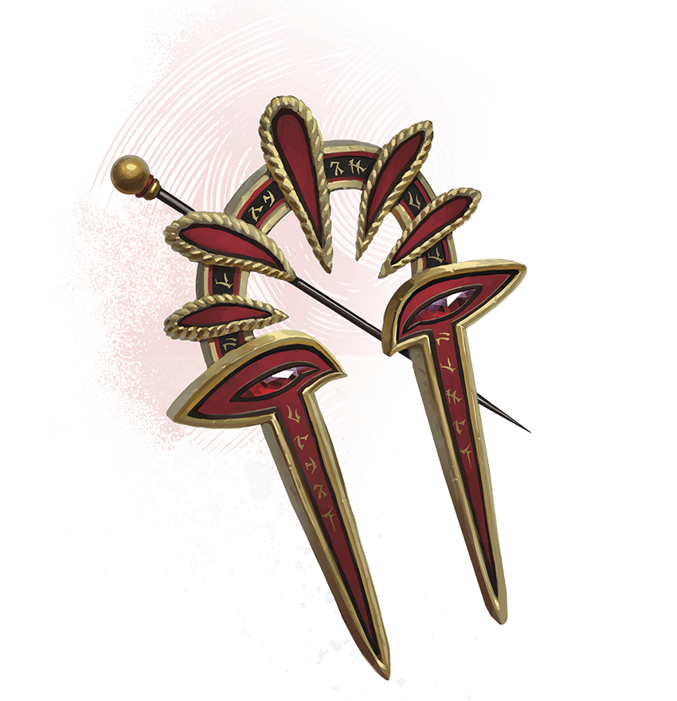](../assets/illustrations/01-002.symbol-of-the-red-wizards.png)

Symbol of the Red Wizards

#### What Thayans Know

Thayans know the following about Red Wizards:

- **They Wear Red.** Red attire is outlawed for anyone else in Thay. Red Wizards also cloak their homes and places of prestige in red, a color that denotes official Thayan business.
- **Their Heads Are Shaved and Tattooed.** Some of these tattoos are decorative and denote family origins or loyalty to a zulkir. Some are magical and boost the mages’ spellpower.
- **They’re Powerful Mages.** Red Wizards are spellcasters who swear loyalty to even more powerful mages of their order.
- **They Demand Obedience.** Red Wizards mete out harsh punishment to those who disobey them. Thay’s common folk avoid interactions with Red Wizards when possible, knowing their world could be overturned at the mages’ whim.
- **They’re Cruel and Self-Centered.** Red Wizards’ demands are often unjust and usually in service to their own schemes, though they might claim to have Thay’s best interest in mind.
- **They Decide What’s Fair.** Red Wizards’ decisions are binding. The only person who can question a Red Wizard is a more powerful Red Wizard.

There are exceptions. Some Red Wizards are benevolent, but common folk can’t afford to assume any Red Wizard isn’t as cruel as a typical member of their order.

#### Red Wizard Hallmarks

Red Wizards conduct themselves according to the following worldview:

- **Red Wizards Are Superior.** Red Wizards believe themselves superior to all others.
- **Common Folk Are Servants.** Red Wizards expect anyone without magical or economic power to obey their commands without question.
- **Personal Ambition Is Paramount.** Red Wizards believe it’s their right to pursue their own power and enrichment as long as they say they’re serving Thay.
- **Loyalty Is Malleable.** Red Wizards swear loyalty to a zulkir and to other powerful Red Wizards. But most would betray that loyalty to increase their own political standing.
- **Supremacy Is Inevitable.** Each Red Wizard believes they have the potential to become a zulkir if they work hard enough and are ruthless enough to seize that title.

Again, there are exceptions—some Red Wizards are loyal to their zulkir, while others put Thay’s interests above their own—but they’re rare.

Thay Timeline

This timeline provides a summary of key events in Thayan history. Dates are in Dalereckoning (DR).

**−1087 DR.** The mage Thayd leads a rebellion against Mulhorand and Unther, seizing the northern provinces of both empires and declaring independence.

**−1081 DR.** Thayd and his conspirators are defeated. The lands revert to the empires’ control.

**922 DR.** Mages who call themselves the Red Wizards, led by Ythazz Buvaar, rebel against Mulhorand. The Red Wizards sack the imperial city of Delhumide, and Thay is born.

**934 DR.** The Red Wizards and their armies invade Rashemen, attempting conquest, and fail.

**976 DR.** Mulhorand launches a failed attempt to regain control of Thay.

**1030 DR.** Thay’s most powerful mages, each specializing in a different school of magic, form a council. They call themselves zulkirs and declare joint rule of Thay.

**1074 DR.** The zulkirs crush opposition to their rule in Thay. The Red Wizards acknowledge the ruling zulkirs; each Red Wizard declares loyalty to one or more zulkirs.

**1157 DR.** The human archmage Szass Tam assassinates the vampire zulkir of necromancy, Nyressa Flass, and is named her successor.

**1159 DR.** Szass Tam becomes a lich.

**1344 DR.** The Guild of Foreign Trade creates the first Thayan trade enclave in the city of Procampur in northern Faerûn.

**1375 DR.** Open conflict between the zulkirs embroils Thay in civil war. Szass Tam seizes control of Thay and names himself regent.

**1478 DR.** Szass Tam begins a ritual to attain godhood but fails. The zulkir council is reestablished, and mages who practice all schools of magic again vie for political power.

**1501 DR.** Current date.

### Becoming a Red Wizard

The title of Red Wizard can’t simply be claimed—it must be officially bestowed by an established Red Wizard who trains aspiring mages. Youngsters with magical aptitude from prominent Thayan families are certain to secure an apprenticeship with a Red Wizard, while less-privileged youth go to great lengths to impress a Red Wizard and earn an apprenticeship.

Most aspirants specialize in one school of magic, hoping to rise in power and prestige through their chosen specialization. When they receive their title, Red Wizards declare loyalty to one or more zulkirs, although the sincerity of their oaths varies.

#### Training

Most apprentices become Red Wizards after five years of training. However, Red Wizard masters set their own timelines. Some apprentices become Red Wizards in only a few years; others take a decade or more to earn their red robes. Still others never become Red Wizards and are dismissed from their apprenticeship or sentenced to harsh punishment—even death—for their perceived incompetence.

#### Hierarchy

Junior Red Wizards are referred to as apprentice Red Wizards by their more established peers until their deeds earn them sufficient prestige. Most Red Wizards are called masters, while the most senior Red Wizards are called sages.

#### Non-Thayan Red Wizards

It’s rare, but a Red Wizard might accept an apprentice born outside of Thay if the mage sees enough potential in them. For example, mercenary mages from outside Thay’s borders may apprentice under a Red Wizard after completing at least three jobs for that mage. Such apprentices must work harder and longer to impress their Red Wizard master.

### Red Wizards Schemes

Red Wizards scheme to attain more political power and magical might. Pursuing these goals often puts Red Wizards at odds with adventurers, especially since Red Wizards think nothing of harming innocents to achieve their ends.

Unraveling a Red Wizard’s scheme before identifying the mage as the villain and defeating them can make a great campaign arc. When using a Red Wizard villain, roll on or choose a result from the Red Wizard Motivations table to inspire the villain’s goal.

#### Red Wizard Motivations

| 1d6 | The Red Wizard Wants ... |
| --- | --- |
| 1 | A hated rival to die spectacularly, but the Red Wizard can’t be seen as involved. |
| 2 | To inherit their master’s lands, but their master has six heirs. |
| 3 | To publicly assassinate a disgraced Red Wizard, but the target’s security is too strong. |
| 4 | To gain the respect and mentorship of a zulkir, but the zulkir dislikes them. |
| 5 | To train the children of a prominent Red Wizard, but the children are promised as apprentices to another. |
| 6 | To eliminate a rival’s business, but the rival is a more powerful Red Wizard. |

### Thayan Knights

Many high-ranking Red Wizards command one or more Thayan knights: highly trained warriors sworn to protect Thay’s elite. Red Wizards or their families typically arrange for the training of the Thayan knights who serve them.

A Thayan knight serves a Red Wizard for life. Should a Red Wizard die before their knight, the Red Wizard’s family decides whether the Thayan knight must serve another Red Wizard or is released from service.

Like Red Wizards, Thayan knights usually sport shaved heads and tattoos, though they wear armor and wield swords, shields, or similar gear. Thayan knights are knowledgeable about magic, and some use spells to augment their skills on the battlefield.

## Council of Zulkirs

The zulkirs are the highest-ranking Red Wizards. They form the Council of Zulkirs, Thay’s ruling body, which makes decisions related to the nation’s commerce and warfare. The council delegates other matters of governance to Thay’s vast bureaucracy (see “[Government](../chapter.md#Government)” later in this chapter).

Publicly, the zulkirs claim their goals align, though most are more interested in advancing their own interests than in the country’s well-being. Clandestine clashes among the zulkirs are common, but none relish a return to the time when civil war raged among the council.

Zulkirship is hard-earned. When a zulkir position opens, the council votes on a replacement selected from the top tier of Red Wizards, usually choosing the mage who bested the previous zulkir—whether through political guile or assassination.

### Zulkirs’ Resources

Thay’s zulkirs accumulate enormous resources prior to ascending to the council. All have numerous streams of income, often from finding or creating and later selling magical treasures. The zulkirs each own at least one home in the Zulkirs’ Ward in [Eltabbar](../chapter.md#Eltabbar), Thay’s capital city, and in [Thaymount](../chapter.md#Thaymount), where protective magic helps them keep their biggest secrets away from prying eyes. Zulkirs also maintain legions of staff, soldiers, and other servants.

### Zulkir Descriptions

Bubble Cat Studio
[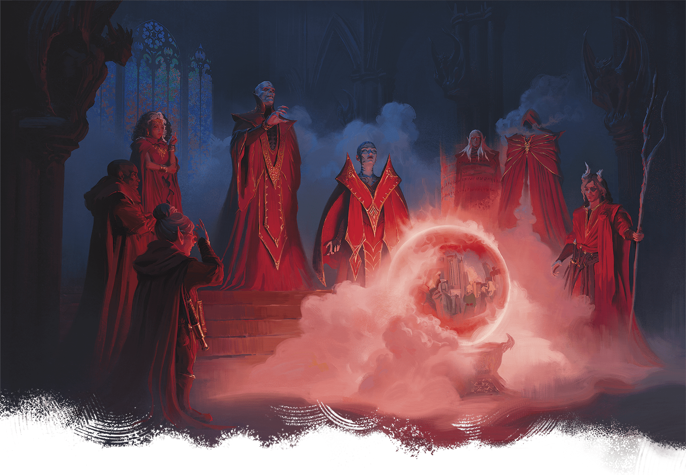](../assets/illustrations/01-003.zulkir.png)

Shown Clockwise from Left: Zulkirs Lethnar, Delraz, Mythrellaa, Szass Tam, Xelnene Thrul, Yazir Nym, Nzas, and Nevron

The current zulkirs are summarized in the Zulkirs by School of Magic table and further described below. Each zulkir references a stat block in [Arcana Unleashed](https://www.dndbeyond.com/sources/dnd/au/chapter-6-magical-creatures#Archmages) or [appendix B](../../appendix-b-bestiary/chapter.md). Use the [Archmage](https://www.dndbeyond.com/monsters/5194902-archmage) stat block if those stat blocks aren’t available.

#### Zulkirs by School of Magic

| School | Zulkir |
| --- | --- |
| Abjuration | Yazir Nym |
| Conjuration | Nevron |
| Divination | Lethnar |
| Enchantment | Delraz |
| Evocation | Xelnene Thrul |
| Illusion | Mythrellaa |
| Necromancy | Szass Tam |
| Transmutation | Nzas |

#### Delraz

*Zulkir of Enchantment*

**Species:** Human

**Stat Block:** Medium [Enchanter Archmage](https://www.dndbeyond.com/monsters/6719571-enchanter-archmage)

**Alignment:** Lawful Evil

**Personality Traits:** Conniving and manipulative

**Primary Ambition:** Steal wealth from non-mages

Delraz upholds Thay’s strict, traditional sense of order in which Red Wizards can act with impunity. He levies heavy taxes against Thayan merchants, believing their businesses’ existence depends on the Red Wizards. The zulkir keeps most of this revenue, using mind-bending magic to influence any who would oppose him.

#### Lethnar

*Zulkir of Divination*

**Species:** Gnome

**Stat Block:** Medium [Diviner Archmage](https://www.dndbeyond.com/monsters/6719570-diviner-archmage)

**Alignment:** Lawful Neutral

**Personality Traits:** Practical and merciless

**Primary Ambition:** Punish illegal magic use

Lethnar is obsessed with enforcing Thay’s labyrinthine laws concerning the use of magic by anyone other than Red Wizards. In the city of [Bezantur](../chapter.md#Bezantur), Lethnar oversees a criminal court where Red Wizards the gnome selects try those accused of breaking these laws, issuing harsh punishments. In recent years, Lethnar has pushed to try more Thayans throughout the country. Many Red Wizards believe Lethnar created the court to avert a future the zulkir foresees for themself in their divinations.

#### Mythrellaa

*Zulkir of Illusion*

**Species:** Human

**Stat Block:** Medium [Illusionist Archmage](https://www.dndbeyond.com/monsters/6719576-illusionist-archmage)

**Alignment:** Chaotic Evil

**Personality Traits:** Calculating and devious

**Primary Ambition:** Become Thay’s regent

Mythrellaa first claimed this zulkirship two hundred years ago but was believed killed when rivals assaulted her tower in [Bezantur](../chapter.md#Bezantur). In reality, she spent the next century in the [Shadowfell](https://www.dndbeyond.com/sources/dnd/dmg-2024/cosmology#Shadowfell) learning powerful arcana, including illusions that drain mages’ spellpower and funnel it to her. Mythrellaa recently returned and reclaimed her zulkirship; she plots to use the arcana she learned to overthrow the council and claim Thay’s regency.

#### Nzas

*Zulkir of Transmutation*

**Species:** Human

**Stat Block:** Medium [Transmuter Archmage](https://www.dndbeyond.com/monsters/6719583-transmuter-archmage)

**Alignment:** Chaotic Evil

**Personality Traits:** Mysterious and ominous

**Primary Ambition:** Command an invincible army

Nzas veils herself in shadows that conceal her visage and is renowned for her ability to alter the physical forms of herself and others. She frequently transforms her limbs into tentacles, bone spurs, or hooks, enabling her to swiftly execute those who offend her. Nzas garrisons an army in the city of Bezantur, and recently she has discovered how to imbue her soldiers with supernatural strength and resilience. She researches a way to make these enhancements permanent so she can become the most militarily powerful zulkir.

#### Nevron

*Zulkir of Conjuration*

**Species:** Tiefling

**Stat Block:** Medium [Conjurer Archmage](https://www.dndbeyond.com/monsters/6719568-conjurer-archmage)

**Alignment:** Neutral Evil

**Personality Traits:** Contemptuous and malicious

**Primary Ambition:** Become the strongest zulkir

Two decades ago, Nevron was a powerful human diabolist and the zulkir of conjuration. When Szass Tam killed him for joining the other zulkirs’ failed attempt to overthrow the lich, Nevron made a pact in the Abyss with a mysterious demon lord and returned to Thay as a tiefling. He worked his way back into power thanks to his ability to quickly summon and command fiendish allies. Nevron seeks ever more fiendish power, hoping to force Thay’s other zulkirs to serve him.

#### Szass Tam

*Zulkir of Necromancy*

**Species:** Formerly human, now a lich

**Stat Block:** See [appendix B](../../appendix-b-bestiary/chapter.md#SzassTam)

**Alignment:** Lawful Evil

**Personality Traits:** Despotic and entitled

**Primary Ambition:** Regain Thay’s regency

The lich [Szass Tam](https://www.dndbeyond.com/monsters/6719633-szass-tam) has lived nearly 400 years. In addition to his zulkirship, he’s the tharchion of Thaymount, the tharch at the nation’s center. He’s open about his belief that he’s superior to the other zulkirs and recently announced his desire to regain regency over Thay. While he insists he has the nation’s best interest at heart, Szass Tam has proven repeatedly that he’d prefer ruling a nation of undead over one with living citizens. He plots to complete a demonic ritual called Malefice Mortum; see [chapter 2](../../chapter-02-thay-in-danger/chapter.md#DemonicRitual) and ["Szass Tam"](../../appendix-b-bestiary/chapter.md#SzassTam) in appendix B for more details.

#### Xelnene Thrul

*Zulkir of Evocation*

**Species:** Human

**Stat Block:** See [appendix B](../../appendix-b-bestiary/chapter.md#XelneneThrul)

**Alignment:** Neutral Good

**Personality Traits:** Pragmatic and shrewd

**Primary Ambition:** Build a more equitable Thay

Though known for her explosive offensive magic, Xelnene Thrul hopes for a better future for Thay’s populace in which the Red Wizards use their magic to enrich and empower all Thayans. She embodies these principles in her council position and as tharchion of Priador. Thrul’s political leadership and magical power make her one of the nation’s most powerful people. Thrul is further detailed in [chapter 3](../../chapter-03-operation-deadfall/chapter.md#PrivateAudience) and [appendix B](../../appendix-b-bestiary/chapter.md#XelneneThrul).

#### Yazir Nym

*Zulkir of Abjuration*

**Species:** Elf

**Stat Block:** Medium [Abjurer Archmage](https://www.dndbeyond.com/monsters/6719566-abjurer-archmage)

**Alignment:** Lawful Evil

**Personality Traits:** Aggressive and sadistic

**Primary Ambition:** Conquer foreign cities

Yazir Nym seeks to bring glory to Thay through his army’s incursions along the nation’s southwest border, where several contested cities lie in a region known as Wizards’ Reach. Known for his potent healing magic and his army’s resilience, Nym is also notorious for capturing enemies and mending their wounds so he can punish them further.

## Thay Details

The following sections provide an overview of Thay’s key structures as well as providing a window into everyday life in Thay.

### Government

Beyond the ruling Council of Zulkirs, Thay’s government is a baroque system of power-hungry bureaucrats manipulated by Red Wizards.

#### Tharchions

Each tharchion—the governor of a tharch, or province—is appointed by the Council of Zulkirs, and a tharchion’s term lasts as long as the zulkirs decide. Most tharchions aren’t Red Wizards and are accountable to the zulkirs and any Red Wizards who question them. Otherwise, each tharchion governs their tharch autonomously.

Tharchions have broad control over material concerns such as infrastructure, trade, laws governing the population, and their tharch’s militaries. The zulkirs look favorably on tharchions who can bring military glory to Thay, so most of these officials are former military commanders. Tharchions and their tharchs are detailed in “[Tharch Descriptions](../chapter.md#TharchDescriptions).”

#### Autharchs

At their discretion, tharchions appoint autharchs: lesser bureaucrats who serve as mayors, magistrates, and other local functionaries. Autharchs are frequently replaced; incompetent autharchs are dismissed, while skilled autharchs are removed before they can become threats.

## Thayan Wealth

Thay’s economy runs off heavy taxes and the export of magic items. Though many of its residents are poor, Thay is one of the richest nations in Faerûn.

### Tax Stations

Small fortresses called tax stations pepper Thay’s border, roads, and internal boundaries. Soldiers at each tax station collect tolls imposed by the controlling tharchion. Tolls vary daily according to a byzantine schedule but are usually 3 SP.

A toll collector might reduce or waive these tolls for travelers with paperwork from a Red Wizard or government official, or in exchange for a service or favor from adventurers. Conversely, corrupt tax collectors might impose “fees” on travelers to line their own pockets. Tolls are never higher than 1 GP.

Álvaro Calvo Escudero
[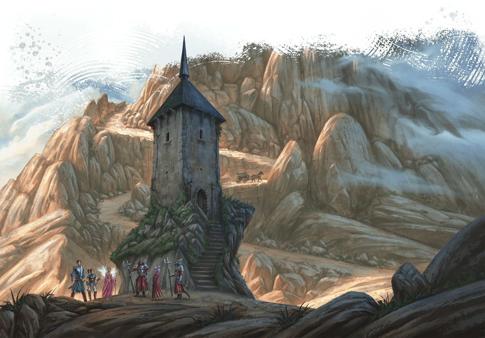](../assets/illustrations/01-004.tax-station.png)

Tax stations such as this one are common throughout Thay.

### Guild of Foreign Trade

Thay’s Guild of Foreign Trade manages the nation’s lucrative, high-volume exports of magic items. Based in the city of [Bezantur](../chapter.md#Bezantur), the Guild of Foreign Trade keeps enormous warehouses of primarily Common and Uncommon magic items to be sent to Thayan trade enclaves abroad. The guild is corrupt, and its business practices are immoral, but no group can rival the low prices or easy access to magic items Thay offers.

The guild’s leader, a human Red Wizard named Gulga Vull (Medium [Archmage](https://www.dndbeyond.com/monsters/5194902-archmage)), grew up an orphan on the streets of Bezantur, but her business acumen led to her meteoric rise. Vull focuses on maximizing profitability, hoping to expand Thayan trade dominance and therefore her own position as an adviser to the zulkirs.

### Thayan Enclaves

Thayan enclaves are trade outposts ensconced in cities across Faerûn. A typical Thayan enclave is walled and houses a handful of Red Wizards, their Thayan knights and other bodyguards, a garrison of soldiers to defend the enclave, and a flourishing market for magic items.

Profits generated by these enclaves go to Thay to fuel the nation’s growth. These enclaves are governed by Thayan law, though visitors are granted leeway to ensure Thay’s harsh laws don’t negatively impact business. For instance, wearing red isn’t outlawed for visitors, although the Red Wizards in an enclave might refuse to haggle with non-Thayans who wear that color.

#### Enclave Locations

There are robust Thayan enclaves in Scardale Town in the Dalelands, Calimport in Calimshan, and Kingsbay in the Moonshae Isles. Red Wizards work to reestablish enclaves in [Baldur’s Gate](https://www.dndbeyond.com/sources/dnd/dmg-2024/lore-glossary#BaldursGate), [Waterdeep](https://www.dndbeyond.com/sources/dnd/dmg-2024/lore-glossary#Waterdeep), and other major metropolises where they’ve been destroyed.

## Magical Military

Johan Grenier
[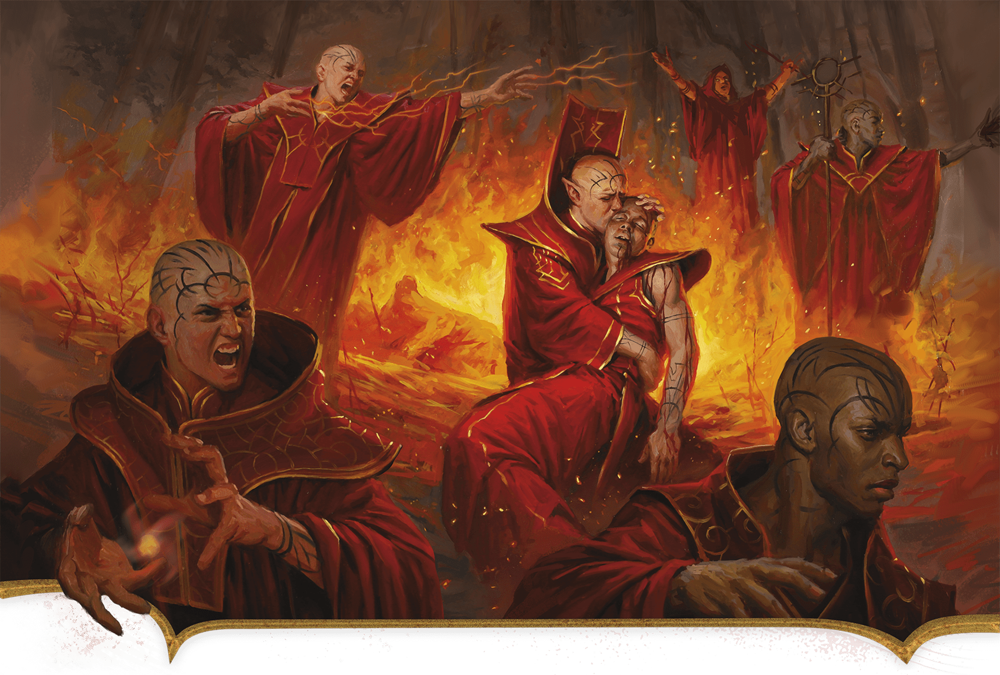](../assets/illustrations/01-005.red-wizard-suffering.png)

Thay’s conflicts with its neighbors cause substantial suffering to all involved.

Thay’s fighting forces boast highly trained spellcasters and mighty warriors. For the impoverished lower class, joining an armed force is the easiest way to guarantee food, shelter, training, and a meager income. As a result, thousands of such folk enlist. Though individual forces rarely include more than a hundred combatants, together, their numbers are formidable.

### Thayan Forces

Thay has numerous military forces, but instead of having a unified command, many are private armies of powerful Red Wizards. Others are commanded by specific tharchions. These armies’ commanders often threaten each other, and sometimes skirmishes break out, though the zulkirs are quick to stifle such conflicts.

#### Private Armies

The zulkirs and other powerful Red Wizards command private armies, raised and garrisoned at their own expense. These armies reflect the magical predilections of their patrons. For example, Red Wizards specializing in Evocation magic command armies that rain down elemental destruction on their enemies, while squadrons led by Illusion specialist Red Wizards might trick their enemies into deadly traps and self-slaughter.

#### Dread Legion

The most famous private army in Thay is the Dread Legion, commanded by [Szass Tam](https://www.dndbeyond.com/monsters/6719633-szass-tam). Garrisoned in Thaymount at the Citadel, where Szass Tam lairs, this terrifying fighting force consists mostly of undead, with only a few living soldiers who have pledged their fealty to the lich. Szass Tam’s legion is commanded by two generals: Slethisz Vendrein and Hazrash Kulmantle (both Medium [Death Knights](https://www.dndbeyond.com/monsters/5194963-death-knight)).

#### Tharchions’ Forces

Most tharchions command their own fighting forces, including in the island tharch of [the Alaor](../chapter.md#TheAlaor), whose shipyards host a formidable navy. Some of these militaries are so powerful that tharchions have single-handedly led invasions of neighboring realms.

### Thayan Aggression

Thay has sought conquest since its earliest days of independence from the Mulhorandi and Unther empires. Although it enjoys a tense but stable trade relationship with the nation of Thesk, its other neighbors rightly consider it a hostile power.

#### Aglarond

The zulkirs have long considered Aglarond a prize from which they might exert control over the entire Sea of Stars. Aglarond’s powerful sorcerers have repeatedly rebuffed Thayan invasions.

A strip of land called Wizards’ Reach along Aglarond’s southern border with Thay is the most contested land in the Thay-Aglarond conflict. Aglarond nominally rules here, but the farther east one goes, the more Red Wizards hold sway.

#### Mulhorand

The people of Mulhorand and Thay regard each other as ancestral enemies. Mulhorand considers Thay a wayward province to be brought back in line. For Thay, conquering its former imperial master would be a crowning achievement. The Sunrise Mountains, however, are a formidable barrier between the two nations, and Thay’s fractured leadership prevents its armies from making a unified assault on Mulhorand. This is fortunate for Mulhorand, which lacks the resources for what would be a costly war.

#### Rashemen

Rashemen and northern Thay have invaded each other dozens of times. Unlike conflicts between Thay and Mulhorand, these invasions stem from outbursts of greed or pride. Thayan leaders covet the wealth flowing from Rashemen’s iron mines, while Rashemen’s aggression against Thay is mostly a matter of individual warriors trying to prove their valor.

## Life in Thay

Life in Thay is difficult and dangerous, yet it holds the promise of glory and riches for those who ruthlessly embrace magical power and political maneuvering.

### Laws

Thayan law is dizzyingly complex and often contradictory. Red Wizards enforce the nation’s strict criminal laws unevenly and as best benefits themselves. They punish commoners however they want, with no recourse for the accused except the hope that a rival Red Wizard might defend them.

These are most commonly enforced Thayan laws:

- **Only Red Wizards Are Allowed to Wear Red.** Even benevolent Red Wizards enforce this law.
- **A Red Wizard’s Command Must Be Obeyed.** If Red Wizards give contradictory commands, the highest-ranking Red Wizard must be obeyed.
- **Disrespecting a Red Wizard Is Treason.** Red Wizards have full discretion to decide when this law is broken.

Less frequently enforced laws prohibit violent crimes and lesser offenses such as property damage. Punishments range from fines or imprisonment to death, at Red Wizards’ whims.

#### Crime

With such uneven enforcement, crime is rampant in Thay. The city of [Bezantur](../chapter.md#Bezantur) is home to massive criminal guilds, but every tharch has its own underworld profiting off the greed, corruption, and abuses of power for which Red Wizards are known. Theft, bribery, smuggling, assassination, blackmail, and every other kind of grift are common in Thayan society. It’s almost impossible for a traveler to move through the realm without falling victim to a few crimes.

### Society

Thayan society is stratified. Below the ruling aristocracy of the Red Wizards is a middle class made up of bureaucrats, merchants, soldiers, priests, and artisans. At the bottom is a working-class population of laborers, most of whom stay within a few miles of their birthplace their whole lives. The only ways to rise socially are through magical talent, military service, trade, or crime. As a result, militaries and guilds never lack recruits.

SWATCHES STUDIO
[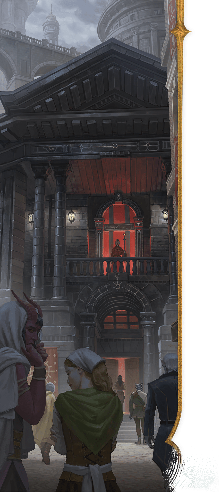](../assets/illustrations/01-006.thayan-life.png)

Red Wizards lord over   
all aspects of Thayan life.

In general, Thayans oppress all those beneath them on the social ladder. Working class Thayans suffer a life of hard labor in the cities, fields, mines, and waterways. Most have adapted to such a life over generations, creating traditions of self-abnegation and acceptance. Still, some wonder if life must always continue in this pattern, and a few even dare to whisper of rebellion (see “[Open Eyes](../chapter.md#OpenEyes)” below).

#### Closed Eyes

Many middle- and working-class Thayans follow a tradition of silence and noninterference called Closed Eyes, whose main teaching is “Ignore trouble that doesn’t concern you.” Thayans who follow this tradition emulate the cranes that nest and migrate throughout the nation: to survive, they focus relentlessly on the everyday tasks of finding safety, eating, and caring for their young. This tradition leads Thayans to ignore any crime around them.

This attitude allows crime to flourish in Thayan cities, but it can also help adventurers operate unimpeded, even if they openly flout the Red Wizards’ authority. Only sycophants to the Red Wizards alert authorities to lawbreakers’ activities, and even they hesitate, as garnering Red Wizards’ attention rarely goes well for the underclass.

#### Open Eyes

Civil resistance and unrest are rare in Thay, as the Red Wizards usually discover dissent quickly with magical spying techniques. But Red Wizards are easily distracted by their own selfish interests, allowing dissent short of open rebellion to simmer.

Made up of small, local cells, the Open Eyes is a group of Thayan rebels who hate the Red Wizards’ rule. The rebels aim to strike at Red Wizards who’ve perpetuated injustice, such as meting out unfair punishments or tolerating violent crime. Retribution ranges from stealing spell components and sabotaging magic item shipments to assassination attempts.

Openly calling oneself a member of the Open Eyes is a death sentence. Nonetheless, incidents attributed to the group flare throughout Thay, suggesting a greater rebellion is brewing.

### Religion

Myriad faiths are common in Thay, where the following gods are worshipped:

- **Bane.** The most common faith is worship of Bane, the god of tyranny. Bane’s purview over ambition and control appeals to Red Wizards, merchants, and bureaucrats.
- **Chauntea.** A god of agriculture, Chauntea is popular among farmers and tradespeople.
- **Cyric.** The god of lies is popular among criminals and common folk who use deception to avoid the Red Wizards’ wrath.
- **Kossuth.** A primordial being from the Elemental Plane of Fire, Kossuth is a god of purification through fire. His worship appeals to Red Wizards who embrace destroying anything they can’t claim for themselves.
- **Mask.** A god of thieves, Mask is popular among the bandits who roam Thay’s highways and prowl its cities’ streets.
- **Mystra.** The best-known god of magic in Faerûn, Mystra is only sporadically worshipped in Thay. The Red Wizards prefer other gods, and common Thayans avoid gods of magic.
- **Shar.** A god of loss and forgetfulness, the Mistress of the Night is popular among common folk who have experienced tragedy or are frustrated at the injustices they suffer.

## Adventuring in Thay

Thay’s reputation as a deadly land is well-earned. But heroes, especially those who wield magic, can achieve great heights here.

### Traveling Adventurers

Adventurers from outside Thay might visit the nation for the following reasons:

- **Magic Item Retrieval.** Thay’s tharchs are littered with ancient sites filled with lost relics and magic items, from the tombs of ancient Mulhorand god-kings in Pyarados to the ruins of the imperial city of Delhumide.
- **Magical Secrets.** Mages throughout Faerûn trace their ancestry to Thayans who fled the Red Wizards. Some might seek spellbooks, magic items, or other remnants of their heritage. A wealthy mage might hire the characters to retrieve an item from the ruins of their family’s Thayan manor or from the Red Wizards who stole it.
- **Sabotage Mission.** Some powerful Red Wizards orchestrate nefarious international networks from Thay. A powerful patron might hire the characters to infiltrate Thay and unravel an evil Red Wizard’s operation, preventing death and suffering across the world.

### Thayan Adventurers

Within Thay, remarkable individuals become adventurers despite the Red Wizards’ oppression, or adventurers might be Red Wizards themselves. Heroes from Thay might follow these paths:

- **Hero of the People.** The character knows that Thay’s common folk suffer greatly and that those in need usually can’t pay. The hero helps the downtrodden no matter the cost. They might rescue a prisoner unjustly sentenced to death or retrieve vital goods stolen from a village. Eventually, the Red Wizards confront the character, and it’s up to the hero whether they want to fight back or find allies among the mages’ ruthless ranks.
- **Open Eyes Operative.** The character might choose to operate as an [Open Eyes](../chapter.md#OpenEyes) rebel, sabotaging and undermining the Red Wizards. They might torch a Red Wizard’s magic item shipment or steal from a mage’s vault. If discovered, the character attracts the Red Wizards’ ire; regardless, most locals refuse to associate with them for fear of reprisal.
- **Red Wizard.** The hero could be a Red Wizard seeking to overturn the status quo or fighting to rise in rank. A selfish and cruel Red Wizard isn’t a good candidate to join an adventuring party, though perhaps an adventuring Red Wizard has left their unsavory past behind. For guidance on playing a Red Wizard character, see [chapter 2](../../chapter-02-thay-in-danger/chapter.md#PlayingRedWizard).
- **Red Wizard’s Agent.** Not all Red Wizards in Thay are evil, and no matter their predilections, many Red Wizards pay adventurers well to handle various tasks. See “Red Wizard Patronage” for more about working for such an employer.

### Red Wizard Patronage

Red Wizards use underlings and mercenaries to achieve their goals, and many seek to hire adventurers. Chapter 6 of [Forgotten Realms: Heroes of Faerûn](https://www.dndbeyond.com/sources/dnd/frhof/factions-of-the-realms) details the Red Wizards as a faction that might hire the characters, including rewards for characters if you use the renown system described in the [Dungeon Master’s Guide](https://www.dndbeyond.com/sources/dnd/dmg-2024).

Roll on or choose a result from the Red Wizard Tasks table when a Red Wizard hires the characters to complete a job.

#### Red Wizard Tasks

| 1d4 | The Characters Must… |
| --- | --- |
| 1 | Retrieve a rare spell component from a dangerous cave. |
| 2 | Seek a strange magic item from a ruin rumored to be haunted. |
| 3 | Recover arcane lore from an ancient Red Wizard’s abandoned tower. |
| 4 | Retrieve the spellbook of a Red Wizard who died in a treacherous mountain pass. |

## Climate and Geography

Thay’s destiny has been shaped by the nation’s natural environment and the powerful magic that sculpts its lands.

### Magical Climate

Although Thay is a desert, centuries ago the Red Wizards created permanent magical effects that bring enough rain to sustain a robust population.

#### Crops and Livestock

Crops such as wheat, olives, citrus, and grapes thrive in Thay’s volcanic soil, so the nation doesn’t need to rely on imports to sustain its populace. In the nation’s lowlands, flora feeds enormous herds of cattle and sheep, ensuring access to meat and fiber. At higher elevations, herds of yaks and goats sustain Thay’s hardy mountain communities.

#### Unnatural Weather

Unnatural weather phenomena are common in Thay thanks to weather-controlling magic. When characters are traveling in Thay, roll on or choose a result from the Weather Phenomena table to inspire what the characters experience.

#### Weather Phenomena

| 1d4 | The Characters Experience… |
| --- | --- |
| 1 | An intense downpour while the sun shines brightly. |
| 2 | Light drizzle that lasts for hours, though dry air stings the eyes. |
| 3 | Ominous banks of crimson clouds. |
| 4 | Wispy clouds racing across the sky, though there’s no wind. |

### Geography

Thay stretches over two enormous plateaus, one atop the other like a cake’s tiers. A small strip of land surrounding Thay’s primary plateau lies at sea level. This area is known as Lower Thay. Thay’s primary plateau, on which most of the nation sits, is called the Thayan Plateau. The plateau atop the Thayan Plateau is called Thaymount. The nation’s imposing physical geography has served as a natural barrier against enemy forces for centuries.

FRANCESCA BAERALD
[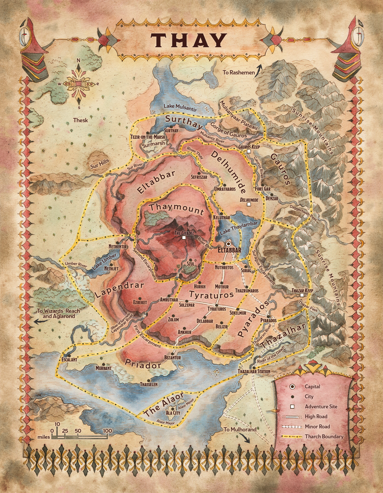](../assets/maps/mj/map-01-01.thay.jpg)

Map 1.1: Thay [View Player Version](../assets/maps/players/map-01-01.thay-player.jpg)

#### Lower Thay

Lower Thay is a fertile region that curves along Thay’s western border from Surthay on Lake Mulsantir to Priador on the Alamber Sea. Most of Thay’s border wars have been fought here. Lower Thay is strategically vital for its coastlines and crops and provides a launching point for invasions. The land rises into the Thayan Plateau through a series of towering precipices in the space of about ten miles; this rise is called the First Escarpment.

#### Tharchs of Thay

| Tharch | Tharchion | Capital | Description |
| --- | --- | --- | --- |
| The Alaor | Bavak Inkander | Ala City | Two islands harboring a navy and Thay’s shipyards |
| Delhumide | Meskie Kudd | Umratharos | Haunted pastureland with ancient ruins |
| Eltabbar | Zedivek Mazradash | Eltabbar | Capital region pouring out Thayan propaganda |
| Gauros | Ozgund Gar | Fort Gar | Hilly hinterland where distrust of the zulkirs runs deep |
| Lapendrar | Keliza Vyrizek | Escalant | Fertile countryside with dangerous borders |
| Priador | Xelnene Thrul | Bezantur | Thay’s commercial hub |
| Pyarados | Mevik Sasvar | Pyarados | Mountainous mining region |
| Surthay | Vederax Skarsk | Surthay | Swampland bordering Rashemen |
| Thaymount | Szass Tam | Szul | Mountainous abode of Red Wizards; forbidden to others |
| Thazalhar | Jynnril | Thazalhar Station | Fortified river lands bordering Mulhorand |
| Tyraturos | Bulgor Ograzep | Tyraturos | Urbane mercantile hub |

#### Thayan Plateau

The Thayan Plateau, Thay’s most populous region, contains rolling vistas broken by cities, towns, low mesas, and ominous ruins. While the Delhumide tharch feels wild, filled with more ruins than population centers, cities and villages dot the Tyraturos tharch’s arid plains. In the plateau’s center rise the dramatic cliffs of the Second Escarpment, leading to the upper plateau of Thaymount.

#### Thaymount

Thaymount is both the name of a plateau featuring volcanic peaks at its center and the name of the tharch this region constitutes. Only Red Wizards and those they invite may tread here. See “Tharch Descriptions” for more information about this area.

## Tharch Descriptions

Thay is divided into eleven tharchs. The Tharchs of Thay table lists each tharch’s details, while the Tharchions of Thay table presents their rulers.

### The Alaor

Kevin Glint, Álvaro Calvo Escudero
[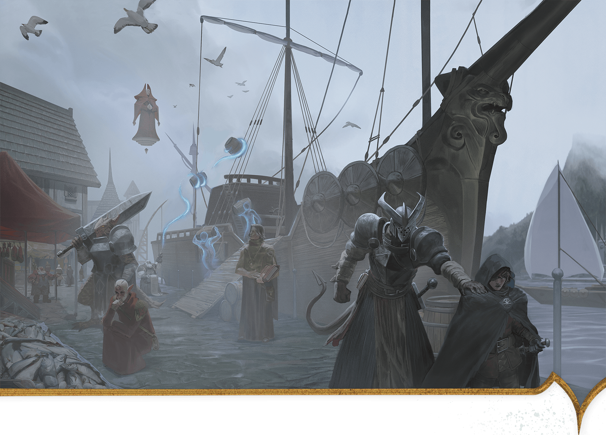](../assets/illustrations/01-007.ala-harbor-merchants.png)

Merchants in Ala Harbor unload their cargo while a Red Wizard looks on.

Off the southern coast of Thay lie two rocky islands, Alaor Major and Alaor Minor. These make up Thay’s smallest tharch, the Alaor. Despite the tharch’s size, the extensive shipyard here makes it one of the nation’s most strategically important.

#### Tharchions of Thay

| Tharchion | Tharch | Stat Block | Tharchion Details |
| --- | --- | --- | --- |
| Bavak Inkander | The Alaor | [Noble Prodigy](https://www.dndbeyond.com/monsters/5195144-noble-prodigy) (Medium, Lawful Neutral) | Human shipbuilding and naval genius |
| Bulgor Ograzep | Tyraturos | [Bandit Crime Lord](https://www.dndbeyond.com/monsters/5194913-bandit-crime-lord) (Medium, Lawful Evil) | Human highway thief turned politician |
| Jynnril | Thazalhar | [Questing Knight](https://www.dndbeyond.com/monsters/5195177-questing-knight) (Small) | Human veteran of border conflicts |
| Keliza Vyrizek | Lapendrar | [Spy Master](https://www.dndbeyond.com/monsters/5195216-spy-master) (Medium, Neutral Evil) | Human international espionage mastermind |
| Meskie Kudd | Delhumide | [Spy Master](https://www.dndbeyond.com/monsters/5195216-spy-master) (Medium, Chaotic Neutral) | Human cattle rancher and spy for the zulkirs |
| Mevik Sasvar | Pyarados | [Performer Legend](https://www.dndbeyond.com/monsters/5195154-performer-legend) (Medium, Lawful Evil) | Silver-tongued tiefling tyrant |
| Ozgund Gar | Gauros | [Warrior Commander](https://www.dndbeyond.com/monsters/5195258-warrior-commander) (Medium, Lawful Evil) | Short-tempered orc military veteran |
| Szass Tam | Thaymount | [See appendix B](https://www.dndbeyond.com/monsters/6719633-szass-tam) (Medium, Lawful Evil) | Lich zulkir of necromancy |
| Vederax Skarsk | Surthay | [Warrior Commander](https://www.dndbeyond.com/monsters/5195258-warrior-commander) (Medium, Chaotic Evil) | Dragonborn and militant Thayan patriot |
| Xelnene Thrul | Priador | [See appendix B](https://www.dndbeyond.com/monsters/6719634-xelnene-thrul) (Medium, Neutral Good) | Human zulkir of evocation |
| Zedivek Mazradash | Eltabbar | [Vampire Umbral Lord](https://www.dndbeyond.com/monsters/5195250-vampire-umbral-lord) (Medium) | Former elf who serves the zulkir of illusion |

#### Alaor Major

Alaor Major is the largest of the two islands that make up the Alaor. The island is dotted with small settlements and family homes, most tied to the extensive navy that harbors at Ala City.

On the shores of a deepwater bay lies the Alaor’s capital, Ala City. This city also contains the tharch’s principal harbor, Ala Harbor. Dozens of naval and merchant ships dock here; all are built in the extensive shipyards nearby. Stationed in the city are approximately 1,000 members of the Thayan navy, ready to deploy against pirates or enemy ships.

Ala City is home to tharchion Bavak Inkander, who owns the shipyards and commands the Alaor’s navy. A no-nonsense naval genius, Inkander is conservative with the fleet. He often declines merchants’ requests for protection, suggesting they hire adventurers for protection.

#### Alaor Minor

Sea caves and rocky shorelines surround Alaor Minor, making it an undesirable place for settlements but an inviting place for pirate crews to lair. The treacherous reefs and menacing sea monsters in the coastal waters mean Thayan forces rarely bother to pursue pirates here.

### Delhumide

Although it held Thay’s provincial capital during Mulhorandi rule, the tharch of Delhumide is now rural, consisting of farmland and ranges for cattle herds. Monsters lurk in Mulhorandi ruins, and lingering fiendish magic from the era of Mulhorandi rule attracts demons to the area.

ÁLVARO CALVO ESCUDERO
[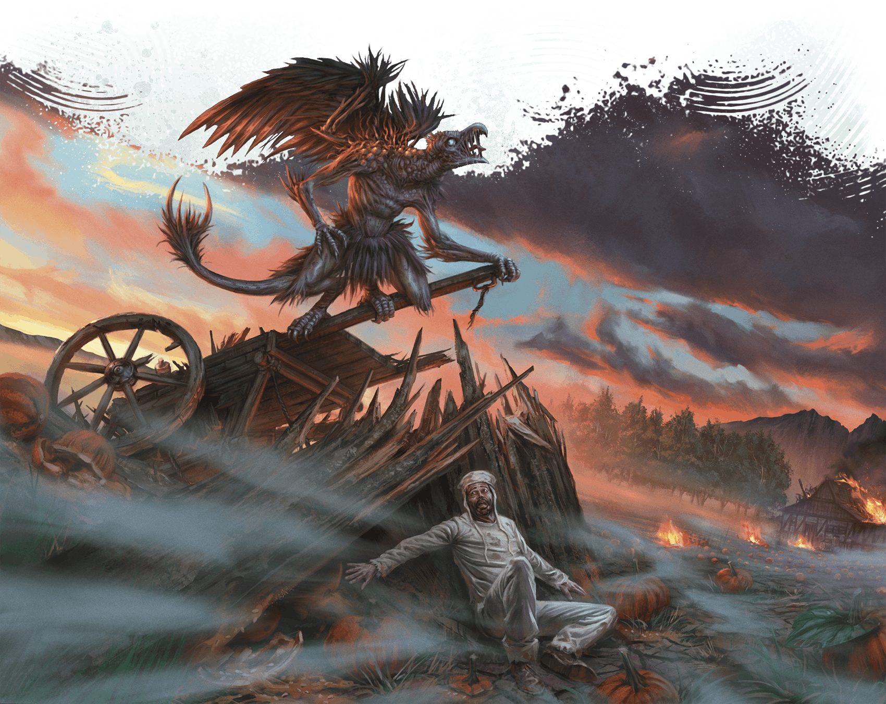](../assets/illustrations/01-008.vrock-terrorizing-farmer.png)

A vrock terrorizes a farmer in Delhumide.

#### Ruins of Delhumide

Once a great city, Delhumide’s eponymous provincial capital was razed in Thay’s earliest bid for independence and has never been rebuilt. Ghosts and lingering, malevolent magical effects haunt the countryside for miles around the ruins and surrounding abandoned estates.

Numerous Red Wizard necromancers have delved into the ruins to study its ancient crypts. The few who have returned claim a terrible Mulhorandi curse protects these sites.

#### Umratharos

A small city at a bend of the River Thay, Umratharos is Delhumide’s capital. In the city’s center stands the Old Thay Inn, an ideal place for adventurers to rest when not exploring the tharch’s ruins. The inn’s halfling proprietor, Brenna Arthan (Small [Scout Captain](https://www.dndbeyond.com/monsters/5195197-scout-captain)), is a retired adventurer who buys magic items found in the ruins and sells them to her Red Wizard contacts.

Tharchion Meskie Kudd levies heavy fees on those who explore ruins. Kudd funnels this money to the zulkirs in hopes of being reassigned to a more cosmopolitan tharch.

### Eltabbar

Though Eltabbar primarily consists of lightly populated scrubland, this tharch is home to Thay’s cosmopolitan capital city. Small settlements of mostly humans, tieflings, elves, and orcs serve as bedroom communities for the capital.

#### Eltabbar

Full of magical marvels, Thay’s capital is the seat of power for Thay’s most prominent Red Wizards and the second most important city in Thay for commercial trade, behind Bezantur. The city of Eltabbar is further detailed later in this chapter.

### Gauros

David Frasheski

The sparsely populated landscape of the tharch of Gauros is breathtaking.

Rocky, rugged, and forbidding, Gauros is a rural tharch with no major cities. The hills abound with precious metals, but the Sunrise Mountains harbor dangerous monsters, including vicious gnolls and hill giants, so only well-defended or well-hidden mining operations survive for long.

Gauros’s tharchions have repeatedly tried to clear the mountains of monsters to entice more Red Wizards to invest in the area, but these efforts have largely failed. The foothills are littered with abandoned fortresses, including Gauros Keep.

Small villages dot the tharch’s riverbanks, with the largest being Denzar. When locals must travel from village to village, they don’t make camp in the open after dark lest they risk a gnoll attack. Those who can afford it pay monster-hunters to escort them through the wilderness.

#### Fort Gar

Fort Gar, situated on the banks of the Gauros River, is the capital of Gauros and the seat of power for its tharchion, Ozgund Gar. Gar is the latest leader to try to fortify Gauros against the region’s perils. Using the heavy tax revenue he collects from mining barons, Gar built the fort, conscripted hundreds of locals, and personally trained them into a formidable fighting force.

Rumors swirl that an army of gnolls led by a [Glabrezu](https://www.dndbeyond.com/monsters/5195041-glabrezu) named Krazt gathers in the mountains and plans to assault the fort soon. Gar regularly petitions the zulkirs for resources and troops to help in the coming fight, but so far, his pleas have been ignored.

### Lapendrar

At the southwestern edge of Thay lies Lapendrar, a tharch known for fertile farmlands, border disputes with the cities of Wizards’ Reach, and the independent city-state of Amruthar. Soldiers garrison in every village. Residents are required by law to house soldiers, and Lapendrar’s Red Wizards don’t tolerate pushback.

#### Amruthar

Before Thay achieved independence, Amruthar was a Mulhorandi city ruled by a powerful satrap named Sekhotet. The satrap agreed to help Thay win its freedom in exchange for the city’s continued autonomy, and ever since, the zulkirs have honored that wish, fearing magical repercussions if they break their agreement.

During Szass Tam’s regency, a seismic disaster opened chasms in Amruthar’s streets, burying half the city in ash and lava. The rest of the city became a haven for refugees, outcasts, and seditious priests. The city’s mayor is an elf named Ulthara Toll (Medium, Lawful Neutral [Archpriest](https://www.dndbeyond.com/monsters/5194903-archpriest)), who follows Mystra, a god of magic.

In Amruthar, the Red Wizards have no authority, and people are free to speak out against their tyranny. Worship of gods whose churches are frowned on in Thay is more prominent here, including worship of Mystra and of Amaunator, a god of the sun. Some in the city still revere gods of the old Mulhorandi pantheon.

Toll and other city leaders fear the zulkirs will move to reclaim Amruthar. As a result, no one enters the city without undergoing thorough questioning in the area of a [Zone of Truth](https://www.dndbeyond.com/spells/2619221-zone-of-truth) spell, and nobody is buried without first being questioned through a [Speak with Dead](https://www.dndbeyond.com/spells/2619068-speak-with-dead) spell. Amruthar might be free from the Red Wizards, but it is a bad place for anyone with secrets.

#### Escalant

Just east of contested territory, the city of Escalant is one of the most patriotic cities in Lapendrar. Tharchion Keliza Vyrizek controls both the tharch and Thayan international espionage. Heroes from Aglarond might work to subvert Vyrizek’s spies or free prisoners captured by the sadistic zulkir of abjuration, Yazir Nym, who garrisons his army here.

### Priador

Full of wealthy towns and cities, Priador is the heart of Thayan commerce. The tharch collects abundant revenue from the many tax stations along the High Road. The road is crowded with merchants and other travelers, both Thayan and foreign.

#### Bezantur

Bezantur is Priador’s largest city and Thay’s commercial hub. The Guild of Foreign Trade is based here, and most residents covet a lucrative position either in the guild’s home offices or abroad. Bezantur also contains Thay’s largest port, where docks host enormous contingents of merchant ships and the naval warships that protect them.

Ruling from a grand palace in Bezantur, Xelnene Thrul (see [appendix B](../../appendix-b-bestiary/chapter.md#XelneneThrul)) is both the zulkir of evocation and the tharchion of Priador. Thrul, whose family has held leadership posts for generations, steers Thay’s economy with a steady hand. Assisting Thrul is Gulga Vull (Medium [Archmage](https://www.dndbeyond.com/monsters/5194902-archmage)), a human Red Wizard who heads the Guild of Foreign Trade (see “[Guild of Foreign Trade](../chapter.md#GuildForeignTrade)” earlier in this chapter). Under these two, an army of bureaucrats collects taxes and enforces Bezantur’s strict trade laws.

Life in Bezantur is deeply stratified. The city’s merchants are wealthy, and its markets teem with even more high-quality goods than those in the capital. The city’s magic item fabrication facilities are enormous, putting those in Eltabbar to shame. In contrast, the city’s poor are deeply disadvantaged. Thieves run rampant in all but the wealthiest areas of Bezantur, and anyone who visits the city without securing their purse soon regrets it.

### Pyarados

The towering peaks of the nearby Sunrise Mountains are visible from every plain in the tharch of Pyarados. The foothills are dotted with mines, which many Red Wizards of Eltabbar and Bezantur have invested in.

Monster attacks are uncommon in the wilds here. However, the mines are full of monsters, including strange creatures from the Elemental Plane of Earth, such as xorns.

Most Red Wizards who back mining operations here are unscrupulous, working the locals until they die—and then raising them as undead to continue their work. Many workers in Pyarados sign over their lives (and unlives) to the Red Wizards, working in the mines in exchange for the Red Wizards’ promises to provide for their families.

LOÏC CANAVAGGIA
[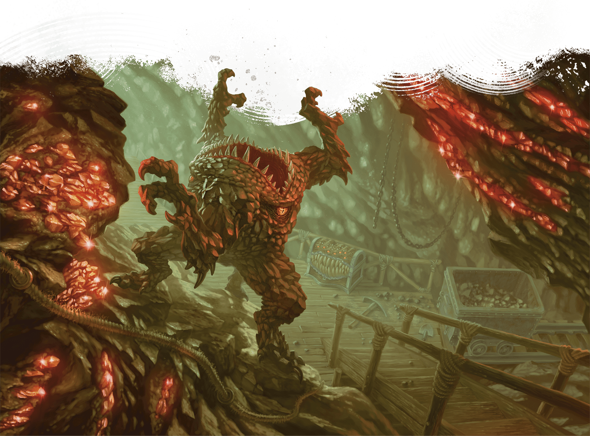](../assets/illustrations/01-010.xorn-in-pyarados-mine.png)

A xorn wanders through a mine in Pyarados.

#### City of Pyarados

The largest city on the Thazarim River is Pyarados, the tharch’s capital. Tharchion Mevik Sasvar, who resides here, encourages Red Wizards to invest in mines and work their laborers as hard as they wish. Many Red Wizard investors spend significant time and money in the city, which boasts the best gambling houses in the nation. To free their time for gambling, these Red Wizards often hire adventurers to scout new mining locations or investigate troubled operations.

### Surthay

The tharch of Surthay is a backwater in multiple senses. The Surmarsh lies within its bounds, and settlements in the area are sparse. Once an important front against neighboring Rashemen, Surthay now languishes with little income or attention from political powers.

#### City of Surthay

The run-down city of Surthay is the home of Tharchion Vederax Skarsk. The veteran of several skirmishes with Rashemen, the tharchion is unfailingly loyal to Thay and requires all locals to register for at least a year of military service. These troops are garrisoned in the city but regularly foray across the Rashemen border. The zulkirs are beginning to tire of Skarsk’s aggressive antics, although the commander has won some small battles that offset the troops’ regular losses.

#### Surmarsh

A wide, fetid swamp near Lake Mulsantir, the Surmarsh is home to dozens of lizardfolk clans. The marsh is cold and dreary, not to mention outside the reach of the Red Wizards’ weather-affecting magic, so Thay’s leaders have shown little interest in governing the region.

Occasionally, Surthay’s militant tharchion captures lizardfolk who wander out of the Surmarsh and conscripts them. In recent years, the lizardfolk’s anger toward this practice has grown. Lizardfolk leaders Vrill and Xornil Fangbane ([Lizardfolk Sovereigns](https://www.dndbeyond.com/monsters/5195108-lizardfolk-sovereign)) seek to unite the marsh’s clans for an assault on the city of Surthay. The tharchion doesn’t take this threat seriously, but should Vrill and Xornil succeed, thousands of angry lizardfolk would descend on the city.

### Thaymount

Loïc Canavaggia, Helge C. Balzer
[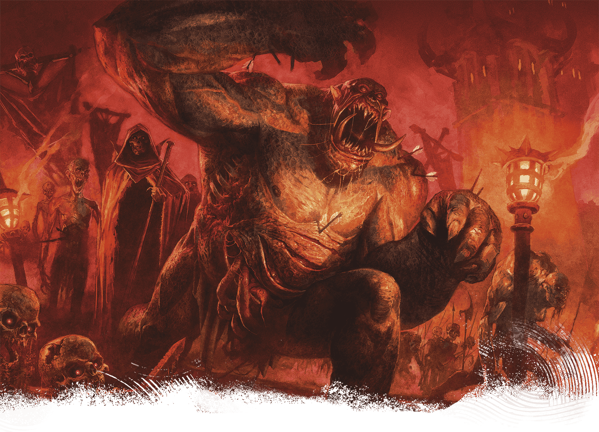](../assets/illustrations/01-011.dread-legion.png)

The Dread Legion includes all manner of undead, including this ogre zombie.

Thaymount is the nation’s highest plateau, atop which stands a chain of volcanic mountains. Szass Tam, zulkir of necromancy (see [appendix B](../../appendix-b-bestiary/chapter.md#SzassTam)), rules here as tharchion.

Traveling to Thaymount uninvited is forbidden to all but the nation’s highest-ranking Red Wizards and their entourages. Permanent, layered spell effects enforce this travel ban, though some clever mages still figure out ways to circumvent the restrictions. See “[Magic on Thaymount](../../chapter-06-precipice-of-oblivion/chapter.md#MagicOnThaymount)” in chapter 6 for more about the tharch’s spell effects.

Thay’s most prestigious Red Wizards maintain private fortresses here, and each zulkir owns several facilities. Some run magic item factories staffed with undead. Others conduct unspeakable magical experiments involving heinous creatures from the Lower Planes.

Below Thaymount wind abandoned mines dating from Thay’s Mulhorandi era, some of which connect to the Underdark. The mines crisscross subterranean highways and complexes that belonged to an ancient empire of snakelike people called sarrukhs (see [appendix B](../../appendix-b-bestiary/chapter.md#Sarrukhs)).

#### The Citadel

Situated in the middle of Thaymount, the sprawling, mostly underground Citadel predates the Thayan nation by thousands of years. Believed to have been constructed by sarrukhs, the Citadel is now Szass Tam’s personal fortress. Here he hatches schemes hidden from his rivals in Eltabbar and conducts rituals and research that, if successful, could bring the entire nation under his thumb. However, the vast Citadel holds many secrets, and even Szass Tam doesn’t know what lurks in its deepest lairs.

Outside the Citadel, Szass Tam garrisons his Dread Legion (described earlier in this chapter).

#### Szul

A small collection of luxury estates, Szul is the only location providing any hospitality in Thaymount. It is also the only place not cloaked in the spell effects that prevent teleportation and other magical incursions into Thaymount. But Szass Tam has placed permanent Abjuration effects in Szul to ensure he’s aware of everyone who arrives here.

The powerful Red Wizards who maintain private facilities in Thaymount occasionally invite non-spellcasters or foreign dignitaries to Szul to discuss lucrative contracts or illicit deals. Widely considered the most impressive and exclusive resort in Thay, Szul includes private feast halls, spas, and facilities where all manner of unsavory entertainment can be found.

Szul also serves as Thaymount’s political capital, as Szass Tam sometimes visits the Red Hall—a tower built inside a small caldera—to announce rulings he has made as tharchion.

### Thazalhar

Andrey Kuzinskiy
[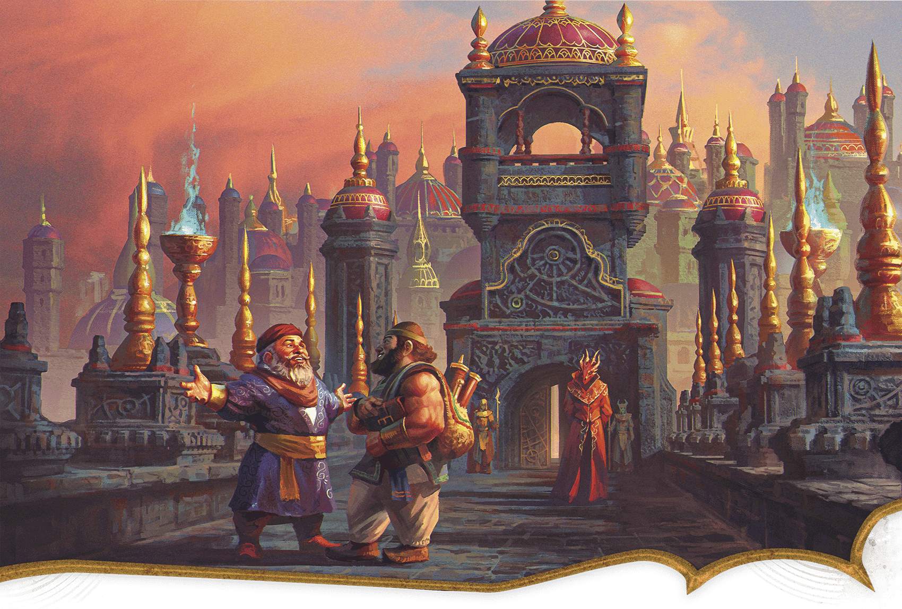](../assets/illustrations/01-012.the-thay-crossing-bridge.png)

Two Mulhorandi merchants on the Thay Crossing bridge chat while a Red Wizard looks on.

In Thay’s earliest days, its second smallest tharch, Thazalhar, served as a bulwark against incursions from Mulhorand. Now, Thazalhar’s liveliest feature is the road that trade caravans use to travel between the two nations. Just inside Thay’s border, a bridge known as Thay Crossing serves as a checkpoint where Red Wizards inspect the cargo of passing merchants. Mulhorandi traders are taxed heavily, though the cost is worthwhile for merchants traveling to bustling Bezantur.

#### Thazalhar Station

Just a few miles from Thay’s border lies Thazalhar Station, a former tax station converted into a governance building. The station also serves as border control, meticulously checking the paperwork of all non-Thayans passing through.

Tharchion Jynnril, a veteran of many border conflicts, steers Thazalhar’s government with a steady hand. The deeply patriotic tharchion keeps a small army garrisoned at the station. Most of these soldiers are borrowed from more powerful tharchs; experience under Jynnril’s command is considered a badge of honor throughout Thay due to her rigor.

### Tyraturos

The High Road crisscrosses the tharch of Tyraturos. Tyraturos is Thay’s most populous tharch, as cities and towns have cropped up all along the road and beyond. Ankhur, Belizir, Delabbar, and Hurkh are the largest cities, with smaller towns including Mothur, Nuthretos, Sekelmur, Solzepar, Surag, Thazrumaros, and Zolum. A wide array of folk people both its settlements and its rural areas, which sometimes face incursions by bands of centaurs and lamias.

#### City of Tyraturos

The tharch’s economic hub and capital is the city of Tyraturos, where Tharchion Bulgor Ograzep rules. Once captain of an infamous band of highway thieves, Ograzep was named tharchion after renouncing his criminal ways—and bribing powerful Red Wizards. He then cracked down on crime, making the city much safer for visitors.

Tyraturos is known as the city with a hundred taverns. Any individual with coin is welcome here, and many travelers seek to hire adventurers for their get-rich-quick schemes. The Red Wizards encourage all business, as long as it’s declared for tax purposes.

## Eltabbar, Thay’s Capital

Gerralt Landman
[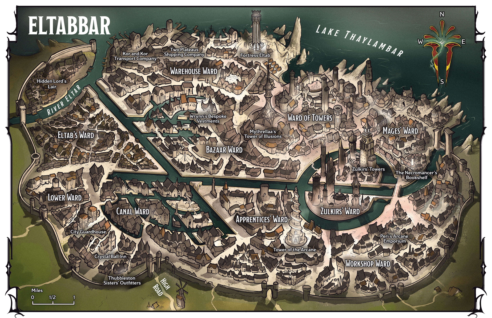](../assets/maps/mj/map-01-02.eltabbar.png)

Map 1.2: Eltabbar [View Player Version](../assets/maps/players/map-01-02.eltabbar-player.png)

Eltabbar is both Thay’s capital and its second-largest city. The settlement is relatively young, having grown from a hamlet of fisher people into a haven for mages after Thay achieved independence.

Eltabbar is an urban hub where the most powerful Red Wizards maintain at least one residence. The city is a center for magic: magical research, magic item production, and magical marketplaces. Eltabbar’s warehouses hold shipments of magic items bound for destinations across Faerûn. Eltabbar is also a city of extreme poverty. Laborers live in hovels, increasingly pinched by the landlords whose greed makes their lives miserable.

### Eltabbar in Play

The following sections will help bring Eltabbar to life during your games. When the characters are adventuring in Eltabbar during Operation Deadfall, the campaign in this book, show them the city’s map and describe any locations they might want to visit. For instance, the characters might want to stay at the Crystal Ball Inn or buy gear at Thubbleston Sisters’ Outfitters, both described in “Lower Ward.”

During any game set in Eltabbar, consider creating encounters at the places described below. See “Adventures in Eltabbar” later in this chapter for more inspiration.

### City Overview

Everyday life in Eltabbar is intrinsically tied to the city’s dark history and the rule of the Red Wizards.

#### Demonic Legacy

The odd layout of Eltabbar’s streets, canals, and catacombs harkens to a dark legacy. While the region was under Mulhorandi rule, Eltabbar’s founders discovered a hidden pocket of the [Abyss](https://www.dndbeyond.com/sources/dnd/dmg-2024/cosmology#Abyss) inhabited by a demon lord named Eltab. They allied with Eltab against the Mulhorandi, and the demon’s aid was invaluable for winning independence, but later, the Red Wizards proved unable to banish the demon.

The mages instead constructed facets of the city to form intricate glyphs, binding the demon lord in an underground prison. Eltab has long since escaped these bonds and fled the region, but marks of Eltab’s imprisonment remain.

To this day, Eltabbar’s extensive catacombs roil with the demon lord’s chaotic energies, creating a vast wild magic zone (see “Environmental Effects” in the [Dungeon Master’s Guide](https://www.dndbeyond.com/sources/dnd/dmg-2024/dms-toolbox#EnvironmentalEffects)) beneath the city. Aberrations and demons are drawn to the area’s latent Abyssal energies. As a result, few city residents dare venture into the catacombs.

#### City Government

The day-to-day government of Eltabbar falls to Tharchion Zedivek Mazradash, who serves Mythrellaa, the zulkir of illusion.

***Crime and the City Watch.*** As in all Thayan cities, Red Wizards have authority in Eltabbar to impose their own punishments for any crimes they witness. When no Red Wizards are present, Eltabbar’s City Watch handles crime reports and responds to crimes in progress. Watch members are posted at city entrances and are equipped with magic that allows them to communicate with the military in Fortress Eltab (see “[Warehouse Ward](../chapter.md#WarehouseWard)” below) in case of invasion.

When not responding to crimes, small watch groups patrol the city, imposing fines of up to 250 GP on those caught brawling, picking pockets, robbing shops, or committing worse crimes. Those unable or unwilling to pay their fines are sent to the City Guardhouse for harsh judgment. As a result, most citizens prefer to deal with crime on their own rather than involve the watch.

Roll on or choose a result from the City Watch Encounters table to generate encounters for a party of any level traveling around Eltabbar.

#### City Watch Encounters

| 1d4 | Encounter |
| --- | --- |
| 1 | Four watch [Guards](https://www.dndbeyond.com/monsters/5195065-guard) chase a [Bandit](https://www.dndbeyond.com/monsters/5194915-bandit) toward a waiting [Guard Captain](https://www.dndbeyond.com/monsters/5195064-guard-captain). |
| 2 | Three watch captains ([Warrior Veterans](https://www.dndbeyond.com/monsters/5195260-warrior-veteran)) order those in the street to make way for a Red Wizard’s entourage. |
| 3 | Two [Mage Apprentices](https://www.dndbeyond.com/monsters/5195109-mage-apprentice) are engaging in a dangerous spell duel on a crowded street. Two watch [Guards](https://www.dndbeyond.com/monsters/5195065-guard) and a captain ([Warrior Veteran](https://www.dndbeyond.com/monsters/5195260-warrior-veteran)) call for any nearby Red Wizards to help while they struggle to separate the mages. |
| 4 | A Red Wizard’s assistant ([Noble Prodigy](https://www.dndbeyond.com/monsters/5195144-noble-prodigy)) loudly denies accusations of shoplifting from a merchant; three watch [Guards](https://www.dndbeyond.com/monsters/5195065-guard) threaten to fine the merchant for interfering with a Red Wizard. |

#### Political Hub

Politics is a way of life in Eltabbar. Thay’s eight zulkirs keep residences here, and the Zulkirs’ Ward houses meeting spaces where decisions about the nation’s governance are made. Occasionally, the zulkirs make grand announcements—public spectacles that use layered castings of powerful spells. For instance, this might involve an enormous illusion of the zulkir flying amid the city’s spectacular towers, with fireworks in the shape of the Red Wizards’ symbol punctuating their booming speech.

Even the lowest-ranking Red Wizards play political games in Eltabbar. Whether through commerce, alliances with other Red Wizards, or sycophancy to a zulkir, they ceaselessly work to increase their standing. Most hope to become an adviser to a zulkir, although some Red Wizards seek to become the appointed leader of a Thayan enclave or a high-ranking member of the Guild of Foreign Trade.

### Eltabbar’s City Wards

Eltabbar is divided into ten wards.

#### Apprentices’ Ward

The Apprentices’ Ward is filled with grand libraries and reading rooms alongside the homes of noble scions and wealthy Red Wizard apprentices. Colorful, magical lights dot the ward’s buildings and gardens, and the chatter of young mages echoes at all hours.

***Tower of the Arcane.*** The Apprentices’ Ward is home to the Tower of the Arcane, the only magic academy in Eltabbar. Although most mages learn spellcraft by apprenticing to Red Wizards, this elite and expensive academy teaches basic magic as well as a robust curriculum of art, literature, and history with a healthy side of Thayan propaganda.

Head teacher Elsa Tor (Medium [Noble Prodigy](https://www.dndbeyond.com/monsters/5195144-noble-prodigy)), an elf and scion of a powerful family of illusionists, insists that the education and dignified demeanor her students learn set them up for a lifetime of success among the Red Wizards’ ranks. Top graduates are guaranteed apprenticeships with high-ranking Red Wizard alumni. The academy’s highest performers must watch for assassination attempts by fellow students competing with them for apprenticeships.

#### Bazaar Ward

Eltabbar’s city center boasts Thay’s largest open-air marketplace. Sprawled across several canals, the Bazaar Ward offers delectable goods kept fresh with magic, as well as supplies fit for the homes of the most powerful Red Wizards. The first day of the month, the city requires vendors to replace their stock with new goods. As a result, Market First Days are famous in Eltabbar, and elite residents attend to see and be seen.

Surrounding the bazaar’s open-air stalls are high-end storefronts, from fashion houses, tailors, and cobblers to fantastical restaurants, spas, and hotels. After a long day of politics and governing, powerful Red Wizards relax in these spaces, making evenings a key time for hopeful apprentices and artisans to hobnob with the elite.

***Wrynn’s Bespoke Vestments.*** One of Eltabbar’s oldest and most respected tailors, Wrynn’s Bespoke Vestments outfits powerful Red Wizards and wealthy visitors. Wynston Wrynn (Medium, Neutral Good [Spy Master](https://www.dndbeyond.com/monsters/5195216-spy-master)), a human and the shop’s seventh-generation owner, secretly works for [Zulkir Xelnene Thrul](../../appendix-b-bestiary/chapter.md#XelneneThrul). Wrynn’s Bespoke Vestments is further detailed in [chapter 3](../../chapter-03-operation-deadfall/chapter.md#WrynnsBespokeVestments).

#### Canal Ward

Largely residential, the Canal Ward is home to merchants who work in the bazaar as well as the staff members of the city’s elite. The Red Wizards look down on this district, as most of its residents aren’t mages, but the streets here are clean and safe.

#### Eltab’s Ward

The most desolate section of the city, Eltab’s Ward, sits directly above the underground prison that once held the demon lord of the same name. This ward is packed with cramped apartment buildings owned by landlords in service of Red Wizards who wring as much money as possible from their renters. A few ramshackle taverns and gambling dens are crammed between tenements. Most who live here experience generational poverty and work odd jobs in the Warehouse Ward. Crime is rampant, and any resident who claims to have fleeced a Red Wizard enjoys folk hero status.

***Hidden Lord’s Lair.*** The Hidden Lord’s Lair is a grimy tavern that leans into the area’s association with the demon lord Eltab, who’s also known as the Lord of the Hidden Layer. Tavernkeeper Xulfer (Medium, Chaotic Evil [Cultist Hierophant](https://www.dndbeyond.com/monsters/5194955-cultist-hierophant)), a tiefling, claims to descend from the Thayans who allied with Eltab. Xulfer leads a gang called Children of Eltab, whose members pickpocket travelers and rough up those who display loyalty to the ruling mages.

#### Lower Ward

Sandwiched between the homes of wealthy merchants and slums, the Lower Ward is mostly home to middle-class laborers. This ward also holds the highest concentration of long-term accommodations for visitors from throughout Thay and beyond, including merchants, mercenaries, and less-successful Red Wizards. The inns and taverns lining the ward’s southern streets, which lie near the High Road, cater to all manner of visitors, including adventurers.

***City Guardhouse.*** The headquarters of Eltabbar’s City Watch, the city guardhouse also houses a jail for accused criminals awaiting judgment. Red Wizard and Watch Commander Renatta Vott (Medium, Lawful Evil [Mage](https://www.dndbeyond.com/monsters/4831023-mage)), a human, heads the watch and hands down punishments for the accused.

Occasionally, a defendant can convince Vott of their innocence. More often, the watch commander pronounces suspects guilty. Punishments usually involve sentences of labor in magic item–production or shipping facilities owned by Red Wizards who have generously agreed to rehabilitate criminals. Failure to complete a sentence of labor or obey the Red Wizards results in death.

***Crystal Ball Inn.*** The city’s most popular inn, the Crystal Ball Inn is also one of the cheapest, providing Modest accommodation for 1 SP per day. A meal at the inn’s tavern costs 1 CP. Large groups of travelers stay here, as well as foreign spellcasters, making the inn an ideal place for adventurers to purchase spellcasting services from someone who isn’t a Red Wizard. The inn’s folksy proprietor, a human named Syle Gur (Medium [Guard Captain](https://www.dndbeyond.com/monsters/5195064-guard-captain)), is retired from the City Watch and simply wishes to run a modest business in peace. Jaded from the cruelties he witnessed as a member of the watch, Gur secretly holds no love for the Red Wizards. The innkeeper pays substantial taxes to ensure the mages leave his clientele alone.

***Thubbleston Sisters’ Outfitters***. Located near the Crystal Ball Inn, Thubbleston Sisters’ Outfitters provides equipment to adventurers and mercenaries. Weapons, armor, tools, and adventuring gear listed in the [Player’s Handbook](https://www.dndbeyond.com/sources/dnd/phb-2024) are available here. Proprietors Felda and Glenora Thubbleston (Small [Nobles](https://www.dndbeyond.com/monsters/5195145-noble))—the shop’s titular sisters—are gnomes from a prominent merchant family. Having failed at previous business ventures, the gnome sisters recently started this shop for adventurers who need equipment other than magic items.

#### Mages’ Ward

Home to powerful Red Wizards and local leaders, the Mages’ Ward boasts gleaming mansions, busy scribes’ workshops, and high-end magic shops catering to power-hungry spellcasters. The Red Wizards who live and work here aren’t the wealthiest or most imposing in the nation, but most are determined to rise to those ranks. Street crime is nonexistent here, but the murder of mages is common as ambitious Red Wizards sneakily pick off their rivals.

***The Necromancer’s Bookshelf.*** The Necromancer’s Bookshelf is a subterranean bookshop that stretches across six basements, each deeper than the last. The shop’s top three floors sell the largest array of tomes about necromancy in Thay. The shop’s bottom three floors are closed to the public but are available for Red Wizards to rent for private study groups or experiments. These rental spaces, each of which includes an enormous crypt complete with hundreds of corpses, start at 10 GP per hour. Shopkeeper Vellis Vant ([Ghast Gravecaller](https://www.dndbeyond.com/monsters/5195006-ghast-gravecaller)), a former human whose experiments with lichdom failed, asks no questions of customers.

#### Ward of Towers

The densest site of magical research in Thay, the Ward of Towers is home to impressive magical facilities where Red Wizards and their assistants develop new spells and rituals.

***Mythrellaa’s Tower of Illusions.*** Famously run by Zulkir Mythrellaa’s Red Wizard associates during her time away from Thay, the Tower of Illusions is one of the tallest spires in Eltabbar. It’s said to hold secrets of illusion magic unknown to most scholars, including ways of layering illusions over several city blocks and crowds of hundreds. Mythrellaa rarely appears here, preferring to allow her ally Hezrexen ([Arcanaloth](https://www.dndbeyond.com/monsters/5194899-arcanaloth)) to spearhead the research conducted in the facility.

#### Warehouse Ward

Sylvain Sarrailh
[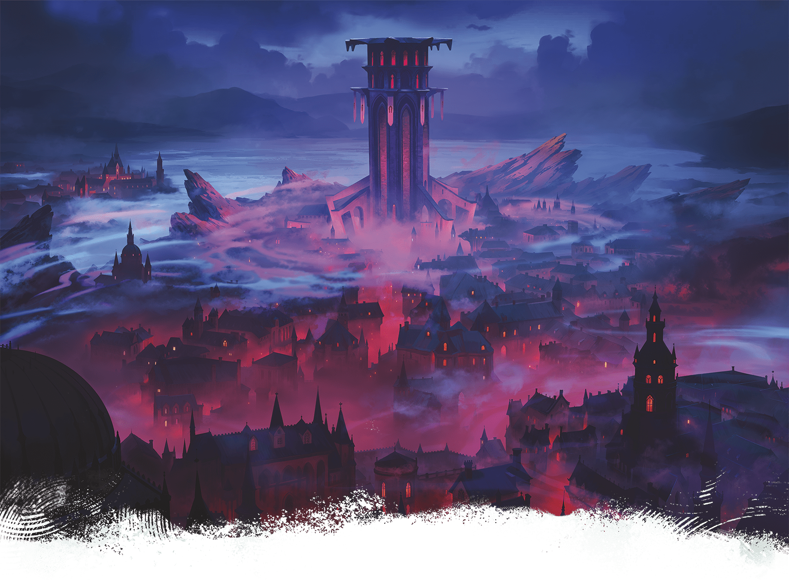](../assets/illustrations/01-013.fortress-eltab.png)

Fortress Eltab stands ominously on the shores of Lake Thaylambar.

Eltabbar’s bustling shipping district, the Warehouse Ward houses the city’s enormous volume of imports and exports. Warehouses stretch along Lake Thaylambar’s shore, which hosts docks for barges and merchant ships alike. An enormous volume of magic items passes through this district. The Guild of Foreign Trade operates most of the shipping and cargo companies here; the companies take bribes from Red Wizard business magnates to speed up or slow down shipments.

***Kor and Kor Transport Company.*** Red Wizard human cousins Elton and Nestor Kor (Medium [Mages](https://www.dndbeyond.com/monsters/4831023-mage)) run an eponymous transport company, which brings supplies from the lake’s shore down Eltabbar’s canals and into the eastern city wards. The brothers handle the transport of imported culinary delicacies, wine, and exotic meats. No fan of the zulkirs, the cousins are happy to help smuggle anyone into the Zulkirs’ Ward, Mages’ Ward, or Ward of Towers in exchange for coin or interesting magical lore.

***Fortress Eltab.*** The imposing Fortress Eltab garrisons the tharch’s military, which protects commercial shipments headed into and out of the port. Up-and-coming Red Wizards and their Thayan knights serve in this force as officers, inspecting shipments to ensure all taxes and import fees are properly paid. The force also includes troops armed with crossbows, who occasionally patrol the lake in small boats to keep its waters free from monsters. Commanded by Zedivek Mazradash, the vampire tharchion, this versatile fighting force is prepared to deploy at a moment’s notice against forces threatening the city or tharch’s borders.

***Two Plateaus Shipping Company.*** A bustling export company, the Two Plateaus Shipping Company ships large quantities of magic items for Red Wizards to customers around Thay and Faerûn. Famous for its speed and efficiency, the company holds lucrative contracts with some of Thay’s most powerful Red Wizards. Owner Iskan Iskari, a [Rakshasa](https://www.dndbeyond.com/monsters/5195178-rakshasa) disguised as a bald, bearded human man, conceals illegal activities behind his company’s operations. Two Plateaus Shipping Company is further detailed in [chapter 3](../../chapter-03-operation-deadfall/chapter.md#TwoPlateausShipping).

#### Workshop Ward

The industrial Workshop Ward is home to the city’s facilities for fabricating magic items. Most shops are owned by Red Wizards who are powerful merchants or members of the Guild of Foreign Trade, although a few are owned by out-of-towners or non-spellcasters who understand the value of Thay’s magic item trade. The ward also contains a handful of facilities where [Spell Scrolls](https://www.dndbeyond.com/magic-items/9229085-spell-scroll) are scribed before they’re sent to the Bazaar Ward to be sold.

***Peri’s Arcane Emporium.*** The owner of this industrious shop, a human and Red Wizard named Peri Po (Medium, Lawful Evil [Archmage](https://www.dndbeyond.com/monsters/5194902-archmage)), makes a fortune selling obscure magical devices made to order. The shop might also have nearly any magic item in stock.

#### Zulkirs’ Ward

The spires of the Zulkirs’ Ward’s magnificent buildings, each topped with beautiful, magical decorations such as illusory waterfalls or strangely colored gardens, are among the most breathtaking sites in Thay. Each member of Thay’s ruling council owns at least one home here. Suspended in the sky between buildings are elaborate meeting spaces, where bureaucrats who report to zulkirs jockey for power and plot Thay’s future.

***Zulkirs’ Towers.*** Zulkirs rarely meet in person, but when they do, they congregate in an elaborate complex of towers. The towers contain sprawling offices for the zulkirs’ expansive entourages, elaborate chambers for meetings between zulkirs, and spaces for the creation of doors to demiplanes where rulers can meet in near-absolute privacy.

At the towers’ center is the Grand Chamber, an ostentatious space draped in Thayan iconography. Here, the zulkirs gather to make infrequent official announcements, which scribes record and distribute throughout the nation.

### Adventures in Eltabbar

Roll on or choose a result from the Eltabbar Adventures table to inspire ideas for games set in the city.

#### Eltabbar Adventures

| 1d4 | The Characters Must… |
| --- | --- |
| 1 | Retrieve a strange magical device from the [Necromancer’s Bookshelf](../chapter.md#MagesWard) for their Red Wizard patron. |
| 2 | Recover a missing shipment of magic items for their merchant patron, who suspects the stolen shipment is hidden in [Two Plateaus Shipping Company](../chapter.md#WarehouseWard). |
| 3 | Recover their Red Wizard patron’s magical research, which was stolen by a rival and hidden in a spire in the [Ward of Towers](../chapter.md#WardOfTowers). |
| 4 | Break out an innocent friend from the [City Guardhouse’s jail](../chapter.md#LowerWard). |
