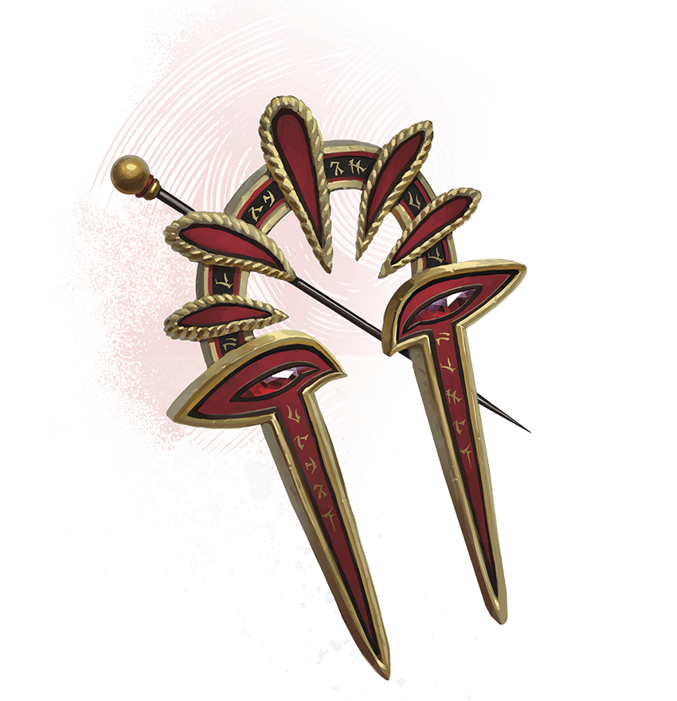

<!-- Notes MJ : contenu fourni par l’utilisateur, non destiné au partage public. -->

## Red Wizards

Thay is governed by Red Wizards: ambitious mages who believe their destiny is to rule the world and subjugate it to their whims.

### Who Are Red Wizards?

Red Wizards are mighty mages who command fear from those less powerful than them. They are granted broad leeway to act however they see fit to promote Thay’s economic and military power.

Red Wizards populate the upper echelons of Thayan society. They are heads of wealthy families, estate owners and operators, political players serving zulkirs, foremost magic scholars, and business magnates. No achievement is out of bounds for a Red Wizard.

### Red Wizard Axioms

Red Wizards are the most notorious and recognizable people in Thay. The general public understands certain defining facts about these mages. Common folk conduct themselves accordingly, hoping to avoid the mages’ wrath.

Swatches Studio

Symbol of the Red Wizards

#### What Thayans Know

Thayans know the following about Red Wizards:

- **They Wear Red.** Red attire is outlawed for anyone else in Thay. Red Wizards also cloak their homes and places of prestige in red, a color that denotes official Thayan business.
- **Their Heads Are Shaved and Tattooed.** Some of these tattoos are decorative and denote family origins or loyalty to a zulkir. Some are magical and boost the mages’ spellpower.
- **They’re Powerful Mages.** Red Wizards are spellcasters who swear loyalty to even more powerful mages of their order.
- **They Demand Obedience.** Red Wizards mete out harsh punishment to those who disobey them. Thay’s common folk avoid interactions with Red Wizards when possible, knowing their world could be overturned at the mages’ whim.
- **They’re Cruel and Self-Centered.** Red Wizards’ demands are often unjust and usually in service to their own schemes, though they might claim to have Thay’s best interest in mind.
- **They Decide What’s Fair.** Red Wizards’ decisions are binding. The only person who can question a Red Wizard is a more powerful Red Wizard.

There are exceptions. Some Red Wizards are benevolent, but common folk can’t afford to assume any Red Wizard isn’t as cruel as a typical member of their order.

#### Red Wizard Hallmarks

Red Wizards conduct themselves according to the following worldview:

- **Red Wizards Are Superior.** Red Wizards believe themselves superior to all others.
- **Common Folk Are Servants.** Red Wizards expect anyone without magical or economic power to obey their commands without question.
- **Personal Ambition Is Paramount.** Red Wizards believe it’s their right to pursue their own power and enrichment as long as they say they’re serving Thay.
- **Loyalty Is Malleable.** Red Wizards swear loyalty to a zulkir and to other powerful Red Wizards. But most would betray that loyalty to increase their own political standing.
- **Supremacy Is Inevitable.** Each Red Wizard believes they have the potential to become a zulkir if they work hard enough and are ruthless enough to seize that title.

Again, there are exceptions—some Red Wizards are loyal to their zulkir, while others put Thay’s interests above their own—but they’re rare.

Thay Timeline

This timeline provides a summary of key events in Thayan history. Dates are in Dalereckoning (DR).

**−1087 DR.** The mage Thayd leads a rebellion against Mulhorand and Unther, seizing the northern provinces of both empires and declaring independence.

**−1081 DR.** Thayd and his conspirators are defeated. The lands revert to the empires’ control.

**922 DR.** Mages who call themselves the Red Wizards, led by Ythazz Buvaar, rebel against Mulhorand. The Red Wizards sack the imperial city of Delhumide, and Thay is born.

**934 DR.** The Red Wizards and their armies invade Rashemen, attempting conquest, and fail.

**976 DR.** Mulhorand launches a failed attempt to regain control of Thay.

**1030 DR.** Thay’s most powerful mages, each specializing in a different school of magic, form a council. They call themselves zulkirs and declare joint rule of Thay.

**1074 DR.** The zulkirs crush opposition to their rule in Thay. The Red Wizards acknowledge the ruling zulkirs; each Red Wizard declares loyalty to one or more zulkirs.

**1157 DR.** The human archmage Szass Tam assassinates the vampire zulkir of necromancy, Nyressa Flass, and is named her successor.

**1159 DR.** Szass Tam becomes a lich.

**1344 DR.** The Guild of Foreign Trade creates the first Thayan trade enclave in the city of Procampur in northern Faerûn.

**1375 DR.** Open conflict between the zulkirs embroils Thay in civil war. Szass Tam seizes control of Thay and names himself regent.

**1478 DR.** Szass Tam begins a ritual to attain godhood but fails. The zulkir council is reestablished, and mages who practice all schools of magic again vie for political power.

**1501 DR.** Current date.

### Becoming a Red Wizard

The title of Red Wizard can’t simply be claimed—it must be officially bestowed by an established Red Wizard who trains aspiring mages. Youngsters with magical aptitude from prominent Thayan families are certain to secure an apprenticeship with a Red Wizard, while less-privileged youth go to great lengths to impress a Red Wizard and earn an apprenticeship.

Most aspirants specialize in one school of magic, hoping to rise in power and prestige through their chosen specialization. When they receive their title, Red Wizards declare loyalty to one or more zulkirs, although the sincerity of their oaths varies.

#### Training

Most apprentices become Red Wizards after five years of training. However, Red Wizard masters set their own timelines. Some apprentices become Red Wizards in only a few years; others take a decade or more to earn their red robes. Still others never become Red Wizards and are dismissed from their apprenticeship or sentenced to harsh punishment—even death—for their perceived incompetence.

#### Hierarchy

Junior Red Wizards are referred to as apprentice Red Wizards by their more established peers until their deeds earn them sufficient prestige. Most Red Wizards are called masters, while the most senior Red Wizards are called sages.

#### Non-Thayan Red Wizards

It’s rare, but a Red Wizard might accept an apprentice born outside of Thay if the mage sees enough potential in them. For example, mercenary mages from outside Thay’s borders may apprentice under a Red Wizard after completing at least three jobs for that mage. Such apprentices must work harder and longer to impress their Red Wizard master.

### Red Wizards Schemes

Red Wizards scheme to attain more political power and magical might. Pursuing these goals often puts Red Wizards at odds with adventurers, especially since Red Wizards think nothing of harming innocents to achieve their ends.

Unraveling a Red Wizard’s scheme before identifying the mage as the villain and defeating them can make a great campaign arc. When using a Red Wizard villain, roll on or choose a result from the Red Wizard Motivations table to inspire the villain’s goal.

#### Red Wizard Motivations

| 1d6 | The Red Wizard Wants ... |
| --- | --- |
| 1 | A hated rival to die spectacularly, but the Red Wizard can’t be seen as involved. |
| 2 | To inherit their master’s lands, but their master has six heirs. |
| 3 | To publicly assassinate a disgraced Red Wizard, but the target’s security is too strong. |
| 4 | To gain the respect and mentorship of a zulkir, but the zulkir dislikes them. |
| 5 | To train the children of a prominent Red Wizard, but the children are promised as apprentices to another. |
| 6 | To eliminate a rival’s business, but the rival is a more powerful Red Wizard. |

### Thayan Knights

Many high-ranking Red Wizards command one or more Thayan knights: highly trained warriors sworn to protect Thay’s elite. Red Wizards or their families typically arrange for the training of the Thayan knights who serve them.

A Thayan knight serves a Red Wizard for life. Should a Red Wizard die before their knight, the Red Wizard’s family decides whether the Thayan knight must serve another Red Wizard or is released from service.

Like Red Wizards, Thayan knights usually sport shaved heads and tattoos, though they wear armor and wield swords, shields, or similar gear. Thayan knights are knowledgeable about magic, and some use spells to augment their skills on the battlefield.
