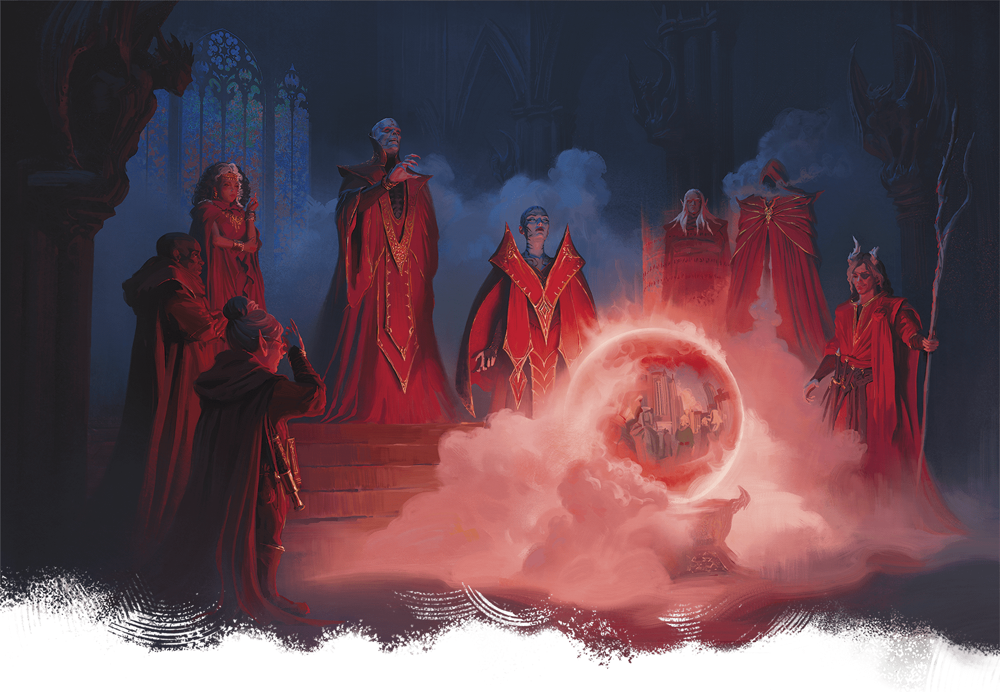

<!-- Notes MJ : contenu fourni par l’utilisateur, non destiné au partage public. -->

## Council of Zulkirs

The zulkirs are the highest-ranking Red Wizards. They form the Council of Zulkirs, Thay’s ruling body, which makes decisions related to the nation’s commerce and warfare. The council delegates other matters of governance to Thay’s vast bureaucracy (see “[Government](../chapter.md#Government)” later in this chapter).

Publicly, the zulkirs claim their goals align, though most are more interested in advancing their own interests than in the country’s well-being. Clandestine clashes among the zulkirs are common, but none relish a return to the time when civil war raged among the council.

Zulkirship is hard-earned. When a zulkir position opens, the council votes on a replacement selected from the top tier of Red Wizards, usually choosing the mage who bested the previous zulkir—whether through political guile or assassination.

### Zulkirs’ Resources

Thay’s zulkirs accumulate enormous resources prior to ascending to the council. All have numerous streams of income, often from finding or creating and later selling magical treasures. The zulkirs each own at least one home in the Zulkirs’ Ward in [Eltabbar](../chapter.md#Eltabbar), Thay’s capital city, and in [Thaymount](../chapter.md#Thaymount), where protective magic helps them keep their biggest secrets away from prying eyes. Zulkirs also maintain legions of staff, soldiers, and other servants.

### Zulkir Descriptions

Bubble Cat Studio

Shown Clockwise from Left: Zulkirs Lethnar, Delraz, Mythrellaa, Szass Tam, Xelnene Thrul, Yazir Nym, Nzas, and Nevron

The current zulkirs are summarized in the Zulkirs by School of Magic table and further described below. Each zulkir references a stat block in [Arcana Unleashed](https://www.dndbeyond.com/sources/dnd/au/chapter-6-magical-creatures#Archmages) or [appendix B](../../appendix-b-bestiary/chapter.md). Use the [Archmage](https://www.dndbeyond.com/monsters/5194902-archmage) stat block if those stat blocks aren’t available.

#### Zulkirs by School of Magic

| School | Zulkir |
| --- | --- |
| Abjuration | Yazir Nym |
| Conjuration | Nevron |
| Divination | Lethnar |
| Enchantment | Delraz |
| Evocation | Xelnene Thrul |
| Illusion | Mythrellaa |
| Necromancy | Szass Tam |
| Transmutation | Nzas |

#### Delraz

*Zulkir of Enchantment*

**Species:** Human

**Stat Block:** Medium [Enchanter Archmage](https://www.dndbeyond.com/monsters/6719571-enchanter-archmage)

**Alignment:** Lawful Evil

**Personality Traits:** Conniving and manipulative

**Primary Ambition:** Steal wealth from non-mages

Delraz upholds Thay’s strict, traditional sense of order in which Red Wizards can act with impunity. He levies heavy taxes against Thayan merchants, believing their businesses’ existence depends on the Red Wizards. The zulkir keeps most of this revenue, using mind-bending magic to influence any who would oppose him.

#### Lethnar

*Zulkir of Divination*

**Species:** Gnome

**Stat Block:** Medium [Diviner Archmage](https://www.dndbeyond.com/monsters/6719570-diviner-archmage)

**Alignment:** Lawful Neutral

**Personality Traits:** Practical and merciless

**Primary Ambition:** Punish illegal magic use

Lethnar is obsessed with enforcing Thay’s labyrinthine laws concerning the use of magic by anyone other than Red Wizards. In the city of [Bezantur](../chapter.md#Bezantur), Lethnar oversees a criminal court where Red Wizards the gnome selects try those accused of breaking these laws, issuing harsh punishments. In recent years, Lethnar has pushed to try more Thayans throughout the country. Many Red Wizards believe Lethnar created the court to avert a future the zulkir foresees for themself in their divinations.

#### Mythrellaa

*Zulkir of Illusion*

**Species:** Human

**Stat Block:** Medium [Illusionist Archmage](https://www.dndbeyond.com/monsters/6719576-illusionist-archmage)

**Alignment:** Chaotic Evil

**Personality Traits:** Calculating and devious

**Primary Ambition:** Become Thay’s regent

Mythrellaa first claimed this zulkirship two hundred years ago but was believed killed when rivals assaulted her tower in [Bezantur](../chapter.md#Bezantur). In reality, she spent the next century in the [Shadowfell](https://www.dndbeyond.com/sources/dnd/dmg-2024/cosmology#Shadowfell) learning powerful arcana, including illusions that drain mages’ spellpower and funnel it to her. Mythrellaa recently returned and reclaimed her zulkirship; she plots to use the arcana she learned to overthrow the council and claim Thay’s regency.

#### Nzas

*Zulkir of Transmutation*

**Species:** Human

**Stat Block:** Medium [Transmuter Archmage](https://www.dndbeyond.com/monsters/6719583-transmuter-archmage)

**Alignment:** Chaotic Evil

**Personality Traits:** Mysterious and ominous

**Primary Ambition:** Command an invincible army

Nzas veils herself in shadows that conceal her visage and is renowned for her ability to alter the physical forms of herself and others. She frequently transforms her limbs into tentacles, bone spurs, or hooks, enabling her to swiftly execute those who offend her. Nzas garrisons an army in the city of Bezantur, and recently she has discovered how to imbue her soldiers with supernatural strength and resilience. She researches a way to make these enhancements permanent so she can become the most militarily powerful zulkir.

#### Nevron

*Zulkir of Conjuration*

**Species:** Tiefling

**Stat Block:** Medium [Conjurer Archmage](https://www.dndbeyond.com/monsters/6719568-conjurer-archmage)

**Alignment:** Neutral Evil

**Personality Traits:** Contemptuous and malicious

**Primary Ambition:** Become the strongest zulkir

Two decades ago, Nevron was a powerful human diabolist and the zulkir of conjuration. When Szass Tam killed him for joining the other zulkirs’ failed attempt to overthrow the lich, Nevron made a pact in the Abyss with a mysterious demon lord and returned to Thay as a tiefling. He worked his way back into power thanks to his ability to quickly summon and command fiendish allies. Nevron seeks ever more fiendish power, hoping to force Thay’s other zulkirs to serve him.

#### Szass Tam

*Zulkir of Necromancy*

**Species:** Formerly human, now a lich

**Stat Block:** See [appendix B](../../appendix-b-bestiary/chapter.md#SzassTam)

**Alignment:** Lawful Evil

**Personality Traits:** Despotic and entitled

**Primary Ambition:** Regain Thay’s regency

The lich [Szass Tam](https://www.dndbeyond.com/monsters/6719633-szass-tam) has lived nearly 400 years. In addition to his zulkirship, he’s the tharchion of Thaymount, the tharch at the nation’s center. He’s open about his belief that he’s superior to the other zulkirs and recently announced his desire to regain regency over Thay. While he insists he has the nation’s best interest at heart, Szass Tam has proven repeatedly that he’d prefer ruling a nation of undead over one with living citizens. He plots to complete a demonic ritual called Malefice Mortum; see [chapter 2](../../chapter-02-thay-in-danger/chapter.md#DemonicRitual) and ["Szass Tam"](../../appendix-b-bestiary/chapter.md#SzassTam) in appendix B for more details.

#### Xelnene Thrul

*Zulkir of Evocation*

**Species:** Human

**Stat Block:** See [appendix B](../../appendix-b-bestiary/chapter.md#XelneneThrul)

**Alignment:** Neutral Good

**Personality Traits:** Pragmatic and shrewd

**Primary Ambition:** Build a more equitable Thay

Though known for her explosive offensive magic, Xelnene Thrul hopes for a better future for Thay’s populace in which the Red Wizards use their magic to enrich and empower all Thayans. She embodies these principles in her council position and as tharchion of Priador. Thrul’s political leadership and magical power make her one of the nation’s most powerful people. Thrul is further detailed in [chapter 3](../../chapter-03-operation-deadfall/chapter.md#PrivateAudience) and [appendix B](../../appendix-b-bestiary/chapter.md#XelneneThrul).

#### Yazir Nym

*Zulkir of Abjuration*

**Species:** Elf

**Stat Block:** Medium [Abjurer Archmage](https://www.dndbeyond.com/monsters/6719566-abjurer-archmage)

**Alignment:** Lawful Evil

**Personality Traits:** Aggressive and sadistic

**Primary Ambition:** Conquer foreign cities

Yazir Nym seeks to bring glory to Thay through his army’s incursions along the nation’s southwest border, where several contested cities lie in a region known as Wizards’ Reach. Known for his potent healing magic and his army’s resilience, Nym is also notorious for capturing enemies and mending their wounds so he can punish them further.
