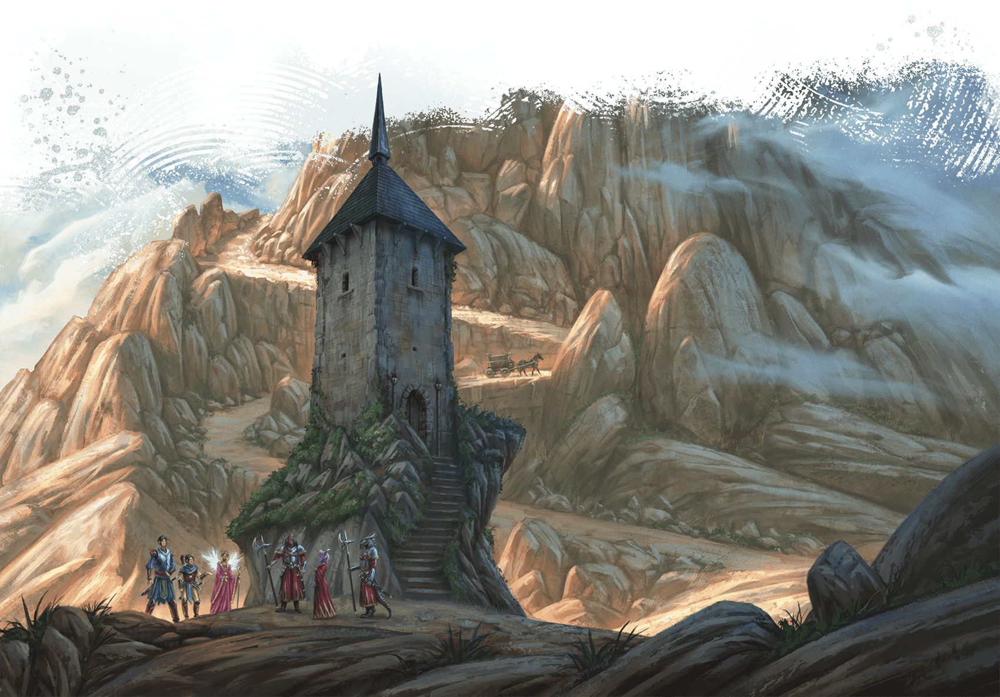

<!-- Notes MJ : contenu fourni par l’utilisateur, non destiné au partage public. -->

### Tax Stations

Small fortresses called tax stations pepper Thay’s border, roads, and internal boundaries. Soldiers at each tax station collect tolls imposed by the controlling tharchion. Tolls vary daily according to a byzantine schedule but are usually 3 SP.

A toll collector might reduce or waive these tolls for travelers with paperwork from a Red Wizard or government official, or in exchange for a service or favor from adventurers. Conversely, corrupt tax collectors might impose “fees” on travelers to line their own pockets. Tolls are never higher than 1 GP.

Álvaro Calvo Escudero

Tax stations such as this one are common throughout Thay.
