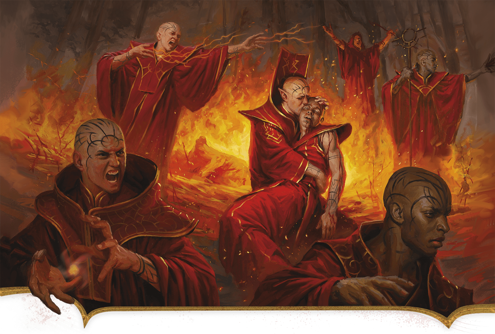

<!-- Notes MJ : contenu fourni par l’utilisateur, non destiné au partage public. -->

## Magical Military

Johan Grenier

Thay’s conflicts with its neighbors cause substantial suffering to all involved.

Thay’s fighting forces boast highly trained spellcasters and mighty warriors. For the impoverished lower class, joining an armed force is the easiest way to guarantee food, shelter, training, and a meager income. As a result, thousands of such folk enlist. Though individual forces rarely include more than a hundred combatants, together, their numbers are formidable.

### Thayan Forces

Thay has numerous military forces, but instead of having a unified command, many are private armies of powerful Red Wizards. Others are commanded by specific tharchions. These armies’ commanders often threaten each other, and sometimes skirmishes break out, though the zulkirs are quick to stifle such conflicts.

#### Private Armies

The zulkirs and other powerful Red Wizards command private armies, raised and garrisoned at their own expense. These armies reflect the magical predilections of their patrons. For example, Red Wizards specializing in Evocation magic command armies that rain down elemental destruction on their enemies, while squadrons led by Illusion specialist Red Wizards might trick their enemies into deadly traps and self-slaughter.

#### Dread Legion

The most famous private army in Thay is the Dread Legion, commanded by [Szass Tam](https://www.dndbeyond.com/monsters/6719633-szass-tam). Garrisoned in Thaymount at the Citadel, where Szass Tam lairs, this terrifying fighting force consists mostly of undead, with only a few living soldiers who have pledged their fealty to the lich. Szass Tam’s legion is commanded by two generals: Slethisz Vendrein and Hazrash Kulmantle (both Medium [Death Knights](https://www.dndbeyond.com/monsters/5194963-death-knight)).

#### Tharchions’ Forces

Most tharchions command their own fighting forces, including in the island tharch of [the Alaor](../chapter.md#TheAlaor), whose shipyards host a formidable navy. Some of these militaries are so powerful that tharchions have single-handedly led invasions of neighboring realms.

### Thayan Aggression

Thay has sought conquest since its earliest days of independence from the Mulhorandi and Unther empires. Although it enjoys a tense but stable trade relationship with the nation of Thesk, its other neighbors rightly consider it a hostile power.

#### Aglarond

The zulkirs have long considered Aglarond a prize from which they might exert control over the entire Sea of Stars. Aglarond’s powerful sorcerers have repeatedly rebuffed Thayan invasions.

A strip of land called Wizards’ Reach along Aglarond’s southern border with Thay is the most contested land in the Thay-Aglarond conflict. Aglarond nominally rules here, but the farther east one goes, the more Red Wizards hold sway.

#### Mulhorand

The people of Mulhorand and Thay regard each other as ancestral enemies. Mulhorand considers Thay a wayward province to be brought back in line. For Thay, conquering its former imperial master would be a crowning achievement. The Sunrise Mountains, however, are a formidable barrier between the two nations, and Thay’s fractured leadership prevents its armies from making a unified assault on Mulhorand. This is fortunate for Mulhorand, which lacks the resources for what would be a costly war.

#### Rashemen

Rashemen and northern Thay have invaded each other dozens of times. Unlike conflicts between Thay and Mulhorand, these invasions stem from outbursts of greed or pride. Thayan leaders covet the wealth flowing from Rashemen’s iron mines, while Rashemen’s aggression against Thay is mostly a matter of individual warriors trying to prove their valor.
