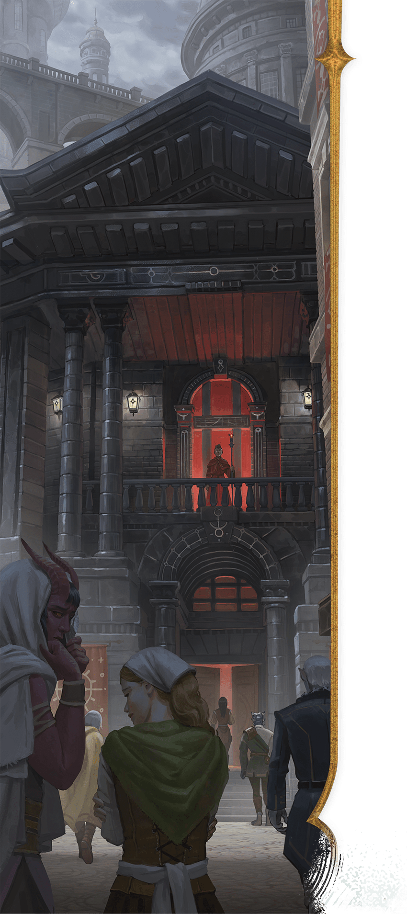

<!-- Notes MJ : contenu fourni par l’utilisateur, non destiné au partage public. -->

## Life in Thay

Life in Thay is difficult and dangerous, yet it holds the promise of glory and riches for those who ruthlessly embrace magical power and political maneuvering.

### Laws

Thayan law is dizzyingly complex and often contradictory. Red Wizards enforce the nation’s strict criminal laws unevenly and as best benefits themselves. They punish commoners however they want, with no recourse for the accused except the hope that a rival Red Wizard might defend them.

These are most commonly enforced Thayan laws:

- **Only Red Wizards Are Allowed to Wear Red.** Even benevolent Red Wizards enforce this law.
- **A Red Wizard’s Command Must Be Obeyed.** If Red Wizards give contradictory commands, the highest-ranking Red Wizard must be obeyed.
- **Disrespecting a Red Wizard Is Treason.** Red Wizards have full discretion to decide when this law is broken.

Less frequently enforced laws prohibit violent crimes and lesser offenses such as property damage. Punishments range from fines or imprisonment to death, at Red Wizards’ whims.

#### Crime

With such uneven enforcement, crime is rampant in Thay. The city of [Bezantur](../chapter.md#Bezantur) is home to massive criminal guilds, but every tharch has its own underworld profiting off the greed, corruption, and abuses of power for which Red Wizards are known. Theft, bribery, smuggling, assassination, blackmail, and every other kind of grift are common in Thayan society. It’s almost impossible for a traveler to move through the realm without falling victim to a few crimes.

### Society

Thayan society is stratified. Below the ruling aristocracy of the Red Wizards is a middle class made up of bureaucrats, merchants, soldiers, priests, and artisans. At the bottom is a working-class population of laborers, most of whom stay within a few miles of their birthplace their whole lives. The only ways to rise socially are through magical talent, military service, trade, or crime. As a result, militaries and guilds never lack recruits.

SWATCHES STUDIO

Red Wizards lord over   
all aspects of Thayan life.

In general, Thayans oppress all those beneath them on the social ladder. Working class Thayans suffer a life of hard labor in the cities, fields, mines, and waterways. Most have adapted to such a life over generations, creating traditions of self-abnegation and acceptance. Still, some wonder if life must always continue in this pattern, and a few even dare to whisper of rebellion (see “[Open Eyes](../chapter.md#OpenEyes)” below).

#### Closed Eyes

Many middle- and working-class Thayans follow a tradition of silence and noninterference called Closed Eyes, whose main teaching is “Ignore trouble that doesn’t concern you.” Thayans who follow this tradition emulate the cranes that nest and migrate throughout the nation: to survive, they focus relentlessly on the everyday tasks of finding safety, eating, and caring for their young. This tradition leads Thayans to ignore any crime around them.

This attitude allows crime to flourish in Thayan cities, but it can also help adventurers operate unimpeded, even if they openly flout the Red Wizards’ authority. Only sycophants to the Red Wizards alert authorities to lawbreakers’ activities, and even they hesitate, as garnering Red Wizards’ attention rarely goes well for the underclass.

#### Open Eyes

Civil resistance and unrest are rare in Thay, as the Red Wizards usually discover dissent quickly with magical spying techniques. But Red Wizards are easily distracted by their own selfish interests, allowing dissent short of open rebellion to simmer.

Made up of small, local cells, the Open Eyes is a group of Thayan rebels who hate the Red Wizards’ rule. The rebels aim to strike at Red Wizards who’ve perpetuated injustice, such as meting out unfair punishments or tolerating violent crime. Retribution ranges from stealing spell components and sabotaging magic item shipments to assassination attempts.

Openly calling oneself a member of the Open Eyes is a death sentence. Nonetheless, incidents attributed to the group flare throughout Thay, suggesting a greater rebellion is brewing.

### Religion

Myriad faiths are common in Thay, where the following gods are worshipped:

- **Bane.** The most common faith is worship of Bane, the god of tyranny. Bane’s purview over ambition and control appeals to Red Wizards, merchants, and bureaucrats.
- **Chauntea.** A god of agriculture, Chauntea is popular among farmers and tradespeople.
- **Cyric.** The god of lies is popular among criminals and common folk who use deception to avoid the Red Wizards’ wrath.
- **Kossuth.** A primordial being from the Elemental Plane of Fire, Kossuth is a god of purification through fire. His worship appeals to Red Wizards who embrace destroying anything they can’t claim for themselves.
- **Mask.** A god of thieves, Mask is popular among the bandits who roam Thay’s highways and prowl its cities’ streets.
- **Mystra.** The best-known god of magic in Faerûn, Mystra is only sporadically worshipped in Thay. The Red Wizards prefer other gods, and common Thayans avoid gods of magic.
- **Shar.** A god of loss and forgetfulness, the Mistress of the Night is popular among common folk who have experienced tragedy or are frustrated at the injustices they suffer.
