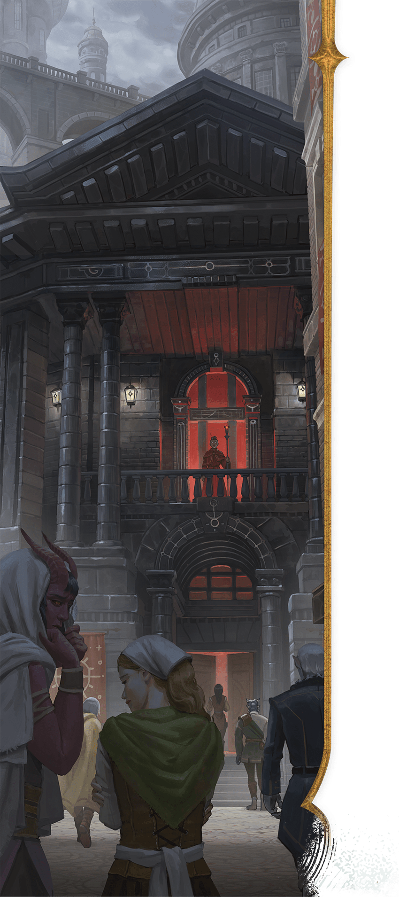

<!-- Notes MJ : contenu fourni par l’utilisateur, non destiné au partage public. -->

### Society

Thayan society is stratified. Below the ruling aristocracy of the Red Wizards is a middle class made up of bureaucrats, merchants, soldiers, priests, and artisans. At the bottom is a working-class population of laborers, most of whom stay within a few miles of their birthplace their whole lives. The only ways to rise socially are through magical talent, military service, trade, or crime. As a result, militaries and guilds never lack recruits.

SWATCHES STUDIO

Red Wizards lord over   
all aspects of Thayan life.

In general, Thayans oppress all those beneath them on the social ladder. Working class Thayans suffer a life of hard labor in the cities, fields, mines, and waterways. Most have adapted to such a life over generations, creating traditions of self-abnegation and acceptance. Still, some wonder if life must always continue in this pattern, and a few even dare to whisper of rebellion (see “[Open Eyes](../chapter.md#OpenEyes)” below).

#### Closed Eyes

Many middle- and working-class Thayans follow a tradition of silence and noninterference called Closed Eyes, whose main teaching is “Ignore trouble that doesn’t concern you.” Thayans who follow this tradition emulate the cranes that nest and migrate throughout the nation: to survive, they focus relentlessly on the everyday tasks of finding safety, eating, and caring for their young. This tradition leads Thayans to ignore any crime around them.

This attitude allows crime to flourish in Thayan cities, but it can also help adventurers operate unimpeded, even if they openly flout the Red Wizards’ authority. Only sycophants to the Red Wizards alert authorities to lawbreakers’ activities, and even they hesitate, as garnering Red Wizards’ attention rarely goes well for the underclass.

#### Open Eyes

Civil resistance and unrest are rare in Thay, as the Red Wizards usually discover dissent quickly with magical spying techniques. But Red Wizards are easily distracted by their own selfish interests, allowing dissent short of open rebellion to simmer.

Made up of small, local cells, the Open Eyes is a group of Thayan rebels who hate the Red Wizards’ rule. The rebels aim to strike at Red Wizards who’ve perpetuated injustice, such as meting out unfair punishments or tolerating violent crime. Retribution ranges from stealing spell components and sabotaging magic item shipments to assassination attempts.

Openly calling oneself a member of the Open Eyes is a death sentence. Nonetheless, incidents attributed to the group flare throughout Thay, suggesting a greater rebellion is brewing.
