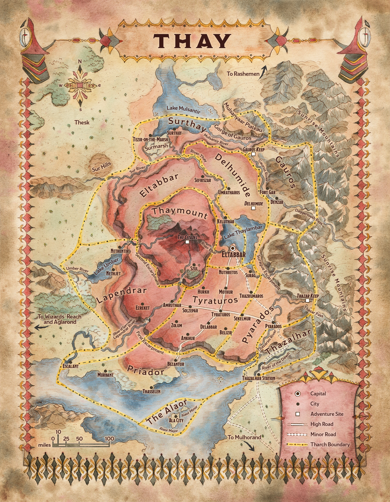

<!-- Notes MJ : contenu fourni par l’utilisateur, non destiné au partage public. -->

### Geography

Thay stretches over two enormous plateaus, one atop the other like a cake’s tiers. A small strip of land surrounding Thay’s primary plateau lies at sea level. This area is known as Lower Thay. Thay’s primary plateau, on which most of the nation sits, is called the Thayan Plateau. The plateau atop the Thayan Plateau is called Thaymount. The nation’s imposing physical geography has served as a natural barrier against enemy forces for centuries.

FRANCESCA BAERALD

Map 1.1: Thay [View Player Version](../assets/maps/players/map-01-01.thay-player.jpg)

#### Lower Thay

Lower Thay is a fertile region that curves along Thay’s western border from Surthay on Lake Mulsantir to Priador on the Alamber Sea. Most of Thay’s border wars have been fought here. Lower Thay is strategically vital for its coastlines and crops and provides a launching point for invasions. The land rises into the Thayan Plateau through a series of towering precipices in the space of about ten miles; this rise is called the First Escarpment.

#### Tharchs of Thay

| Tharch | Tharchion | Capital | Description |
| --- | --- | --- | --- |
| The Alaor | Bavak Inkander | Ala City | Two islands harboring a navy and Thay’s shipyards |
| Delhumide | Meskie Kudd | Umratharos | Haunted pastureland with ancient ruins |
| Eltabbar | Zedivek Mazradash | Eltabbar | Capital region pouring out Thayan propaganda |
| Gauros | Ozgund Gar | Fort Gar | Hilly hinterland where distrust of the zulkirs runs deep |
| Lapendrar | Keliza Vyrizek | Escalant | Fertile countryside with dangerous borders |
| Priador | Xelnene Thrul | Bezantur | Thay’s commercial hub |
| Pyarados | Mevik Sasvar | Pyarados | Mountainous mining region |
| Surthay | Vederax Skarsk | Surthay | Swampland bordering Rashemen |
| Thaymount | Szass Tam | Szul | Mountainous abode of Red Wizards; forbidden to others |
| Thazalhar | Jynnril | Thazalhar Station | Fortified river lands bordering Mulhorand |
| Tyraturos | Bulgor Ograzep | Tyraturos | Urbane mercantile hub |

#### Thayan Plateau

The Thayan Plateau, Thay’s most populous region, contains rolling vistas broken by cities, towns, low mesas, and ominous ruins. While the Delhumide tharch feels wild, filled with more ruins than population centers, cities and villages dot the Tyraturos tharch’s arid plains. In the plateau’s center rise the dramatic cliffs of the Second Escarpment, leading to the upper plateau of Thaymount.

#### Thaymount

Thaymount is both the name of a plateau featuring volcanic peaks at its center and the name of the tharch this region constitutes. Only Red Wizards and those they invite may tread here. See “Tharch Descriptions” for more information about this area.
