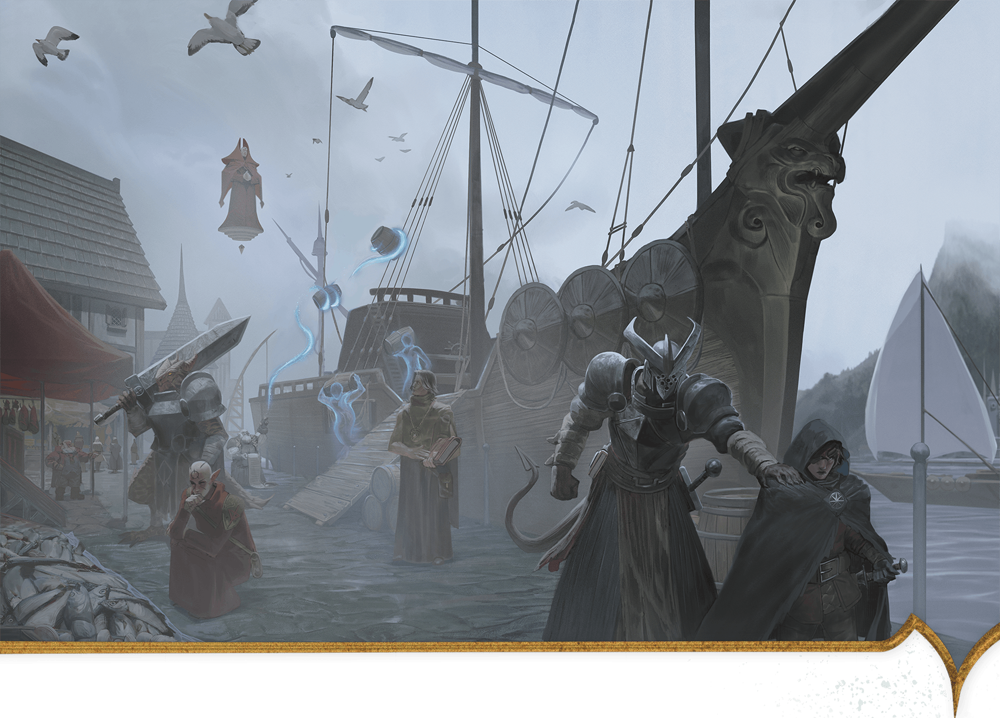
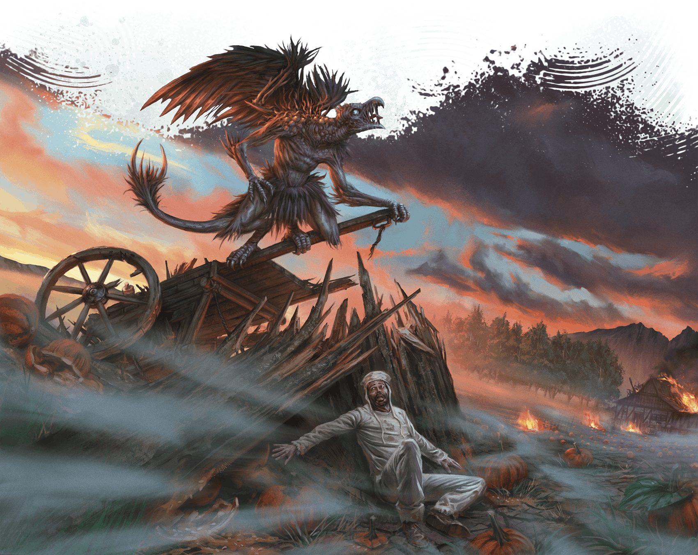
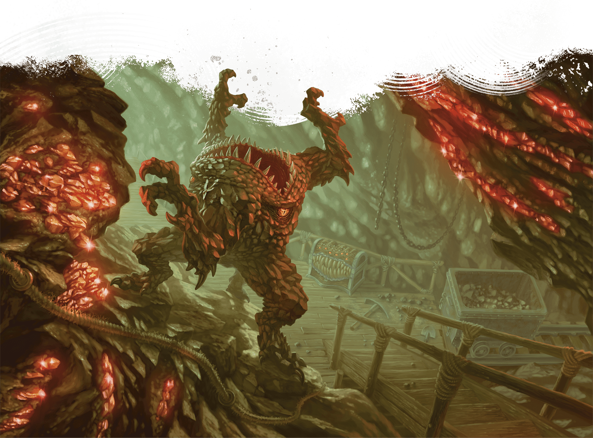
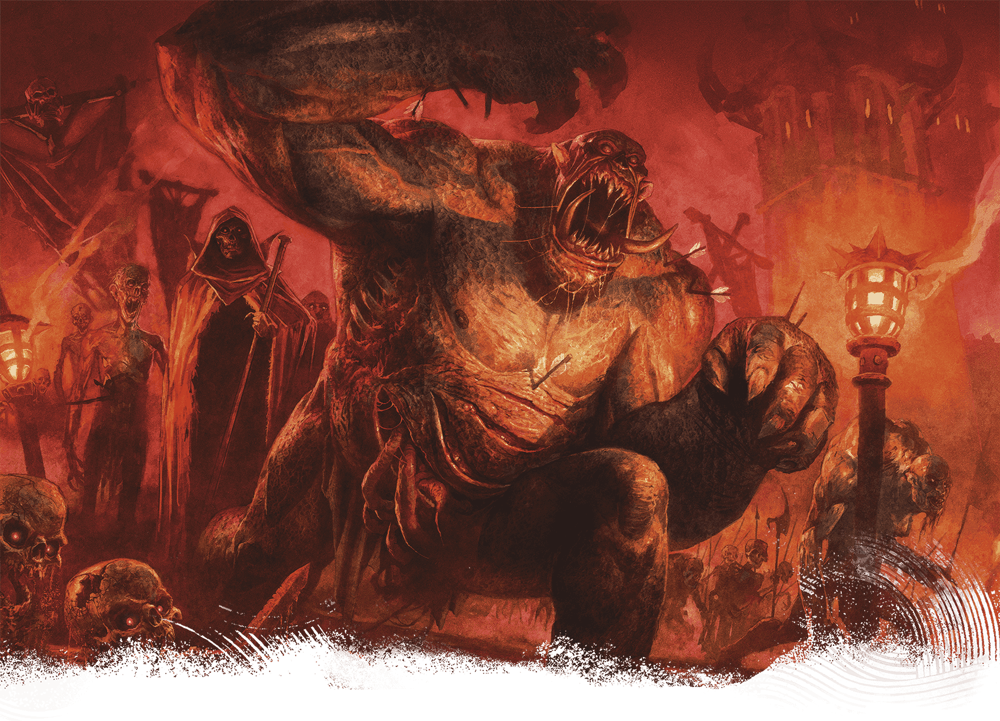

<!-- Notes MJ : contenu fourni par l’utilisateur, non destiné au partage public. -->

## Tharch Descriptions

Thay is divided into eleven tharchs. The Tharchs of Thay table lists each tharch’s details, while the Tharchions of Thay table presents their rulers.

### The Alaor

Kevin Glint, Álvaro Calvo Escudero

Merchants in Ala Harbor unload their cargo while a Red Wizard looks on.

Off the southern coast of Thay lie two rocky islands, Alaor Major and Alaor Minor. These make up Thay’s smallest tharch, the Alaor. Despite the tharch’s size, the extensive shipyard here makes it one of the nation’s most strategically important.

#### Tharchions of Thay

| Tharchion | Tharch | Stat Block | Tharchion Details |
| --- | --- | --- | --- |
| Bavak Inkander | The Alaor | [Noble Prodigy](https://www.dndbeyond.com/monsters/5195144-noble-prodigy) (Medium, Lawful Neutral) | Human shipbuilding and naval genius |
| Bulgor Ograzep | Tyraturos | [Bandit Crime Lord](https://www.dndbeyond.com/monsters/5194913-bandit-crime-lord) (Medium, Lawful Evil) | Human highway thief turned politician |
| Jynnril | Thazalhar | [Questing Knight](https://www.dndbeyond.com/monsters/5195177-questing-knight) (Small) | Human veteran of border conflicts |
| Keliza Vyrizek | Lapendrar | [Spy Master](https://www.dndbeyond.com/monsters/5195216-spy-master) (Medium, Neutral Evil) | Human international espionage mastermind |
| Meskie Kudd | Delhumide | [Spy Master](https://www.dndbeyond.com/monsters/5195216-spy-master) (Medium, Chaotic Neutral) | Human cattle rancher and spy for the zulkirs |
| Mevik Sasvar | Pyarados | [Performer Legend](https://www.dndbeyond.com/monsters/5195154-performer-legend) (Medium, Lawful Evil) | Silver-tongued tiefling tyrant |
| Ozgund Gar | Gauros | [Warrior Commander](https://www.dndbeyond.com/monsters/5195258-warrior-commander) (Medium, Lawful Evil) | Short-tempered orc military veteran |
| Szass Tam | Thaymount | [See appendix B](https://www.dndbeyond.com/monsters/6719633-szass-tam) (Medium, Lawful Evil) | Lich zulkir of necromancy |
| Vederax Skarsk | Surthay | [Warrior Commander](https://www.dndbeyond.com/monsters/5195258-warrior-commander) (Medium, Chaotic Evil) | Dragonborn and militant Thayan patriot |
| Xelnene Thrul | Priador | [See appendix B](https://www.dndbeyond.com/monsters/6719634-xelnene-thrul) (Medium, Neutral Good) | Human zulkir of evocation |
| Zedivek Mazradash | Eltabbar | [Vampire Umbral Lord](https://www.dndbeyond.com/monsters/5195250-vampire-umbral-lord) (Medium) | Former elf who serves the zulkir of illusion |

#### Alaor Major

Alaor Major is the largest of the two islands that make up the Alaor. The island is dotted with small settlements and family homes, most tied to the extensive navy that harbors at Ala City.

On the shores of a deepwater bay lies the Alaor’s capital, Ala City. This city also contains the tharch’s principal harbor, Ala Harbor. Dozens of naval and merchant ships dock here; all are built in the extensive shipyards nearby. Stationed in the city are approximately 1,000 members of the Thayan navy, ready to deploy against pirates or enemy ships.

Ala City is home to tharchion Bavak Inkander, who owns the shipyards and commands the Alaor’s navy. A no-nonsense naval genius, Inkander is conservative with the fleet. He often declines merchants’ requests for protection, suggesting they hire adventurers for protection.

#### Alaor Minor

Sea caves and rocky shorelines surround Alaor Minor, making it an undesirable place for settlements but an inviting place for pirate crews to lair. The treacherous reefs and menacing sea monsters in the coastal waters mean Thayan forces rarely bother to pursue pirates here.

### Delhumide

Although it held Thay’s provincial capital during Mulhorandi rule, the tharch of Delhumide is now rural, consisting of farmland and ranges for cattle herds. Monsters lurk in Mulhorandi ruins, and lingering fiendish magic from the era of Mulhorandi rule attracts demons to the area.

ÁLVARO CALVO ESCUDERO

A vrock terrorizes a farmer in Delhumide.

#### Ruins of Delhumide

Once a great city, Delhumide’s eponymous provincial capital was razed in Thay’s earliest bid for independence and has never been rebuilt. Ghosts and lingering, malevolent magical effects haunt the countryside for miles around the ruins and surrounding abandoned estates.

Numerous Red Wizard necromancers have delved into the ruins to study its ancient crypts. The few who have returned claim a terrible Mulhorandi curse protects these sites.

#### Umratharos

A small city at a bend of the River Thay, Umratharos is Delhumide’s capital. In the city’s center stands the Old Thay Inn, an ideal place for adventurers to rest when not exploring the tharch’s ruins. The inn’s halfling proprietor, Brenna Arthan (Small [Scout Captain](https://www.dndbeyond.com/monsters/5195197-scout-captain)), is a retired adventurer who buys magic items found in the ruins and sells them to her Red Wizard contacts.

Tharchion Meskie Kudd levies heavy fees on those who explore ruins. Kudd funnels this money to the zulkirs in hopes of being reassigned to a more cosmopolitan tharch.

### Eltabbar

Though Eltabbar primarily consists of lightly populated scrubland, this tharch is home to Thay’s cosmopolitan capital city. Small settlements of mostly humans, tieflings, elves, and orcs serve as bedroom communities for the capital.

#### Eltabbar

Full of magical marvels, Thay’s capital is the seat of power for Thay’s most prominent Red Wizards and the second most important city in Thay for commercial trade, behind Bezantur. The city of Eltabbar is further detailed later in this chapter.

### Gauros

David Frasheski

The sparsely populated landscape of the tharch of Gauros is breathtaking.

Rocky, rugged, and forbidding, Gauros is a rural tharch with no major cities. The hills abound with precious metals, but the Sunrise Mountains harbor dangerous monsters, including vicious gnolls and hill giants, so only well-defended or well-hidden mining operations survive for long.

Gauros’s tharchions have repeatedly tried to clear the mountains of monsters to entice more Red Wizards to invest in the area, but these efforts have largely failed. The foothills are littered with abandoned fortresses, including Gauros Keep.

Small villages dot the tharch’s riverbanks, with the largest being Denzar. When locals must travel from village to village, they don’t make camp in the open after dark lest they risk a gnoll attack. Those who can afford it pay monster-hunters to escort them through the wilderness.

#### Fort Gar

Fort Gar, situated on the banks of the Gauros River, is the capital of Gauros and the seat of power for its tharchion, Ozgund Gar. Gar is the latest leader to try to fortify Gauros against the region’s perils. Using the heavy tax revenue he collects from mining barons, Gar built the fort, conscripted hundreds of locals, and personally trained them into a formidable fighting force.

Rumors swirl that an army of gnolls led by a [Glabrezu](https://www.dndbeyond.com/monsters/5195041-glabrezu) named Krazt gathers in the mountains and plans to assault the fort soon. Gar regularly petitions the zulkirs for resources and troops to help in the coming fight, but so far, his pleas have been ignored.

### Lapendrar

At the southwestern edge of Thay lies Lapendrar, a tharch known for fertile farmlands, border disputes with the cities of Wizards’ Reach, and the independent city-state of Amruthar. Soldiers garrison in every village. Residents are required by law to house soldiers, and Lapendrar’s Red Wizards don’t tolerate pushback.

#### Amruthar

Before Thay achieved independence, Amruthar was a Mulhorandi city ruled by a powerful satrap named Sekhotet. The satrap agreed to help Thay win its freedom in exchange for the city’s continued autonomy, and ever since, the zulkirs have honored that wish, fearing magical repercussions if they break their agreement.

During Szass Tam’s regency, a seismic disaster opened chasms in Amruthar’s streets, burying half the city in ash and lava. The rest of the city became a haven for refugees, outcasts, and seditious priests. The city’s mayor is an elf named Ulthara Toll (Medium, Lawful Neutral [Archpriest](https://www.dndbeyond.com/monsters/5194903-archpriest)), who follows Mystra, a god of magic.

In Amruthar, the Red Wizards have no authority, and people are free to speak out against their tyranny. Worship of gods whose churches are frowned on in Thay is more prominent here, including worship of Mystra and of Amaunator, a god of the sun. Some in the city still revere gods of the old Mulhorandi pantheon.

Toll and other city leaders fear the zulkirs will move to reclaim Amruthar. As a result, no one enters the city without undergoing thorough questioning in the area of a [Zone of Truth](https://www.dndbeyond.com/spells/2619221-zone-of-truth) spell, and nobody is buried without first being questioned through a [Speak with Dead](https://www.dndbeyond.com/spells/2619068-speak-with-dead) spell. Amruthar might be free from the Red Wizards, but it is a bad place for anyone with secrets.

#### Escalant

Just east of contested territory, the city of Escalant is one of the most patriotic cities in Lapendrar. Tharchion Keliza Vyrizek controls both the tharch and Thayan international espionage. Heroes from Aglarond might work to subvert Vyrizek’s spies or free prisoners captured by the sadistic zulkir of abjuration, Yazir Nym, who garrisons his army here.

### Priador

Full of wealthy towns and cities, Priador is the heart of Thayan commerce. The tharch collects abundant revenue from the many tax stations along the High Road. The road is crowded with merchants and other travelers, both Thayan and foreign.

#### Bezantur

Bezantur is Priador’s largest city and Thay’s commercial hub. The Guild of Foreign Trade is based here, and most residents covet a lucrative position either in the guild’s home offices or abroad. Bezantur also contains Thay’s largest port, where docks host enormous contingents of merchant ships and the naval warships that protect them.

Ruling from a grand palace in Bezantur, Xelnene Thrul (see [appendix B](../../appendix-b-bestiary/chapter.md#XelneneThrul)) is both the zulkir of evocation and the tharchion of Priador. Thrul, whose family has held leadership posts for generations, steers Thay’s economy with a steady hand. Assisting Thrul is Gulga Vull (Medium [Archmage](https://www.dndbeyond.com/monsters/5194902-archmage)), a human Red Wizard who heads the Guild of Foreign Trade (see “[Guild of Foreign Trade](../chapter.md#GuildForeignTrade)” earlier in this chapter). Under these two, an army of bureaucrats collects taxes and enforces Bezantur’s strict trade laws.

Life in Bezantur is deeply stratified. The city’s merchants are wealthy, and its markets teem with even more high-quality goods than those in the capital. The city’s magic item fabrication facilities are enormous, putting those in Eltabbar to shame. In contrast, the city’s poor are deeply disadvantaged. Thieves run rampant in all but the wealthiest areas of Bezantur, and anyone who visits the city without securing their purse soon regrets it.

### Pyarados

The towering peaks of the nearby Sunrise Mountains are visible from every plain in the tharch of Pyarados. The foothills are dotted with mines, which many Red Wizards of Eltabbar and Bezantur have invested in.

Monster attacks are uncommon in the wilds here. However, the mines are full of monsters, including strange creatures from the Elemental Plane of Earth, such as xorns.

Most Red Wizards who back mining operations here are unscrupulous, working the locals until they die—and then raising them as undead to continue their work. Many workers in Pyarados sign over their lives (and unlives) to the Red Wizards, working in the mines in exchange for the Red Wizards’ promises to provide for their families.

LOÏC CANAVAGGIA

A xorn wanders through a mine in Pyarados.

#### City of Pyarados

The largest city on the Thazarim River is Pyarados, the tharch’s capital. Tharchion Mevik Sasvar, who resides here, encourages Red Wizards to invest in mines and work their laborers as hard as they wish. Many Red Wizard investors spend significant time and money in the city, which boasts the best gambling houses in the nation. To free their time for gambling, these Red Wizards often hire adventurers to scout new mining locations or investigate troubled operations.

### Surthay

The tharch of Surthay is a backwater in multiple senses. The Surmarsh lies within its bounds, and settlements in the area are sparse. Once an important front against neighboring Rashemen, Surthay now languishes with little income or attention from political powers.

#### City of Surthay

The run-down city of Surthay is the home of Tharchion Vederax Skarsk. The veteran of several skirmishes with Rashemen, the tharchion is unfailingly loyal to Thay and requires all locals to register for at least a year of military service. These troops are garrisoned in the city but regularly foray across the Rashemen border. The zulkirs are beginning to tire of Skarsk’s aggressive antics, although the commander has won some small battles that offset the troops’ regular losses.

#### Surmarsh

A wide, fetid swamp near Lake Mulsantir, the Surmarsh is home to dozens of lizardfolk clans. The marsh is cold and dreary, not to mention outside the reach of the Red Wizards’ weather-affecting magic, so Thay’s leaders have shown little interest in governing the region.

Occasionally, Surthay’s militant tharchion captures lizardfolk who wander out of the Surmarsh and conscripts them. In recent years, the lizardfolk’s anger toward this practice has grown. Lizardfolk leaders Vrill and Xornil Fangbane ([Lizardfolk Sovereigns](https://www.dndbeyond.com/monsters/5195108-lizardfolk-sovereign)) seek to unite the marsh’s clans for an assault on the city of Surthay. The tharchion doesn’t take this threat seriously, but should Vrill and Xornil succeed, thousands of angry lizardfolk would descend on the city.

### Thaymount

Loïc Canavaggia, Helge C. Balzer

The Dread Legion includes all manner of undead, including this ogre zombie.

Thaymount is the nation’s highest plateau, atop which stands a chain of volcanic mountains. Szass Tam, zulkir of necromancy (see [appendix B](../../appendix-b-bestiary/chapter.md#SzassTam)), rules here as tharchion.

Traveling to Thaymount uninvited is forbidden to all but the nation’s highest-ranking Red Wizards and their entourages. Permanent, layered spell effects enforce this travel ban, though some clever mages still figure out ways to circumvent the restrictions. See “[Magic on Thaymount](../../chapter-06-precipice-of-oblivion/chapter.md#MagicOnThaymount)” in chapter 6 for more about the tharch’s spell effects.

Thay’s most prestigious Red Wizards maintain private fortresses here, and each zulkir owns several facilities. Some run magic item factories staffed with undead. Others conduct unspeakable magical experiments involving heinous creatures from the Lower Planes.

Below Thaymount wind abandoned mines dating from Thay’s Mulhorandi era, some of which connect to the Underdark. The mines crisscross subterranean highways and complexes that belonged to an ancient empire of snakelike people called sarrukhs (see [appendix B](../../appendix-b-bestiary/chapter.md#Sarrukhs)).

#### The Citadel

Situated in the middle of Thaymount, the sprawling, mostly underground Citadel predates the Thayan nation by thousands of years. Believed to have been constructed by sarrukhs, the Citadel is now Szass Tam’s personal fortress. Here he hatches schemes hidden from his rivals in Eltabbar and conducts rituals and research that, if successful, could bring the entire nation under his thumb. However, the vast Citadel holds many secrets, and even Szass Tam doesn’t know what lurks in its deepest lairs.

Outside the Citadel, Szass Tam garrisons his Dread Legion (described earlier in this chapter).

#### Szul

A small collection of luxury estates, Szul is the only location providing any hospitality in Thaymount. It is also the only place not cloaked in the spell effects that prevent teleportation and other magical incursions into Thaymount. But Szass Tam has placed permanent Abjuration effects in Szul to ensure he’s aware of everyone who arrives here.

The powerful Red Wizards who maintain private facilities in Thaymount occasionally invite non-spellcasters or foreign dignitaries to Szul to discuss lucrative contracts or illicit deals. Widely considered the most impressive and exclusive resort in Thay, Szul includes private feast halls, spas, and facilities where all manner of unsavory entertainment can be found.

Szul also serves as Thaymount’s political capital, as Szass Tam sometimes visits the Red Hall—a tower built inside a small caldera—to announce rulings he has made as tharchion.

### Thazalhar

Andrey Kuzinskiy

Two Mulhorandi merchants on the Thay Crossing bridge chat while a Red Wizard looks on.

In Thay’s earliest days, its second smallest tharch, Thazalhar, served as a bulwark against incursions from Mulhorand. Now, Thazalhar’s liveliest feature is the road that trade caravans use to travel between the two nations. Just inside Thay’s border, a bridge known as Thay Crossing serves as a checkpoint where Red Wizards inspect the cargo of passing merchants. Mulhorandi traders are taxed heavily, though the cost is worthwhile for merchants traveling to bustling Bezantur.

#### Thazalhar Station

Just a few miles from Thay’s border lies Thazalhar Station, a former tax station converted into a governance building. The station also serves as border control, meticulously checking the paperwork of all non-Thayans passing through.

Tharchion Jynnril, a veteran of many border conflicts, steers Thazalhar’s government with a steady hand. The deeply patriotic tharchion keeps a small army garrisoned at the station. Most of these soldiers are borrowed from more powerful tharchs; experience under Jynnril’s command is considered a badge of honor throughout Thay due to her rigor.

### Tyraturos

The High Road crisscrosses the tharch of Tyraturos. Tyraturos is Thay’s most populous tharch, as cities and towns have cropped up all along the road and beyond. Ankhur, Belizir, Delabbar, and Hurkh are the largest cities, with smaller towns including Mothur, Nuthretos, Sekelmur, Solzepar, Surag, Thazrumaros, and Zolum. A wide array of folk people both its settlements and its rural areas, which sometimes face incursions by bands of centaurs and lamias.

#### City of Tyraturos

The tharch’s economic hub and capital is the city of Tyraturos, where Tharchion Bulgor Ograzep rules. Once captain of an infamous band of highway thieves, Ograzep was named tharchion after renouncing his criminal ways—and bribing powerful Red Wizards. He then cracked down on crime, making the city much safer for visitors.

Tyraturos is known as the city with a hundred taverns. Any individual with coin is welcome here, and many travelers seek to hire adventurers for their get-rich-quick schemes. The Red Wizards encourage all business, as long as it’s declared for tax purposes.
