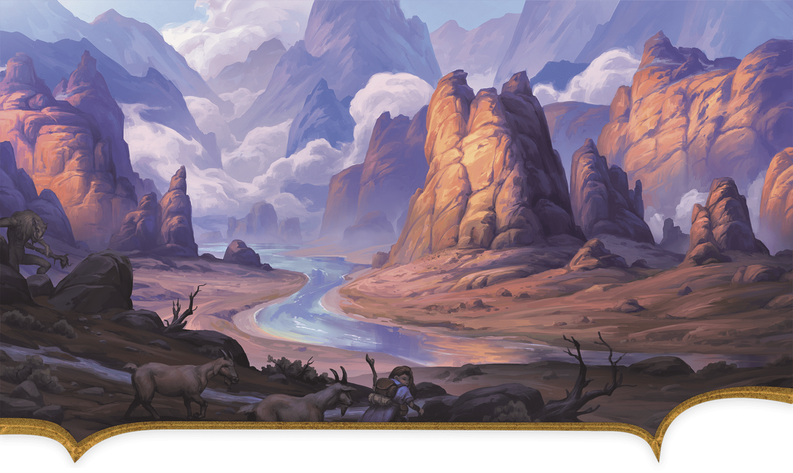

<!-- Notes MJ : contenu fourni par l’utilisateur, non destiné au partage public. -->

### Gauros

David Frasheski

The sparsely populated landscape of the tharch of Gauros is breathtaking.

Rocky, rugged, and forbidding, Gauros is a rural tharch with no major cities. The hills abound with precious metals, but the Sunrise Mountains harbor dangerous monsters, including vicious gnolls and hill giants, so only well-defended or well-hidden mining operations survive for long.

Gauros’s tharchions have repeatedly tried to clear the mountains of monsters to entice more Red Wizards to invest in the area, but these efforts have largely failed. The foothills are littered with abandoned fortresses, including Gauros Keep.

Small villages dot the tharch’s riverbanks, with the largest being Denzar. When locals must travel from village to village, they don’t make camp in the open after dark lest they risk a gnoll attack. Those who can afford it pay monster-hunters to escort them through the wilderness.

#### Fort Gar

Fort Gar, situated on the banks of the Gauros River, is the capital of Gauros and the seat of power for its tharchion, Ozgund Gar. Gar is the latest leader to try to fortify Gauros against the region’s perils. Using the heavy tax revenue he collects from mining barons, Gar built the fort, conscripted hundreds of locals, and personally trained them into a formidable fighting force.

Rumors swirl that an army of gnolls led by a [Glabrezu](https://www.dndbeyond.com/monsters/5195041-glabrezu) named Krazt gathers in the mountains and plans to assault the fort soon. Gar regularly petitions the zulkirs for resources and troops to help in the coming fight, but so far, his pleas have been ignored.
