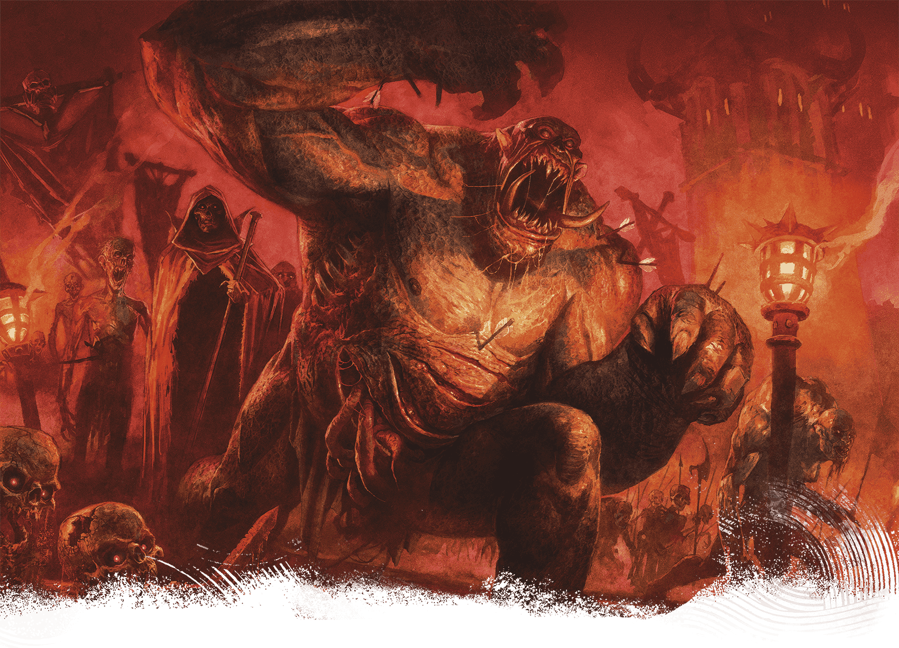

<!-- Notes MJ : contenu fourni par l’utilisateur, non destiné au partage public. -->

### Thaymount

Loïc Canavaggia, Helge C. Balzer

The Dread Legion includes all manner of undead, including this ogre zombie.

Thaymount is the nation’s highest plateau, atop which stands a chain of volcanic mountains. Szass Tam, zulkir of necromancy (see [appendix B](../../appendix-b-bestiary/chapter.md#SzassTam)), rules here as tharchion.

Traveling to Thaymount uninvited is forbidden to all but the nation’s highest-ranking Red Wizards and their entourages. Permanent, layered spell effects enforce this travel ban, though some clever mages still figure out ways to circumvent the restrictions. See “[Magic on Thaymount](../../chapter-06-precipice-of-oblivion/chapter.md#MagicOnThaymount)” in chapter 6 for more about the tharch’s spell effects.

Thay’s most prestigious Red Wizards maintain private fortresses here, and each zulkir owns several facilities. Some run magic item factories staffed with undead. Others conduct unspeakable magical experiments involving heinous creatures from the Lower Planes.

Below Thaymount wind abandoned mines dating from Thay’s Mulhorandi era, some of which connect to the Underdark. The mines crisscross subterranean highways and complexes that belonged to an ancient empire of snakelike people called sarrukhs (see [appendix B](../../appendix-b-bestiary/chapter.md#Sarrukhs)).

#### The Citadel

Situated in the middle of Thaymount, the sprawling, mostly underground Citadel predates the Thayan nation by thousands of years. Believed to have been constructed by sarrukhs, the Citadel is now Szass Tam’s personal fortress. Here he hatches schemes hidden from his rivals in Eltabbar and conducts rituals and research that, if successful, could bring the entire nation under his thumb. However, the vast Citadel holds many secrets, and even Szass Tam doesn’t know what lurks in its deepest lairs.

Outside the Citadel, Szass Tam garrisons his Dread Legion (described earlier in this chapter).

#### Szul

A small collection of luxury estates, Szul is the only location providing any hospitality in Thaymount. It is also the only place not cloaked in the spell effects that prevent teleportation and other magical incursions into Thaymount. But Szass Tam has placed permanent Abjuration effects in Szul to ensure he’s aware of everyone who arrives here.

The powerful Red Wizards who maintain private facilities in Thaymount occasionally invite non-spellcasters or foreign dignitaries to Szul to discuss lucrative contracts or illicit deals. Widely considered the most impressive and exclusive resort in Thay, Szul includes private feast halls, spas, and facilities where all manner of unsavory entertainment can be found.

Szul also serves as Thaymount’s political capital, as Szass Tam sometimes visits the Red Hall—a tower built inside a small caldera—to announce rulings he has made as tharchion.
