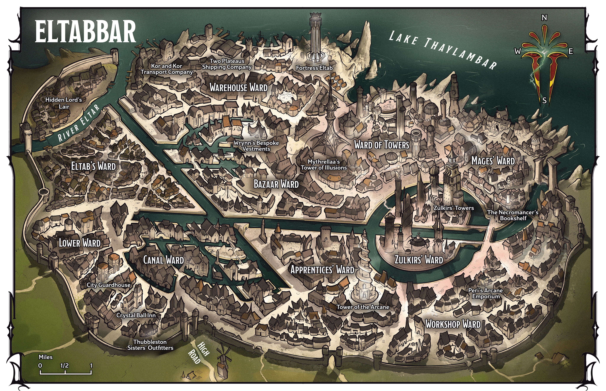
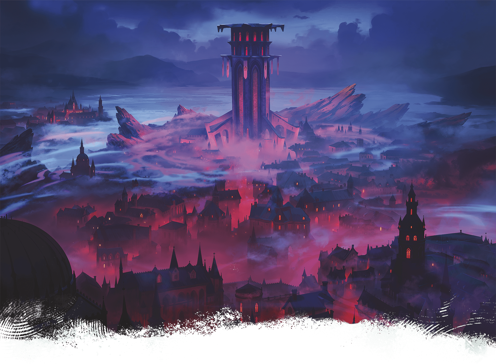

<!-- Notes MJ : contenu fourni par l’utilisateur, non destiné au partage public. -->

## Eltabbar, Thay’s Capital

Gerralt Landman

Map 1.2: Eltabbar [View Player Version](../assets/maps/players/map-01-02.eltabbar-player.png)

Eltabbar is both Thay’s capital and its second-largest city. The settlement is relatively young, having grown from a hamlet of fisher people into a haven for mages after Thay achieved independence.

Eltabbar is an urban hub where the most powerful Red Wizards maintain at least one residence. The city is a center for magic: magical research, magic item production, and magical marketplaces. Eltabbar’s warehouses hold shipments of magic items bound for destinations across Faerûn. Eltabbar is also a city of extreme poverty. Laborers live in hovels, increasingly pinched by the landlords whose greed makes their lives miserable.

### Eltabbar in Play

The following sections will help bring Eltabbar to life during your games. When the characters are adventuring in Eltabbar during Operation Deadfall, the campaign in this book, show them the city’s map and describe any locations they might want to visit. For instance, the characters might want to stay at the Crystal Ball Inn or buy gear at Thubbleston Sisters’ Outfitters, both described in “Lower Ward.”

During any game set in Eltabbar, consider creating encounters at the places described below. See “Adventures in Eltabbar” later in this chapter for more inspiration.

### City Overview

Everyday life in Eltabbar is intrinsically tied to the city’s dark history and the rule of the Red Wizards.

#### Demonic Legacy

The odd layout of Eltabbar’s streets, canals, and catacombs harkens to a dark legacy. While the region was under Mulhorandi rule, Eltabbar’s founders discovered a hidden pocket of the [Abyss](https://www.dndbeyond.com/sources/dnd/dmg-2024/cosmology#Abyss) inhabited by a demon lord named Eltab. They allied with Eltab against the Mulhorandi, and the demon’s aid was invaluable for winning independence, but later, the Red Wizards proved unable to banish the demon.

The mages instead constructed facets of the city to form intricate glyphs, binding the demon lord in an underground prison. Eltab has long since escaped these bonds and fled the region, but marks of Eltab’s imprisonment remain.

To this day, Eltabbar’s extensive catacombs roil with the demon lord’s chaotic energies, creating a vast wild magic zone (see “Environmental Effects” in the [Dungeon Master’s Guide](https://www.dndbeyond.com/sources/dnd/dmg-2024/dms-toolbox#EnvironmentalEffects)) beneath the city. Aberrations and demons are drawn to the area’s latent Abyssal energies. As a result, few city residents dare venture into the catacombs.

#### City Government

The day-to-day government of Eltabbar falls to Tharchion Zedivek Mazradash, who serves Mythrellaa, the zulkir of illusion.

***Crime and the City Watch.*** As in all Thayan cities, Red Wizards have authority in Eltabbar to impose their own punishments for any crimes they witness. When no Red Wizards are present, Eltabbar’s City Watch handles crime reports and responds to crimes in progress. Watch members are posted at city entrances and are equipped with magic that allows them to communicate with the military in Fortress Eltab (see “[Warehouse Ward](../chapter.md#WarehouseWard)” below) in case of invasion.

When not responding to crimes, small watch groups patrol the city, imposing fines of up to 250 GP on those caught brawling, picking pockets, robbing shops, or committing worse crimes. Those unable or unwilling to pay their fines are sent to the City Guardhouse for harsh judgment. As a result, most citizens prefer to deal with crime on their own rather than involve the watch.

Roll on or choose a result from the City Watch Encounters table to generate encounters for a party of any level traveling around Eltabbar.

#### City Watch Encounters

| 1d4 | Encounter |
| --- | --- |
| 1 | Four watch [Guards](https://www.dndbeyond.com/monsters/5195065-guard) chase a [Bandit](https://www.dndbeyond.com/monsters/5194915-bandit) toward a waiting [Guard Captain](https://www.dndbeyond.com/monsters/5195064-guard-captain). |
| 2 | Three watch captains ([Warrior Veterans](https://www.dndbeyond.com/monsters/5195260-warrior-veteran)) order those in the street to make way for a Red Wizard’s entourage. |
| 3 | Two [Mage Apprentices](https://www.dndbeyond.com/monsters/5195109-mage-apprentice) are engaging in a dangerous spell duel on a crowded street. Two watch [Guards](https://www.dndbeyond.com/monsters/5195065-guard) and a captain ([Warrior Veteran](https://www.dndbeyond.com/monsters/5195260-warrior-veteran)) call for any nearby Red Wizards to help while they struggle to separate the mages. |
| 4 | A Red Wizard’s assistant ([Noble Prodigy](https://www.dndbeyond.com/monsters/5195144-noble-prodigy)) loudly denies accusations of shoplifting from a merchant; three watch [Guards](https://www.dndbeyond.com/monsters/5195065-guard) threaten to fine the merchant for interfering with a Red Wizard. |

#### Political Hub

Politics is a way of life in Eltabbar. Thay’s eight zulkirs keep residences here, and the Zulkirs’ Ward houses meeting spaces where decisions about the nation’s governance are made. Occasionally, the zulkirs make grand announcements—public spectacles that use layered castings of powerful spells. For instance, this might involve an enormous illusion of the zulkir flying amid the city’s spectacular towers, with fireworks in the shape of the Red Wizards’ symbol punctuating their booming speech.

Even the lowest-ranking Red Wizards play political games in Eltabbar. Whether through commerce, alliances with other Red Wizards, or sycophancy to a zulkir, they ceaselessly work to increase their standing. Most hope to become an adviser to a zulkir, although some Red Wizards seek to become the appointed leader of a Thayan enclave or a high-ranking member of the Guild of Foreign Trade.

### Eltabbar’s City Wards

Eltabbar is divided into ten wards.

#### Apprentices’ Ward

The Apprentices’ Ward is filled with grand libraries and reading rooms alongside the homes of noble scions and wealthy Red Wizard apprentices. Colorful, magical lights dot the ward’s buildings and gardens, and the chatter of young mages echoes at all hours.

***Tower of the Arcane.*** The Apprentices’ Ward is home to the Tower of the Arcane, the only magic academy in Eltabbar. Although most mages learn spellcraft by apprenticing to Red Wizards, this elite and expensive academy teaches basic magic as well as a robust curriculum of art, literature, and history with a healthy side of Thayan propaganda.

Head teacher Elsa Tor (Medium [Noble Prodigy](https://www.dndbeyond.com/monsters/5195144-noble-prodigy)), an elf and scion of a powerful family of illusionists, insists that the education and dignified demeanor her students learn set them up for a lifetime of success among the Red Wizards’ ranks. Top graduates are guaranteed apprenticeships with high-ranking Red Wizard alumni. The academy’s highest performers must watch for assassination attempts by fellow students competing with them for apprenticeships.

#### Bazaar Ward

Eltabbar’s city center boasts Thay’s largest open-air marketplace. Sprawled across several canals, the Bazaar Ward offers delectable goods kept fresh with magic, as well as supplies fit for the homes of the most powerful Red Wizards. The first day of the month, the city requires vendors to replace their stock with new goods. As a result, Market First Days are famous in Eltabbar, and elite residents attend to see and be seen.

Surrounding the bazaar’s open-air stalls are high-end storefronts, from fashion houses, tailors, and cobblers to fantastical restaurants, spas, and hotels. After a long day of politics and governing, powerful Red Wizards relax in these spaces, making evenings a key time for hopeful apprentices and artisans to hobnob with the elite.

***Wrynn’s Bespoke Vestments.*** One of Eltabbar’s oldest and most respected tailors, Wrynn’s Bespoke Vestments outfits powerful Red Wizards and wealthy visitors. Wynston Wrynn (Medium, Neutral Good [Spy Master](https://www.dndbeyond.com/monsters/5195216-spy-master)), a human and the shop’s seventh-generation owner, secretly works for [Zulkir Xelnene Thrul](../../appendix-b-bestiary/chapter.md#XelneneThrul). Wrynn’s Bespoke Vestments is further detailed in [chapter 3](../../chapter-03-operation-deadfall/chapter.md#WrynnsBespokeVestments).

#### Canal Ward

Largely residential, the Canal Ward is home to merchants who work in the bazaar as well as the staff members of the city’s elite. The Red Wizards look down on this district, as most of its residents aren’t mages, but the streets here are clean and safe.

#### Eltab’s Ward

The most desolate section of the city, Eltab’s Ward, sits directly above the underground prison that once held the demon lord of the same name. This ward is packed with cramped apartment buildings owned by landlords in service of Red Wizards who wring as much money as possible from their renters. A few ramshackle taverns and gambling dens are crammed between tenements. Most who live here experience generational poverty and work odd jobs in the Warehouse Ward. Crime is rampant, and any resident who claims to have fleeced a Red Wizard enjoys folk hero status.

***Hidden Lord’s Lair.*** The Hidden Lord’s Lair is a grimy tavern that leans into the area’s association with the demon lord Eltab, who’s also known as the Lord of the Hidden Layer. Tavernkeeper Xulfer (Medium, Chaotic Evil [Cultist Hierophant](https://www.dndbeyond.com/monsters/5194955-cultist-hierophant)), a tiefling, claims to descend from the Thayans who allied with Eltab. Xulfer leads a gang called Children of Eltab, whose members pickpocket travelers and rough up those who display loyalty to the ruling mages.

#### Lower Ward

Sandwiched between the homes of wealthy merchants and slums, the Lower Ward is mostly home to middle-class laborers. This ward also holds the highest concentration of long-term accommodations for visitors from throughout Thay and beyond, including merchants, mercenaries, and less-successful Red Wizards. The inns and taverns lining the ward’s southern streets, which lie near the High Road, cater to all manner of visitors, including adventurers.

***City Guardhouse.*** The headquarters of Eltabbar’s City Watch, the city guardhouse also houses a jail for accused criminals awaiting judgment. Red Wizard and Watch Commander Renatta Vott (Medium, Lawful Evil [Mage](https://www.dndbeyond.com/monsters/4831023-mage)), a human, heads the watch and hands down punishments for the accused.

Occasionally, a defendant can convince Vott of their innocence. More often, the watch commander pronounces suspects guilty. Punishments usually involve sentences of labor in magic item–production or shipping facilities owned by Red Wizards who have generously agreed to rehabilitate criminals. Failure to complete a sentence of labor or obey the Red Wizards results in death.

***Crystal Ball Inn.*** The city’s most popular inn, the Crystal Ball Inn is also one of the cheapest, providing Modest accommodation for 1 SP per day. A meal at the inn’s tavern costs 1 CP. Large groups of travelers stay here, as well as foreign spellcasters, making the inn an ideal place for adventurers to purchase spellcasting services from someone who isn’t a Red Wizard. The inn’s folksy proprietor, a human named Syle Gur (Medium [Guard Captain](https://www.dndbeyond.com/monsters/5195064-guard-captain)), is retired from the City Watch and simply wishes to run a modest business in peace. Jaded from the cruelties he witnessed as a member of the watch, Gur secretly holds no love for the Red Wizards. The innkeeper pays substantial taxes to ensure the mages leave his clientele alone.

***Thubbleston Sisters’ Outfitters***. Located near the Crystal Ball Inn, Thubbleston Sisters’ Outfitters provides equipment to adventurers and mercenaries. Weapons, armor, tools, and adventuring gear listed in the [Player’s Handbook](https://www.dndbeyond.com/sources/dnd/phb-2024) are available here. Proprietors Felda and Glenora Thubbleston (Small [Nobles](https://www.dndbeyond.com/monsters/5195145-noble))—the shop’s titular sisters—are gnomes from a prominent merchant family. Having failed at previous business ventures, the gnome sisters recently started this shop for adventurers who need equipment other than magic items.

#### Mages’ Ward

Home to powerful Red Wizards and local leaders, the Mages’ Ward boasts gleaming mansions, busy scribes’ workshops, and high-end magic shops catering to power-hungry spellcasters. The Red Wizards who live and work here aren’t the wealthiest or most imposing in the nation, but most are determined to rise to those ranks. Street crime is nonexistent here, but the murder of mages is common as ambitious Red Wizards sneakily pick off their rivals.

***The Necromancer’s Bookshelf.*** The Necromancer’s Bookshelf is a subterranean bookshop that stretches across six basements, each deeper than the last. The shop’s top three floors sell the largest array of tomes about necromancy in Thay. The shop’s bottom three floors are closed to the public but are available for Red Wizards to rent for private study groups or experiments. These rental spaces, each of which includes an enormous crypt complete with hundreds of corpses, start at 10 GP per hour. Shopkeeper Vellis Vant ([Ghast Gravecaller](https://www.dndbeyond.com/monsters/5195006-ghast-gravecaller)), a former human whose experiments with lichdom failed, asks no questions of customers.

#### Ward of Towers

The densest site of magical research in Thay, the Ward of Towers is home to impressive magical facilities where Red Wizards and their assistants develop new spells and rituals.

***Mythrellaa’s Tower of Illusions.*** Famously run by Zulkir Mythrellaa’s Red Wizard associates during her time away from Thay, the Tower of Illusions is one of the tallest spires in Eltabbar. It’s said to hold secrets of illusion magic unknown to most scholars, including ways of layering illusions over several city blocks and crowds of hundreds. Mythrellaa rarely appears here, preferring to allow her ally Hezrexen ([Arcanaloth](https://www.dndbeyond.com/monsters/5194899-arcanaloth)) to spearhead the research conducted in the facility.

#### Warehouse Ward

Sylvain Sarrailh

Fortress Eltab stands ominously on the shores of Lake Thaylambar.

Eltabbar’s bustling shipping district, the Warehouse Ward houses the city’s enormous volume of imports and exports. Warehouses stretch along Lake Thaylambar’s shore, which hosts docks for barges and merchant ships alike. An enormous volume of magic items passes through this district. The Guild of Foreign Trade operates most of the shipping and cargo companies here; the companies take bribes from Red Wizard business magnates to speed up or slow down shipments.

***Kor and Kor Transport Company.*** Red Wizard human cousins Elton and Nestor Kor (Medium [Mages](https://www.dndbeyond.com/monsters/4831023-mage)) run an eponymous transport company, which brings supplies from the lake’s shore down Eltabbar’s canals and into the eastern city wards. The brothers handle the transport of imported culinary delicacies, wine, and exotic meats. No fan of the zulkirs, the cousins are happy to help smuggle anyone into the Zulkirs’ Ward, Mages’ Ward, or Ward of Towers in exchange for coin or interesting magical lore.

***Fortress Eltab.*** The imposing Fortress Eltab garrisons the tharch’s military, which protects commercial shipments headed into and out of the port. Up-and-coming Red Wizards and their Thayan knights serve in this force as officers, inspecting shipments to ensure all taxes and import fees are properly paid. The force also includes troops armed with crossbows, who occasionally patrol the lake in small boats to keep its waters free from monsters. Commanded by Zedivek Mazradash, the vampire tharchion, this versatile fighting force is prepared to deploy at a moment’s notice against forces threatening the city or tharch’s borders.

***Two Plateaus Shipping Company.*** A bustling export company, the Two Plateaus Shipping Company ships large quantities of magic items for Red Wizards to customers around Thay and Faerûn. Famous for its speed and efficiency, the company holds lucrative contracts with some of Thay’s most powerful Red Wizards. Owner Iskan Iskari, a [Rakshasa](https://www.dndbeyond.com/monsters/5195178-rakshasa) disguised as a bald, bearded human man, conceals illegal activities behind his company’s operations. Two Plateaus Shipping Company is further detailed in [chapter 3](../../chapter-03-operation-deadfall/chapter.md#TwoPlateausShipping).

#### Workshop Ward

The industrial Workshop Ward is home to the city’s facilities for fabricating magic items. Most shops are owned by Red Wizards who are powerful merchants or members of the Guild of Foreign Trade, although a few are owned by out-of-towners or non-spellcasters who understand the value of Thay’s magic item trade. The ward also contains a handful of facilities where [Spell Scrolls](https://www.dndbeyond.com/magic-items/9229085-spell-scroll) are scribed before they’re sent to the Bazaar Ward to be sold.

***Peri’s Arcane Emporium.*** The owner of this industrious shop, a human and Red Wizard named Peri Po (Medium, Lawful Evil [Archmage](https://www.dndbeyond.com/monsters/5194902-archmage)), makes a fortune selling obscure magical devices made to order. The shop might also have nearly any magic item in stock.

#### Zulkirs’ Ward

The spires of the Zulkirs’ Ward’s magnificent buildings, each topped with beautiful, magical decorations such as illusory waterfalls or strangely colored gardens, are among the most breathtaking sites in Thay. Each member of Thay’s ruling council owns at least one home here. Suspended in the sky between buildings are elaborate meeting spaces, where bureaucrats who report to zulkirs jockey for power and plot Thay’s future.

***Zulkirs’ Towers.*** Zulkirs rarely meet in person, but when they do, they congregate in an elaborate complex of towers. The towers contain sprawling offices for the zulkirs’ expansive entourages, elaborate chambers for meetings between zulkirs, and spaces for the creation of doors to demiplanes where rulers can meet in near-absolute privacy.

At the towers’ center is the Grand Chamber, an ostentatious space draped in Thayan iconography. Here, the zulkirs gather to make infrequent official announcements, which scribes record and distribute throughout the nation.

### Adventures in Eltabbar

Roll on or choose a result from the Eltabbar Adventures table to inspire ideas for games set in the city.

#### Eltabbar Adventures

| 1d4 | The Characters Must… |
| --- | --- |
| 1 | Retrieve a strange magical device from the [Necromancer’s Bookshelf](../chapter.md#MagesWard) for their Red Wizard patron. |
| 2 | Recover a missing shipment of magic items for their merchant patron, who suspects the stolen shipment is hidden in [Two Plateaus Shipping Company](../chapter.md#WarehouseWard). |
| 3 | Recover their Red Wizard patron’s magical research, which was stolen by a rival and hidden in a spire in the [Ward of Towers](../chapter.md#WardOfTowers). |
| 4 | Break out an innocent friend from the [City Guardhouse’s jail](../chapter.md#LowerWard). |
