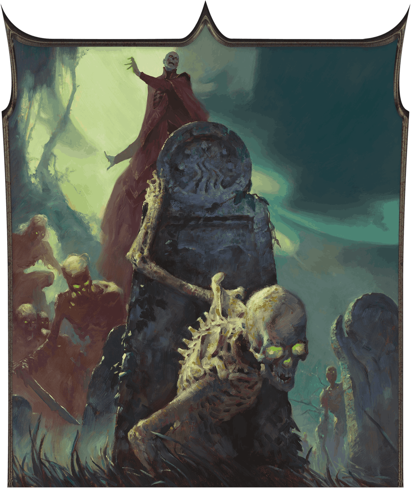
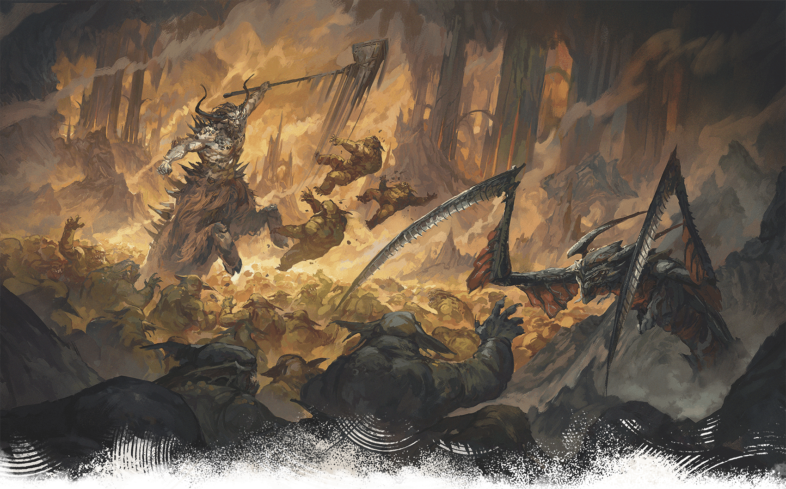
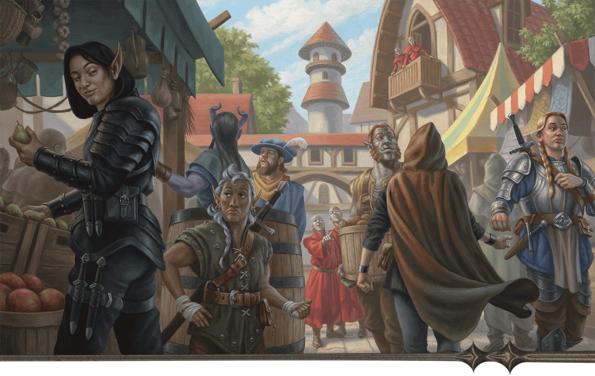

<!-- Notes MJ : contenu fourni par l’utilisateur, non destiné au partage public. -->

# Chapter 2: Thay In Danger

Chapter 2

# Thay In Danger

SIDHARTH CHATURVEDI

The lich Szass Tam plans to raise an army of undead infused with demonic power.

This chapter describes the campaign that unfolds in chapters 3–7: Operation Deadfall. In this magical spy thriller, the characters work as agents for a Thayan leader to undermine and defeat [Szass Tam](https://www.dndbeyond.com/sources/dnd/dmg-2024/lore-glossary#SzassTam), a lich and the zulkir of necromancy. If the characters are successful, they might keep him dead for one hundred years, protecting the world from his despotic plans. If the characters fail, undead hordes infused with demonic power will overrun Thay and kill anyone who doesn’t swear fealty to Szass Tam.

This chapter also provides tools for preparing and running a campaign in which espionage, political intrigue, and dangerous missions are core elements. Character creation tips and guidelines help you assist players in creating characters suited to this campaign.

## Evil Regent Rising

Szass Tam is a tyrannical lich necromancer obsessed with commanding undead hordes. He envisions a Thay in which all residents bow to him or become his undead servants. (Read more about the lich in “Szass Tam” in [appendix B](../appendix-b-bestiary/chapter.md#SzassTam).)

Szass Tam has spent the last 150 years plotting to take over Thay. After becoming zulkir of necromancy and gaining lichdom, he tried to harness the power of Eltab, the demon formerly trapped underneath Thay’s capital. Szass Tam intended to enhance his own magic with demonic power and thereby stifle any who would oppose his rule. When he failed, he raised an army of undead, killed the zulkirs who opposed him, and declared himself regent.

A few decades ago, Szass Tam restored the zulkir council and installed loyal zulkirs to spare himself from the minutiae of rule. But rivals have overthrown those zulkirs and recognize Szass Tam only as zulkir of necromancy, not as Thay’s regent. The lich is enraged that anyone dares question his authority and plots to retake control of the nation.

### Demonic Ritual

Szass Tam plans to raise an army of undead to overrun Thay, then declare himself regent. He has devised a ritual he calls Malefice Mortum (pronounced MAL-uh-fis MOR-tum) that would raise an undead army while simultaneously siphoning Abyssal power from demons and infusing that energy into those undead. The resulting demonic undead, called malefites (pronounced MAL-uh-fights), glow with unholy green energy.

When the campaign begins, Szass Tam is ensconced in his lair in Thaymount, trapping powerful demons and draining their Abyssal power.

#### Szass Tam’s Aim

Szass Tam’s Malefice Mortum ritual is just his first step toward reclaiming Thay. After his malefites sweep the nation, he plans to kill any zulkirs who oppose him and seize power.

#### Growing Demonic Power

Szass Tam’s experiments using the foul magic of his Malefice Mortum ritual have created groups of malefites that roam Thay’s countryside, attacking innocents and destroying homes.

The experiments also weakened the veil between the Material Plane and the [Abyss](https://www.dndbeyond.com/sources/dnd/dmg-2024/cosmology#Abyss). Some demons have invaded Thay to wreak havoc, and more will pour into the region after Szass Tam’s ritual is complete. (See [appendix B](../appendix-b-bestiary/chapter.md) for new demons that invade Thay.) Szass Tam doesn’t care about the suffering he causes; he considers Thayans valuable only as fodder for his hordes.

## Thay’s Only Hope

Before this campaign, [Zulkir Xelnene Thrul](https://www.dndbeyond.com/monsters/6719634-xelnene-thrul) learned of Szass Tam’s plans through her spies. Thrul warned the other zulkirs that Szass Tam planned to attack Thay and betray them, but they dismissed her, insisting she was the one who coveted ultimate power.

The other zulkirs had anonymously received correspondence between Thrul and unnamed Red Wizards that indicated Thrul—the second-strongest zulkir, behind Szass Tam—planned to oust the lich and defeat the others to claim Thay’s regency. Thrul eventually proved the correspondence was fabricated, but the paranoid zulkirs still don’t trust her intelligence about Szass Tam. Thrul knows Szass Tam is behind the effort to discredit her, but she can’t prove it.

Thrul also knows that defeating Szass Tam in combat would require the combined might of the Council of Zulkirs; without the others’ help, that approach is impossible. So Thrul, a master of spycraft accustomed to working behind the scenes to achieve her goals, launched Operation Deadfall: a high-risk espionage effort to undermine and defeat Szass Tam.

In this campaign, the characters become Thrul’s field agents. They’re the only ones standing between Szass Tam and Thay’s destruction. They should have their own reasons for wanting to save Thay. Perhaps it’s their homeland, perhaps they hail from a realm that would be threatened by the lich-regent, or perhaps they’re committed to affecting political change in this harsh nation.

Regardless, Operation Deadfall is extremely dangerous. Szass Tam has spies everywhere, and if he or his agents discover the operation’s details, he’ll murder everyone involved.

## Campaign Summary

The campaign requires the characters to target Szass Tam’s spy network, gather allies, and confront the lich. The plot is further outlined below.

### Chapter 3

[Chapter 3](../chapter-03-operation-deadfall/chapter.md) takes place in Eltabbar, Thay’s capital. After malefites attack the bazaar, the characters are recruited into Operation Deadfall. They undertake missions to weaken Szass Tam’s spy network so their future work can go undetected.

### Chapter 4

In [chapter 4](../chapter-04-peril-in-pyarados/chapter.md), the characters travel to a rural tax station in the tharch of Pyarados, where they try to convince disgruntled militia members to join their fight. They also travel to an abandoned temple to seek the [Spirit-Binding Censer](https://www.dndbeyond.com/magic-items/11914557-spirit-binding-censer), which could keep Szass Tam dead for one hundred years.

### Chapter 5

In [chapter 5](../chapter-05-rebel-alliances/chapter.md), the characters travel to the hinterlands of the tharch of Eltabbar to seek aid from rebellious Red Wizards who could help the characters reach Szass Tam’s ritual site discreetly. They also journey to the island of Alaor Minor to convince pirates to join their cause.

### Chapter 6

The characters return to Thay’s capital in [chapter 6](https://www.dndbeyond.com/sources/dnd/aud/chapter-6-percipice-of-oblivion), but when they attempt to rendezvous with Thrul, they find their operation headquarters ransacked. Szass Tam’s agents have discovered Operation Deadfall. After dealing with the aftermath of this exposure, the characters race to Thaymount to find the underground tunnel that leads to Szass Tam’s lair. They must break through the barrier the lich has placed around the tunnel’s entrance and contend with demons that flood the region.

### Chapter 7

Finally, in [chapter 7](../chapter-07-szass-tam-must-die/chapter.md), the characters contend with a powerful clan of snakelike people called sarrukhs who guard the areas outside Szass Tam’s ritual chamber. On entering the chamber, they find Zulkir Thrul near death and must face Szass Tam once and for all.

## Preparing the Campaign

Before beginning this campaign, review the “Campaign Start” section of the [Dungeon Master’s Guide](https://www.dndbeyond.com/sources/dnd/dmg-2024). Plan to share the following information with the players prior to your game:

- **Campaign Length.** This campaign will likely span fifteen or more sessions.
- **High Level.** Characters should be level 11 when the campaign begins. If players don’t already have characters of this level, they’ll need to create new ones.
- **Spy Thriller.** This campaign combines elements of high fantasy and spy thrillers. Players should anticipate a plot that involves schemes and subterfuge in addition to fantasy action.

### Preparation

Before your first session, review chapters 3–7, taking notes as needed. The campaign’s details might spark ideas for character backstories to suggest to your players or for NPCs you want to emphasize.

Each chapter begins with a page to help you prepare and run it that includes the following:

- **Key Plot Points:** A summary of the important elements in the chapter’s story
- **Preparation:** Steps to prepare to run the chapter, including the stat blocks from the [Monster Manual](https://www.dndbeyond.com/sources/dnd/mm-2024) or [appendix B](../appendix-b-bestiary/chapter.md) that you might need
- **Key NPCs:** A [table](../chapter-03-operation-deadfall/chapter.md#KeyNPCs) summarizing the names, roles, stat blocks, and locations of key nonplayer characters in the chapter

## Magical Spy Thriller

KENT DAVIS

Szass Tam’s ritual will weaken the veil between planes, allowing demons to pour into Thay.

This campaign is a spy thriller. The fate of Thay lies on the characters’ shoulders, but no one can know about their heroics. Use the guidance in this section to emphasize Operation Deadfall’s high stakes, the importance of secrecy, and the danger involved.

### Running a Magical Spy Thriller

A magical thriller focuses on careful planning and the use of magic while tensions run high and the stakes are higher.

For example, the characters might need to get a target—a dangerous Red Wizard—alone and convince the target to betray Szass Tam. If they arouse the target’s suspicions, the characters jeopardize their clandestine mission.

Two characters, both gregarious charmers, begin chatting with the target at a bar the target frequents. An unremarkable drinker—another character—watches and whispers a [Message](https://www.dndbeyond.com/spells/2619034-message) spell to a fourth character, who lurks in the alley outside. The character in the alley shoos away bystanders while the gregarious characters usher the target into the alley under false pretenses. The characters have the target alone and can bribe, persuade, or intimidate the target—whatever they think will be most effective.

If this mission goes smoothly, it’s thanks to the characters’ coordination. Even though the characters kept cool, it’s likely they—and the players—felt tension about what might happen if their plan fell apart.

Use the following suggestions to reinforce the themes of a magical thriller.

#### Base of Operations

The characters might have a home, a [Bastion](https://www.dndbeyond.com/sources/dnd/dmg-2024/bastions), or another facility from which they decide to run their espionage activities. If they don’t want to use a personal location as their base, suggest the Crystal Ball Inn as their meeting place. The inn is described in chapter 1 in “[Eltabbar, Thay’s Capital](../chapter-01-thay/chapter.md#EltabbarThaysCapital).”

#### Code Names

Since the characters must not openly discuss their missions in public, Zulkir Thrul assigns code names to their targets and goals. Code names are nicknames that obscure the subject’s identity, allowing the discussion of sensitive matters in public without identifying real names.

The characters might come up with code names for other aspects of their clandestine work. Encourage this tactic; the more your game leans into this staple of espionage storytelling, the more fun your players are likely to have.

In chapter 3, Thrul asks the characters to determine a code name for their group as well as one for each character. It’s important for the players to like their characters’ code names, since that’s how others will refer to them throughout the campaign.

Roll on or choose results from the Group Code Names table and the Character Code Names table to help inspire these code names.

#### Group Code Names

| 1d10 | Type |
| --- | --- |
| 1 | Bakers |
| 2 | Chandlers |
| 3 | Doppelgangers |
| 4 | Gardeners |
| 5 | Patricians |
| 6 | Phantoms |
| 7 | Rat Catchers |
| 8 | Serpents |
| 9 | Weavers |
| 10 | Zero Team |

#### Character Code Names

| 1d10 | Type |
| --- | --- |
| 1 | Ace |
| 2 | Ghost |
| 3 | Hawk |
| 4 | Listener |
| 5 | Onyx |
| 6 | Peril |
| 7 | Shadow |
| 8 | Sunny |
| 9 | Wyrm |
| 10 | Zenith |

#### Magical Tactics

Level 11 characters begin play with access to powerful magical resources that can help them remain covert. Whether the characters wield spells or magic items, encourage them to avoid suspicion via creative use of magic.

If your players aren’t sure how to use magic to aid their espionage activities, suggest the options below to spark their imaginations.

***Magical Reconnaissance.*** The [Greater Invisibility](https://www.dndbeyond.com/spells/2618958-greater-invisibility) spell can allow characters to scout or sneak about unseen. Similarly, the [Scrying](https://www.dndbeyond.com/spells/2619007-scrying) spell might help them learn about a target from afar. Later in the campaign, the [Teleport](https://www.dndbeyond.com/spells/2619163-teleport) spell can help characters quickly get in and out of locations without being spotted.

***Magical Infiltration.*** The [Invisibility](https://www.dndbeyond.com/spells/2619116-invisibility) spell could help characters remain unseen in crowds; the [Mass Suggestion](https://www.dndbeyond.com/spells/2619029-mass-suggestion) spell could prompt bystanders to leave an area the party wants to infiltrate.

***Magically Hiding Evidence.***The [Illusory Script](https://www.dndbeyond.com/spells/2619173-illusory-script) spell is useful for concealing incriminating written communication from prying eyes. If the evidence is a magic item, the [Nystul’s Magic Aura](https://www.dndbeyond.com/spells/2619124-nystuls-magic-aura) spell could make it appear to be nonmagical or appear to belong to a different school of magic.

***Magically Hiding Identities.*** In chapter 3, Thrul gives each character a [Masquerader’s Brooch](https://www.dndbeyond.com/magic-items/11914533-masqueraders-brooch) (see [appendix A](../appendix-a-magic-item/chapter.md#MasqueradersBrooch)) to help them hide their identities when meeting with her. Other magic items they could use to hide their identities or misdirect enemies include a [Hat of Disguise](https://www.dndbeyond.com/magic-items/4651-hat-of-disguise) and a [Staff of Birdcalls](https://www.dndbeyond.com/magic-items/9229092-staff-of-birdcalls). Similarly, the characters can use Illusion spells such as [Alter Self](https://www.dndbeyond.com/spells/2618846-alter-self), [Disguise Self](https://www.dndbeyond.com/spells/2619102-disguise-self), or [Seeming](https://www.dndbeyond.com/spells/2619014-seeming) to hide their identities.

### Importance of Secrecy

It’s up to you whether you think the characters are doing enough to keep their activities clandestine during Operation Deadfall. If the characters aren’t secretive, there should be consequences, as discussed in “Three Failures” below.

#### Use Your Discretion

How much being noticed during their missions gets the characters into trouble depends on the context. If a bystander notices the characters breaking into a building or attacking a target, the bystander won’t automatically know the group’s goal. However, if the characters do these things while discussing their plan to defeat Szass Tam, they’re not respecting Zulkir Thrul’s mandated secrecy. If they’re usually careful, you might decide that the only witness follows the Closed Eyes tradition (see “[Closed Eyes](../chapter-01-thay/chapter.md#ClosedEyes)” in chapter 1) and doesn’t report the characters’ activities to the authorities.

#### Reward Consistent Secrecy

If the characters take pains to hide their espionage—always using code names and liberally employing magic to cover their trail, for example—you could skip some encounters as a reward. The campaign provides guidance on encounters in chapters 3–4 you can skip, and you might choose to skip others.

#### Three Failures

The characters can fail their secrecy mandate three times before their ability to complete Operation Deadfall is compromised. Each time you decide the characters seriously violate secrecy, describe one of the following events:

- **Dead Agents.** While the characters are in Eltabbar, they hear that Red Wizards loyal to Szass Tam have discovered and executed several spies working against the lich. The next time the characters speak with Zulkir Thrul or her agents, the characters learn the spies were working for Thrul. She believes the spies were mistaken for the characters and warns the characters to be more careful.
- **Enemies on Alert.** While the characters are in Eltabbar, they notice that City Watch patrols have increased. The next time the characters speak with Zulkir Thrul, she tells them the patrols are Szass Tam loyalists who are hunting the characters. She warns the characters to be more careful.
- **Raided Allies.** The next time the characters speak with Zulkir Thrul or her agents, they learn that several agents’ safe houses were raided by Szass Tam’s loyalists. She believes the loyalists were looking for the characters’ hideout and warns the characters to be more careful.

These events can happen in any order, and you can repeat events if you like. Once three events have happened, the next time the characters violate their secrecy mandate, they suffer a serious narrative consequence (see “Compromised Characters”).

#### Compromised Characters

The fourth time you decide the characters seriously violate their secrecy mandate, the characters are compromised. Zulkir Thrul sends them a note (whose content is obfuscated via the [Illusory Script](https://www.dndbeyond.com/spells/2619173-illusory-script) spell) informing them that Szass Tam’s agents have discovered their identities.

The characters have a final chance to salvage their ability to complete Operation Deadfall. Describe the following mission options and allow them to pursue one of their choice:

- **Destroy the Dossier.** A tiefling spy leader for Szass Tam named Nya Yar (Medium, Neutral Evil [Archpriest](https://www.dndbeyond.com/monsters/5194903-archpriest)) has collected a dossier that implicates the characters. The characters must destroy the dossier to regain anonymity. A worshipper of Bane, Yar operates a spy outpost based in a hookah bar. Use [map 3.4](../chapter-03-operation-deadfall/chapter.md#TheHoodedLanternLocations) in chapter 3 for this encounter, with the dossier hidden in [area H2](../chapter-03-operation-deadfall/chapter.md#H2Storage). Yar and 1d4 [Spy Masters](https://www.dndbeyond.com/monsters/5195216-spy-master) are in the building at all times. (If the characters attempt this mission more than once, change the spy leader’s name each time.)
- **Fake Your Death.** The characters must convince Szass Tam’s agents they’re dead. To do this, the characters must spend 2,500 GP and work with Thrul’s agents for 24 hours to create a scene of violent destruction in an appropriate space (the details are up to you). The agents then use [Spell Scrolls](https://www.dndbeyond.com/magic-items/9229085-spell-scroll) to cast [Feign Death](https://www.dndbeyond.com/spells/2618873-feign-death) on each character before anonymously alerting Szass Tam’s loyalists. A group can use this option once; Szass Tam’s agents won’t be fooled twice.
- **Hire the Cleaners.** The characters can give Thrul or her agents 5,000 GP to hire mages to remove evidence of the characters’ recent activities by bribing witnesses, magically modifying memories, or the like.

Zulkir Thrul is unwilling to pay any costs associated with salvage missions.

If the characters successfully complete a salvage mission, continue the campaign as if they hadn’t violated their secrecy mandate. The characters can complete “Destroy the Dossier” and “Hire the Cleaners” as many times during the campaign as you allow.

## Character Creation

This campaign is designed for four to six level 11 characters. Your players might create new characters or use characters they’ve played previously.

### New Characters

Scott Murphy

Operatives distract Red Wizards while others make a hand off.

New characters should be suited for a covert operation. Being adept at stealth, social skills, useful magic, and problem-solving could mean the difference between completing a mission without alerting Szass Tam’s allies and blowing the operation.

Characters might have myriad reasons to undertake Operation Deadfall. Zulkir Thrul offers ample payment, of course, but this campaign is most satisfying if new characters hate Szass Tam. “[Thayan Adventurers](../chapter-01-thay/chapter.md#ThayanAdventurers)” in chapter 1 provides more details about Thayans who pursue adventuring.

#### Playing Thayan Characters

Roll on or choose results from the Thayan Character Motivations table to help players develop their characters’ backstories.

#### Thayan Character Motivations

| 1d6 | Details |
| --- | --- |
| 1 | The character’s loved one was murdered by a Red Wizard who served Szass Tam. The character has plotted against those loyalists, accepting mercenary work that targets such Red Wizards and their allies. |
| 2 | The character’s loved one aspired to serve Szass Tam. The character tried to dissuade the loved one, who died due to their ambitions. |
| 3 | The character’s family was prominent in Thayan society, but an ancestor opposed Szass Tam, who killed the ancestor and ruined the family. The character blames the lich for their family’s misfortunes. |
| 4 | The character was on track to become a Red Wizard or a Thayan knight but spoke against Szass Tam, whose allies killed the character’s employers. The character took mercenary work to survive. |
| 5 | The character’s parents were in the magic items trade. They competed with Szass Tam, whose allies framed the family for treason. The character now seeks revenge. |
| 6 | The character is an Open Eyes rebel and might come from a long line of Thayan political dissidents. The character hates Szass Tam and other evil Red Wizards. |

#### Playing a Red Wizard

One or more of your players might want to play a Red Wizard who opposes Szass Tam. The characters also might have pledged loyalty to Zulkir Thrul; this provides a good reason why she recruits them.

A Red Wizard character might be of any species from the [Player’s Handbook](https://www.dndbeyond.com/sources/dnd/phb-2024). The following backgrounds are common for Red Wizards. Entries marked with an asterisk are from [Arcana Unleashed](https://www.dndbeyond.com/sources/dnd/au):

[Bejeweled Conclave Spy](https://www.dndbeyond.com/sources/dnd/au/chapter-1-character-options#BejeweledConclaveSpy)\*

[Covenant of the Grave Recruit](https://www.dndbeyond.com/sources/dnd/au/chapter-1-character-options#CovenantOfTheGraveRecruit)\*

[Merchant](https://www.dndbeyond.com/sources/dnd/phb-2024/character-origins#Merchant)

[Noble](https://www.dndbeyond.com/sources/dnd/phb-2024/character-origins#Noble)

[Sage](https://www.dndbeyond.com/sources/dnd/phb-2024/character-origins#Sage)

[Scribe](https://www.dndbeyond.com/sources/dnd/phb-2024/character-origins#Scribe)

[Seer Apprentice](https://www.dndbeyond.com/sources/dnd/au/chapter-1-character-options#SeerApprentice)\*

[Ward of the Sheltering Hands](https://www.dndbeyond.com/sources/dnd/au/chapter-1-character-options#WardOfTheShelteringHands)\*

The Red Wizard Class Options table suggests classes and subclasses common for Red Wizards.

#### Red Wizard Class Options

| Class | Suggested Subclasses |
| --- | --- |
| Sorcerer | Aberrant Sorcery |
| Warlock | Fiend Patron, Great Old One Patron |
| Wizard | Abjurer, Conjurer\*, Enchanter\*, Diviner, Evoker, Illusionist, Necromancer\*, Transmuter\* |
|  |  |  |  |
| --- | --- | --- | --- |
| \*See [Arcana Unleashed](https://www.dndbeyond.com/sources/dnd/au). | | | |

Encourage players who want to play Red Wizard characters to review “[Red Wizards](../chapter-01-thay/chapter.md#RedWizards)” in chapter 1. Appendix A includes magic items Red Wizard characters might want, including a [Robe of Thayan Arcana](https://www.dndbeyond.com/magic-items/11914535-robe-of-thayan-arcana) and a [Scarlet Spellbook](https://www.dndbeyond.com/magic-items/11914536-scarlet-spellbook). The characters might find these items in [chapter 5](../chapter-05-rebel-alliances/chapter.md). [Forgotten Realms: Heroes of Faerûn](https://www.dndbeyond.com/sources/dnd/frhof) includes rules for Thayan Spell Tattoos, which you might decide are available to characters.

#### Playing a Thayan Knight

If one of your characters is a Red Wizard, another player might want to play a Thayan knight who serves that Red Wizard. (Thayan knights are described in [chapter 1](../chapter-01-thay/chapter.md#ThayanKnights).)

A Thayan knight character might be of any species from the Player’s Handbook. The following backgrounds are common for Thayan knights:

Guard

Noble

Sage

Soldier

The Thayan Knight Class Options table suggests classes and subclasses common for Thayan knights.

#### Thayan Knight Class Options

| Class | Suggested Subclasses |
| --- | --- |
| Barbarian | Path of the Berserker |
| Fighter | Champion, Eldritch Knight |
| Paladin | Oath of Glory |

Appendix A includes magic items a Thayan knight character might want, including a [Thayan Sword](https://www.dndbeyond.com/magic-items/11914562-thayan-sword). The characters might find this item in chapter 5.

#### Playing Non-Thayan Characters

Players need not create Thayan characters. At level 11, the heroes might be powerful mercenaries or roving adventurers from anywhere in Faerûn who happen to visit Thay while Szass Tam prepares his Malefice Mortum ritual.

Roll on or choose results from the General Character Motivations table to help players develop their characters’ backstories.

#### General Character Motivations

| 1d6 | Details |
| --- | --- |
| 1 | The character has sworn an oath to oppose tyranny and seek justice for the downtrodden. They believe Szass Tam is one of the world’s worst tyrants and must be stopped. |
| 2 | The character suffered at the hands of an evil necromancer. They find Szass Tam abhorrent and believe he must be destroyed. |
| 3 | The character hails from a nation that borders Thay. Their homeland would suffer greatly if Thay falls to Szass Tam. |
| 4 | The character has close ties to benevolent necromancers or is one. The character finds Szass Tam’s evil necromancy an abomination that must be stopped. |
| 5 | The character is fascinated by the Red Wizards’ approach to magic; they might even be a mage. They fear for the safety of Red Wizards who oppose Szass Tam should he again rise to power. |
| 6 | The character is associated with a good god and finds association with demons hateful. Once they learn Szass Tam’s plan, they decide he must be stopped. |

### Existing Characters

Any character from Faerûn—or another setting, if you allow it—can undertake Operation Deadfall as long as they are of an appropriate level (see “[Character Level](#CharacterLevel)”).

This campaign begins in Eltabbar, so work with your players to come up with a reason why their characters are in the city and why Zulkir Thrul recruits them. Roll on or choose results from the Purpose in Eltabbar table to inspire what brings the characters to the city.

#### Purpose in Eltabbar

| 1d4 | Reason |
| --- | --- |
| 1 | The character is an expert at retrieving kidnapped individuals. A wealthy Thayan family has paid the character to travel to Eltabbar and retrieve their scion from a powerful Red Wizard whose employ the scion wants to leave. |
| 2 | The character studies demonology or necromancy and has heard rumors of powerful energy spikes in Thay. The character believes this is an ill omen and has traveled to Eltabbar to investigate. |
| 3 | The character is a mercenary whose mysterious employer paid them to come to Eltabbar and destroy magic item shipments or sabotage meetings. The character later learns their employer works for Zulkir Thrul. |
| 4 | The character is a political activist who understands that when powerful nations fall under the yoke of tyranny, the whole world suffers. They’ve traveled to Eltabbar to investigate rumors that Szass Tam seeks to regain his regency. |

### Character Level

#### Recommended Character Levels

| Chapter | Starting Level |
| --- | --- |
| 3 | 11 |
| 4 | 13 |
| 5 | 15 |
| 6 | 17 |
| 7 | 19 |

The Recommended Character Levels table indicates the level characters should be when they begin each chapter.

At designated points in the campaign, the characters should have enough XP to reach the required level for the next part of the story. If you’re using a method of level advancement that doesn’t rely on XP, the characters gain a level when the campaign says so.
