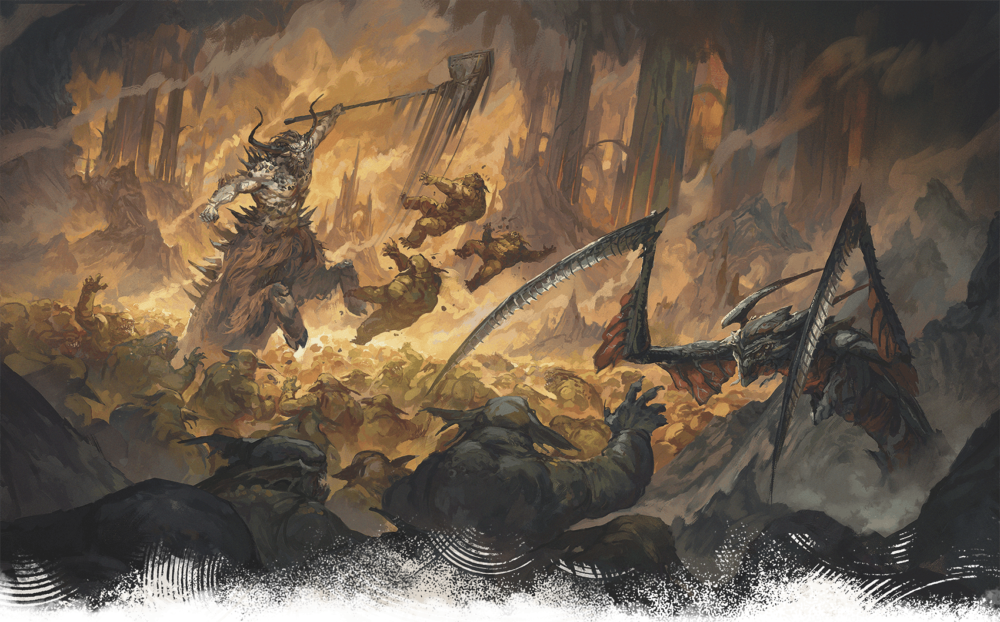

<!-- Notes MJ : contenu fourni par l’utilisateur, non destiné au partage public. -->

## Magical Spy Thriller

KENT DAVIS

Szass Tam’s ritual will weaken the veil between planes, allowing demons to pour into Thay.

This campaign is a spy thriller. The fate of Thay lies on the characters’ shoulders, but no one can know about their heroics. Use the guidance in this section to emphasize Operation Deadfall’s high stakes, the importance of secrecy, and the danger involved.

### Running a Magical Spy Thriller

A magical thriller focuses on careful planning and the use of magic while tensions run high and the stakes are higher.

For example, the characters might need to get a target—a dangerous Red Wizard—alone and convince the target to betray Szass Tam. If they arouse the target’s suspicions, the characters jeopardize their clandestine mission.

Two characters, both gregarious charmers, begin chatting with the target at a bar the target frequents. An unremarkable drinker—another character—watches and whispers a [Message](https://www.dndbeyond.com/spells/2619034-message) spell to a fourth character, who lurks in the alley outside. The character in the alley shoos away bystanders while the gregarious characters usher the target into the alley under false pretenses. The characters have the target alone and can bribe, persuade, or intimidate the target—whatever they think will be most effective.

If this mission goes smoothly, it’s thanks to the characters’ coordination. Even though the characters kept cool, it’s likely they—and the players—felt tension about what might happen if their plan fell apart.

Use the following suggestions to reinforce the themes of a magical thriller.

#### Base of Operations

The characters might have a home, a [Bastion](https://www.dndbeyond.com/sources/dnd/dmg-2024/bastions), or another facility from which they decide to run their espionage activities. If they don’t want to use a personal location as their base, suggest the Crystal Ball Inn as their meeting place. The inn is described in chapter 1 in “[Eltabbar, Thay’s Capital](../../chapter-01-thay/chapter.md#EltabbarThaysCapital).”

#### Code Names

Since the characters must not openly discuss their missions in public, Zulkir Thrul assigns code names to their targets and goals. Code names are nicknames that obscure the subject’s identity, allowing the discussion of sensitive matters in public without identifying real names.

The characters might come up with code names for other aspects of their clandestine work. Encourage this tactic; the more your game leans into this staple of espionage storytelling, the more fun your players are likely to have.

In chapter 3, Thrul asks the characters to determine a code name for their group as well as one for each character. It’s important for the players to like their characters’ code names, since that’s how others will refer to them throughout the campaign.

Roll on or choose results from the Group Code Names table and the Character Code Names table to help inspire these code names.

#### Group Code Names

| 1d10 | Type |
| --- | --- |
| 1 | Bakers |
| 2 | Chandlers |
| 3 | Doppelgangers |
| 4 | Gardeners |
| 5 | Patricians |
| 6 | Phantoms |
| 7 | Rat Catchers |
| 8 | Serpents |
| 9 | Weavers |
| 10 | Zero Team |

#### Character Code Names

| 1d10 | Type |
| --- | --- |
| 1 | Ace |
| 2 | Ghost |
| 3 | Hawk |
| 4 | Listener |
| 5 | Onyx |
| 6 | Peril |
| 7 | Shadow |
| 8 | Sunny |
| 9 | Wyrm |
| 10 | Zenith |

#### Magical Tactics

Level 11 characters begin play with access to powerful magical resources that can help them remain covert. Whether the characters wield spells or magic items, encourage them to avoid suspicion via creative use of magic.

If your players aren’t sure how to use magic to aid their espionage activities, suggest the options below to spark their imaginations.

***Magical Reconnaissance.*** The [Greater Invisibility](https://www.dndbeyond.com/spells/2618958-greater-invisibility) spell can allow characters to scout or sneak about unseen. Similarly, the [Scrying](https://www.dndbeyond.com/spells/2619007-scrying) spell might help them learn about a target from afar. Later in the campaign, the [Teleport](https://www.dndbeyond.com/spells/2619163-teleport) spell can help characters quickly get in and out of locations without being spotted.

***Magical Infiltration.*** The [Invisibility](https://www.dndbeyond.com/spells/2619116-invisibility) spell could help characters remain unseen in crowds; the [Mass Suggestion](https://www.dndbeyond.com/spells/2619029-mass-suggestion) spell could prompt bystanders to leave an area the party wants to infiltrate.

***Magically Hiding Evidence.***The [Illusory Script](https://www.dndbeyond.com/spells/2619173-illusory-script) spell is useful for concealing incriminating written communication from prying eyes. If the evidence is a magic item, the [Nystul’s Magic Aura](https://www.dndbeyond.com/spells/2619124-nystuls-magic-aura) spell could make it appear to be nonmagical or appear to belong to a different school of magic.

***Magically Hiding Identities.*** In chapter 3, Thrul gives each character a [Masquerader’s Brooch](https://www.dndbeyond.com/magic-items/11914533-masqueraders-brooch) (see [appendix A](../../appendix-a-magic-item/chapter.md#MasqueradersBrooch)) to help them hide their identities when meeting with her. Other magic items they could use to hide their identities or misdirect enemies include a [Hat of Disguise](https://www.dndbeyond.com/magic-items/4651-hat-of-disguise) and a [Staff of Birdcalls](https://www.dndbeyond.com/magic-items/9229092-staff-of-birdcalls). Similarly, the characters can use Illusion spells such as [Alter Self](https://www.dndbeyond.com/spells/2618846-alter-self), [Disguise Self](https://www.dndbeyond.com/spells/2619102-disguise-self), or [Seeming](https://www.dndbeyond.com/spells/2619014-seeming) to hide their identities.

### Importance of Secrecy

It’s up to you whether you think the characters are doing enough to keep their activities clandestine during Operation Deadfall. If the characters aren’t secretive, there should be consequences, as discussed in “Three Failures” below.

#### Use Your Discretion

How much being noticed during their missions gets the characters into trouble depends on the context. If a bystander notices the characters breaking into a building or attacking a target, the bystander won’t automatically know the group’s goal. However, if the characters do these things while discussing their plan to defeat Szass Tam, they’re not respecting Zulkir Thrul’s mandated secrecy. If they’re usually careful, you might decide that the only witness follows the Closed Eyes tradition (see “[Closed Eyes](../../chapter-01-thay/chapter.md#ClosedEyes)” in chapter 1) and doesn’t report the characters’ activities to the authorities.

#### Reward Consistent Secrecy

If the characters take pains to hide their espionage—always using code names and liberally employing magic to cover their trail, for example—you could skip some encounters as a reward. The campaign provides guidance on encounters in chapters 3–4 you can skip, and you might choose to skip others.

#### Three Failures

The characters can fail their secrecy mandate three times before their ability to complete Operation Deadfall is compromised. Each time you decide the characters seriously violate secrecy, describe one of the following events:

- **Dead Agents.** While the characters are in Eltabbar, they hear that Red Wizards loyal to Szass Tam have discovered and executed several spies working against the lich. The next time the characters speak with Zulkir Thrul or her agents, the characters learn the spies were working for Thrul. She believes the spies were mistaken for the characters and warns the characters to be more careful.
- **Enemies on Alert.** While the characters are in Eltabbar, they notice that City Watch patrols have increased. The next time the characters speak with Zulkir Thrul, she tells them the patrols are Szass Tam loyalists who are hunting the characters. She warns the characters to be more careful.
- **Raided Allies.** The next time the characters speak with Zulkir Thrul or her agents, they learn that several agents’ safe houses were raided by Szass Tam’s loyalists. She believes the loyalists were looking for the characters’ hideout and warns the characters to be more careful.

These events can happen in any order, and you can repeat events if you like. Once three events have happened, the next time the characters violate their secrecy mandate, they suffer a serious narrative consequence (see “Compromised Characters”).

#### Compromised Characters

The fourth time you decide the characters seriously violate their secrecy mandate, the characters are compromised. Zulkir Thrul sends them a note (whose content is obfuscated via the [Illusory Script](https://www.dndbeyond.com/spells/2619173-illusory-script) spell) informing them that Szass Tam’s agents have discovered their identities.

The characters have a final chance to salvage their ability to complete Operation Deadfall. Describe the following mission options and allow them to pursue one of their choice:

- **Destroy the Dossier.** A tiefling spy leader for Szass Tam named Nya Yar (Medium, Neutral Evil [Archpriest](https://www.dndbeyond.com/monsters/5194903-archpriest)) has collected a dossier that implicates the characters. The characters must destroy the dossier to regain anonymity. A worshipper of Bane, Yar operates a spy outpost based in a hookah bar. Use [map 3.4](../../chapter-03-operation-deadfall/chapter.md#TheHoodedLanternLocations) in chapter 3 for this encounter, with the dossier hidden in [area H2](../../chapter-03-operation-deadfall/chapter.md#H2Storage). Yar and 1d4 [Spy Masters](https://www.dndbeyond.com/monsters/5195216-spy-master) are in the building at all times. (If the characters attempt this mission more than once, change the spy leader’s name each time.)
- **Fake Your Death.** The characters must convince Szass Tam’s agents they’re dead. To do this, the characters must spend 2,500 GP and work with Thrul’s agents for 24 hours to create a scene of violent destruction in an appropriate space (the details are up to you). The agents then use [Spell Scrolls](https://www.dndbeyond.com/magic-items/9229085-spell-scroll) to cast [Feign Death](https://www.dndbeyond.com/spells/2618873-feign-death) on each character before anonymously alerting Szass Tam’s loyalists. A group can use this option once; Szass Tam’s agents won’t be fooled twice.
- **Hire the Cleaners.** The characters can give Thrul or her agents 5,000 GP to hire mages to remove evidence of the characters’ recent activities by bribing witnesses, magically modifying memories, or the like.

Zulkir Thrul is unwilling to pay any costs associated with salvage missions.

If the characters successfully complete a salvage mission, continue the campaign as if they hadn’t violated their secrecy mandate. The characters can complete “Destroy the Dossier” and “Hire the Cleaners” as many times during the campaign as you allow.
