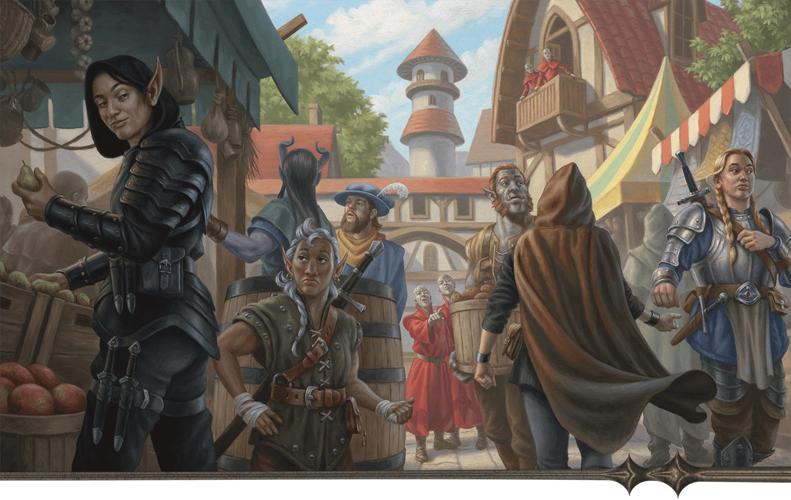

<!-- Notes MJ : contenu fourni par l’utilisateur, non destiné au partage public. -->

## Character Creation

This campaign is designed for four to six level 11 characters. Your players might create new characters or use characters they’ve played previously.

### New Characters

Scott Murphy

Operatives distract Red Wizards while others make a hand off.

New characters should be suited for a covert operation. Being adept at stealth, social skills, useful magic, and problem-solving could mean the difference between completing a mission without alerting Szass Tam’s allies and blowing the operation.

Characters might have myriad reasons to undertake Operation Deadfall. Zulkir Thrul offers ample payment, of course, but this campaign is most satisfying if new characters hate Szass Tam. “[Thayan Adventurers](../../chapter-01-thay/chapter.md#ThayanAdventurers)” in chapter 1 provides more details about Thayans who pursue adventuring.

#### Playing Thayan Characters

Roll on or choose results from the Thayan Character Motivations table to help players develop their characters’ backstories.

#### Thayan Character Motivations

| 1d6 | Details |
| --- | --- |
| 1 | The character’s loved one was murdered by a Red Wizard who served Szass Tam. The character has plotted against those loyalists, accepting mercenary work that targets such Red Wizards and their allies. |
| 2 | The character’s loved one aspired to serve Szass Tam. The character tried to dissuade the loved one, who died due to their ambitions. |
| 3 | The character’s family was prominent in Thayan society, but an ancestor opposed Szass Tam, who killed the ancestor and ruined the family. The character blames the lich for their family’s misfortunes. |
| 4 | The character was on track to become a Red Wizard or a Thayan knight but spoke against Szass Tam, whose allies killed the character’s employers. The character took mercenary work to survive. |
| 5 | The character’s parents were in the magic items trade. They competed with Szass Tam, whose allies framed the family for treason. The character now seeks revenge. |
| 6 | The character is an Open Eyes rebel and might come from a long line of Thayan political dissidents. The character hates Szass Tam and other evil Red Wizards. |

#### Playing a Red Wizard

One or more of your players might want to play a Red Wizard who opposes Szass Tam. The characters also might have pledged loyalty to Zulkir Thrul; this provides a good reason why she recruits them.

A Red Wizard character might be of any species from the [Player’s Handbook](https://www.dndbeyond.com/sources/dnd/phb-2024). The following backgrounds are common for Red Wizards. Entries marked with an asterisk are from [Arcana Unleashed](https://www.dndbeyond.com/sources/dnd/au):

[Bejeweled Conclave Spy](https://www.dndbeyond.com/sources/dnd/au/chapter-1-character-options#BejeweledConclaveSpy)\*

[Covenant of the Grave Recruit](https://www.dndbeyond.com/sources/dnd/au/chapter-1-character-options#CovenantOfTheGraveRecruit)\*

[Merchant](https://www.dndbeyond.com/sources/dnd/phb-2024/character-origins#Merchant)

[Noble](https://www.dndbeyond.com/sources/dnd/phb-2024/character-origins#Noble)

[Sage](https://www.dndbeyond.com/sources/dnd/phb-2024/character-origins#Sage)

[Scribe](https://www.dndbeyond.com/sources/dnd/phb-2024/character-origins#Scribe)

[Seer Apprentice](https://www.dndbeyond.com/sources/dnd/au/chapter-1-character-options#SeerApprentice)\*

[Ward of the Sheltering Hands](https://www.dndbeyond.com/sources/dnd/au/chapter-1-character-options#WardOfTheShelteringHands)\*

The Red Wizard Class Options table suggests classes and subclasses common for Red Wizards.

#### Red Wizard Class Options

| Class | Suggested Subclasses |
| --- | --- |
| Sorcerer | Aberrant Sorcery |
| Warlock | Fiend Patron, Great Old One Patron |
| Wizard | Abjurer, Conjurer\*, Enchanter\*, Diviner, Evoker, Illusionist, Necromancer\*, Transmuter\* |
|  |  |  |  |
| --- | --- | --- | --- |
| \*See [Arcana Unleashed](https://www.dndbeyond.com/sources/dnd/au). | | | |

Encourage players who want to play Red Wizard characters to review “[Red Wizards](../../chapter-01-thay/chapter.md#RedWizards)” in chapter 1. Appendix A includes magic items Red Wizard characters might want, including a [Robe of Thayan Arcana](https://www.dndbeyond.com/magic-items/11914535-robe-of-thayan-arcana) and a [Scarlet Spellbook](https://www.dndbeyond.com/magic-items/11914536-scarlet-spellbook). The characters might find these items in [chapter 5](../../chapter-05-rebel-alliances/chapter.md). [Forgotten Realms: Heroes of Faerûn](https://www.dndbeyond.com/sources/dnd/frhof) includes rules for Thayan Spell Tattoos, which you might decide are available to characters.

#### Playing a Thayan Knight

If one of your characters is a Red Wizard, another player might want to play a Thayan knight who serves that Red Wizard. (Thayan knights are described in [chapter 1](../../chapter-01-thay/chapter.md#ThayanKnights).)

A Thayan knight character might be of any species from the Player’s Handbook. The following backgrounds are common for Thayan knights:

Guard

Noble

Sage

Soldier

The Thayan Knight Class Options table suggests classes and subclasses common for Thayan knights.

#### Thayan Knight Class Options

| Class | Suggested Subclasses |
| --- | --- |
| Barbarian | Path of the Berserker |
| Fighter | Champion, Eldritch Knight |
| Paladin | Oath of Glory |

Appendix A includes magic items a Thayan knight character might want, including a [Thayan Sword](https://www.dndbeyond.com/magic-items/11914562-thayan-sword). The characters might find this item in chapter 5.

#### Playing Non-Thayan Characters

Players need not create Thayan characters. At level 11, the heroes might be powerful mercenaries or roving adventurers from anywhere in Faerûn who happen to visit Thay while Szass Tam prepares his Malefice Mortum ritual.

Roll on or choose results from the General Character Motivations table to help players develop their characters’ backstories.

#### General Character Motivations

| 1d6 | Details |
| --- | --- |
| 1 | The character has sworn an oath to oppose tyranny and seek justice for the downtrodden. They believe Szass Tam is one of the world’s worst tyrants and must be stopped. |
| 2 | The character suffered at the hands of an evil necromancer. They find Szass Tam abhorrent and believe he must be destroyed. |
| 3 | The character hails from a nation that borders Thay. Their homeland would suffer greatly if Thay falls to Szass Tam. |
| 4 | The character has close ties to benevolent necromancers or is one. The character finds Szass Tam’s evil necromancy an abomination that must be stopped. |
| 5 | The character is fascinated by the Red Wizards’ approach to magic; they might even be a mage. They fear for the safety of Red Wizards who oppose Szass Tam should he again rise to power. |
| 6 | The character is associated with a good god and finds association with demons hateful. Once they learn Szass Tam’s plan, they decide he must be stopped. |

### Existing Characters

Any character from Faerûn—or another setting, if you allow it—can undertake Operation Deadfall as long as they are of an appropriate level (see “[Character Level](../chapter.md#CharacterLevel)”).

This campaign begins in Eltabbar, so work with your players to come up with a reason why their characters are in the city and why Zulkir Thrul recruits them. Roll on or choose results from the Purpose in Eltabbar table to inspire what brings the characters to the city.

#### Purpose in Eltabbar

| 1d4 | Reason |
| --- | --- |
| 1 | The character is an expert at retrieving kidnapped individuals. A wealthy Thayan family has paid the character to travel to Eltabbar and retrieve their scion from a powerful Red Wizard whose employ the scion wants to leave. |
| 2 | The character studies demonology or necromancy and has heard rumors of powerful energy spikes in Thay. The character believes this is an ill omen and has traveled to Eltabbar to investigate. |
| 3 | The character is a mercenary whose mysterious employer paid them to come to Eltabbar and destroy magic item shipments or sabotage meetings. The character later learns their employer works for Zulkir Thrul. |
| 4 | The character is a political activist who understands that when powerful nations fall under the yoke of tyranny, the whole world suffers. They’ve traveled to Eltabbar to investigate rumors that Szass Tam seeks to regain his regency. |

### Character Level

#### Recommended Character Levels

| Chapter | Starting Level |
| --- | --- |
| 3 | 11 |
| 4 | 13 |
| 5 | 15 |
| 6 | 17 |
| 7 | 19 |

The Recommended Character Levels table indicates the level characters should be when they begin each chapter.

At designated points in the campaign, the characters should have enough XP to reach the required level for the next part of the story. If you’re using a method of level advancement that doesn’t rely on XP, the characters gain a level when the campaign says so.
