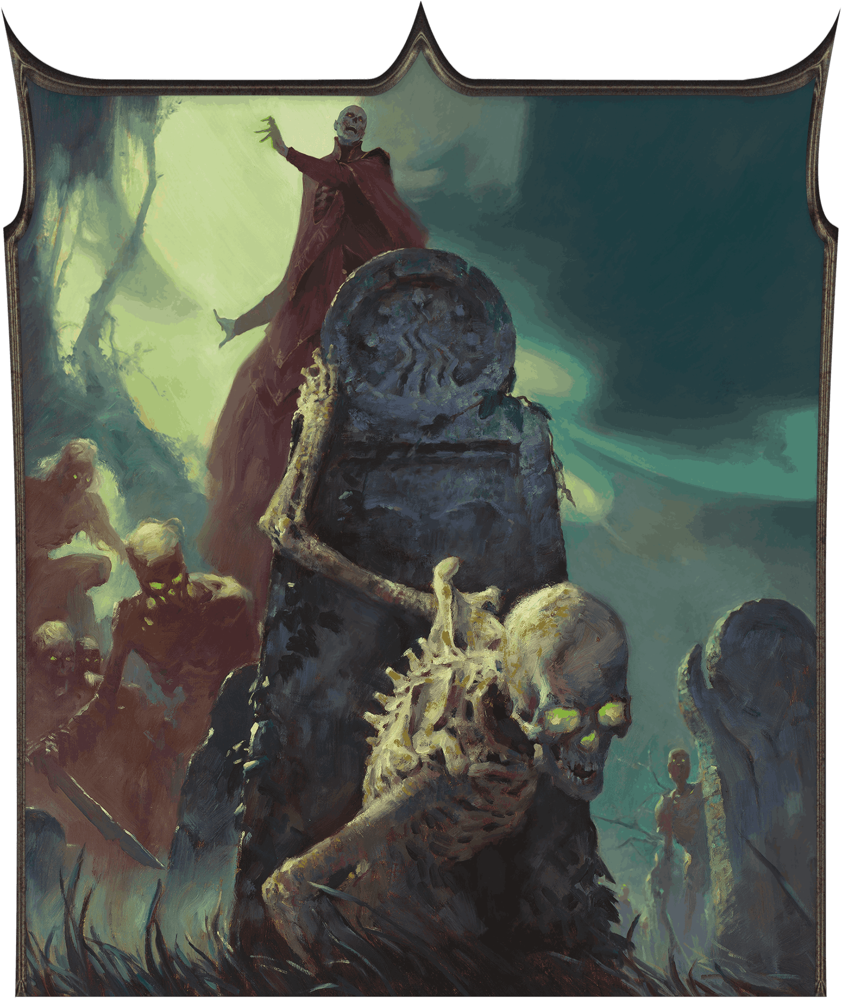

<!-- Notes MJ : contenu fourni par l’utilisateur, non destiné au partage public. -->

# Chapter 2: Thay In Danger

Chapter 2

# Thay In Danger

SIDHARTH CHATURVEDI

The lich Szass Tam plans to raise an army of undead infused with demonic power.

This chapter describes the campaign that unfolds in chapters 3–7: Operation Deadfall. In this magical spy thriller, the characters work as agents for a Thayan leader to undermine and defeat [Szass Tam](https://www.dndbeyond.com/sources/dnd/dmg-2024/lore-glossary#SzassTam), a lich and the zulkir of necromancy. If the characters are successful, they might keep him dead for one hundred years, protecting the world from his despotic plans. If the characters fail, undead hordes infused with demonic power will overrun Thay and kill anyone who doesn’t swear fealty to Szass Tam.

This chapter also provides tools for preparing and running a campaign in which espionage, political intrigue, and dangerous missions are core elements. Character creation tips and guidelines help you assist players in creating characters suited to this campaign.
