<!-- Notes MJ : contenu fourni par l’utilisateur, non destiné au partage public. -->

# Operation Deadfall

Embark on a mission to defeat Szass Tam.

Adventure  
for Level

11

Characters

Sessions

4-5

SIDHARTH CHATURVEDI
[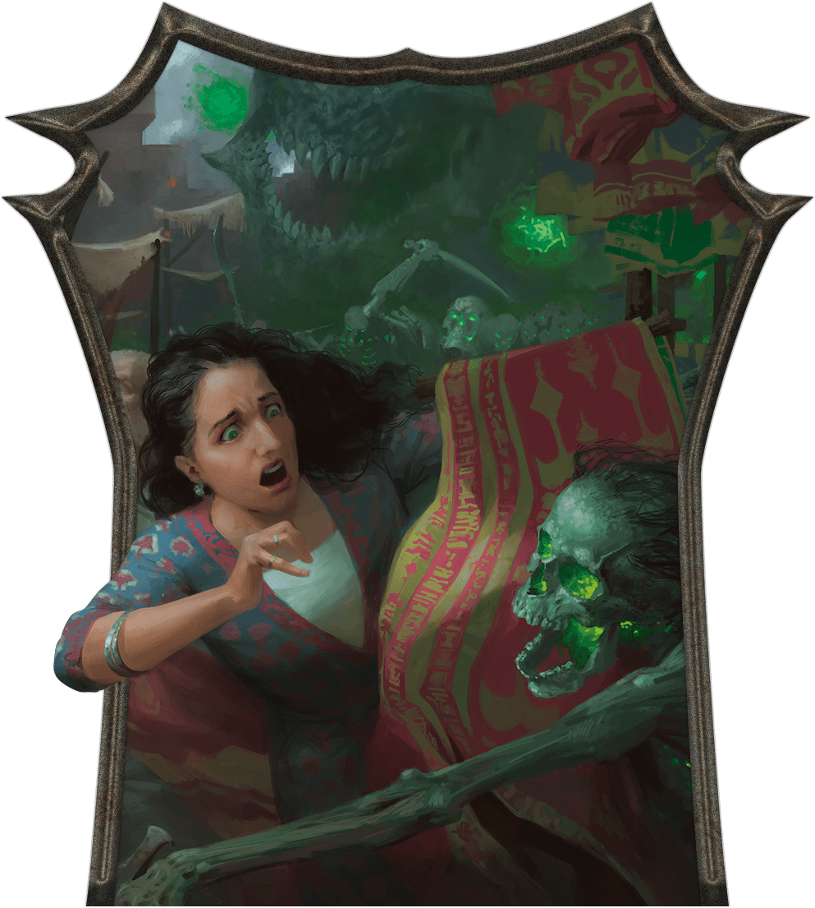](../assets/illustrations/03-001.ch-3-splash.png)

Malefites attack Eltabbar’s bazaar.

## Key Plot Points

The following information is key to this chapter’s story:

- **Malefite Attack.** Malefites attack Eltabbar’s Bazaar Ward. After the monsters are dispatched, the characters are summoned to a nearby tailor shop, Wrynn’s Bespoke Vestments. There, Zulkir Xelnene Thrul recruits them into Operation Deadfall: a secret undertaking to undermine and defeat Szass Tam.
- **First Tasks.** The zulkir tasks the characters with neutralizing three spies key to Szass Tam’s operations: a gambler, a landlord, and a racketeer.
- **Turn the Courier.** The zulkir then orders the characters to infiltrate the headquarters of Szass Tam’s intel courier. There, they can force him to provide information vital to their cause or kill him.

## Preparation

Before running this chapter, prepare as follows:

- **Step 1.** Read the “[Running This Chapter](../chapter.md#RunningThisChapter)” section, including “[Character Advancement](../chapter.md#CharacterAdvancement).”
- **Step 2.** Familiarize yourself with the Key NPCs table below. Two NPCs—[Xelnene Thrul](../../appendix-b-bestiary/chapter.md#XelneneThrul) and [Wynston Wrynn](../chapter.md#MysteriousMessenger)—recur throughout the campaign, while others might make repeat appearances.
- **Step 3.** Bookmark the stat blocks below, which appear in the [Monster Manual](https://www.dndbeyond.com/sources/dnd/mm-2024) and on D&D Beyond unless otherwise noted. If a stat block appears in appendix B, an asterisk appears after its name:

- [Archmage](https://www.dndbeyond.com/monsters/5194902-archmage)
- [Archpriest](https://www.dndbeyond.com/monsters/5194903-archpriest)
- [Assassin](https://www.dndbeyond.com/monsters/5194904-assassin)
- [Bandit Crime Lord](https://www.dndbeyond.com/monsters/5194913-bandit-crime-lord)
- [Bandit Deceiver](https://www.dndbeyond.com/monsters/5194914-bandit-deceiver)
- [Commoner](https://www.dndbeyond.com/monsters/5194951-commoner)

- [Cultist Fanatic](https://www.dndbeyond.com/monsters/4904746-cultist-fanatic)
- [Cultist Hierophant](https://www.dndbeyond.com/monsters/5194955-cultist-hierophant)
- [Death Tyrant](https://www.dndbeyond.com/monsters/5194965-death-tyrant)
- [Gladiator](https://www.dndbeyond.com/monsters/5195042-gladiator)
- [Mage](https://www.dndbeyond.com/monsters/4831023-mage)
- [Noble](https://www.dndbeyond.com/monsters/5195145-noble)

- [Rakshasa](https://www.dndbeyond.com/monsters/5195178-rakshasa)
- [Skeleton](https://www.dndbeyond.com/monsters/4775841-skeleton)
- [Spy Master](https://www.dndbeyond.com/monsters/5195216-spy-master)
- [Stone Golem](https://www.dndbeyond.com/monsters/4904850-stone-golem)
- [Warrior Commander](https://www.dndbeyond.com/monsters/5195258-warrior-commander)
- [Xelnene Thrul](https://www.dndbeyond.com/monsters/6719634-xelnene-thrul)\*

#### Key NPCs

| Name | Role | Stat Block | Location |
| --- | --- | --- | --- |
| Alik Nal | Elf shipping agent | [Mage](https://www.dndbeyond.com/monsters/4831023-mage) (Medium) | [T10](../chapter.md#T10ShippingOffice) |
| Iskan Iskari | Szass Tam’s intel courier and owner of Two Plateaus Shipping Company | [Rakshasa](https://www.dndbeyond.com/monsters/5195178-rakshasa) | [T14](../chapter.md#T14IskarisOffice) |
| Knudrek | Human owner of a gambling den | [Gladiator](https://www.dndbeyond.com/monsters/5195042-gladiator) (Medium) | [H1](../chapter.md#H1Barroom) |
| Pryas Nym | Human landlord and spy target | [Warrior Commander](https://www.dndbeyond.com/monsters/5195258-warrior-commander) (Medium) | [N4](../chapter.md#N4UpstairsHallway) |
| Rathan Jur | Goliath racketeer and spy target | [Bandit Crime Lord](https://www.dndbeyond.com/monsters/5194913-bandit-crime-lord) (Medium, Neutral Evil) | “[Encountering Rathan Jur](../chapter.md#EncounteringRathanJur)” |
| Thellania Marr | Human Red Wizard, gambler, and spy target | [Cultist Hierophant](https://www.dndbeyond.com/monsters/5194955-cultist-hierophant) (Medium) | [H3](../chapter.md#H3GamblingDen) |
| Thom | Human receptionist | [Noble](https://www.dndbeyond.com/monsters/5195145-noble) (Medium) | [T1](../chapter.md#ShippingCompanyT1Reception) |
| Wynston Wrynn | Human tailor and Zulkir Thrul’s spy master | [Spy Master](https://www.dndbeyond.com/monsters/5195216-spy-master) (Medium, Neutral Good) | “[Mysterious Messenger](../chapter.md#MysteriousMessenger)” |
| Xelnene Thrul | Human zulkir of evocation and Operation Deadfall leader | [See appendix B](https://www.dndbeyond.com/monsters/6719634-xelnene-thrul) | “[Zulkir Thrul’s Demiplane](../chapter.md#ZulkirThrulsDemiplane)” |

## Campaign Background

As the campaign begins, the characters are in [Eltabbar](../../chapter-01-thay/chapter.md#EltabbarThaysCapital), the capital of Thay. Thayan politics are always volatile, but the current atmosphere feels like a powder keg.

The lich [Szass Tam](https://www.dndbeyond.com/sources/dnd/dmg-2024/lore-glossary#SzassTam), zulkir of necromancy, has recently made several alarming public proclamations. Pointing to hostile neighbors and the dangers of unchecked magical experimentation at home, Szass Tam demanded the other zulkirs reestablish his regency to protect Thay and help it grow richer from its magic item trade. They balked but made no public response. Surprisingly, Szass Tam then went silent; no one has seen or heard from him for some time.

Unknown to any but Zulkir [Xelnene Thrul](https://www.dndbeyond.com/monsters/6719634-xelnene-thrul), who opposes the lich wholeheartedly, Szass Tam has retreated to Thaymount to prepare for a heinous ritual he calls Malefice Mortum. (See [chapter 2](../../chapter-02-thay-in-danger/chapter.md#DemonicRitual) for more information about his plot.) Soon, the characters will become embroiled in a struggle to stop Szass Tam and save Thay from certain doom.

## Running This Chapter

This chapter begins as the characters wander through the Bazaar Ward in Eltabbar, depicted on map 1.2 in chapter 1. “[Eltabbar, Thay’s Capital](../../chapter-01-thay/chapter.md#EltabbarThaysCapital)” in chapter 1 includes numerous places the characters might want to visit during this chapter, such as shops, taverns, and an inn.

### Character Advancement

The characters should be level 11 when this chapter begins. They should have enough XP to advance to level 12 before they embark on their second mission. They should reach level 13 by the end of this chapter. If you’re using a method of level advancement that doesn’t rely on XP, the characters gain levels at these points.

## Terror at the Bazaar

In recent weeks, Szass Tam’s experiments using the foul magic of his Malefice Mortum ritual have created rampaging hordes of malefites throughout Thay, including many in Eltabbar. One such horde—a [death tyrant](https://www.dndbeyond.com/monsters/5194965-death-tyrant) and [skeletons](https://www.dndbeyond.com/monsters/4775841-skeleton)—awakened deep in the [Underdark](https://www.dndbeyond.com/sources/dnd/dmg-2024/lore-glossary#UnderdarkThe) beneath the capital. The death tyrant drove the group through a passage that led to the Bazaar Ward’s canals to vent their Abyss-fueled murderousness on the living above.

When the campaign begins, ask the players why their characters are browsing Eltabbar’s Bazaar Ward together. Perhaps they seek a specific trinket or want to enjoy one of Eltabbar’s most luxurious wards on this energetic Market First Day. Whatever the reason, the characters wander through the part of the bazaar shown on map 3.1.

Read or paraphrase the following:

The city’s trees are blossoming, cranes flock to the canals, and permanent weather magic brings gentle rain and warm breezes. It’s the first day of the month of Tarsakh, and the bazaar’s merchants have just unveiled a new batch of goods and attractive discounts.

The market is crowded with shoppers—Medium and Small [Commoners](https://www.dndbeyond.com/monsters/5194951-commoner) and [Nobles](https://www.dndbeyond.com/monsters/5195145-noble) of various species.

### Bazaar Features

Gerralt Landman
[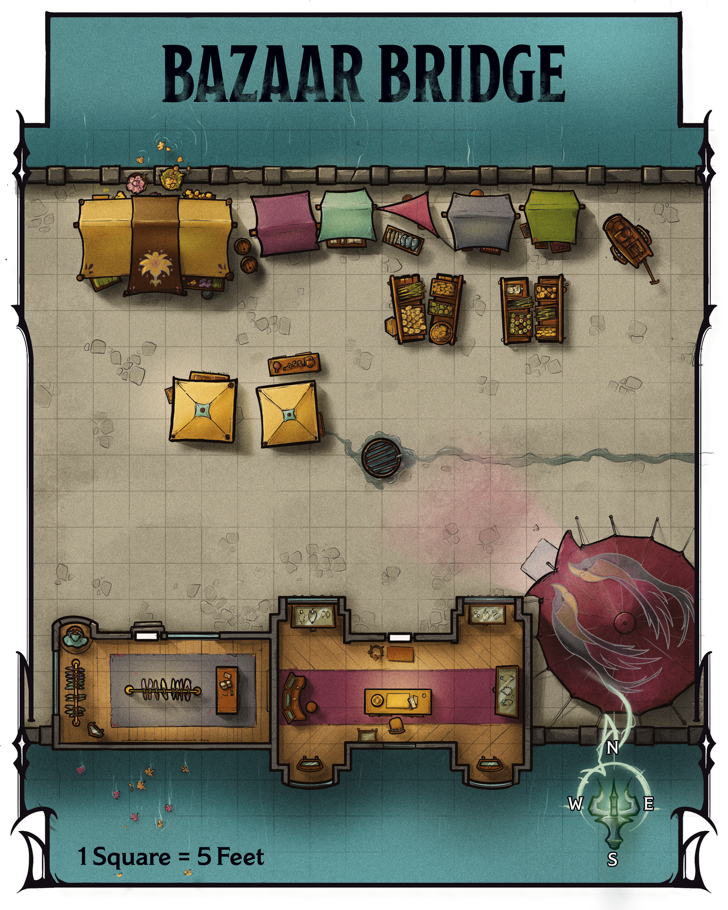](../assets/maps/mj/map-03-01.bazaar-bridge.png)

Map 3.1: Bazaar Bridge [View Player Version](../assets/maps/players/map-03-01.bazaar-bridge-player.png)

This section of the bazaar is situated on a bridge that spans a canal in the center of the Bazaar Ward. The bridge section of the bazaar has the following features.

#### Buildings

Two buildings lie to the south. The buildings’ doors are unlocked.

***Lin’s Capes and Cloaks.*** To the west is Lin’s Capes and Cloaks, a shop that specializes in fashionable outerwear. Proprietor Teeva Lin (Medium [Noble](https://www.dndbeyond.com/monsters/5195145-noble)), a genial and cultured human, sells nonmagical pieces ranging in cost from 10 GP to 500 GP.

She also has magic garments for sale, whose costs are listed in parentheses:

[Cape of the Mountebank](https://www.dndbeyond.com/magic-items/9228376-cape-of-the-mountebank) (4,000 GP)

[Cloak of Arachnida](https://www.dndbeyond.com/magic-items/4604-cloak-of-arachnida) (40,000 GP)

[Cloak of Billowing](https://www.dndbeyond.com/magic-items/27040-cloak-of-billowing) (100 GP)

[Cloak of Many Fashions](https://www.dndbeyond.com/magic-items/27041-cloak-of-many-fashions) (100 GP)

***The Jeweled Crane.*** To the east is the Jeweled Crane, which specializes in nonmagical brooches. Made from gold decorated with precious gemstones, these pieces cost anywhere from 100 GP to 1,000 GP apiece. Jeweler Garend Gil (Medium [Noble](https://www.dndbeyond.com/monsters/5195145-noble)), a self-absorbed human, owns the shop.

#### Fruit Displays

On the bridge’s eastern half are four displays of fresh fruits, including apricots, pears, plums, and pomegranates. The displays are tended by the gregarious elf Jayleen (Medium [Noble](https://www.dndbeyond.com/monsters/5195145-noble)), who hand-selects the produce from farmers every day. Individual fruits cost 1 SP.

#### Supply Cart

A cart with cleaning supplies stands in the northeast corner. The cart provides [Half Cover](https://www.dndbeyond.com/sources/dnd/free-rules/rules-glossary#Cover) to anyone behind it.

#### Tents

Merchants have erected several tents along this portion of the bridge. Each sells merchandise as described below.

***Northern Tents.*** The tents along the north side of the bridge display bolts of beautiful textiles in all colors but red, including silk and satin brocade. These are the wares of the orc Ven Terrytooth (Medium [Noble](https://www.dndbeyond.com/monsters/5195145-noble)), who chats genially with customers and brags about his good relationship with several Red Wizards. Each bolt of cloth weighs 1 pound and costs between 10 GP and 30 GP.

***Central Tents.*** The central tents display [Spyglasses](https://www.dndbeyond.com/equipment/427-spyglass), from simple pieces made with polished steel to ones fashioned from gold encrusted with gemstones. The serious and bespectacled human Val Vann (Medium [Noble](https://www.dndbeyond.com/monsters/5195145-noble)) tends to the wares, which her grandfather crafts in their home in the Mages’ Ward. The Spyglasses cost from 1,000 GP to 5,000 GP.

***Southeastern Tent.*** The southeastern tent displays precious spices, including cloves, cinnamon, cardamom, and saffron. The intellectual proprietor, a human named Meri (Medium [Noble](https://www.dndbeyond.com/monsters/5195145-noble)), sells the spices in 1-pound jars. Jars of cloves or cinnamon each cost 3 GP, while jars of cardamom and saffron each cost 15 GP.

### Malefite Attack

Allow the characters to interact with NPCs in the bazaar for a few minutes. Then read or paraphrase the following:

Bloodcurdling screams fill the air as the crowd suddenly flees east in a panic. You decipher a warning cry amid the chaos: “Skeletons! Run for your lives!” Half a dozen skeletons, their eyes glowing green, advance while swinging rusty blades.

Shambling across the bridge are six [Skeletons](https://www.dndbeyond.com/monsters/4775841-skeleton) that were raised in one of Szass Tam’s recent experiments. The skeletons fight the characters and anyone near them on the bridge, focusing on the characters after the first character acts.

On Initiative count 0 of the second round of combat (losing ties), a [Death Tyrant](https://www.dndbeyond.com/monsters/5194965-death-tyrant) erupts from the canal and flies toward the characters. Read or paraphrase the following:

Bursting from the canal is an enormous, flying orb of desiccated flesh, its slavering maw filled with gnashing teeth. Its single eye glows with green energy.

The death tyrant, whose lair is in the [Underdark](https://www.dndbeyond.com/sources/dnd/dmg-2024/lore-glossary#UnderdarkThe), fights the characters until destroyed.

#### Fleeing Crowd

Thirty vendors, customers, and bystanders are on the bridge when the attack begins. They try to flee during the first round of combat, making the bridge [Difficult Terrain](https://www.dndbeyond.com/sources/dnd/free-rules/rules-glossary#DifficultTerrain) during that time.

#### Development

If combat lasts more than 6 rounds, five human Red Wizards (Medium [Archmages](https://www.dndbeyond.com/monsters/5194902-archmage)) who belong to the City Watch rush onto the scene to dispatch the monsters. After the battle, these Red Wizards grumble about increasing incidents involving strange undead monsters, but they refuse to answer any questions from the crowd or the characters.

The watch members immediately depart the area. If civilians are dead or injured (see “After the Attack”), the Red Wizards say they aren’t versed in healing magic and promise to send healers.

### After the Attack

It’s up to you whether civilians are injured or die in this attack. If the characters acted heroically, you might decide everyone in the crowd escapes. If the characters fled the attack, you might decide some of or all the civilians on the bridge die.

#### Shaken Crowd

No matter how the characters acted, the crowd returns to the bridge after the attack while vendors clean up the disarray.

If the characters defeated the monsters without the City Watch’s help, Jayleen (see “[Fruit Displays](../chapter.md#FruitDisplays)”) thanks them profusely and offers them as much free fruit as they want. The other vendors and shoppers also hail the characters as heroes.

#### Mysterious Messenger

 EKATERINA BURMAK
[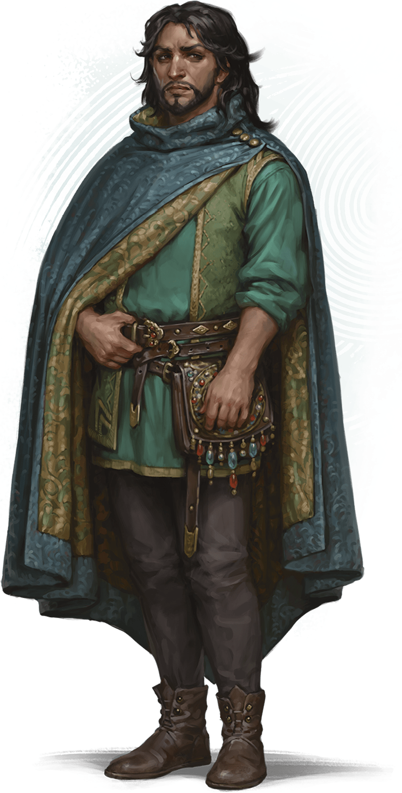](../assets/illustrations/03-002.wynston-wrynn.png)

Wynston Wrynn

A human man with long hair and a neatly trimmed beard, dressed in beautifully made clothing, approaches a character of your choice.

The man clasps the character’s hand, into which he places a small piece of folded parchment. He says only, “I’m glad I found you, my friends,” before walking away.

The man is Wynston Wrynn (Medium, Neutral Good [Spy Master](https://www.dndbeyond.com/monsters/5195216-spy-master)), who came to the bridge to deliver the parchment and witnessed the battle’s last moments.

If the characters follow Wrynn after he hands them the parchment, the man asks them to accompany him. He won’t divulge details, but he promises that an offer awaits them that they’ll want to consider.

***The Parchment.*** The parchment contains a note written by Zulkir Xelnene Thrul, whom the characters meet later in this chapter. The zulkir has cast the [Illusory Script](https://www.dndbeyond.com/spells/2619173-illusory-script) spell on the parchment; to anyone but the characters, the note looks like a list of grocery items.

When the characters unfold the parchment, give the players a copy of the Mysterious Note handout.

***Development.*** Wrynn’s Bespoke Vestments is a few blocks northeast. Any characters from Eltabbar recognize the name of the shop and know its location. Otherwise, the party can learn the shop’s location from any bystander.

[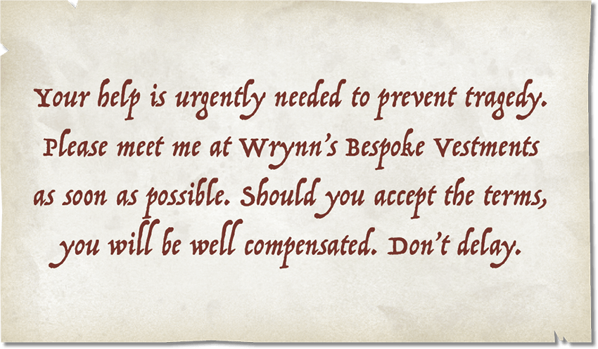](../assets/illustrations/03-003.handout-mysterious-note.png)

Handout: Mysterious Note

## Wrynn’s Bespoke Vestments

Wrynn’s Bespoke Vestments has stood in the heart of Eltabbar’s Bazaar Ward for centuries. This family-owned tailor shop has a sterling reputation for selling fashionable and beautifully made clothes. The shop has a coveted license to produce red clothing for Red Wizards.

For the last twenty years, the tailor shop also has clandestinely served as headquarters for the spy operations of [Xelnene Thrul](../../appendix-b-bestiary/chapter.md#XelneneThrul), zulkir of evocation. Seventh-generation shop owner Wynston Wrynn is the zulkir’s spy master. Thrul visits the shop only in disguises she crafts using the [Alter Self](https://www.dndbeyond.com/spells/2618846-alter-self) spell or by using the [Teleport](https://www.dndbeyond.com/spells/2619163-teleport) spell to arrive in a secret back room.

### Shop Features

The shop has the following features.

#### Ceilings

The shop’s ceilings are 15 feet high.

#### Doors

The shop’s doors are made of wood. Secret doors (marked with an *S* on the map; DC 20 to notice) lead to Wrynn’s office ([area W3](../chapter.md#W3SecretOffice)). The front door has a lock; it’s Complex (1 minute to pick) and of Superior quality (DC 20). (See “Doors” in the [Dungeon Master’s Guide](https://www.dndbeyond.com/sources/dnd/dmg-2024/dms-toolbox#Doors).)

#### Hours of Operation

The shop remains open with its front doors unlocked from sunup to sundown unless Wrynn has left the building. In that case, the tailor places a sign that says “Please return later” on the front door, which he locks.

#### Lighting

Picture windows along the shop’s western walls bathe the display and fitting areas ([area W1](../chapter.md#W1DisplayAndFittingAreas)) in [Bright Light](https://www.dndbeyond.com/sources/dnd/free-rules/rules-glossary#BrightLight) during the day. In the workshop and secret office (areas [W2](../chapter.md#W2Workshop) and [W3](../chapter.md#W3SecretOffice)), sconces with [Continual Flame](https://www.dndbeyond.com/spells/2619065-continual-flame) spells cast on them emit Bright Light.

#### Valuables

A cashbox holds coins in [area W1](../chapter.md#W1DisplayAndFittingAreas), and [area W3](../chapter.md#W3SecretOffice) holds coins and gems. If Wrynn discovers the characters have stolen any of these, he politely asks for their return. If the characters refuse, the next time they talk with Zulkir Thrul (see “[How to Meet with the Zulkir](../chapter.md#HowToMeetWithTheZulkir)”), she demands the valuables’ return on threat of dismissal from her service.

### Shop Locations

Gerralt Landman
[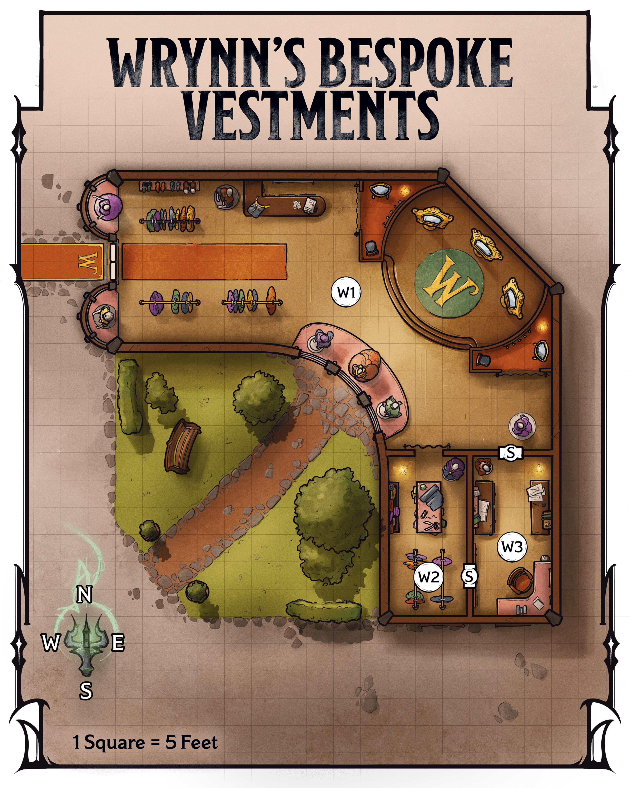](../assets/maps/mj/map-03-02.wrynns-bespoke-vestments.png)

Map 3.2: Wrynn's Bespoke Vestments [View Player Version](https://media-stg.dndbeyond.com/compendium-images/aud/aqZhSuV5QislqWyN/map-03-02.wrynns-bespoke-vestments-player.png)

The following locations are keyed to map 3.2.

#### W1: Display and Fitting Areas

Beams of natural light illuminate this elegant shop. Racks of beautiful clothing for all genders stand near the entrance, where an orc man and an elf woman browse. On a desk to the east are a stack of parchment, an ink pot, and a quill.

Farther into the shop, mannequins dressed in tasteful satins, silks, cottons, and corduroys stand near tall windows, while a stepped dais in the shop’s center features dressing mirrors. Two humans, a man and a woman in well-tailored waistcoats with measuring tapes draped around their necks, each adjust a mannequin’s outfit.

The display and fitting space is the shop’s primary area. Curtained changing areas flank the dais.

***Bystanders.*** See “[Private Audience](../chapter.md#PrivateAudience)” for what happens when the characters enter this area.

***Front Desk.*** Wrynn or his employees record purchases and provide customers with receipts at the front desk. In a drawer is an unlocked cashbox with the day’s earnings; there are 2,500 GP inside.

***Clothing Costs.*** There are fifty sets of [Fine Clothes](https://www.dndbeyond.com/equipment/539-fine-clothes) in the shop in addition to other custom clothing pieces. Prices range from 5 GP for a small piece, such as a silk scarf or neckerchief, to 5,000 GP for sets of items. Customers must request prices for custom items from Wrynn or his employees.

#### W2: Workshop

A long worktable and racks fill this cramped but organized space. Arranged meticulously on the table are shears, chalk, awls, needles, thread, and measuring tapes, along with folded piles of clothing. A stack of leather-bound ledgers sits on a shelf along the western wall.

Wrynn performs custom tailoring in this workspace; most production work occurs elsewhere. The ledgers note transactions for the last six months.

#### W3: Secret Office

This tidy room includes a desk in the southeast corner and tables along the east and west walls. The tables hold neatly arranged stacks of coins and open sacks of gemstones.

The valuables in this room are payments from wealthy clients. Stacked on the desk is business correspondence.

***Treasure.*** There are 25,000 GP in various coins here on the tables, as well as gemstones worth 10,000 GP in total.

### Private Audience

Browsing the shop’s wares is an orc man—actually Zulkir Thrul under the effects of an [Alter Self](https://www.dndbeyond.com/spells/2618846-alter-self) spell—who ignores the characters until Wrynn beckons them into his workshop.

The other browser is a terse elf named Gerleine (Medium [Noble](https://www.dndbeyond.com/monsters/5195145-noble)), who announces, “Wynston, I’ve decided.” She carries a blue satin frock to the desk along the north wall and pays the tailor, who writes her a receipt before she leaves.

The human man and woman are Wrynn’s employees, Cora Finn and Tate Vonn. After Gerleine leaves the shop, Wrynn approaches his two employees and quietly asks them to take a break. They also leave the shop.

Once the characters, Wrynn, and the disguised Xelnene Thrul are the only people in the shop, the tailor places a sign that says “Please return later” outside the front door. He approaches the characters.

Read or paraphrase the following:

“My name is Wynston Wrynn, and I own this shop,” the man says in a warm voice. “I respect the trust you have extended by meeting me here. However, before we can speak candidly, I ask you to extend that trust a bit further. Please follow me.” The man gestures to the nearby orc before adding, “This man is with us.”

Wrynn and the disguised zulkir then step into the workshop ([area W2](../chapter.md#W2Workshop)) and slip into the secret office ([area W3](../chapter.md#W3SecretOffice)), beckoning the characters to follow. If the characters seem suspicious or balk, the tailor assures them again about a promising offer, emphasizes the importance of this meeting, and asks for their trust.

In the secret office, the disguised zulkir waves her hands in a complex pattern, and a shadowy door appears on the east wall; Thrul has cast the [Demiplane](https://www.dndbeyond.com/spells/2619088-demiplane) spell. Wrynn and the zulkir step through the door, again beckoning the characters to follow.

#### Zulkir Thrul’s Demiplane

Gerralt Landman
[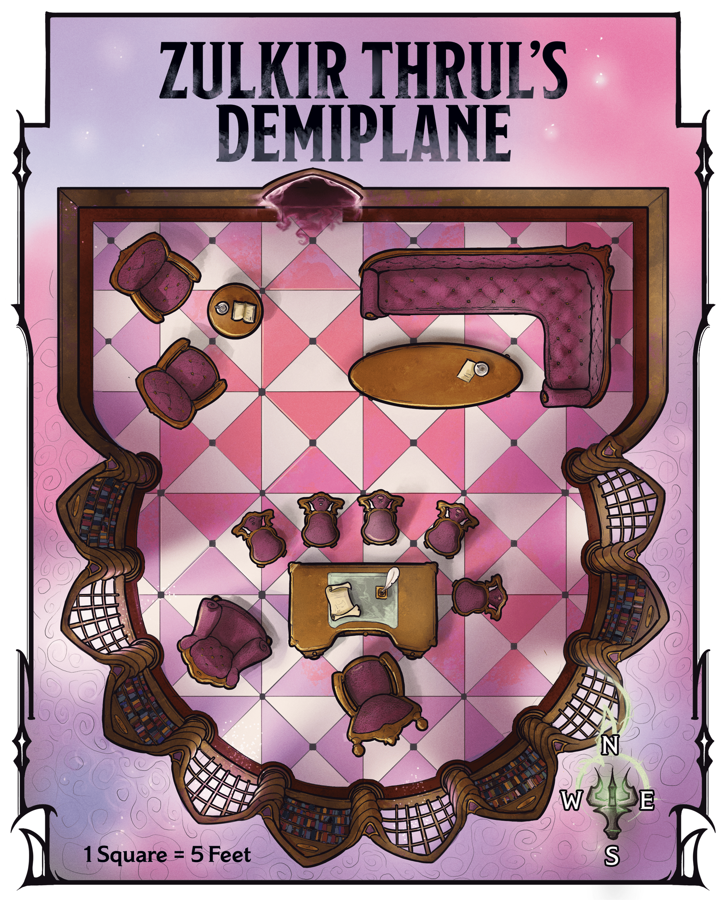](../assets/maps/mj/map-03-03.zulkir-thruls-demiplane.png)

Map 3.3: Zulkir Thrul's Demiplane [View Player Version](../assets/maps/players/map-03-03.zulkir-thruls-demiplane-player.png)

When the characters walk through the shadowy door, read or paraphrase the following:

Sconces shed soft, yellow light over this beautifully furnished office, which boasts oak furniture upholstered in maroon velvet. A gleaming desk sits to the south, along with nearby seats and a plush armchair. A wraparound sofa and a table bearing crystal wineglasses sit to the north across from a cozy armchair nook.

The demiplane’s layout appears on map 3.3. The wood-paneled space is bathed in [Bright Light](https://www.dndbeyond.com/sources/dnd/free-rules/rules-glossary#BrightLight) from wall sconces with [Continual Flame](https://www.dndbeyond.com/spells/2619065-continual-flame) spells cast on them. From this office, Zulkir Xelnene Thrul—assisted by Wynston Wrynn—conducts her clandestine activities. The desk’s drawers hold encoded dossiers supporting those activities.

After walking through the door, the disguised zulkir settles into the chair behind the desk. Wrynn sits in the armchair beside her. Once the characters are ready to hear the zulkir’s proposal, read or paraphrase the following:

The orc man lifts his head regally and closes his eyes. When he opens them, his appearance transforms. You now see a pale human woman with piercing blue eyes and a shaved head covered in tattoos. She wears the unmistakable red robes of a Red Wizard.

“Thank you for your patience,” the woman says in a strong, mellifluous voice. “I am Xelnene Thrul, Red Wizard sage and Thay’s zulkir of evocation. You’ve already met Wynston Wrynn, my spy master and the man I trust most in this world.

“I have invited you here to discuss a matter of utmost importance. I won’t waste words: I intend to hire you to stop the lich Szass Tam, zulkir of necromancy, before he unleashes destruction on Thay and murders or subjugates all who resist him. This enterprise will be long, dangerous, and—if successful—without public recognition. But it is necessary to save countless lives. You may ask me any questions you have before you give me your answer.”

If the characters are unfamiliar with Thay’s zulkir council or with [Szass Tam](https://www.dndbeyond.com/sources/dnd/dmg-2024/lore-glossary#SzassTam), Thrul shares the information about those topics presented in [chapter 1](../../chapter-01-thay/chapter.md#CouncilOfZulkirs).

Bubble Cat Studio
[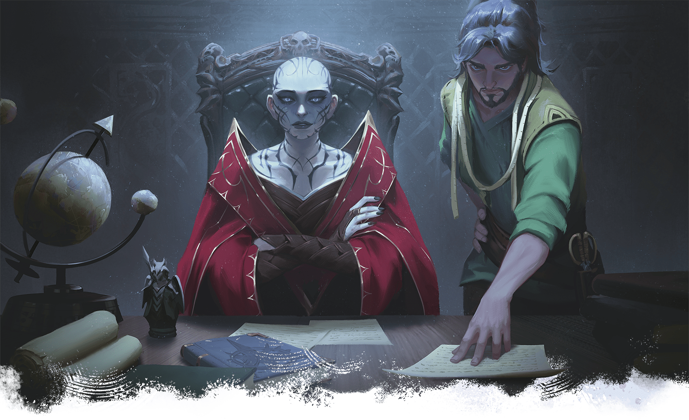](../assets/illustrations/03-004.zulkir-thrul-and-wynston-wrynn.png)

Zulkir Xelnene Thrul and her spy master, Wynston Wrynn, seek to recruit the characters.

Thrul can provide the following information about Operation Deadfall:

- **Why Target Szass Tam/Why Is Thay in Danger?** The zulkir shares the information in “[Demonic Ritual](../../chapter-02-thay-in-danger/chapter.md#DemonicRitual)” and “[Thay’s Only Hope](../../chapter-02-thay-in-danger/chapter.md#ThaysOnlyHope)” in chapter 2. “The terrible attack you witnessed today at the bazaar is merely a by-product of Szass Tam’s plan. As you can see, he is no longer content with simply sitting on Thay’s ruling zulkir council. He seeks to become Thay’s tyrant once more, and if he succeeds, his obscene servants will kill thousands. Thay will fall yet again into generations of suffering. Even death will not be a reprieve for Szass Tam’s victims; he’ll simply raise them as undead horrors to serve his whims. We can’t allow this to happen.”
- **What Are You Paying?** “If you agree, I’ll pay you each a topaz worth 500 GP today. Consider it a down payment. After you complete each mission, I’ll give your group a magic item of your choice from this list.” The zulkir gives the characters the list of magic items in “[Mission Rewards](../chapter.md#DeadfallMissionRewards)” below. “You may also keep any money and magic items you find during your service. If you defeat Szass Tam, we will discuss a further reward.”
- **Are We in Danger If We Join the Operation?** “Szass Tam has spies everywhere. If any catch wind of your involvement, they’ll hunt you down and kill you. Szass Tam will hunt me down, too.”
- **What’s the Plan for the Operation?** “First, you will undermine Szass Tam’s spy network. Once his spy network is disrupted, you will gather allies to our cause. Finally, you will confront the lich and stop his ongoing ritual. You may try to kill him, but stopping his ritual is more important.”
- **What’s in It for You?** “If Szass Tam’s ritual succeeds and he seizes leadership, some zulkirs might ally with him to save themselves. I am unwilling to do this. Szass Tam is evil, and I will not turn a blind eye to his murderous ways. For my resistance, he will certainly kill me. If you succeed, I live and keep my position on the council—but more importantly, you’ll prevent immense suffering for Thay’s people. I would gladly die for my nation, and I refuse to allow it to fall into Szass Tam’s hands again. This is why I need your help.”
- **Who Else Is Part of the Operation?** “Only you, should you agree, as well as me and Wynston. I have other operatives, but they know nothing of this operation.”
- **Won’t Szass Tam Revive If We Kill Him?** “Normally, he’d revive in a matter of days. However, my scholars believe interrupting his ritual would require the lich to start it anew, setting him back years. In addition, I will ask you to retrieve an item that would keep the lich dead for one hundred years—more than enough time for Thay to fortify its defenses should Szass Tam try to return to power later.”
- **Why Not Confront Szass Tam Yourself?** “I can’t confront Szass Tam myself and hope to win. No one zulkir—or even three or four zulkirs—could. All seven of us would need to unite against the lich. I’ve tried to form such an alliance, but Szass Tam has undermined my credibility with them. I have shown them as much proof as I can, to no avail. Alas, we must handle this situation discreetly and on our own. We are Thay’s only chance.”
- **Why Recruit Us?** “Your considerable skills have come to my attention. I believe you would be excellent operatives and that you are up to this task.” If the characters dislike Szass Tam or are dedicated to Thay, Thrul tells them these factors make them attractive candidates, too. If the characters acted heroically to defeat the undead earlier in the chapter, she points to this as proof of their capabilities.
- **What If We Say No?** “I will wipe your memory with a [Modify Memory](https://www.dndbeyond.com/spells/2619109-modify-memory) spell, and this conversation will never have happened.”

Once Thrul answers the characters’ questions, read or paraphrase the following:

The zulkir steeples her fingers together and fixes you with a serious stare.

“So, adventurers, what is your answer? There is no turning back once you agree. Respond wisely.”

When the characters agree to join Operation Deadfall, Thrul gives a small smile and hands each of them a topaz, as promised.

#### Mission Rewards

Each time the characters complete a mission, Thrul will give the group one magic item listed below. The characters can tell Wrynn which item they’ve chosen anytime after completing the mission, but they can’t choose the same item twice. They receive their reward via anonymous courier before the end of the following day.

The zulkir’s list follows:

[Chime of Opening](https://www.dndbeyond.com/magic-items/9228405-chime-of-opening)

[Helm of Teleportation](https://www.dndbeyond.com/magic-items/4656-helm-of-teleportation)

[Life-Sapping Blade](https://www.dndbeyond.com/magic-items/11914527-life-sapping-blade) (see [appendix A](../../appendix-a-magic-item/chapter.md#LifeSappingBlade))

[Portable Hole](https://www.dndbeyond.com/magic-items/9228932-portable-hole)

[Ring of Spell Storing](https://www.dndbeyond.com/magic-items/4730-ring-of-spell-storing)

[Robe of Eyes](https://www.dndbeyond.com/magic-items/9228976-robe-of-eyes)

[Wand of Enemy Detection](https://www.dndbeyond.com/magic-items/9229184-wand-of-enemy-detection)

[Wand of Paralysis](https://www.dndbeyond.com/magic-items/9229190-wand-of-paralysis)

## Operation Deadfall

Read or paraphrases the following:

Zulkir Thrul leans forward, the gravity of her words reflected in her formal tone and posture.

“Thank you for joining this cause. You’re now operatives of Operation Deadfall. Before I describe the parameters of our undertaking, think of code names for yourselves and your group. Wynston and I will refer to you by these code names at all times; we will never use your real names.

“Refer to Wynston as the Sparrow. Refer to me as the Crane. Szass Tam is the Hydra. When outside this office, always use these code names. We will assign code names to other targets and goals as needed.

“Above all, this operation is secret. You must never reveal anything about Operation Deadfall to anyone unless I authorize it. You may ask questions of no one but myself or the Sparrow, and always discreetly.

“Publicly, you don’t know me or the Sparrow, and we don’t know you. Remember, the Hydra’s eyes are everywhere.”

***Code Names.*** Thrul uses code names with all her operatives, not just for Operation Deadfall. Using code names for Operation Deadfall’s objectives will help ensure the characters don’t mention key mission details in public.

If your players struggle to come up with code names, help them using the guidance in “[Code Names](../../chapter-02-thay-in-danger/chapter.md#CodeNames)” in chapter 2.

The zulkir then lays out the following parameters of Operation Deadfall.

### How to Meet with the Zulkir

Once the characters have chosen their code names, Zulkir Thrul addresses them again. Read or paraphrase the following:

Linda Lithen
[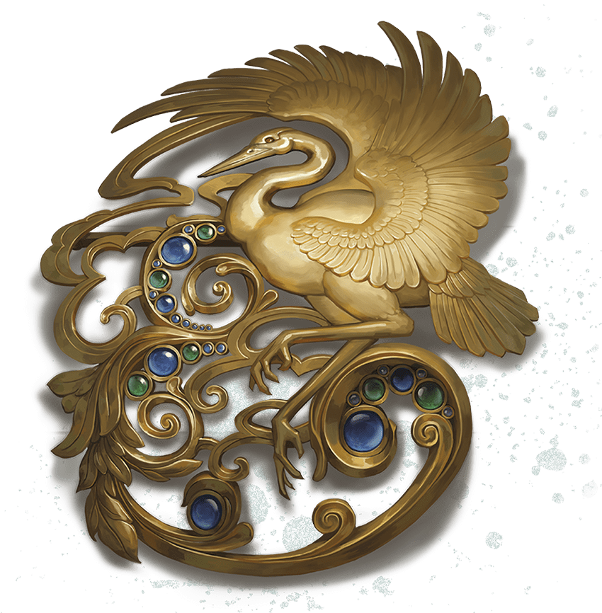](../assets/illustrations/03-005.masqueraders-brooch.png)

Masquerader’s Brooch from Zulkir Thrul

“I will assign you missions in this office. When you have completed a mission, return to the shop in disguise. Disguise yourselves differently each time. The Sparrow will know who you are. Request your reward from him, and give him any intel you found to pass on. He will contact you when it’s time for our next meeting. When you arrive here for the meeting, he will contact me. I will appear in the shop shortly, and we will enter this office in the same manner as today. After you report about your previous mission, I will give you details about the next.

“When the time is right, you will confront the Hydra. All your missions leading to that moment will assist you in this task.”

To help with their disguises, Thrul gives each character a [Masquerader’s Brooch](https://www.dndbeyond.com/magic-items/11914533-masqueraders-brooch) (see [appendix A](../../appendix-a-magic-item/chapter.md#MasqueradersBrooch)) shaped like a crane, an animal frequently depicted in Thayan artwork and fashion. She tells the characters always to incorporate a white crane feather into their disguises when they visit the shop to help Wrynn identify them.

She also gives the characters one of a pair of [Sending Stones](https://www.dndbeyond.com/magic-items/9180147-sending-stones); the stone has an image of a sparrow carved on it. She tells them that Wrynn has the other stone but instructs them to use the stone to contact him only when necessary. The zulkir forbids the characters from contacting her directly.

### If the Party’s Cover Is Blown

The zulkir informs the characters that she reserves the right to dismiss them from her service if they don’t remain clandestine. If she dismisses them, she will use [Modify Memory](https://www.dndbeyond.com/spells/2619109-modify-memory) or a [Spell Scroll](https://www.dndbeyond.com/magic-items/9229085-spell-scroll) *of* [Wish](https://www.dndbeyond.com/spells/2619213-wish) to wipe their memories.

If Thrul dismisses the characters, the campaign ends for them. See “[Importance of Secrecy](../../chapter-02-thay-in-danger/chapter.md#ImportanceOfSecrecy)” in chapter 2 for more about what happens if characters don’t maintain secrecy.

If the characters worry about keeping Operation Deadfall secret, share the advice for staying clandestine from “[Running a Magical Spy Thriller](../../chapter-02-thay-in-danger/chapter.md#RunningMagicalSpy)” in chapter 2.

## First Mission

Once the characters understand Operation Deadfall’s parameters, read or paraphrase the following:

“Your first mission, operatives, is to neutralize three of the Hydra’s spies,” says Zulkir Thrul. “Doing so will ensure our future activities avoid suspicion.

“One spy, the Gambler, reports disloyal Red Wizards. Another, the Landlord, informs on the Hydra’s business rivals. The third, the Racketeer, informs on activists who oppose the Hydra’s return to regency. Anyone deemed a threat is killed.

“I will divulge everything I know about these individuals, including where to find them. I care not how you neutralize them, as long as they cease working for the Hydra. If you gain assurance from a target that they’ll stop spying or leave the city, tell the Sparrow, and he will dispatch other operatives to ensure the target’s honesty.”

“Report back here when you have completed this mission. As always, this conversation never happened.”

Thrul then shares the following details about the three targets.

### The Gambler

Thrul tells the characters the following about the Gambler:

- **Name.** The Gambler’s real name is Thellania Marr.
- **Physical Description.** Marr is a human with a shaved and tattooed head, and tattoos on her face and arms. She wears red robes and a cape with spiked shoulders.
- **Target Details.** Marr is a Red Wizard who works for Szass Tam. She informs his agents about Red Wizards who oppose the lich’s desire to regain his regency.
- **Neutralization Benefit.** If Marr is neutralized, public dissent against Szass Tam will increase among Red Wizards. More importantly, should rumors of Operation Deadfall emerge, Szass Tam’s suspicion will likely shift toward publicly dissenting Red Wizards and away from Thrul and her agents.
- **How to Neutralize.** Thrul knows where Marr participates in illegal gambling in the evenings. The games take place in the back room of a small bar in the Apprentices’ Ward called the Hooded Lantern, to which the zulkir gives the characters directions. Thrul suggests the characters approach Marr at the Hooded Lantern and convince her to stop working for Szass Tam.

When the characters are ready to confront the Gambler, see “[The Hooded Lantern](../chapter.md#TheHoodedLantern).”

### The Landlord

Thrul tells the characters the following about the Landlord:

- **Name.** The Landlord’s real name is Pryas Nym.
- **Physical Description.** Nym is a bald human who sports a heavy blond beard.
- **Target Details.** Nym is a landlord and magical goods inspector who informs Szass Tam’s agents about influential merchants who disparage the lich’s bid for the Thayan regency.
- **Neutralization Benefit.** If Nym is neutralized, public dissent against Szass Tam will increase among merchants. Reports of the lich’s sabotage of business rivals might also emerge, weakening his political support.
- **How to Neutralize.** Nym owns an apartment building in Eltab’s Ward called Nym Building 3, to which Thrul gives the characters directions. Each night, Nym goes door to door to harass those who are late paying rent. Thrul suggests the characters approach Nym during his rounds and convince him to stop working for Szass Tam.

When the characters are ready to confront the Landlord, see “[Nym Building 3.](../chapter.md#NymBuilding3)”

### The Racketeer

Thrul tells the characters the following about the Racketeer:

- **Name.** The Racketeer’s real name is Rathan Jur.
- **Physical Description.** Jur is a bald goliath who wears studded leather armor and wields a scimitar.
- **Target Details.** Jur is an extortionist and cousin to several Red Wizards. Jur offers “protection” from these Red Wizards, but in reality, he and his goons use that excuse to extort money from a large neighborhood. Szass Tam recently demanded these Red Wizards’ loyalty, and in turn, the mages have instructed Jur to find out who opposes Szass Tam’s plan to regain Thay’s regency.
- **Neutralization Benefit.** Jur’s intel has led to the deaths of multiple wealthy neighborhood activists, among whom were Thrul’s key informants on Szass Tam’s movements in Eltabbar. If Jur is neutralized, activists will feel safer and Thrul will stop losing informants.
- **How to Neutralize.** Thrul knows the location of an alley in the Lower Ward where Jur and his goons meet with his extortion victims every evening. Thrul suggests the characters approach Jur there and convince him to stop working for Szass Tam.

When the characters are ready to confront the Racketeer, see “[Lower Ward Alley](../chapter.md#LowerWardAlley).”

### Leaving the Demiplane

Once the characters join Operation Deadfall and receive their first mission, each character earns 4,100 XP.

When the characters leave the demiplane, Wrynn and Thrul follow. The zulkir dismisses her [Demiplane](https://www.dndbeyond.com/spells/2619088-demiplane) spell, and the door in [area W3](../chapter.md#W3SecretOffice) disappears. She casts the [Teleport](https://www.dndbeyond.com/spells/2619163-teleport) spell and departs, while Wrynn remains in his office.

#### Speaking with Wynston Wrynn

If the characters want to know more about Wrynn, he chats with them in his secret office ([area W3](../chapter.md#W3SecretOffice)).

***Wrynn’s Family.*** The tailor’s family has owned and operated this shop for seven generations. The Wrynns are a respected family among Eltabbar’s artisans, renowned for the high-quality clothes they make for the city’s wealthy merchants, Red Wizards, and elite families.

***Wrynn’s Story.*** Wrynn has always had a deep sense of right and wrong, and he hates the injustices evil Red Wizards visit on the populace. He hates Szass Tam even more; to Wrynn, the only thing worse than inflicting suffering and death on innocents is using necromancy to animate their bodies to commit more terror. Reserved and eminently self-controlled, Wrynn learned as a child that it’s better to keep one’s strong feelings hidden while working in the background to effect change.

Wrynn and Thrul crossed paths as youths at the Tower of the Arcane in the Apprentices’ Ward. Thrul was already promised to a powerful Red Wizard as an apprentice. The two bonded over their mutual dislike of state-sanctioned cruelty and their commitment to a fairer Thay. Thrul recognized Wrynn’s potential as an operative even then, and once she ascended in the Red Wizards’ ranks, she made him her spy master. Wrynn regards Thrul as an older sister and considers her family, as she does him.

### Order of Operations

You can run “The Hooded Lantern,” “Nym Building 3,” and “Lower Ward Alley” in any order. Allow the characters to choose the order they want to confront the spies in.

## The Hooded Lantern

The grimy tavern known as the Hooded Lantern is on the northern side of the Apprentices’ Ward along one of the city’s many canals. The tavern’s water comes from the canal, and the constant groaning of the waterwheel behind the building reverberates throughout the tavern. This conceals the sound of the gamblers in the back room. Gambling is legal in Eltabbar as long as gambling houses pay heavy taxes; this tavern doesn’t pay the taxes.

### The Hooded Lantern Features

The Hooded Lantern has the following features.

#### Canal

The canal’s water level is 10 feet below street level. The water is 10 feet deep.

#### Ceilings

The tavern’s ceilings are 15 feet high.

#### Constant Din

Because several buildings on this block use it to supply water, the waterwheel outside the tavern operates nonstop, creating an awful din of grinding and screeching. As a result, inside the tavern, Wisdom ([Perception](https://www.dndbeyond.com/sources/dnd/free-rules/playing-the-game#Skills)) checks that rely on hearing are made with [Disadvantage](https://www.dndbeyond.com/sources/dnd/free-rules/rules-glossary#Disadvantage).

#### Doors

The tavern’s doors are made of wood. The front door remains unlocked while the establishment is open, from dawn until midnight. When the place is closed, the front door is locked. The doors to the storeroom and gambling den (areas [H2](../chapter.md#H2Storage) and [H3](../chapter.md#H3GamblingDen)) are locked whether the tavern is open or closed. All locks are Simple (1 action to pick) and of Superior quality (DC 20). The bartender Knudrek (see [area H1](../chapter.md#H1Barroom)) has keys for all doors.

#### Lighting

Small sconces throughout the tavern cast [Dim Light](https://www.dndbeyond.com/sources/dnd/free-rules/rules-glossary#DimLight) in interior areas. The grimy windows let in little natural light.

#### Windows

The tavern has three unlocked windows: a window on the east side of the barroom and another on the west ([area H1](../chapter.md#H1Barroom)), and a window above the water basin in the storage room ([area H2](../chapter.md#H2Storage)). Medium or smaller characters who want to climb through them can do so easily.

### The Hooded Lantern Locations

The following locations are keyed to map 3.4. Descriptions assume the characters visit the tavern in the evening, when gambling goes on. If they visit the tavern earlier, they see the people described in the gambling den ([area H3](../chapter.md#H3GamblingDen)) enter the establishment.

Gerralt Landman
[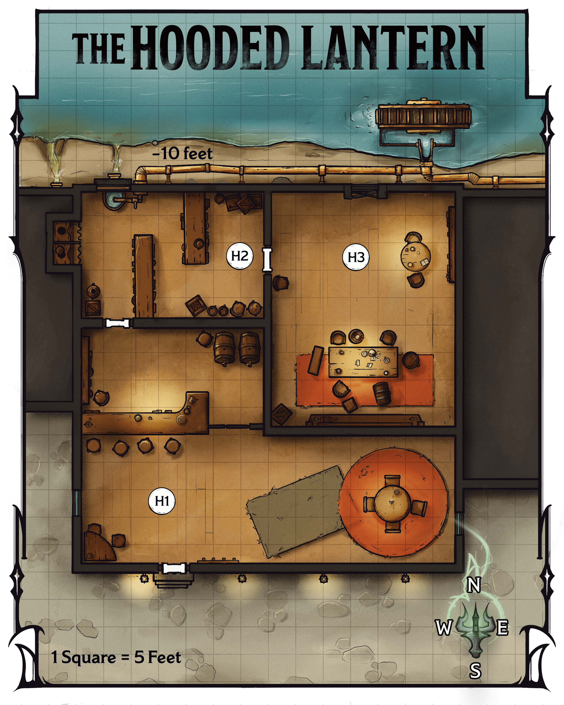](../assets/maps/mj/map-03-04.the-hooded-lantern.png)

Map 3.4: The Hooded Lantern [View Player Version](https://media-stg.dndbeyond.com/compendium-images/aud/aqZhSuV5QislqWyN/map-03-04.the-hooded-lantern-player.png)

#### H1: Barroom

High-top stools line a bar to the north. Two cloaked patrons sit at a nearby table, clutching drinks. Behind the bar stands a burly human man wearing an apron, his face lined with scars and wrinkles.

The human bartender is Knudrek (Medium [Gladiator](https://www.dndbeyond.com/monsters/5195042-gladiator)). The orc patrons, Strak and Gert (Medium [Commoners](https://www.dndbeyond.com/monsters/5194951-commoner)), glower at the characters and provide one-word answers if anyone attempts conversation with them. They are custodians who work nearby and just want everyone to leave them alone. If a fight breaks out, Strak and Gert flee.

Knudrek was renowned as a gladiator in the city, but he has long since retired. He now runs this tavern and the gambling den in the back room ([area H3](../chapter.md#H3GamblingDen)), taking a cut of the money that changes hands. He pays no taxes on that income.

On his apron, Knudrek wears a faded badge depicting two muscular, interlocking arms. A character examining the badge can take the [Study](https://www.dndbeyond.com/sources/dnd/free-rules/rules-glossary#StudyAction) action and make a DC 12 Intelligence ([History](https://www.dndbeyond.com/sources/dnd/free-rules/playing-the-game#Skills)) check. On a success, the character realizes the badge represents a local gladiatorial league called Elite Gladiators.

***Chatting with Knudrek.*** When the characters enter, Knudrek nods to them but offers no welcome. Patrons can purchase three different types of ale for 1 SP each.

If the characters ask about gambling here, Knudrek denies any knowledge unless they mention his badge and speak favorably about the city’s gladiators. Knudrek then reveals he was once a grappler in Elite Gladiators, as well as the information below.

***Joining the Gambling.*** As an [Influence](https://www.dndbeyond.com/sources/dnd/free-rules/rules-glossary#InfluenceAction) action, a character can try to convince Knudrek to let them gamble and make a DC 15 Charisma ([Deception](https://www.dndbeyond.com/sources/dnd/free-rules/playing-the-game#Skills) or [Persuasion](https://www.dndbeyond.com/sources/dnd/free-rules/playing-the-game#Skills)) check. On a success, Knudrek invites them to the game in the back room ([area H3](../chapter.md#H3GamblingDen)). Entry costs 25 GP per person.

If they pay the fee, Knudrek escorts them to the gambling den.

#### H2: Storage

The door to this room is locked (see “[The Hooded Lantern Features](../chapter.md#TheHoodedLanternDoors)”).

This room holds kegs of ale and shelves for crates of mugs and other miscellany.

A window in the northwest wall above a water basin overlooks the canal.

#### H3: Gambling Den

Katerina Ladon
[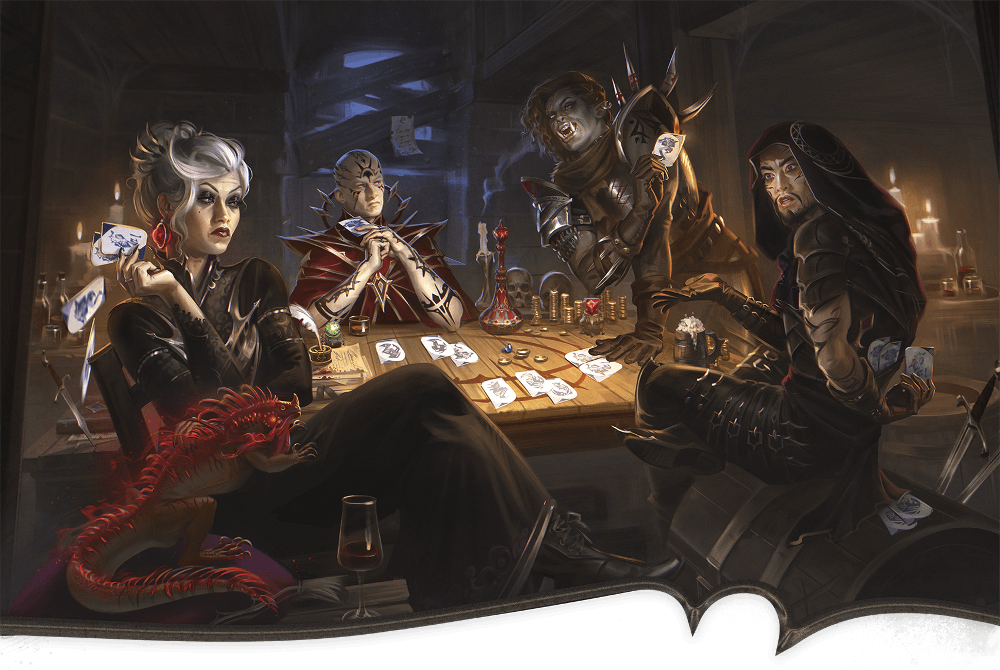](../assets/illustrations/03-006.the-gamblers.png)

From Left to Right: the Gamblers Belinda, Thellania Marr, Gilda, and Terk.

The door to this room is locked (see “[The Hooded Lantern Features](../chapter.md#TheHoodedLanternDoors)”).

Around a long table sit four people: a white-haired human woman in purple robes with a lizard sitting on her knee, a bearded human man wearing a heavy cloak, a brawny orc woman wearing heavy armor, and a human woman with a shaved head wearing the distinctive robes of a Red Wizard. The four are playing cards, placing money and magic items on the table as collateral.

These are the gamblers:

- **Belinda.** Belinda (Medium [Cultist Fanatic](https://www.dndbeyond.com/monsters/4904746-cultist-fanatic)) is a white-haired human woman.
- **Gilda.** Gilda (Medium [Assassin](https://www.dndbeyond.com/monsters/5194904-assassin)) is an orc woman.
- **Terk.** Terk (Medium [Assassin](https://www.dndbeyond.com/monsters/5194904-assassin)) is a human man.
- **Thellania Marr.** This human Red Wizard (Medium [Cultist Hierophant](https://www.dndbeyond.com/monsters/5194955-cultist-hierophant)) is the characters’ target.

The gamblers play a card game called three wizards, in which the highest-ranking hand after three rounds of play wins.

If Knudrek escorts the characters, the gamblers welcome them. Otherwise, a character can claim the bartender has allowed them to gamble. The character must take the [Influence](https://www.dndbeyond.com/sources/dnd/free-rules/rules-glossary#InfluenceAction) action and make a DC 16 Charisma ([Deception](https://www.dndbeyond.com/sources/dnd/free-rules/playing-the-game#Skills)) check. On a success, the gamblers welcome the characters into the game. On a failure, the gamblers begin combat.

If combat happens while Knudrek isn’t in this area, he hears the commotion and enters the fight at the beginning of the third round of combat, insisting the characters leave. All combatants fight to the death.

***Speaking with Thellania.*** If the characters want to speak with Thellania, she says one of them must win a game before she’ll talk to them. The gamblers tell the characters one person from their group can play at a time; the others must watch.

To win a game, a character must bet 400 GP or an Uncommon magic item and make three DC 12 Charisma ([Deception](https://www.dndbeyond.com/sources/dnd/free-rules/playing-the-game#Skills)) or Wisdom ([Insight](https://www.dndbeyond.com/sources/dnd/free-rules/playing-the-game#Skills)) checks. On three successes, the character wins back their collateral plus 1,600 GP. Thellania also agrees to speak with the characters in the barroom ([area H1](../chapter.md#H1Barroom)) or outside, as the characters choose. (She will not speak with them in the gambling den.) On a failure, she ignores the characters.

Each character may play one game. Afterward, Knudrek or the gamblers ask them to leave, but tell them if they want to play more, they can come back the next night before the game starts.

The gamblers stay in the tavern for another two hours. Thellania stays to gather her belongings, then leaves five minutes after the other gamblers.

***Neutralizing the Gambler.*** Thellania isn’t particularly loyal to Szass Tam. A character can take the [Influence](https://www.dndbeyond.com/sources/dnd/free-rules/rules-glossary#InfluenceAction) action to try to convince her to stop spying. The character makes a DC 15 Charisma ([Intimidation](https://www.dndbeyond.com/sources/dnd/free-rules/playing-the-game#Skills) or [Persuasion](https://www.dndbeyond.com/sources/dnd/free-rules/playing-the-game#Skills)) check; if they give Thellania a magic item that’s Rare or rarer, the check automatically succeeds.

On a success, Thellania promises to stop spying and keeps her word. If the characters press her, she agrees to leave town temporarily and allows the characters to escort her to the city gates as a guarantee. On a failure, Thellania begins combat.

***Treasure.*** Thellania wears a [Heward’s Handy Haversack](https://www.dndbeyond.com/magic-items/9228722-hewards-handy-haversack) with 500 GP within it.

Bets from previous rounds on the table include the following:

1,600 GP

[Efreeti Bottle](https://www.dndbeyond.com/magic-items/9228528-efreeti-bottle)

Two [Elemental Gems](https://www.dndbeyond.com/magic-items/9228536-elemental-gem) (emerald and red corundum)

***Development.*** If the characters kill Thellania or convince her to stop spying, Thellania is neutralized as a spy, and each character earns 4,100 XP.

## Nym Building 3

Nym Building 3, a drab, two-story apartment building in Eltab’s Ward, is adjacent to the River Eltar. The building’s owner, Pryas Nym, owns several similar structures across the city. Of Nym’s holdings, this building lies in the city’s poorest neighborhood. He enjoys making nightly rounds to intimidate tenants and harass those whose rent is late.

### Nym Building 3 Features

The building has the following features.

#### Apartment Layout and Residents

Each apartment (areas [N2](../chapter.md#N2LowerEastern), [N3](../chapter.md#N3LowerWestern), [N5](../chapter.md#N5UpperWestern), and [N6](../chapter.md#N6UpperEastern)) contains a modest living space, kitchen, and bedroom.

The inhabitants are impoverished and have no belongings of value. Strangers terrify them, as any outsiders are likely to be Nym’s goons. Residents won’t answer the door if the characters knock.

#### Ceilings

The building’s ceilings are 10 feet high.

#### Doors

The building’s doors are made of wood. The front door is left unlocked. Doors to the apartments (areas [N2](../chapter.md#N2LowerEastern), [N3](../chapter.md#N3LowerWestern), [N5](../chapter.md#N5UpperWestern), and [N6](../chapter.md#N6UpperEastern)) are locked. The locks on the doors are Simple (1 action to pick) and of Inferior quality (DC 10).

#### Lighting

The building’s windows allow [Bright Light](https://www.dndbeyond.com/sources/dnd/free-rules/rules-glossary#BrightLight) into the apartments during the day. At night, there is [Dim Light](https://www.dndbeyond.com/sources/dnd/free-rules/rules-glossary#DimLight) if the residents are at home and awake (areas [N2](../chapter.md#N2LowerEastern) and [N3](../chapter.md#N3LowerWestern)) and [Darkness](https://www.dndbeyond.com/sources/dnd/free-rules/rules-glossary#Darkness) otherwise (areas [N5](../chapter.md#N5UpperWestern) and [N6](../chapter.md#N6UpperEastern)). Interior hallways (areas [N1](../chapter.md#N1Entryway) and [N4](../chapter.md#N4UpstairsHallway)) are lit with a few sconces that cast Dim Light in the area at all hours.

#### Walls

The walls between apartments are made of thin wood and plaster. Characters can hear loud noises coming from any area in the building.

#### Windows

The building’s windows are big enough for a Medium or smaller creature to fit through. Windows on the first floor stand 3 feet above the ground. Windows on the second floor are 15 feet above the ground. The windows are locked from the inside.

Characters within 5 feet of a window on the inside of the building can take the [Utilize](https://www.dndbeyond.com/sources/dnd/free-rules/rules-glossary#UtilizeAction) action to open the window. From the outside, a character can take the Utilize action to try to pick a window’s lock using [Thieves’ Tools](https://www.dndbeyond.com/equipment/495-thieves-tools), completing the task with a successful DC 15 Dexterity ([Sleight of Hand](https://www.dndbeyond.com/sources/dnd/free-rules/playing-the-game#Skills)) check.

### Nym Building 3 Locations

Gerralt Landman
[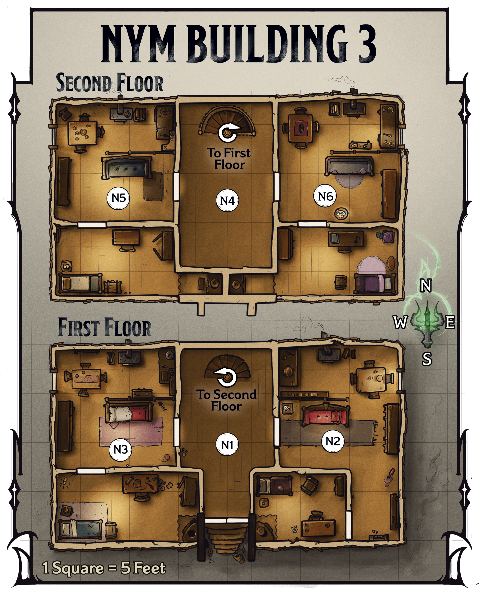](../assets/maps/mj/map-03-05.nym-building-3.png)

Map 3.5: Nym Building 3 [View Player Version](https://media-stg.dndbeyond.com/compendium-images/aud/aqZhSuV5QislqWyN/map-03-05.nym-building-3-player.png)

The apartment building has two floors with similar floor plans.

The following locations are keyed to map 3.5. Descriptions assume the characters arrive in the evening, when Nym visits the building to harass the tenants. If the characters show up earlier, they eventually see Nym and his three associates enter the building (see area N1); resident Varrel Phor is inside his apartment ([area N6](../chapter.md#N6UpperEastern)).

#### N1: Entryway

Dim light flickers from sconces along the walls in this dingy, empty hallway.

This hall affords access to the first-floor apartments (areas [N2](../chapter.md#N2LowerEastern) and [N3](../chapter.md#N3LowerWestern)). A character who takes the [Study](https://www.dndbeyond.com/sources/dnd/free-rules/rules-glossary#StudyAction) action to listen carefully in the hall hears murmuring voices in the western apartment (area N3).

#### N2: Lower Eastern Apartment

Inside the eastern apartment on the first floor live the halfling couple Melda and Markus Fiddlestand (Small [Commoners](https://www.dndbeyond.com/monsters/5194951-commoner)). The Fiddlestands are eating a modest dinner of bread and boiled radishes after a long day laboring on a nearby construction site.

#### N3: Lower Western Apartment

Darvin Dorn and his teenage son Rufus (Medium [Commoners](https://www.dndbeyond.com/monsters/5194951-commoner)) are humans who rent the western first-floor apartment. They’re solving a crossword puzzle together after working their fruit stand all day.

#### N4: Upstairs Hallway

If the characters enter this area while Nym is present read or paraphrase the following text; otherwise, this hall is empty.

An angry shout rings throughout this hall: “You know what’ll happen if you’re late again!” Three muscled ruffians, one clad in heavy armor, taunt a whimpering man slumped at their feet. The speaker, one of the ruffians, is a bald man with a blond beard. A robed woman with horns leers nearby, her mouth twisted in a cruel smile.

The armored ruffian with the blond beard is the human Pryas Nym (Medium, Neutral Evil [Warrior Commander](https://www.dndbeyond.com/monsters/5195258-warrior-commander)), the characters’ target. The other ruffians are the humans Nora Nym and Horace Nym (Medium, Neutral Evil [Bandit Deceivers](https://www.dndbeyond.com/monsters/5194914-bandit-deceiver)), Pryas’s cousins. The horned woman, the tiefling Vareina (Medium, Neutral Evil [Mage](https://www.dndbeyond.com/monsters/4831023-mage)), works for Pryas. All four fight the characters if the characters interrupt their bullying.

The gang is accosting the human Varrel Phor (Medium [Commoner](https://www.dndbeyond.com/monsters/5194951-commoner)), who lives in the upper eastern apartment ([area N6](../chapter.md#N6UpperEastern)) and works as an apprentice for a nearby blacksmith. The gang threatens to injure Phor if he doesn’t pay his rent on time.

***Fighting the Landlord.*** Pryas Nym is a cruel and sycophantic man who’s loyal to Szass Tam. Nym fights to the death. If he dies, his cronies surrender; they don’t work for Szass Tam.

***Development.*** Killing Pryas Nym neutralizes him as a spy, and each character earns 4,100 XP. If the characters resurrect him, Nym fawns on them, promising to stop spying and even to leave town if the characters insist. He follows through with that promise.

#### N5: Upper Western Apartment

An orc woman named Feridine (Medium [Commoner](https://www.dndbeyond.com/monsters/5194951-commoner)) lives in the western apartment on the second floor. She is napping before her night shift as a bartender at a nearby tavern.

#### N6: Upper Eastern Apartment

The human Varrel Phor lives in the eastern apartment on the second floor. He is currently in the upper hall ([area N4](../chapter.md#N4UpstairsHallway)) enduring Nym’s bullying.

## Lower Ward Alley

When workers in smithies and shops in the Lower Ward depart at dusk, a local racketeer, Rathan Jur, commandeers an empty alley to meet with those he extorts. A cruel goliath man, he relishes violence.

The following sections assume the characters come to the alley during the evening. Jur doesn’t visit this area during the day.

Gerralt Landman
[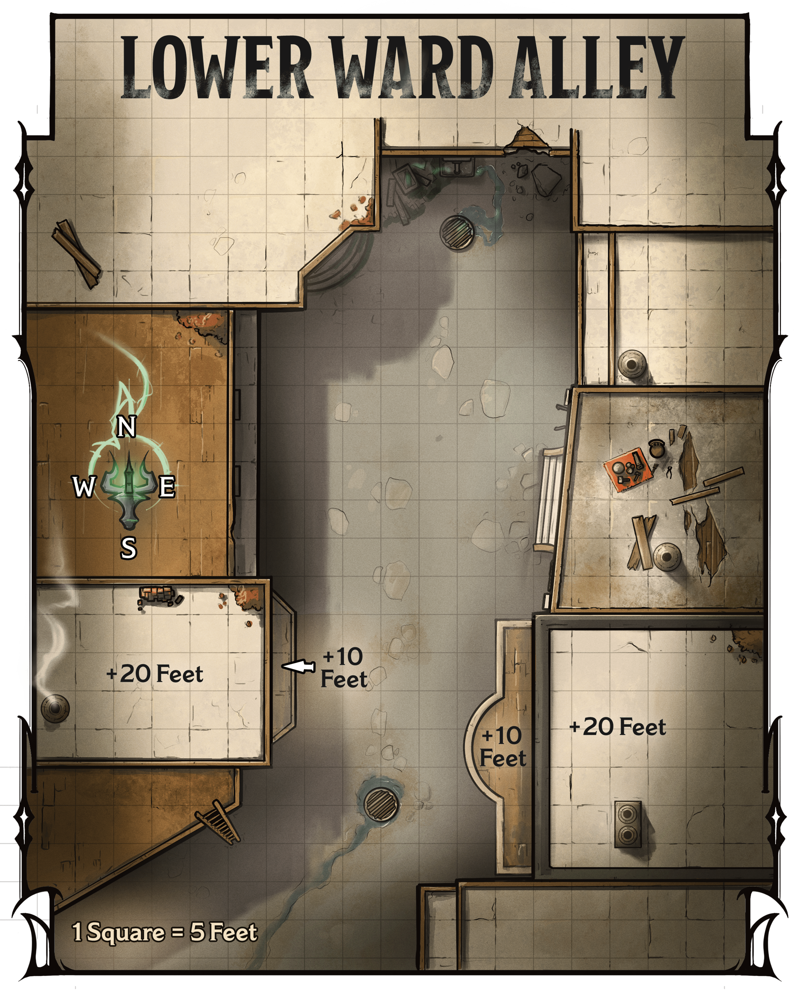](../assets/maps/mj/map-03-06.lower-ward-alley.png)

Map 3.6: Lower Ward Alley[View Player Version](../assets/maps/players/map-03-06.lower-ward-alley-player.png)

### Alley Features

The alley, shown on map 3.6, has the following features.

#### Balconies

Near the alley’s southern end, balconies to the east and west overlook the alley. The balconies are 10 feet above the ground.

#### Buildings

The buildings that flank the alley are made of wood and have flat roofs 20 feet above the ground.

#### Doors

The buildings’ doors are made of wood and locked. The locks are Simple (1 action to pick) and of Good quality (DC 15).

#### Ladder

A 20-foot-tall ladder that maintenance workers use during the day leans against the side of a building to the southwest.

#### Lighting

Sconces with [Continual Flame](https://www.dndbeyond.com/spells/2619065-continual-flame) spells cast on them shed [Dim Light](https://www.dndbeyond.com/sources/dnd/free-rules/rules-glossary#DimLight) throughout the alley at street level. The rooftops are in [Darkness](https://www.dndbeyond.com/sources/dnd/free-rules/rules-glossary#Darkness).

### Encountering Rathan Jur

If the characters arrive during the day, they see normal foot traffic come and go from nearby businesses, but Rathan Jur doesn’t appear.

Once the alley becomes deserted, the characters have about an hour to prepare for the confrontation. If they wait in the area for Jur to arrive, they see the goliath and two human associates walk to the center of the alley, followed shortly by a frightened orc man.

If the characters don’t confront the group immediately, read or paraphrase the following:

A bald, armored goliath man with a scimitar belted to his hip grins and pounds his fist into his palm. He jeers at an orc man wearing simple robes, saying, “You better pay up, Ruther. Accidents happen all the time. In fact, I feel like my fist is about to slip.” The goliath punches the orc. Two smug-looking human women standing beside the goliath burst into laughter.

The goliath is Rathan Jur (Medium, Neutral Evil [Bandit Crime Lord](https://www.dndbeyond.com/monsters/5194913-bandit-crime-lord)), and the humans are Rettene and Carla (Medium, Neutral Evil [Bandit Deceivers](https://www.dndbeyond.com/monsters/5194914-bandit-deceiver)). The three fight the characters if the characters interrupt their bullying.

The orc man (Medium [Commoner](https://www.dndbeyond.com/monsters/5194951-commoner)) is named Ruther. The punch reduces him to 3 HP. If the characters don’t intervene, Jur punches Ruther again, reducing him to 2 HP.

***Engaging with the Racketeer.*** Jur isn’t particularly loyal to Szass Tam, but threats alone won’t get him to agree to stop spying. But if the characters reduce him to 20 HP or fewer, he promises to leave town immediately. He keeps his word and allows the characters to escort him out of town as assurance.

***Development.*** If the characters kill Jur or convince him to leave town, they have neutralized him as a spy, and each character earns 4,100 XP.

## Concluding the Mission

If the characters neutralize the spies Thellania Marr, Pryas Nym, and Rathan Jur, their mission is successful.

### Mission Reward

As the zulkir promised, the party is entitled to one magic item from the list in “[Mission Rewards](../chapter.md#DeadfallMissionRewards)” earlier in this chapter. Remind them to tell Wrynn which item they’ve chosen. Additionally, each character earns 4,100 XP.

## Returning to the Zulkir

When the characters are ready to receive their next mission from Zulkir Thrul, they should return to Wrynn’s Bespoke Vestments as instructed in “[How to Meet with the Zulkir](../chapter.md#HowToMeetWithTheZulkir)” earlier in this chapter. The details of what’s happening in the shop when the characters arrive are up to you. The zulkir soon shows up in a new disguise created using the [Alter Self](https://www.dndbeyond.com/spells/2618846-alter-self) spell, appearing as an elderly gnome woman with golden spectacles and long, purple robes.

When Wrynn, the characters, and the disguised zulkir are alone, the tailor locks the front door and ushers everyone into the shop’s secret office (area W3 on [map 3.2](../chapter.md#Map0302wrynnsbespokevestments)). Thrul casts the [Demiplane](https://www.dndbeyond.com/spells/2619088-demiplane) spell and escorts the group through the shadowy door that appears on the wall.

## Second Mission

Read or paraphrase the following speech from Thrul when the characters are ready to receive their second mission:

“Operatives, you’ve taken three of the Hydra’s pawns off the board. Your next target is bigger.

“The Hydra’s intel courier in Eltabbar, the Messenger, owns the Two Plateaus Shipping Company. The Messenger receives reports from the Hydra’s spies at his company’s headquarters and reports them to the Hydra via allied Red Wizards.

“My spies have also learned that despite his outward loyalty to the Hydra, the Messenger is stealing magic items from the Hydra’s shipments. If the Hydra knew, the Messenger would be dead.

“We need to disrupt the Hydra’s spy operations in the city. While you could simply kill the Messenger, learning what intel he’s passing on would help us stay one step ahead of the Hydra.

“I recommend you use evidence of the Messenger’s thefts to blackmail him into sharing the information he receives with us before he sends it to the Hydra. The Sparrow will provide details about a dead drop the Messenger should use. If you succeed at blackmailing the Messenger, give him that information.

“Operatives, this task won’t be easy. We haven’t scouted the company’s interior, and we don’t know what evidence of the Messenger’s skimming might exist. If you must kill the Messenger, I will still consider this mission a success.

“Do you have questions?”

More information about the Two Plateaus Shipping Company appears in [chapter 1](../../chapter-01-thay/chapter.md#WarehouseWard).

The zulkir can provide the following information to the characters:

- **How Do You Suggest We Infiltrate the Company?** “You could sneak into the building, but doing so is risky. I suggest you pose as individuals who the Messenger would expect on site: clients, workers, or potential business partners. The company has a receptionist who deals with all visitors. If you can convince this receptionist, whose details are unknown to us, that you’re supposed to enter the building, this task might go smoother.”
- **How Is the Messenger Stealing from the Hydra?** “The Hydra uses the Messenger’s company to send magic items his workshops have produced to buyers throughout the region. Before the shipments leave Eltabbar, the Messenger steals one or two items. The buyer assumes the workshops mispacked or lost them, and they are reported as losses. The Messenger does this only occasionally, so he hasn’t gotten caught.”
- **What Do You Know About This Company?** “The Two Plateaus Shipping Company is located in the Warehouse Ward on the shores of Lake Thaylambar. The company ships trade goods and magic items in bulk from entrepreneurs, mostly Red Wizards, to clients. The staff works a day shift and a night shift. Given the Messenger’s secret work for the Hydra, I expect the building has magical defenses but don’t know their nature. We believe the Messenger stays on site at all times.”
- **How Will We Recognize the Messenger?** “The Messenger is a bearded, middle-aged human man named Iskan Iskari. I know no more, I’m afraid.”
- **What Evidence Against the Messenger Should We Find?** “Look for anything that proves the Messenger has been stealing: ledgers, lists of lost items, receipts from fences, and hidden items marked as lost. You’ll need as many pieces of evidence as possible to convince the Messenger we have enough information to turn him in to the Hydra.”
- **Will We Find Intel Destined for the Hydra There?** “Perhaps; bring back any information you find that might prove valuable. We can use all the information we can get.”

After the zulkir answers the characters’ questions, she provides directions to the Two Plateaus Shipping Company.

### Dead Drops

Before they leave the shop, Wrynn hands the characters a sheet of paper with the location of the dead drop—a public waste bin in the Warehouse Ward—and a list of days and times.

If the characters convince Iskari to turn against Szass Tam, they must give him this paper; he should deliver intelligence there according to this schedule.

## Unwelcome Company

If the characters haven’t remained discreet about their intent to confront Szass Tam, rumors have begun to swirl around the city. If the characters have remained discreet, skip this encounter. (See “Importance of Secrecy” in [chapter 2](../../chapter-02-thay-in-danger/chapter.md#ImportanceOfSecrecy) for more about emphasizing discretion and guile.)

As the characters head to the Two Plateaus Shipping Company, a gang of Szass Tam’s operatives accosts them. Use [map 3.6](../chapter.md#Map0306lowerwardalley) for this encounter, though it takes place in the Warehouse Ward.

Read or paraphrase the following:

Four figures block your path: three humans, armored and with weapons drawn, and a tiefling in black robes emblazoned with a fist-shaped symbol. The tiefling shouts, “You dare oppose Szass Tam? Time to find out what happens next, fools.”

These operatives are the tiefling man Daris Dredd (Medium, Neutral Evil [Archpriest](https://www.dndbeyond.com/monsters/5194903-archpriest)), a priest of Bane who believes Szass Tam is destined to rule Thay, and the humans Ferron Tor, Werther Rudd, and Xerta Xon (Medium [Bandit Deceivers](https://www.dndbeyond.com/monsters/5194914-bandit-deceiver)). They’re low-level agents of Szass Tam who bully anyone who speaks out against the lich. They fight the characters to the death.

## Two Plateaus Shipping

The building that houses the Two Plateaus Shipping Company is both the company’s headquarters and Iskari’s base of operations, from which he sends Szass Tam information from the lich’s spy operations in the tharch of Eltabbar. The shipping company often deals with dangerous clients and expensive goods, so Iskari employs capable guards to discourage any agents sent to sabotage rivals’ shipments and burglars.

### The Messenger

The Messenger’s real name is Iskan Iskari. He is a [Rakshasa](https://www.dndbeyond.com/monsters/5195178-rakshasa) disguised as a human Thayan. He uses the [Disguise Self](https://www.dndbeyond.com/spells/2619102-disguise-self) spell to cloak his true form, appearing as a bald, broad-shouldered, broad-chested human with a dark beard. Undisguised, he resembles a humanoid tiger covered in pale fur with dark stripes. In any form, Iskari has a forked tongue, hinting at his true nature.

Iskari holds the keys to the locked trunks and drawers in the storeroom ([area T5](../chapter.md#T5SecretStoreroom)), the drawer in the break room ([area T12](../chapter.md#T12BreakRoom)), his office ([area T14](../chapter.md#T14IskarisOffice)), and his quarters ([area T15](../chapter.md#T15IskarisQuarters)). During the day, Iskari usually works in his office, although you can place him elsewhere in the building. At night, he sleeps in his quarters (area T15).

### Iskari’s Scam

Zuzanna Wuzyk
[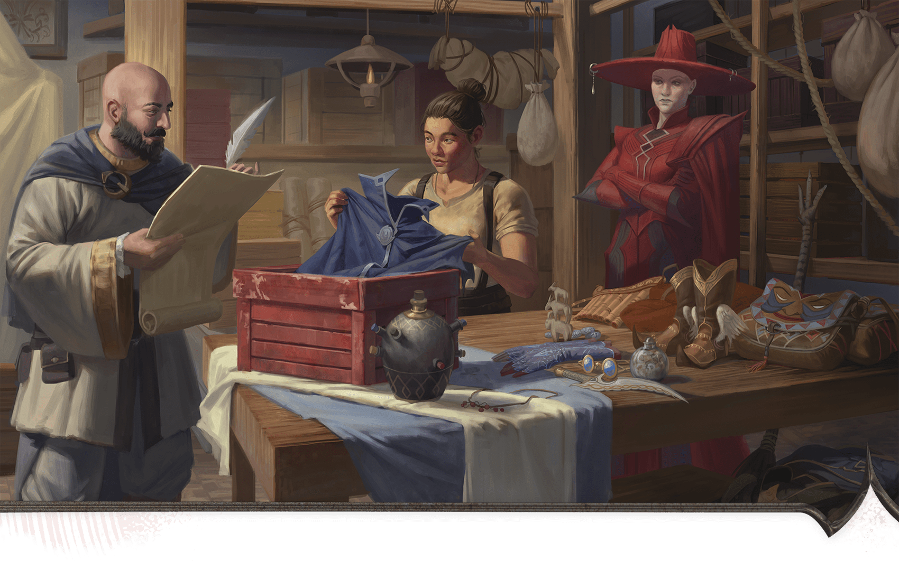](../assets/illustrations/03-007.inventory-shipment.png)

Iskan Iskari and an employee inventory a shipment of magic items for a Red Wizard client.

The workers and guards at Two Plateaus Shipping Company don’t know that Iskari has been stealing magic items from clients and selling them. Iskari doesn’t fear many of his clients—but he is afraid of Szass Tam. He carefully hides any evidence of his scam.

#### Securing Evidence

If the characters want to convince Iskari to work against Szass Tam, they must secure one or more pieces of evidence that prove Iskari has stolen from the lich. The characters recognize when something they find is evidence. They can find four pieces of evidence, which are in the following areas:

- **Area T5:** Stolen [Mantle of Spell Resistance](https://www.dndbeyond.com/magic-items/4673-mantle-of-spell-resistance)
- **Area T10:** Document listing items that were supposedly lost in transit
- **Area T12:** Receipt for stolen items sold to a fence
- **Area T14:** Stolen [Nine Lives Stealer (Longsword)](https://www.dndbeyond.com/magic-items/5124-nine-lives-stealer-longsword)

#### Blackmailing Iskari

When the characters interact with Iskari, a character can take the [Influence](https://www.dndbeyond.com/sources/dnd/free-rules/rules-glossary#InfluenceAction) action to try to convince him that they know about his scam and will inform Szass Tam unless Iskari cooperates. The character then makes a Charisma ([Persuasion](https://www.dndbeyond.com/sources/dnd/free-rules/playing-the-game#Skills)) check. The DC of that check depends on how many pieces of evidence the characters have when they confront Iskari, as noted in the Blackmailing Iskari table.

Although Iskari serves Szass Tam, he is greedy and self-centered. Iskari lies about stealing magic items unless the characters have three or more pieces of evidence or convince him to work against Szass Tam.

If the characters convince Iskari to work against Szass Tam, they must give him the instructions described in “[Dead Drops](../chapter.md#DeadDrops).”

#### Blackmailing Iskari

| Pieces of Evidence | DC |
| --- | --- |
| None | Impossible |
| 1 | 25 |
| 2 | 20 |
| 3 | 15 |
| 4 | 10 |

***Development.*** If the characters find three or more pieces of evidence, each character earns 4,700 XP.

### Shipping Company Features

Unless otherwise specified, the shipping company has the following features.

#### Ceilings

The building’s ceilings are 15 feet high. The loading dock ([area T16](../chapter.md#T16LoadingDock)) has no ceiling.

#### Doors

The doors in the shipping company are made of wood, and most are unlocked.

***Secret Doors.*** Unless otherwise noted, secret doors (marked with an *S* on the map; DC 18 to notice) blend in with the surrounding surfaces from the outside but are obvious from the inside. They’re unlocked and swing inward on hidden hinges. Iskari; shipping agents Alik Nal, Korla, and Cam; and the building’s guards know about the secret areas, but the company’s other employees don’t.

#### Lighting

Inside the building, lamps with [Continual Flame](https://www.dndbeyond.com/spells/2619065-continual-flame) spells cast on them emit [Bright Light](https://www.dndbeyond.com/sources/dnd/free-rules/rules-glossary#BrightLight). The loading dock is in Bright Light during the day.

#### Windows

The windows near the building’s front entrance are unlocked and large enough for a Medium or smaller creature to climb through.

***Window Traps.*** The windows are trapped from the outside with a wire that sends a jolt of electricity through intruders. The traps are denoted by a *T* on the map. A creature that touches the outside of a window gets shocked. The creature makes a DC 15 Constitution saving throw, taking 28 (8d6) Lightning damage on a failed save or half as much damage on a successful one.

***Detecting the Traps.*** A creature can take the [Search](https://www.dndbeyond.com/sources/dnd/free-rules/rules-glossary#SearchAction) action to inspect a window. They make a DC 18 Wisdom ([Perception](https://www.dndbeyond.com/sources/dnd/free-rules/playing-the-game#Skills)) check; on a success, the creature finds the wire. The traps are built into the window’s structure and can’t be disarmed, but once detected, the wire is easily avoided when climbing through a window.

### Shipping Company Locations

Gerralt Landman
[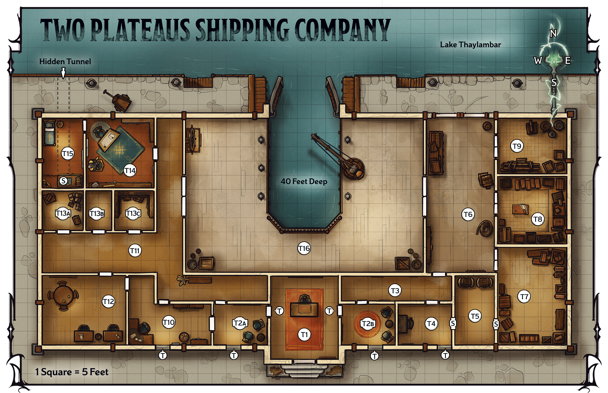](../assets/maps/mj/map-03-07.two-plateaus-shipping-company.png)

Map 3.7: Two Plateaus Shipping Company [View Player Version](https://media-stg.dndbeyond.com/compendium-images/aud/aqZhSuV5QislqWyN/map-03-07.two-plateaus-shipping-company-player.png)

The following locations are keyed to map 3.7. The shipping company operates around the clock. If the characters visit during the day and return at night (or vice versa), the same number of staff members occupy each area. Except for Iskari, they are different individuals.

#### T1: Reception

The walls of this reception area are decorated with landscapes of Thay’s rocky plateaus. At a central desk sits a young human man with red hair and freckles. He greets you with a smile.

“Welcome to Two Plateaus Shipping Company! How can I help you today?”

The human receptionist is Thom (Medium [Noble](https://www.dndbeyond.com/monsters/5195145-noble)). If the characters fight Thom, he flees into area T2a, using his key to bypass the trap (see [area T2a–b](../chapter.md#ShippingCompanyT2ABWaiting)). In 2 minutes, Iskari and the guard from [area T7](../chapter.md#ShippingCompanyT7WarehouseA) arrive and confront the characters.

***Gaining Entry.*** As an [Influence](https://www.dndbeyond.com/sources/dnd/free-rules/rules-glossary#InfluenceAction) action, a character can try to convince Thom they need to go inside the building. The character then makes a DC 15 Charisma ([Deception](https://www.dndbeyond.com/sources/dnd/free-rules/playing-the-game#Skills) or [Persuasion](https://www.dndbeyond.com/sources/dnd/free-rules/playing-the-game#Skills)) check. On a successful check, Thom escorts the characters into a waiting room (area T2a), using a key that bypasses the trap on the door (see area [T2a–b](../chapter.md#ShippingCompanyT2ABWaiting)).

Thom tells them to wait while he summons a shipping agent. In 20 minutes, Alik Nal arrives from the shipping office ([area T10](../chapter.md#T10ShippingOffice)). If the characters request to meet with Iskari, Thom tells them it will be an hour before the owner is free; he never arrives.

On a failure, Thom demands the characters leave and flees into area T2a if they don’t.

***Traps.*** The locks on the doors to the east and west are trapped, as described below.

#### T2a–b: Waiting Rooms

The doors leading from reception ([area T1](../chapter.md#ShippingCompanyT1Reception)) to the waiting rooms are locked. The locks are Complex (1 minute to pick) and of Superior quality (DC 20).

The locks on the doors to the east and west are each outfitted with a poisoned needle trap, as described in the [Dungeon Master’s Guide](https://www.dndbeyond.com/sources/dnd/dmg-2024/dms-toolbox#PoisonedNeedle), except the Constitution saving throw is DC 15, and the Poison damage is 22 (4d10).

Comfortable armchairs are nestled against the walls, while doors lead to the lobby and farther into the building. Portraits of Red Wizards standing in powerful poses adorn the walls.

Clients wait here to speak with shipping agents.

***Treasure.*** The paintings depict powerful Red Wizards—allies of Szass Tam and Iskari. These four portraits by renowned Thayan artist Taryn Gill are worth 2,500 GP apiece.

#### T3: Southeast Hall

A narrow hall stretches about forty feet west to east, with two doors on the south wall and one on the northeast corner.

The sounds of crates being moved and packed in the nearby hall and warehouses (areas T6–T9) are audible here.

#### T4: Dummy Office

This office contains a small desk with drawers against the west wall. A door leads north.

Old shipping paperwork lies scattered atop the desk, but none seems recent. This office primarily serves as a buffer between the rest of the company and the secret storeroom (area T5).

***Secret Door.*** A secret door on the east wall opens into area T5. See “[Shipping Company Features](../chapter.md#ShippingCompanyFeatures)” for details on this door.

#### T5: Secret Storeroom

Two steamer trunks sit against the north wall. Doors lead east and west.

Iskari tells Alik Nal and the guards that items clients have forgotten are kept here, but in reality, he uses this space to store stolen goods. The doors lead to the dummy office ([area T4](../chapter.md#ShippingCompanyT4DummyOffice)) and a warehouse ([area T7](../chapter.md#ShippingCompanyT7WarehouseA)).

***Blackmail Evidence.*** The trunks are both locked. As a [Utilize](https://www.dndbeyond.com/sources/dnd/free-rules/rules-glossary#UtilizeAction) action, a character can try to pick a lock using [Thieves’ Tools](https://www.dndbeyond.com/equipment/495-thieves-tools), accomplishing the task with a successful DC 18 Dexterity ([Sleight of Hand](https://www.dndbeyond.com/sources/dnd/free-rules/playing-the-game#Skills)) check.

The west trunk holds twelve nonmagical cloaks. Underneath them is the [Mantle of Spell Resistance](https://www.dndbeyond.com/magic-items/4673-mantle-of-spell-resistance) mentioned in the document found in the shipping office (area T10).

The east trunk holds fourteen nonmagical cloaks plus a small purse with 50 GP inside.

#### T6: Northeast Hall

Double doors dot this hall’s east and west walls; another door stands in the southwest corner. Three human workers mill about. The hall is otherwise empty aside from a few wooden crates.

The three workers are the humans Xenk, Jera, and Lilah (Medium [Bandit Deceivers](https://www.dndbeyond.com/monsters/5194914-bandit-deceiver)).

The workers assume the characters are authorized to be here unless they look like obvious intruders. In that case, the workers fight the party, shouting for help from workers and guards in nearby warehouses (areas T7–T9). Those individuals arrive to join the fight at the beginning of the third round of combat.

#### T7: Warehouse A

This warehouse is filled with crates. Three goliath workers loiter, and an orc woman wearing studded leather armor guards the double door.

The three goliath workers—Jorah, Jumah, and Karis (Medium [Bandit Deceivers](https://www.dndbeyond.com/monsters/5194914-bandit-deceiver))—await word on when the next boat is scheduled to arrive in the loading dock ([area T16](../chapter.md#T16LoadingDock)). The guard is the orc Dora Brokenjaw (Medium [Bandit Crime Lord](https://www.dndbeyond.com/monsters/5194913-bandit-crime-lord)), who demands the characters leave when she notices them.

As an [Influence](https://www.dndbeyond.com/sources/dnd/free-rules/rules-glossary#InfluenceAction) action, a character can insist they’re authorized to be here. The character makes a DC 18 Charisma ([Deception](https://www.dndbeyond.com/sources/dnd/free-rules/playing-the-game#Skills)) check. On a success, the staff allows the characters to go about their business. On a failure, the guard begins combat and the workers flee. Should combat begin, the guards from areas T8 and T9 arrive at the end of the second round of combat.

***Crates.*** This room holds twenty-one crates. Ten crates contain 20 pounds of flour and are worth 50 CP apiece; another eleven contain 20 pounds of wheat and are worth 20 CP apiece.

***Secret Door.*** A secret door near the southeast corner leads to the storeroom [(area T5](../chapter.md#T5SecretStoreroom)). See “[Shipping Company Features](../chapter.md#ShippingCompanyFeatures)” for details on this door.

#### T8: Warehouse B

This warehouse is filled with crates. A human man wearing studded leather armor guards the double door.

The guard is the human Rian Jon (Medium [Assassin](https://www.dndbeyond.com/monsters/5194904-assassin)), who demands the characters leave when he notices them.

As an [Influence](https://www.dndbeyond.com/sources/dnd/free-rules/rules-glossary#InfluenceAction) action, a character can insist they’re authorized to be here. The character makes a DC 16 Charisma ([Deception](https://www.dndbeyond.com/sources/dnd/free-rules/playing-the-game#Skills)) check. On a success, the guard allows the characters to go about their business. On a failure, the guard begins combat. Should combat begin, the guards from areas T7 and T9 arrive at the end of the second round of combat.

***Crates.*** This warehouse holds twenty crates. Ten contain canvas textiles and are worth 10 GP apiece. Another ten contain cotton textiles and are worth 100 GP apiece.

#### T9: Warehouse C

This large warehouse is filled with barrels and crates. A tiefling woman wearing studded leather armor guards the double door in the west wall.

The guard is the tiefling Terra Senpher (Medium [Bandit Crime Lord](https://www.dndbeyond.com/monsters/5194913-bandit-crime-lord)), who demands the characters leave when she notices them.

As an [Influence](https://www.dndbeyond.com/sources/dnd/free-rules/rules-glossary#InfluenceAction) action, a character can insist they’re authorized to be here. The character makes a DC 18 Charisma ([Deception](https://www.dndbeyond.com/sources/dnd/free-rules/playing-the-game#Skills)) check. On a successful check, the guard allows the characters to go about their business. On a failure or if they’re caught stealing, the guard begins combat. Should combat begin, the guards from areas T7 and T8 arrive at the end of the second round of combat.

***Barrels and Crates.*** Ten barrels contain burlap and are worth 10 GP apiece; another ten crates contain linen textiles and are worth 100 GP apiece.

***Treasure.*** A crate in the southeast corner contains the following (all but [Walloping Ammunition](https://www.dndbeyond.com/magic-items/36839-walloping-ammunition) appear in appendix A):

[Sniper’s Bracelet](https://www.dndbeyond.com/magic-items/11914537-snipers-bracelet)

[Trick Weapon](https://www.dndbeyond.com/magic-items/11914593-trick-weapon)

Three pieces of Walloping Ammunition

[Wand of Enthralling](https://www.dndbeyond.com/magic-items/11914595-wand-of-enthralling)

#### T10: Shipping Office

An elf man wearing gray robes sits at this room’s desk, writing with a quill on a roll of parchment. A shelf full of ledgers sits against the south wall, and doors lead to the north, west, and east.

The elf man is Alik Nal (Medium [Mage](https://www.dndbeyond.com/monsters/4831023-mage)), a shipping agent. Nal is recording the details of a recent shipment.

Nal demands the characters leave if he notices them, barking that he’s too busy to speak with them. If they won’t leave, he fights them. Should combat begin here, the guards from areas T7–T9 join the fight at the end of the second round of combat.

As an [Influence](https://www.dndbeyond.com/sources/dnd/free-rules/rules-glossary#InfluenceAction) action, a character can try to convince Nal to leave the room or allow them to peruse the ledgers. The character then makes a DC 17 Charisma ([Deception](https://www.dndbeyond.com/sources/dnd/free-rules/playing-the-game#Skills) or [Persuasion](https://www.dndbeyond.com/sources/dnd/free-rules/playing-the-game#Skills)) check. On a success, Nal assents to the request. If he discovers the characters have deceived him, he fights them.

***Blackmail Evidence.*** Hidden among the ledgers on the shelf is a document listing magic items Iskari has reported to clients as lost:

[Broom of Flying](https://www.dndbeyond.com/magic-items/9228372-broom-of-flying)

[Helm of Comprehending Languages](https://www.dndbeyond.com/magic-items/4654-helm-of-comprehending-languages)

[Lantern of Revealing](https://www.dndbeyond.com/magic-items/9228811-lantern-of-revealing)

[Mantle of Spell Resistance](https://www.dndbeyond.com/magic-items/4673-mantle-of-spell-resistance)

[Nine Lives Stealer (Longsword)](https://www.dndbeyond.com/magic-items/5124-nine-lives-stealer-longsword)

Pair of [Sending Stones](https://www.dndbeyond.com/magic-items/9180147-sending-stones)

The words “fenced” appear next to the entries for the broom, helm, lantern, and *Sending Stones*.

Iskari has fenced all but the *Mantle of Spell Resistance* and the *Nine Lives Stealer (Longsword)*, which are in the secret storeroom ([area T5](../chapter.md#T5SecretStoreroom)) and his office ([area T14](../chapter.md#T14IskarisOffice)), respectively. If the characters have found either of these magic items, they realize those are the items mentioned in this list.

#### T11: West Hall

Plush carpet covers the floor of this hall, which is lined with seascapes showing the Thayan coast.

Iskari takes his most valued clients to his office ([area T14](../chapter.md#T14IskarisOffice)) through this hall.

#### T12: Break Room

This room’s table and chairs are spartan, its walls and floors undecorated. Two desks sit along the south wall; the one to the west has a drawer.

This area serves as a break room for the guards in the warehouses (areas T7–T9).

***Blackmail Evidence.*** The western desk’s drawer is locked. A character can take the [Utilize](https://www.dndbeyond.com/sources/dnd/free-rules/rules-glossary#UtilizeAction) action to try to pick the lock using [Thieves’ Tools](https://www.dndbeyond.com/equipment/495-thieves-tools), accomplishing the task with a successful DC 18 Dexterity ([Sleight of Hand](https://www.dndbeyond.com/sources/dnd/free-rules/playing-the-game#Skills)) check. Inside the drawer lies a handwritten receipt for the following items, sold for 200 GP apiece:

[Broom of Flying](https://www.dndbeyond.com/magic-items/9228372-broom-of-flying)

[Helm of Comprehending Languages](https://www.dndbeyond.com/magic-items/4654-helm-of-comprehending-languages)

[Lantern of Revealing](https://www.dndbeyond.com/magic-items/9228811-lantern-of-revealing)

Pair of [Sending Stones](https://www.dndbeyond.com/magic-items/9180147-sending-stones)

#### T13a-c: Small Storage Rooms

These rooms are used for storage.

***T13a.*** This room holds small shipments (see “[Treasure](../chapter.md#Treasure)”).

***T13b.*** This room is empty.

***T13c.*** The shelves in this room hold office and cleaning supplies, which have no value.

***Treasure.*** A character who searches area T13a finds several carefully packed crates full of glass vials and bottles; the boxes hold eight [Potion of Healings](https://www.dndbeyond.com/equipment/71-potion-of-healing) in total.

#### T14. Iskari’s Office

The door from the hallway into the office is locked. The lock is Complex (1 minute to pick) and of Superior quality (DC 20). On bypassing the door, read or paraphrase the following:

Sitting behind the heavy desk in this spacious office is a bearded, broad-shouldered man wearing a purple cloak and a scowl. A glass orb sits on the desk. Beside the desk looms a stone statue of a soldier. A bookshelf stands in the northeast corner.

Company owner and intel courier Iskan Iskari ([Rakshasa](https://www.dndbeyond.com/monsters/5195178-rakshasa)) sits here wearing his human disguise (see “[The Messenger](../chapter.md#TheMessenger)” earlier in this chapter). The statue ([Stone Golem](https://www.dndbeyond.com/monsters/4904850-stone-golem)) animates and fights the characters if combat begins in this room. Before the statue animates, a character must succeed on a DC 15 Intelligence ([Investigation](https://www.dndbeyond.com/sources/dnd/free-rules/playing-the-game#Skills)) check to discern its magical nature.

The characters can try to convince Iskari to work against Szass Tam as described in “[Blackmailing Iskari](../chapter.md#BlackmailingIskari)” earlier in this chapter. If the characters don’t try to talk to Iskari, when he realizes they are intruders, he and the golem begin combat. Iskari fights until reduced to 50 HP. He then attempts to flee into his quarters and through the trapdoor (see [area T15](../chapter.md#T15IskarisQuarters)).

***Blackmail Evidence.*** The desk’s bottom drawer is locked. A character can take the [Utilize](https://www.dndbeyond.com/sources/dnd/free-rules/rules-glossary#UtilizeAction) action to try to pick the lock using [Thieves’ Tools](https://www.dndbeyond.com/equipment/495-thieves-tools), accomplishing the task with a successful DC 18 Dexterity ([Sleight of Hand](https://www.dndbeyond.com/sources/dnd/free-rules/playing-the-game#Skills)) check. On a successful check, the drawer opens, revealing the [Nine Lives Stealer (Longsword)](https://www.dndbeyond.com/magic-items/5124-nine-lives-stealer-longsword) mentioned in the document found in the shipping office ([area T10](../chapter.md#T10ShippingOffice)). Iskari is debating whether to fence or keep this item.

***Intel.*** The drawer in the table to the south is locked. A character can take the [Utilize](https://www.dndbeyond.com/sources/dnd/free-rules/rules-glossary#UtilizeAction) action to try to pick the lock using [Thieves’ Tools](https://www.dndbeyond.com/equipment/495-thieves-tools), accomplishing the task with a successful DC 18 Dexterity ([Sleight of Hand](https://www.dndbeyond.com/sources/dnd/free-rules/playing-the-game#Skills)) check. Inside the drawer is a piece of folded parchment. When the characters read it, read or paraphrase the following:

When you unfold this parchment, you see the following written in Common in a halting hand:

“A militia of disgruntled former soldiers has formed in Pyarados. They hate all Red Wizards, especially Szass Tam. Their leader is Fallon, whose family members were Szass Tam’s enemies and were justly punished years ago. Fallon tries to rally the region against Szass Tam’s impending regency and needs to be dealt with.

“Place this note in the shipment marked for Zoltir Zith to ensure it reaches our esteemed regent.”

An agent of Szass Tam recently gave this note to Iskari, who intends to send it to the lich in an upcoming shipment bound for Thaymount. This note foreshadows the characters’ mission to recruit Fallon and the Pyarados militia in [chapter 4](../../chapter-04-peril-in-pyarados/chapter.md#ThirdAndFourthMissions).

***Treasure.*** The glass orb on the table is a [Driftglobe](https://www.dndbeyond.com/magic-items/9228521-driftglobe).

#### T15: Iskari’s Quarters

The door to this chamber is locked. The lock is Complex (1 minute to pick) and of Superior quality (DC 20).

This room contains a narrow bed. A large rug covers most of the floor. To the south is a closet.

***Secret Door.*** Underneath the trunk in the closet is a secret trapdoor that opens into a hidden tunnel. This trapdoor is marked with an *S* on the map. The tunnel leads out of the building and emerges just above Lake Thaylambar’s water level.

***Treasure.*** The closet contains a trunk, which is locked. A character can take the [Utilize](https://www.dndbeyond.com/sources/dnd/free-rules/rules-glossary#UtilizeAction) action to try to pick the lock using [Thieves’ Tools](https://www.dndbeyond.com/equipment/495-thieves-tools), accomplishing the task with a successful DC 18 Dexterity ([Sleight of Hand](https://www.dndbeyond.com/sources/dnd/free-rules/playing-the-game#Skills)) check. On a successful check, the trunk opens.

Inside the trunk are Iskari’s valuables:

2,500 GP in various coins

[Eyes of Deceit](https://www.dndbeyond.com/magic-items/11914526-eyes-of-deceit) (see appendix A)

[Gem of Brightness](https://www.dndbeyond.com/magic-items/9228652-gem-of-brightness)

[Gem of Seeing](https://www.dndbeyond.com/magic-items/9228653-gem-of-seeing)

[Keoghtom’s Ointment](https://www.dndbeyond.com/magic-items/9228809-keoghtoms-ointment)

#### T16: Loading Dock

Standing on this wooden loading dock are two gray-robed humans who gesture while speaking to an orc man wearing a black robe emblazoned with a fist-shaped symbol. The dock surrounds an empty boat slip, to the east of which sits a crane. A mechanism stands along the west wall. The slip’s doors are closed, making it inaccessible to passing boats. The area has no roof.

The robed humans are the shipping agents Korla and Cam (Medium [Mages](https://www.dndbeyond.com/monsters/4831023-mage)). They are showing the boat slip to a prospective client, the orc Grosh (Medium, Neutral Evil [Archpriest](https://www.dndbeyond.com/monsters/5194903-archpriest)), who worships Bane and owns a magic item business.

If they notice the characters, they’re incensed at the interruption. Grosh fights the characters while the agents flee to retrieve a guard. Should combat begin here, the guard from [area T9](../chapter.md#ShippingCompanyT9WarehouseC) arrives at the end of the second round of combat.

***Boat Slip.***The water here is 40 feet deep.

***Crane.*** The 10-foot-tall crane has a heavy hook block. A creature standing next to the crane can take the [Utilize](https://www.dndbeyond.com/sources/dnd/free-rules/rules-glossary#UtilizeAction) action to swing its hook block, knocking over any creatures in its path. Each creature standing next to the crane except the character swinging the hook block must succeed on a DC 15 Dexterity saving throw or take 7 (2d6) Bludgeoning damage and have the [Prone](https://www.dndbeyond.com/sources/dnd/free-rules/rules-glossary#ProneCondition) condition.

***Mechanism and Outer Doors.***The mechanism to the west controls the outer doors. A character standing next to the mechanism can take the [Utilize](https://www.dndbeyond.com/sources/dnd/free-rules/rules-glossary#UtilizeAction) action to open or close the doors. The doors and adjacent walls are 15 feet tall.

## Concluding the Mission

If the characters kill Iskari or convince him to work against Szass Tam, their mission is successful.

### Mission Reward

The characters should tell Wrynn which magic item they want from the list in “[Mission Rewards](../chapter.md#DeadfallMissionRewards)” earlier in this chapter. Additionally, each character earns 4,700 XP.

### Reporting Spy Intel

If the characters found the spy intel note in [area T14](../chapter.md#T14IskarisOffice) and share its contents with Wrynn, he looks thoughtful and tells the characters he’s not surprised to hear that Szass Tam’s agents have targeted the militia.

## Gift from the Sparrow

Handout: Gift Note

Sometime after the characters complete their first or second mission, Wrynn sends them a gift via an anonymous courier to express his thanks for the work they’ve done so far.

The details are up to you, but at your discretion, a parcel arrives where one or more characters stay. The parcel is a cherrywood box wrapped in black satin. The box is lined with purple velvet, on which sit a number of elegantly embroidered handkerchiefs equal to the number of characters. Ask each player their character’s favorite color; that’s the color of the handkerchief Wrynn has given them.

The box also contains a note. When the characters read the note, give the players a copy of the Gift Note handout.
