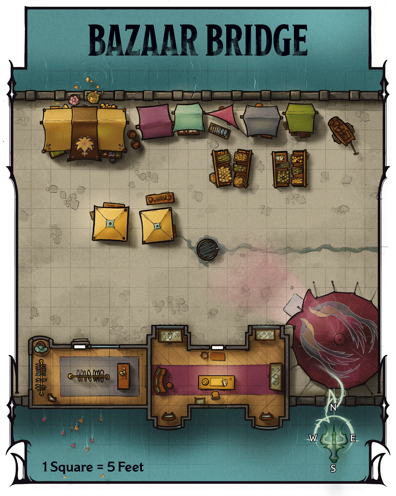
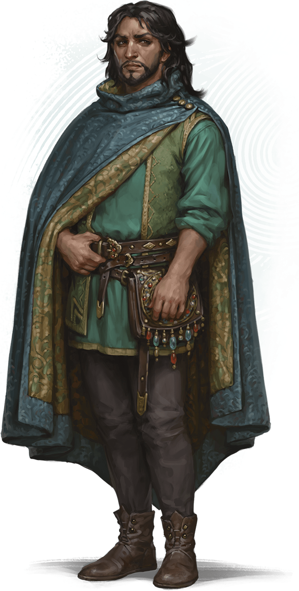
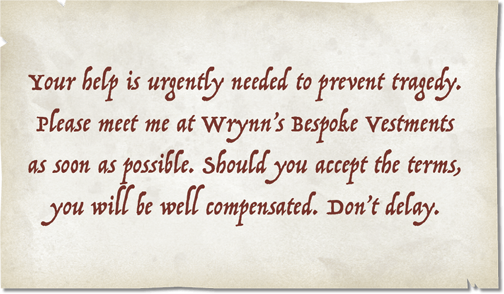

<!-- Notes MJ : contenu fourni par l’utilisateur, non destiné au partage public. -->

## Terror at the Bazaar

In recent weeks, Szass Tam’s experiments using the foul magic of his Malefice Mortum ritual have created rampaging hordes of malefites throughout Thay, including many in Eltabbar. One such horde—a [death tyrant](https://www.dndbeyond.com/monsters/5194965-death-tyrant) and [skeletons](https://www.dndbeyond.com/monsters/4775841-skeleton)—awakened deep in the [Underdark](https://www.dndbeyond.com/sources/dnd/dmg-2024/lore-glossary#UnderdarkThe) beneath the capital. The death tyrant drove the group through a passage that led to the Bazaar Ward’s canals to vent their Abyss-fueled murderousness on the living above.

When the campaign begins, ask the players why their characters are browsing Eltabbar’s Bazaar Ward together. Perhaps they seek a specific trinket or want to enjoy one of Eltabbar’s most luxurious wards on this energetic Market First Day. Whatever the reason, the characters wander through the part of the bazaar shown on map 3.1.

Read or paraphrase the following:

The city’s trees are blossoming, cranes flock to the canals, and permanent weather magic brings gentle rain and warm breezes. It’s the first day of the month of Tarsakh, and the bazaar’s merchants have just unveiled a new batch of goods and attractive discounts.

The market is crowded with shoppers—Medium and Small [Commoners](https://www.dndbeyond.com/monsters/5194951-commoner) and [Nobles](https://www.dndbeyond.com/monsters/5195145-noble) of various species.

### Bazaar Features

Gerralt Landman

Map 3.1: Bazaar Bridge [View Player Version](../assets/maps/players/map-03-01.bazaar-bridge-player.png)

This section of the bazaar is situated on a bridge that spans a canal in the center of the Bazaar Ward. The bridge section of the bazaar has the following features.

#### Buildings

Two buildings lie to the south. The buildings’ doors are unlocked.

***Lin’s Capes and Cloaks.*** To the west is Lin’s Capes and Cloaks, a shop that specializes in fashionable outerwear. Proprietor Teeva Lin (Medium [Noble](https://www.dndbeyond.com/monsters/5195145-noble)), a genial and cultured human, sells nonmagical pieces ranging in cost from 10 GP to 500 GP.

She also has magic garments for sale, whose costs are listed in parentheses:

[Cape of the Mountebank](https://www.dndbeyond.com/magic-items/9228376-cape-of-the-mountebank) (4,000 GP)

[Cloak of Arachnida](https://www.dndbeyond.com/magic-items/4604-cloak-of-arachnida) (40,000 GP)

[Cloak of Billowing](https://www.dndbeyond.com/magic-items/27040-cloak-of-billowing) (100 GP)

[Cloak of Many Fashions](https://www.dndbeyond.com/magic-items/27041-cloak-of-many-fashions) (100 GP)

***The Jeweled Crane.*** To the east is the Jeweled Crane, which specializes in nonmagical brooches. Made from gold decorated with precious gemstones, these pieces cost anywhere from 100 GP to 1,000 GP apiece. Jeweler Garend Gil (Medium [Noble](https://www.dndbeyond.com/monsters/5195145-noble)), a self-absorbed human, owns the shop.

#### Fruit Displays

On the bridge’s eastern half are four displays of fresh fruits, including apricots, pears, plums, and pomegranates. The displays are tended by the gregarious elf Jayleen (Medium [Noble](https://www.dndbeyond.com/monsters/5195145-noble)), who hand-selects the produce from farmers every day. Individual fruits cost 1 SP.

#### Supply Cart

A cart with cleaning supplies stands in the northeast corner. The cart provides [Half Cover](https://www.dndbeyond.com/sources/dnd/free-rules/rules-glossary#Cover) to anyone behind it.

#### Tents

Merchants have erected several tents along this portion of the bridge. Each sells merchandise as described below.

***Northern Tents.*** The tents along the north side of the bridge display bolts of beautiful textiles in all colors but red, including silk and satin brocade. These are the wares of the orc Ven Terrytooth (Medium [Noble](https://www.dndbeyond.com/monsters/5195145-noble)), who chats genially with customers and brags about his good relationship with several Red Wizards. Each bolt of cloth weighs 1 pound and costs between 10 GP and 30 GP.

***Central Tents.*** The central tents display [Spyglasses](https://www.dndbeyond.com/equipment/427-spyglass), from simple pieces made with polished steel to ones fashioned from gold encrusted with gemstones. The serious and bespectacled human Val Vann (Medium [Noble](https://www.dndbeyond.com/monsters/5195145-noble)) tends to the wares, which her grandfather crafts in their home in the Mages’ Ward. The Spyglasses cost from 1,000 GP to 5,000 GP.

***Southeastern Tent.*** The southeastern tent displays precious spices, including cloves, cinnamon, cardamom, and saffron. The intellectual proprietor, a human named Meri (Medium [Noble](https://www.dndbeyond.com/monsters/5195145-noble)), sells the spices in 1-pound jars. Jars of cloves or cinnamon each cost 3 GP, while jars of cardamom and saffron each cost 15 GP.

### Malefite Attack

Allow the characters to interact with NPCs in the bazaar for a few minutes. Then read or paraphrase the following:

Bloodcurdling screams fill the air as the crowd suddenly flees east in a panic. You decipher a warning cry amid the chaos: “Skeletons! Run for your lives!” Half a dozen skeletons, their eyes glowing green, advance while swinging rusty blades.

Shambling across the bridge are six [Skeletons](https://www.dndbeyond.com/monsters/4775841-skeleton) that were raised in one of Szass Tam’s recent experiments. The skeletons fight the characters and anyone near them on the bridge, focusing on the characters after the first character acts.

On Initiative count 0 of the second round of combat (losing ties), a [Death Tyrant](https://www.dndbeyond.com/monsters/5194965-death-tyrant) erupts from the canal and flies toward the characters. Read or paraphrase the following:

Bursting from the canal is an enormous, flying orb of desiccated flesh, its slavering maw filled with gnashing teeth. Its single eye glows with green energy.

The death tyrant, whose lair is in the [Underdark](https://www.dndbeyond.com/sources/dnd/dmg-2024/lore-glossary#UnderdarkThe), fights the characters until destroyed.

#### Fleeing Crowd

Thirty vendors, customers, and bystanders are on the bridge when the attack begins. They try to flee during the first round of combat, making the bridge [Difficult Terrain](https://www.dndbeyond.com/sources/dnd/free-rules/rules-glossary#DifficultTerrain) during that time.

#### Development

If combat lasts more than 6 rounds, five human Red Wizards (Medium [Archmages](https://www.dndbeyond.com/monsters/5194902-archmage)) who belong to the City Watch rush onto the scene to dispatch the monsters. After the battle, these Red Wizards grumble about increasing incidents involving strange undead monsters, but they refuse to answer any questions from the crowd or the characters.

The watch members immediately depart the area. If civilians are dead or injured (see “After the Attack”), the Red Wizards say they aren’t versed in healing magic and promise to send healers.

### After the Attack

It’s up to you whether civilians are injured or die in this attack. If the characters acted heroically, you might decide everyone in the crowd escapes. If the characters fled the attack, you might decide some of or all the civilians on the bridge die.

#### Shaken Crowd

No matter how the characters acted, the crowd returns to the bridge after the attack while vendors clean up the disarray.

If the characters defeated the monsters without the City Watch’s help, Jayleen (see “[Fruit Displays](../chapter.md#FruitDisplays)”) thanks them profusely and offers them as much free fruit as they want. The other vendors and shoppers also hail the characters as heroes.

#### Mysterious Messenger

 EKATERINA BURMAK

Wynston Wrynn

A human man with long hair and a neatly trimmed beard, dressed in beautifully made clothing, approaches a character of your choice.

The man clasps the character’s hand, into which he places a small piece of folded parchment. He says only, “I’m glad I found you, my friends,” before walking away.

The man is Wynston Wrynn (Medium, Neutral Good [Spy Master](https://www.dndbeyond.com/monsters/5195216-spy-master)), who came to the bridge to deliver the parchment and witnessed the battle’s last moments.

If the characters follow Wrynn after he hands them the parchment, the man asks them to accompany him. He won’t divulge details, but he promises that an offer awaits them that they’ll want to consider.

***The Parchment.*** The parchment contains a note written by Zulkir Xelnene Thrul, whom the characters meet later in this chapter. The zulkir has cast the [Illusory Script](https://www.dndbeyond.com/spells/2619173-illusory-script) spell on the parchment; to anyone but the characters, the note looks like a list of grocery items.

When the characters unfold the parchment, give the players a copy of the Mysterious Note handout.

***Development.*** Wrynn’s Bespoke Vestments is a few blocks northeast. Any characters from Eltabbar recognize the name of the shop and know its location. Otherwise, the party can learn the shop’s location from any bystander.

Handout: Mysterious Note
