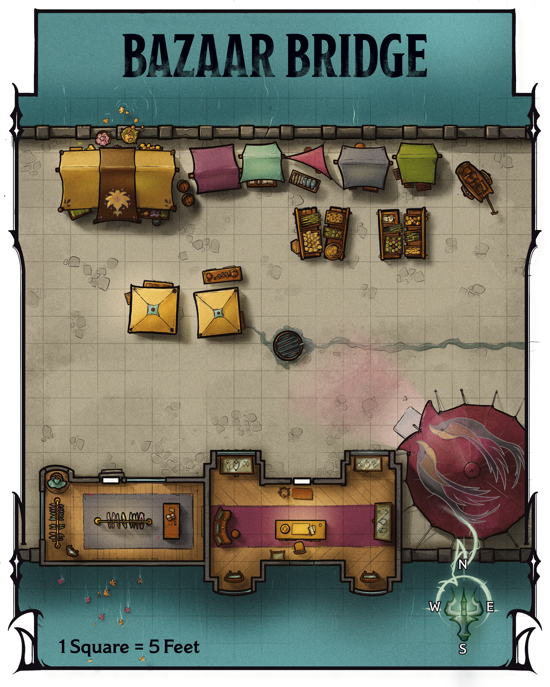

<!-- Notes MJ : contenu fourni par l’utilisateur, non destiné au partage public. -->

### Bazaar Features

Gerralt Landman

Map 3.1: Bazaar Bridge [View Player Version](../assets/maps/players/map-03-01.bazaar-bridge-player.png)

This section of the bazaar is situated on a bridge that spans a canal in the center of the Bazaar Ward. The bridge section of the bazaar has the following features.

#### Buildings

Two buildings lie to the south. The buildings’ doors are unlocked.

***Lin’s Capes and Cloaks.*** To the west is Lin’s Capes and Cloaks, a shop that specializes in fashionable outerwear. Proprietor Teeva Lin (Medium [Noble](https://www.dndbeyond.com/monsters/5195145-noble)), a genial and cultured human, sells nonmagical pieces ranging in cost from 10 GP to 500 GP.

She also has magic garments for sale, whose costs are listed in parentheses:

[Cape of the Mountebank](https://www.dndbeyond.com/magic-items/9228376-cape-of-the-mountebank) (4,000 GP)

[Cloak of Arachnida](https://www.dndbeyond.com/magic-items/4604-cloak-of-arachnida) (40,000 GP)

[Cloak of Billowing](https://www.dndbeyond.com/magic-items/27040-cloak-of-billowing) (100 GP)

[Cloak of Many Fashions](https://www.dndbeyond.com/magic-items/27041-cloak-of-many-fashions) (100 GP)

***The Jeweled Crane.*** To the east is the Jeweled Crane, which specializes in nonmagical brooches. Made from gold decorated with precious gemstones, these pieces cost anywhere from 100 GP to 1,000 GP apiece. Jeweler Garend Gil (Medium [Noble](https://www.dndbeyond.com/monsters/5195145-noble)), a self-absorbed human, owns the shop.

#### Fruit Displays

On the bridge’s eastern half are four displays of fresh fruits, including apricots, pears, plums, and pomegranates. The displays are tended by the gregarious elf Jayleen (Medium [Noble](https://www.dndbeyond.com/monsters/5195145-noble)), who hand-selects the produce from farmers every day. Individual fruits cost 1 SP.

#### Supply Cart

A cart with cleaning supplies stands in the northeast corner. The cart provides [Half Cover](https://www.dndbeyond.com/sources/dnd/free-rules/rules-glossary#Cover) to anyone behind it.

#### Tents

Merchants have erected several tents along this portion of the bridge. Each sells merchandise as described below.

***Northern Tents.*** The tents along the north side of the bridge display bolts of beautiful textiles in all colors but red, including silk and satin brocade. These are the wares of the orc Ven Terrytooth (Medium [Noble](https://www.dndbeyond.com/monsters/5195145-noble)), who chats genially with customers and brags about his good relationship with several Red Wizards. Each bolt of cloth weighs 1 pound and costs between 10 GP and 30 GP.

***Central Tents.*** The central tents display [Spyglasses](https://www.dndbeyond.com/equipment/427-spyglass), from simple pieces made with polished steel to ones fashioned from gold encrusted with gemstones. The serious and bespectacled human Val Vann (Medium [Noble](https://www.dndbeyond.com/monsters/5195145-noble)) tends to the wares, which her grandfather crafts in their home in the Mages’ Ward. The Spyglasses cost from 1,000 GP to 5,000 GP.

***Southeastern Tent.*** The southeastern tent displays precious spices, including cloves, cinnamon, cardamom, and saffron. The intellectual proprietor, a human named Meri (Medium [Noble](https://www.dndbeyond.com/monsters/5195145-noble)), sells the spices in 1-pound jars. Jars of cloves or cinnamon each cost 3 GP, while jars of cardamom and saffron each cost 15 GP.
