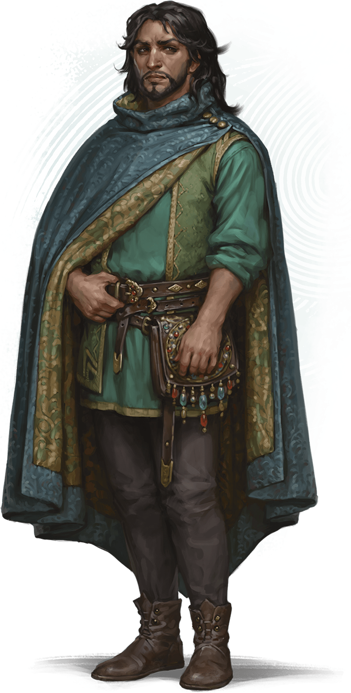
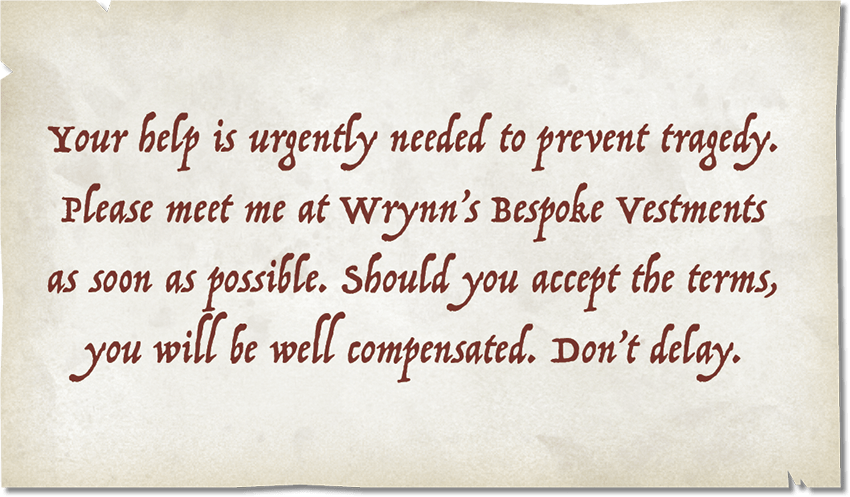

<!-- Notes MJ : contenu fourni par l’utilisateur, non destiné au partage public. -->

### After the Attack

It’s up to you whether civilians are injured or die in this attack. If the characters acted heroically, you might decide everyone in the crowd escapes. If the characters fled the attack, you might decide some of or all the civilians on the bridge die.

#### Shaken Crowd

No matter how the characters acted, the crowd returns to the bridge after the attack while vendors clean up the disarray.

If the characters defeated the monsters without the City Watch’s help, Jayleen (see “[Fruit Displays](../chapter.md#FruitDisplays)”) thanks them profusely and offers them as much free fruit as they want. The other vendors and shoppers also hail the characters as heroes.

#### Mysterious Messenger

 EKATERINA BURMAK

Wynston Wrynn

A human man with long hair and a neatly trimmed beard, dressed in beautifully made clothing, approaches a character of your choice.

The man clasps the character’s hand, into which he places a small piece of folded parchment. He says only, “I’m glad I found you, my friends,” before walking away.

The man is Wynston Wrynn (Medium, Neutral Good [Spy Master](https://www.dndbeyond.com/monsters/5195216-spy-master)), who came to the bridge to deliver the parchment and witnessed the battle’s last moments.

If the characters follow Wrynn after he hands them the parchment, the man asks them to accompany him. He won’t divulge details, but he promises that an offer awaits them that they’ll want to consider.

***The Parchment.*** The parchment contains a note written by Zulkir Xelnene Thrul, whom the characters meet later in this chapter. The zulkir has cast the [Illusory Script](https://www.dndbeyond.com/spells/2619173-illusory-script) spell on the parchment; to anyone but the characters, the note looks like a list of grocery items.

When the characters unfold the parchment, give the players a copy of the Mysterious Note handout.

***Development.*** Wrynn’s Bespoke Vestments is a few blocks northeast. Any characters from Eltabbar recognize the name of the shop and know its location. Otherwise, the party can learn the shop’s location from any bystander.

Handout: Mysterious Note
