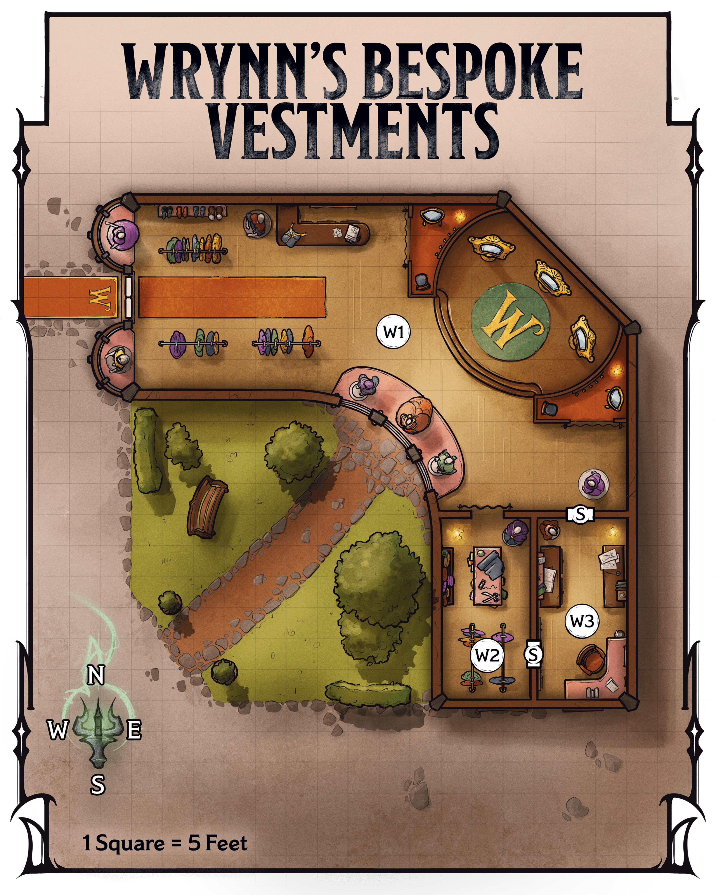
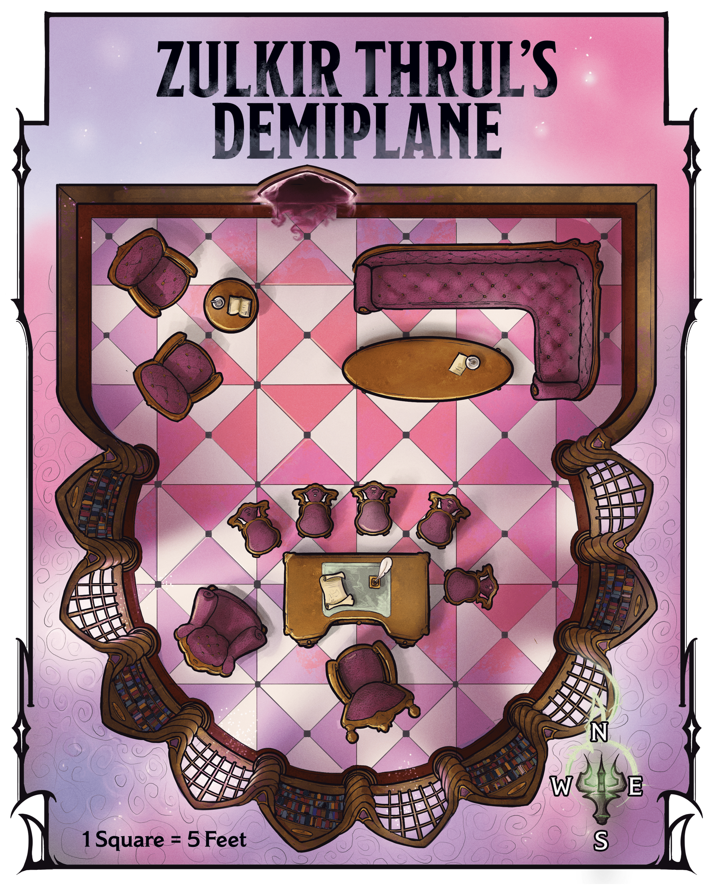
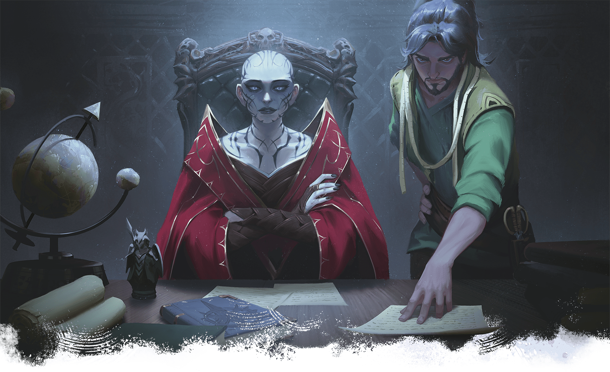

<!-- Notes MJ : contenu fourni par l’utilisateur, non destiné au partage public. -->

## Wrynn’s Bespoke Vestments

Wrynn’s Bespoke Vestments has stood in the heart of Eltabbar’s Bazaar Ward for centuries. This family-owned tailor shop has a sterling reputation for selling fashionable and beautifully made clothes. The shop has a coveted license to produce red clothing for Red Wizards.

For the last twenty years, the tailor shop also has clandestinely served as headquarters for the spy operations of [Xelnene Thrul](../../appendix-b-bestiary/chapter.md#XelneneThrul), zulkir of evocation. Seventh-generation shop owner Wynston Wrynn is the zulkir’s spy master. Thrul visits the shop only in disguises she crafts using the [Alter Self](https://www.dndbeyond.com/spells/2618846-alter-self) spell or by using the [Teleport](https://www.dndbeyond.com/spells/2619163-teleport) spell to arrive in a secret back room.

### Shop Features

The shop has the following features.

#### Ceilings

The shop’s ceilings are 15 feet high.

#### Doors

The shop’s doors are made of wood. Secret doors (marked with an *S* on the map; DC 20 to notice) lead to Wrynn’s office ([area W3](../chapter.md#W3SecretOffice)). The front door has a lock; it’s Complex (1 minute to pick) and of Superior quality (DC 20). (See “Doors” in the [Dungeon Master’s Guide](https://www.dndbeyond.com/sources/dnd/dmg-2024/dms-toolbox#Doors).)

#### Hours of Operation

The shop remains open with its front doors unlocked from sunup to sundown unless Wrynn has left the building. In that case, the tailor places a sign that says “Please return later” on the front door, which he locks.

#### Lighting

Picture windows along the shop’s western walls bathe the display and fitting areas ([area W1](../chapter.md#W1DisplayAndFittingAreas)) in [Bright Light](https://www.dndbeyond.com/sources/dnd/free-rules/rules-glossary#BrightLight) during the day. In the workshop and secret office (areas [W2](../chapter.md#W2Workshop) and [W3](../chapter.md#W3SecretOffice)), sconces with [Continual Flame](https://www.dndbeyond.com/spells/2619065-continual-flame) spells cast on them emit Bright Light.

#### Valuables

A cashbox holds coins in [area W1](../chapter.md#W1DisplayAndFittingAreas), and [area W3](../chapter.md#W3SecretOffice) holds coins and gems. If Wrynn discovers the characters have stolen any of these, he politely asks for their return. If the characters refuse, the next time they talk with Zulkir Thrul (see “[How to Meet with the Zulkir](../chapter.md#HowToMeetWithTheZulkir)”), she demands the valuables’ return on threat of dismissal from her service.

### Shop Locations

Gerralt Landman

Map 3.2: Wrynn's Bespoke Vestments [View Player Version](https://media-stg.dndbeyond.com/compendium-images/aud/aqZhSuV5QislqWyN/map-03-02.wrynns-bespoke-vestments-player.png)

The following locations are keyed to map 3.2.

#### W1: Display and Fitting Areas

Beams of natural light illuminate this elegant shop. Racks of beautiful clothing for all genders stand near the entrance, where an orc man and an elf woman browse. On a desk to the east are a stack of parchment, an ink pot, and a quill.

Farther into the shop, mannequins dressed in tasteful satins, silks, cottons, and corduroys stand near tall windows, while a stepped dais in the shop’s center features dressing mirrors. Two humans, a man and a woman in well-tailored waistcoats with measuring tapes draped around their necks, each adjust a mannequin’s outfit.

The display and fitting space is the shop’s primary area. Curtained changing areas flank the dais.

***Bystanders.*** See “[Private Audience](../chapter.md#PrivateAudience)” for what happens when the characters enter this area.

***Front Desk.*** Wrynn or his employees record purchases and provide customers with receipts at the front desk. In a drawer is an unlocked cashbox with the day’s earnings; there are 2,500 GP inside.

***Clothing Costs.*** There are fifty sets of [Fine Clothes](https://www.dndbeyond.com/equipment/539-fine-clothes) in the shop in addition to other custom clothing pieces. Prices range from 5 GP for a small piece, such as a silk scarf or neckerchief, to 5,000 GP for sets of items. Customers must request prices for custom items from Wrynn or his employees.

#### W2: Workshop

A long worktable and racks fill this cramped but organized space. Arranged meticulously on the table are shears, chalk, awls, needles, thread, and measuring tapes, along with folded piles of clothing. A stack of leather-bound ledgers sits on a shelf along the western wall.

Wrynn performs custom tailoring in this workspace; most production work occurs elsewhere. The ledgers note transactions for the last six months.

#### W3: Secret Office

This tidy room includes a desk in the southeast corner and tables along the east and west walls. The tables hold neatly arranged stacks of coins and open sacks of gemstones.

The valuables in this room are payments from wealthy clients. Stacked on the desk is business correspondence.

***Treasure.*** There are 25,000 GP in various coins here on the tables, as well as gemstones worth 10,000 GP in total.

### Private Audience

Browsing the shop’s wares is an orc man—actually Zulkir Thrul under the effects of an [Alter Self](https://www.dndbeyond.com/spells/2618846-alter-self) spell—who ignores the characters until Wrynn beckons them into his workshop.

The other browser is a terse elf named Gerleine (Medium [Noble](https://www.dndbeyond.com/monsters/5195145-noble)), who announces, “Wynston, I’ve decided.” She carries a blue satin frock to the desk along the north wall and pays the tailor, who writes her a receipt before she leaves.

The human man and woman are Wrynn’s employees, Cora Finn and Tate Vonn. After Gerleine leaves the shop, Wrynn approaches his two employees and quietly asks them to take a break. They also leave the shop.

Once the characters, Wrynn, and the disguised Xelnene Thrul are the only people in the shop, the tailor places a sign that says “Please return later” outside the front door. He approaches the characters.

Read or paraphrase the following:

“My name is Wynston Wrynn, and I own this shop,” the man says in a warm voice. “I respect the trust you have extended by meeting me here. However, before we can speak candidly, I ask you to extend that trust a bit further. Please follow me.” The man gestures to the nearby orc before adding, “This man is with us.”

Wrynn and the disguised zulkir then step into the workshop ([area W2](../chapter.md#W2Workshop)) and slip into the secret office ([area W3](../chapter.md#W3SecretOffice)), beckoning the characters to follow. If the characters seem suspicious or balk, the tailor assures them again about a promising offer, emphasizes the importance of this meeting, and asks for their trust.

In the secret office, the disguised zulkir waves her hands in a complex pattern, and a shadowy door appears on the east wall; Thrul has cast the [Demiplane](https://www.dndbeyond.com/spells/2619088-demiplane) spell. Wrynn and the zulkir step through the door, again beckoning the characters to follow.

#### Zulkir Thrul’s Demiplane

Gerralt Landman

Map 3.3: Zulkir Thrul's Demiplane [View Player Version](../assets/maps/players/map-03-03.zulkir-thruls-demiplane-player.png)

When the characters walk through the shadowy door, read or paraphrase the following:

Sconces shed soft, yellow light over this beautifully furnished office, which boasts oak furniture upholstered in maroon velvet. A gleaming desk sits to the south, along with nearby seats and a plush armchair. A wraparound sofa and a table bearing crystal wineglasses sit to the north across from a cozy armchair nook.

The demiplane’s layout appears on map 3.3. The wood-paneled space is bathed in [Bright Light](https://www.dndbeyond.com/sources/dnd/free-rules/rules-glossary#BrightLight) from wall sconces with [Continual Flame](https://www.dndbeyond.com/spells/2619065-continual-flame) spells cast on them. From this office, Zulkir Xelnene Thrul—assisted by Wynston Wrynn—conducts her clandestine activities. The desk’s drawers hold encoded dossiers supporting those activities.

After walking through the door, the disguised zulkir settles into the chair behind the desk. Wrynn sits in the armchair beside her. Once the characters are ready to hear the zulkir’s proposal, read or paraphrase the following:

The orc man lifts his head regally and closes his eyes. When he opens them, his appearance transforms. You now see a pale human woman with piercing blue eyes and a shaved head covered in tattoos. She wears the unmistakable red robes of a Red Wizard.

“Thank you for your patience,” the woman says in a strong, mellifluous voice. “I am Xelnene Thrul, Red Wizard sage and Thay’s zulkir of evocation. You’ve already met Wynston Wrynn, my spy master and the man I trust most in this world.

“I have invited you here to discuss a matter of utmost importance. I won’t waste words: I intend to hire you to stop the lich Szass Tam, zulkir of necromancy, before he unleashes destruction on Thay and murders or subjugates all who resist him. This enterprise will be long, dangerous, and—if successful—without public recognition. But it is necessary to save countless lives. You may ask me any questions you have before you give me your answer.”

If the characters are unfamiliar with Thay’s zulkir council or with [Szass Tam](https://www.dndbeyond.com/sources/dnd/dmg-2024/lore-glossary#SzassTam), Thrul shares the information about those topics presented in [chapter 1](../../chapter-01-thay/chapter.md#CouncilOfZulkirs).

Bubble Cat Studio

Zulkir Xelnene Thrul and her spy master, Wynston Wrynn, seek to recruit the characters.

Thrul can provide the following information about Operation Deadfall:

- **Why Target Szass Tam/Why Is Thay in Danger?** The zulkir shares the information in “[Demonic Ritual](../../chapter-02-thay-in-danger/chapter.md#DemonicRitual)” and “[Thay’s Only Hope](../../chapter-02-thay-in-danger/chapter.md#ThaysOnlyHope)” in chapter 2. “The terrible attack you witnessed today at the bazaar is merely a by-product of Szass Tam’s plan. As you can see, he is no longer content with simply sitting on Thay’s ruling zulkir council. He seeks to become Thay’s tyrant once more, and if he succeeds, his obscene servants will kill thousands. Thay will fall yet again into generations of suffering. Even death will not be a reprieve for Szass Tam’s victims; he’ll simply raise them as undead horrors to serve his whims. We can’t allow this to happen.”
- **What Are You Paying?** “If you agree, I’ll pay you each a topaz worth 500 GP today. Consider it a down payment. After you complete each mission, I’ll give your group a magic item of your choice from this list.” The zulkir gives the characters the list of magic items in “[Mission Rewards](../chapter.md#DeadfallMissionRewards)” below. “You may also keep any money and magic items you find during your service. If you defeat Szass Tam, we will discuss a further reward.”
- **Are We in Danger If We Join the Operation?** “Szass Tam has spies everywhere. If any catch wind of your involvement, they’ll hunt you down and kill you. Szass Tam will hunt me down, too.”
- **What’s the Plan for the Operation?** “First, you will undermine Szass Tam’s spy network. Once his spy network is disrupted, you will gather allies to our cause. Finally, you will confront the lich and stop his ongoing ritual. You may try to kill him, but stopping his ritual is more important.”
- **What’s in It for You?** “If Szass Tam’s ritual succeeds and he seizes leadership, some zulkirs might ally with him to save themselves. I am unwilling to do this. Szass Tam is evil, and I will not turn a blind eye to his murderous ways. For my resistance, he will certainly kill me. If you succeed, I live and keep my position on the council—but more importantly, you’ll prevent immense suffering for Thay’s people. I would gladly die for my nation, and I refuse to allow it to fall into Szass Tam’s hands again. This is why I need your help.”
- **Who Else Is Part of the Operation?** “Only you, should you agree, as well as me and Wynston. I have other operatives, but they know nothing of this operation.”
- **Won’t Szass Tam Revive If We Kill Him?** “Normally, he’d revive in a matter of days. However, my scholars believe interrupting his ritual would require the lich to start it anew, setting him back years. In addition, I will ask you to retrieve an item that would keep the lich dead for one hundred years—more than enough time for Thay to fortify its defenses should Szass Tam try to return to power later.”
- **Why Not Confront Szass Tam Yourself?** “I can’t confront Szass Tam myself and hope to win. No one zulkir—or even three or four zulkirs—could. All seven of us would need to unite against the lich. I’ve tried to form such an alliance, but Szass Tam has undermined my credibility with them. I have shown them as much proof as I can, to no avail. Alas, we must handle this situation discreetly and on our own. We are Thay’s only chance.”
- **Why Recruit Us?** “Your considerable skills have come to my attention. I believe you would be excellent operatives and that you are up to this task.” If the characters dislike Szass Tam or are dedicated to Thay, Thrul tells them these factors make them attractive candidates, too. If the characters acted heroically to defeat the undead earlier in the chapter, she points to this as proof of their capabilities.
- **What If We Say No?** “I will wipe your memory with a [Modify Memory](https://www.dndbeyond.com/spells/2619109-modify-memory) spell, and this conversation will never have happened.”

Once Thrul answers the characters’ questions, read or paraphrase the following:

The zulkir steeples her fingers together and fixes you with a serious stare.

“So, adventurers, what is your answer? There is no turning back once you agree. Respond wisely.”

When the characters agree to join Operation Deadfall, Thrul gives a small smile and hands each of them a topaz, as promised.

#### Mission Rewards

Each time the characters complete a mission, Thrul will give the group one magic item listed below. The characters can tell Wrynn which item they’ve chosen anytime after completing the mission, but they can’t choose the same item twice. They receive their reward via anonymous courier before the end of the following day.

The zulkir’s list follows:

[Chime of Opening](https://www.dndbeyond.com/magic-items/9228405-chime-of-opening)

[Helm of Teleportation](https://www.dndbeyond.com/magic-items/4656-helm-of-teleportation)

[Life-Sapping Blade](https://www.dndbeyond.com/magic-items/11914527-life-sapping-blade) (see [appendix A](../../appendix-a-magic-item/chapter.md#LifeSappingBlade))

[Portable Hole](https://www.dndbeyond.com/magic-items/9228932-portable-hole)

[Ring of Spell Storing](https://www.dndbeyond.com/magic-items/4730-ring-of-spell-storing)

[Robe of Eyes](https://www.dndbeyond.com/magic-items/9228976-robe-of-eyes)

[Wand of Enemy Detection](https://www.dndbeyond.com/magic-items/9229184-wand-of-enemy-detection)

[Wand of Paralysis](https://www.dndbeyond.com/magic-items/9229190-wand-of-paralysis)
