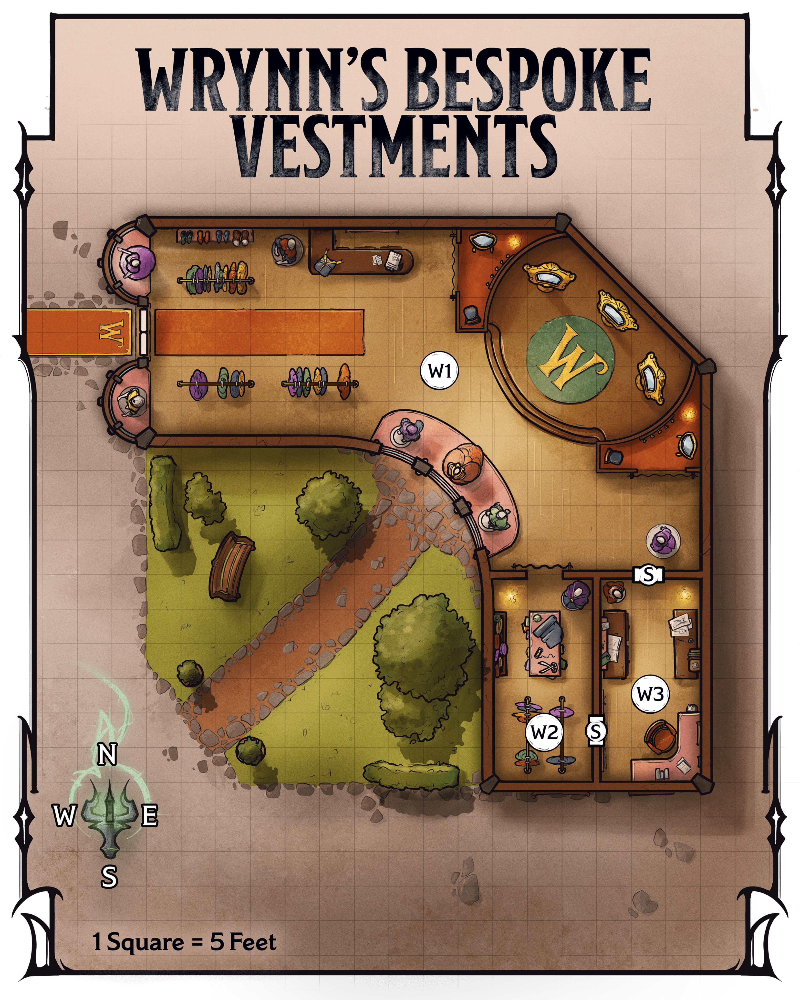

<!-- Notes MJ : contenu fourni par l’utilisateur, non destiné au partage public. -->

### Shop Locations

Gerralt Landman

Map 3.2: Wrynn's Bespoke Vestments [View Player Version](https://media-stg.dndbeyond.com/compendium-images/aud/aqZhSuV5QislqWyN/map-03-02.wrynns-bespoke-vestments-player.png)

The following locations are keyed to map 3.2.

#### W1: Display and Fitting Areas

Beams of natural light illuminate this elegant shop. Racks of beautiful clothing for all genders stand near the entrance, where an orc man and an elf woman browse. On a desk to the east are a stack of parchment, an ink pot, and a quill.

Farther into the shop, mannequins dressed in tasteful satins, silks, cottons, and corduroys stand near tall windows, while a stepped dais in the shop’s center features dressing mirrors. Two humans, a man and a woman in well-tailored waistcoats with measuring tapes draped around their necks, each adjust a mannequin’s outfit.

The display and fitting space is the shop’s primary area. Curtained changing areas flank the dais.

***Bystanders.*** See “[Private Audience](../chapter.md#PrivateAudience)” for what happens when the characters enter this area.

***Front Desk.*** Wrynn or his employees record purchases and provide customers with receipts at the front desk. In a drawer is an unlocked cashbox with the day’s earnings; there are 2,500 GP inside.

***Clothing Costs.*** There are fifty sets of [Fine Clothes](https://www.dndbeyond.com/equipment/539-fine-clothes) in the shop in addition to other custom clothing pieces. Prices range from 5 GP for a small piece, such as a silk scarf or neckerchief, to 5,000 GP for sets of items. Customers must request prices for custom items from Wrynn or his employees.

#### W2: Workshop

A long worktable and racks fill this cramped but organized space. Arranged meticulously on the table are shears, chalk, awls, needles, thread, and measuring tapes, along with folded piles of clothing. A stack of leather-bound ledgers sits on a shelf along the western wall.

Wrynn performs custom tailoring in this workspace; most production work occurs elsewhere. The ledgers note transactions for the last six months.

#### W3: Secret Office

This tidy room includes a desk in the southeast corner and tables along the east and west walls. The tables hold neatly arranged stacks of coins and open sacks of gemstones.

The valuables in this room are payments from wealthy clients. Stacked on the desk is business correspondence.

***Treasure.*** There are 25,000 GP in various coins here on the tables, as well as gemstones worth 10,000 GP in total.
