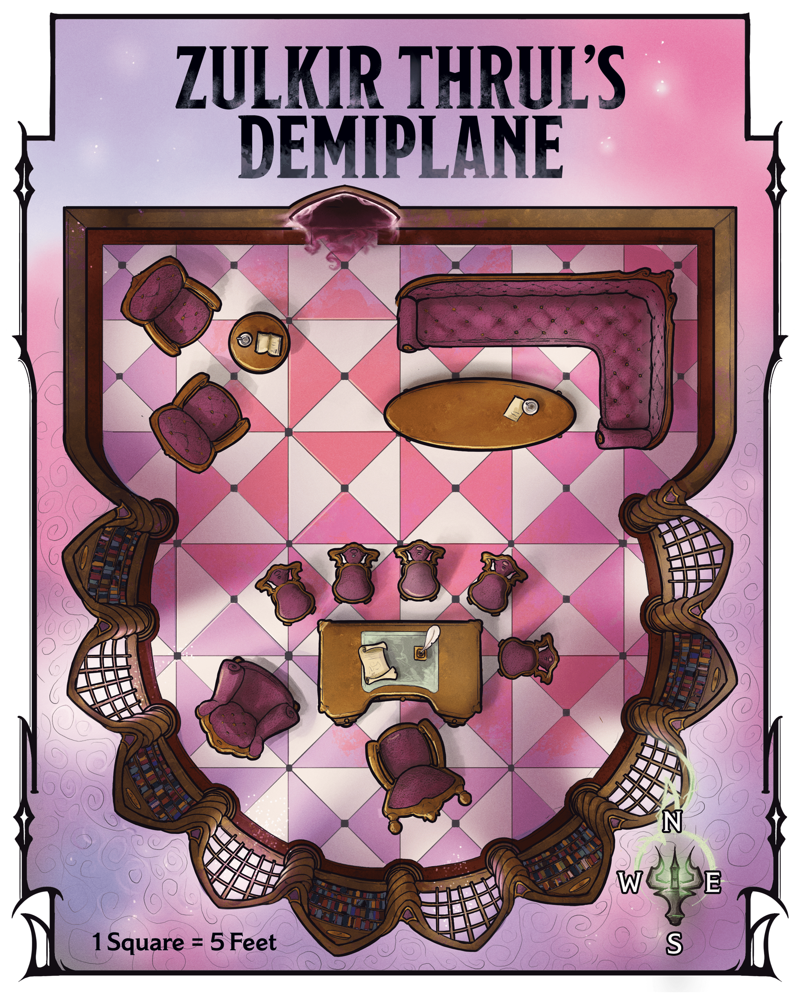
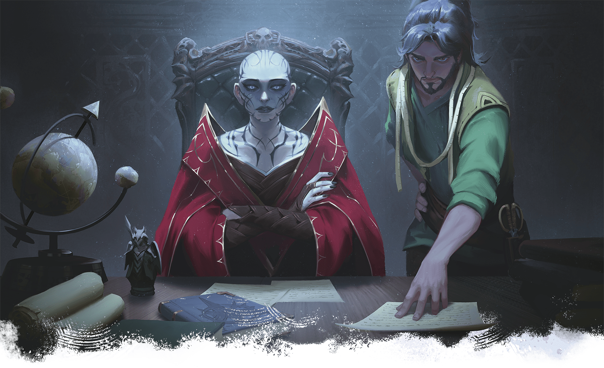

<!-- Notes MJ : contenu fourni par l’utilisateur, non destiné au partage public. -->

#### Zulkir Thrul’s Demiplane

Gerralt Landman

Map 3.3: Zulkir Thrul's Demiplane [View Player Version](../assets/maps/players/map-03-03.zulkir-thruls-demiplane-player.png)

When the characters walk through the shadowy door, read or paraphrase the following:

Sconces shed soft, yellow light over this beautifully furnished office, which boasts oak furniture upholstered in maroon velvet. A gleaming desk sits to the south, along with nearby seats and a plush armchair. A wraparound sofa and a table bearing crystal wineglasses sit to the north across from a cozy armchair nook.

The demiplane’s layout appears on map 3.3. The wood-paneled space is bathed in [Bright Light](https://www.dndbeyond.com/sources/dnd/free-rules/rules-glossary#BrightLight) from wall sconces with [Continual Flame](https://www.dndbeyond.com/spells/2619065-continual-flame) spells cast on them. From this office, Zulkir Xelnene Thrul—assisted by Wynston Wrynn—conducts her clandestine activities. The desk’s drawers hold encoded dossiers supporting those activities.

After walking through the door, the disguised zulkir settles into the chair behind the desk. Wrynn sits in the armchair beside her. Once the characters are ready to hear the zulkir’s proposal, read or paraphrase the following:

The orc man lifts his head regally and closes his eyes. When he opens them, his appearance transforms. You now see a pale human woman with piercing blue eyes and a shaved head covered in tattoos. She wears the unmistakable red robes of a Red Wizard.

“Thank you for your patience,” the woman says in a strong, mellifluous voice. “I am Xelnene Thrul, Red Wizard sage and Thay’s zulkir of evocation. You’ve already met Wynston Wrynn, my spy master and the man I trust most in this world.

“I have invited you here to discuss a matter of utmost importance. I won’t waste words: I intend to hire you to stop the lich Szass Tam, zulkir of necromancy, before he unleashes destruction on Thay and murders or subjugates all who resist him. This enterprise will be long, dangerous, and—if successful—without public recognition. But it is necessary to save countless lives. You may ask me any questions you have before you give me your answer.”

If the characters are unfamiliar with Thay’s zulkir council or with [Szass Tam](https://www.dndbeyond.com/sources/dnd/dmg-2024/lore-glossary#SzassTam), Thrul shares the information about those topics presented in [chapter 1](../../chapter-01-thay/chapter.md#CouncilOfZulkirs).

Bubble Cat Studio

Zulkir Xelnene Thrul and her spy master, Wynston Wrynn, seek to recruit the characters.

Thrul can provide the following information about Operation Deadfall:

- **Why Target Szass Tam/Why Is Thay in Danger?** The zulkir shares the information in “[Demonic Ritual](../../chapter-02-thay-in-danger/chapter.md#DemonicRitual)” and “[Thay’s Only Hope](../../chapter-02-thay-in-danger/chapter.md#ThaysOnlyHope)” in chapter 2. “The terrible attack you witnessed today at the bazaar is merely a by-product of Szass Tam’s plan. As you can see, he is no longer content with simply sitting on Thay’s ruling zulkir council. He seeks to become Thay’s tyrant once more, and if he succeeds, his obscene servants will kill thousands. Thay will fall yet again into generations of suffering. Even death will not be a reprieve for Szass Tam’s victims; he’ll simply raise them as undead horrors to serve his whims. We can’t allow this to happen.”
- **What Are You Paying?** “If you agree, I’ll pay you each a topaz worth 500 GP today. Consider it a down payment. After you complete each mission, I’ll give your group a magic item of your choice from this list.” The zulkir gives the characters the list of magic items in “[Mission Rewards](../chapter.md#DeadfallMissionRewards)” below. “You may also keep any money and magic items you find during your service. If you defeat Szass Tam, we will discuss a further reward.”
- **Are We in Danger If We Join the Operation?** “Szass Tam has spies everywhere. If any catch wind of your involvement, they’ll hunt you down and kill you. Szass Tam will hunt me down, too.”
- **What’s the Plan for the Operation?** “First, you will undermine Szass Tam’s spy network. Once his spy network is disrupted, you will gather allies to our cause. Finally, you will confront the lich and stop his ongoing ritual. You may try to kill him, but stopping his ritual is more important.”
- **What’s in It for You?** “If Szass Tam’s ritual succeeds and he seizes leadership, some zulkirs might ally with him to save themselves. I am unwilling to do this. Szass Tam is evil, and I will not turn a blind eye to his murderous ways. For my resistance, he will certainly kill me. If you succeed, I live and keep my position on the council—but more importantly, you’ll prevent immense suffering for Thay’s people. I would gladly die for my nation, and I refuse to allow it to fall into Szass Tam’s hands again. This is why I need your help.”
- **Who Else Is Part of the Operation?** “Only you, should you agree, as well as me and Wynston. I have other operatives, but they know nothing of this operation.”
- **Won’t Szass Tam Revive If We Kill Him?** “Normally, he’d revive in a matter of days. However, my scholars believe interrupting his ritual would require the lich to start it anew, setting him back years. In addition, I will ask you to retrieve an item that would keep the lich dead for one hundred years—more than enough time for Thay to fortify its defenses should Szass Tam try to return to power later.”
- **Why Not Confront Szass Tam Yourself?** “I can’t confront Szass Tam myself and hope to win. No one zulkir—or even three or four zulkirs—could. All seven of us would need to unite against the lich. I’ve tried to form such an alliance, but Szass Tam has undermined my credibility with them. I have shown them as much proof as I can, to no avail. Alas, we must handle this situation discreetly and on our own. We are Thay’s only chance.”
- **Why Recruit Us?** “Your considerable skills have come to my attention. I believe you would be excellent operatives and that you are up to this task.” If the characters dislike Szass Tam or are dedicated to Thay, Thrul tells them these factors make them attractive candidates, too. If the characters acted heroically to defeat the undead earlier in the chapter, she points to this as proof of their capabilities.
- **What If We Say No?** “I will wipe your memory with a [Modify Memory](https://www.dndbeyond.com/spells/2619109-modify-memory) spell, and this conversation will never have happened.”

Once Thrul answers the characters’ questions, read or paraphrase the following:

The zulkir steeples her fingers together and fixes you with a serious stare.

“So, adventurers, what is your answer? There is no turning back once you agree. Respond wisely.”

When the characters agree to join Operation Deadfall, Thrul gives a small smile and hands each of them a topaz, as promised.
