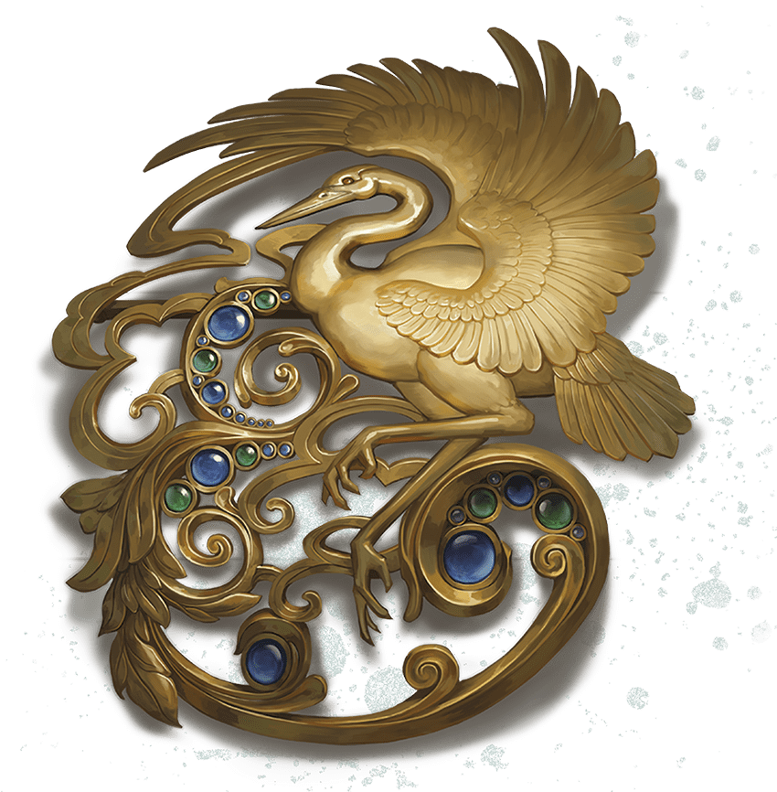

<!-- Notes MJ : contenu fourni par l’utilisateur, non destiné au partage public. -->

### How to Meet with the Zulkir

Once the characters have chosen their code names, Zulkir Thrul addresses them again. Read or paraphrase the following:

Linda Lithen

Masquerader’s Brooch from Zulkir Thrul

“I will assign you missions in this office. When you have completed a mission, return to the shop in disguise. Disguise yourselves differently each time. The Sparrow will know who you are. Request your reward from him, and give him any intel you found to pass on. He will contact you when it’s time for our next meeting. When you arrive here for the meeting, he will contact me. I will appear in the shop shortly, and we will enter this office in the same manner as today. After you report about your previous mission, I will give you details about the next.

“When the time is right, you will confront the Hydra. All your missions leading to that moment will assist you in this task.”

To help with their disguises, Thrul gives each character a [Masquerader’s Brooch](https://www.dndbeyond.com/magic-items/11914533-masqueraders-brooch) (see [appendix A](../../appendix-a-magic-item/chapter.md#MasqueradersBrooch)) shaped like a crane, an animal frequently depicted in Thayan artwork and fashion. She tells the characters always to incorporate a white crane feather into their disguises when they visit the shop to help Wrynn identify them.

She also gives the characters one of a pair of [Sending Stones](https://www.dndbeyond.com/magic-items/9180147-sending-stones); the stone has an image of a sparrow carved on it. She tells them that Wrynn has the other stone but instructs them to use the stone to contact him only when necessary. The zulkir forbids the characters from contacting her directly.
