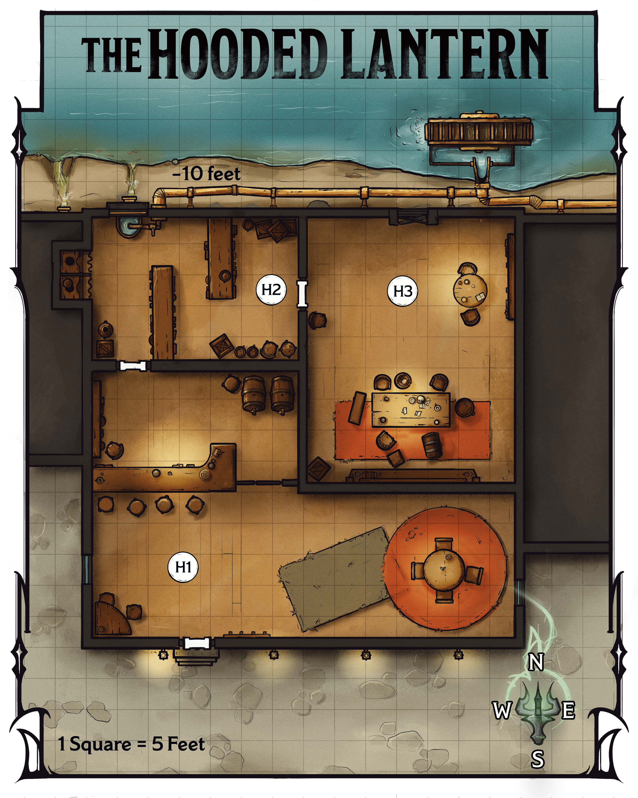
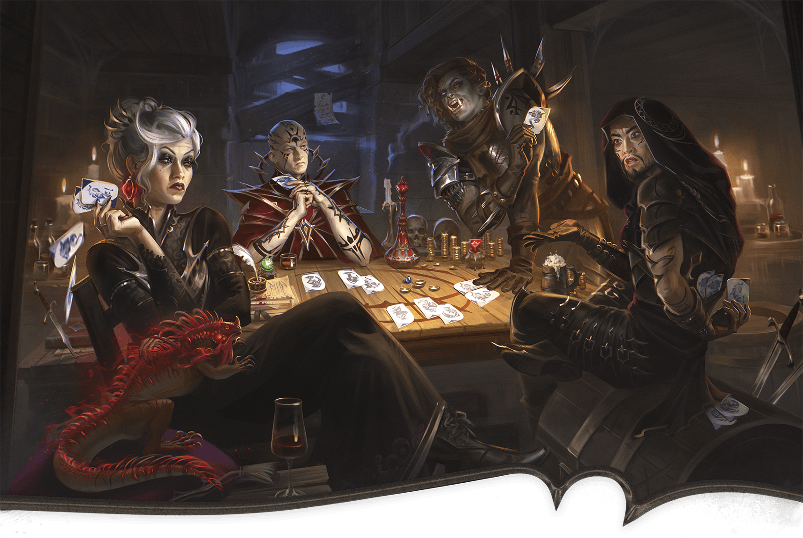

<!-- Notes MJ : contenu fourni par l’utilisateur, non destiné au partage public. -->

## The Hooded Lantern

The grimy tavern known as the Hooded Lantern is on the northern side of the Apprentices’ Ward along one of the city’s many canals. The tavern’s water comes from the canal, and the constant groaning of the waterwheel behind the building reverberates throughout the tavern. This conceals the sound of the gamblers in the back room. Gambling is legal in Eltabbar as long as gambling houses pay heavy taxes; this tavern doesn’t pay the taxes.

### The Hooded Lantern Features

The Hooded Lantern has the following features.

#### Canal

The canal’s water level is 10 feet below street level. The water is 10 feet deep.

#### Ceilings

The tavern’s ceilings are 15 feet high.

#### Constant Din

Because several buildings on this block use it to supply water, the waterwheel outside the tavern operates nonstop, creating an awful din of grinding and screeching. As a result, inside the tavern, Wisdom ([Perception](https://www.dndbeyond.com/sources/dnd/free-rules/playing-the-game#Skills)) checks that rely on hearing are made with [Disadvantage](https://www.dndbeyond.com/sources/dnd/free-rules/rules-glossary#Disadvantage).

#### Doors

The tavern’s doors are made of wood. The front door remains unlocked while the establishment is open, from dawn until midnight. When the place is closed, the front door is locked. The doors to the storeroom and gambling den (areas [H2](../chapter.md#H2Storage) and [H3](../chapter.md#H3GamblingDen)) are locked whether the tavern is open or closed. All locks are Simple (1 action to pick) and of Superior quality (DC 20). The bartender Knudrek (see [area H1](../chapter.md#H1Barroom)) has keys for all doors.

#### Lighting

Small sconces throughout the tavern cast [Dim Light](https://www.dndbeyond.com/sources/dnd/free-rules/rules-glossary#DimLight) in interior areas. The grimy windows let in little natural light.

#### Windows

The tavern has three unlocked windows: a window on the east side of the barroom and another on the west ([area H1](../chapter.md#H1Barroom)), and a window above the water basin in the storage room ([area H2](../chapter.md#H2Storage)). Medium or smaller characters who want to climb through them can do so easily.

### The Hooded Lantern Locations

The following locations are keyed to map 3.4. Descriptions assume the characters visit the tavern in the evening, when gambling goes on. If they visit the tavern earlier, they see the people described in the gambling den ([area H3](../chapter.md#H3GamblingDen)) enter the establishment.

Gerralt Landman

Map 3.4: The Hooded Lantern [View Player Version](https://media-stg.dndbeyond.com/compendium-images/aud/aqZhSuV5QislqWyN/map-03-04.the-hooded-lantern-player.png)

#### H1: Barroom

High-top stools line a bar to the north. Two cloaked patrons sit at a nearby table, clutching drinks. Behind the bar stands a burly human man wearing an apron, his face lined with scars and wrinkles.

The human bartender is Knudrek (Medium [Gladiator](https://www.dndbeyond.com/monsters/5195042-gladiator)). The orc patrons, Strak and Gert (Medium [Commoners](https://www.dndbeyond.com/monsters/5194951-commoner)), glower at the characters and provide one-word answers if anyone attempts conversation with them. They are custodians who work nearby and just want everyone to leave them alone. If a fight breaks out, Strak and Gert flee.

Knudrek was renowned as a gladiator in the city, but he has long since retired. He now runs this tavern and the gambling den in the back room ([area H3](../chapter.md#H3GamblingDen)), taking a cut of the money that changes hands. He pays no taxes on that income.

On his apron, Knudrek wears a faded badge depicting two muscular, interlocking arms. A character examining the badge can take the [Study](https://www.dndbeyond.com/sources/dnd/free-rules/rules-glossary#StudyAction) action and make a DC 12 Intelligence ([History](https://www.dndbeyond.com/sources/dnd/free-rules/playing-the-game#Skills)) check. On a success, the character realizes the badge represents a local gladiatorial league called Elite Gladiators.

***Chatting with Knudrek.*** When the characters enter, Knudrek nods to them but offers no welcome. Patrons can purchase three different types of ale for 1 SP each.

If the characters ask about gambling here, Knudrek denies any knowledge unless they mention his badge and speak favorably about the city’s gladiators. Knudrek then reveals he was once a grappler in Elite Gladiators, as well as the information below.

***Joining the Gambling.*** As an [Influence](https://www.dndbeyond.com/sources/dnd/free-rules/rules-glossary#InfluenceAction) action, a character can try to convince Knudrek to let them gamble and make a DC 15 Charisma ([Deception](https://www.dndbeyond.com/sources/dnd/free-rules/playing-the-game#Skills) or [Persuasion](https://www.dndbeyond.com/sources/dnd/free-rules/playing-the-game#Skills)) check. On a success, Knudrek invites them to the game in the back room ([area H3](../chapter.md#H3GamblingDen)). Entry costs 25 GP per person.

If they pay the fee, Knudrek escorts them to the gambling den.

#### H2: Storage

The door to this room is locked (see “[The Hooded Lantern Features](../chapter.md#TheHoodedLanternDoors)”).

This room holds kegs of ale and shelves for crates of mugs and other miscellany.

A window in the northwest wall above a water basin overlooks the canal.

#### H3: Gambling Den

Katerina Ladon

From Left to Right: the Gamblers Belinda, Thellania Marr, Gilda, and Terk.

The door to this room is locked (see “[The Hooded Lantern Features](../chapter.md#TheHoodedLanternDoors)”).

Around a long table sit four people: a white-haired human woman in purple robes with a lizard sitting on her knee, a bearded human man wearing a heavy cloak, a brawny orc woman wearing heavy armor, and a human woman with a shaved head wearing the distinctive robes of a Red Wizard. The four are playing cards, placing money and magic items on the table as collateral.

These are the gamblers:

- **Belinda.** Belinda (Medium [Cultist Fanatic](https://www.dndbeyond.com/monsters/4904746-cultist-fanatic)) is a white-haired human woman.
- **Gilda.** Gilda (Medium [Assassin](https://www.dndbeyond.com/monsters/5194904-assassin)) is an orc woman.
- **Terk.** Terk (Medium [Assassin](https://www.dndbeyond.com/monsters/5194904-assassin)) is a human man.
- **Thellania Marr.** This human Red Wizard (Medium [Cultist Hierophant](https://www.dndbeyond.com/monsters/5194955-cultist-hierophant)) is the characters’ target.

The gamblers play a card game called three wizards, in which the highest-ranking hand after three rounds of play wins.

If Knudrek escorts the characters, the gamblers welcome them. Otherwise, a character can claim the bartender has allowed them to gamble. The character must take the [Influence](https://www.dndbeyond.com/sources/dnd/free-rules/rules-glossary#InfluenceAction) action and make a DC 16 Charisma ([Deception](https://www.dndbeyond.com/sources/dnd/free-rules/playing-the-game#Skills)) check. On a success, the gamblers welcome the characters into the game. On a failure, the gamblers begin combat.

If combat happens while Knudrek isn’t in this area, he hears the commotion and enters the fight at the beginning of the third round of combat, insisting the characters leave. All combatants fight to the death.

***Speaking with Thellania.*** If the characters want to speak with Thellania, she says one of them must win a game before she’ll talk to them. The gamblers tell the characters one person from their group can play at a time; the others must watch.

To win a game, a character must bet 400 GP or an Uncommon magic item and make three DC 12 Charisma ([Deception](https://www.dndbeyond.com/sources/dnd/free-rules/playing-the-game#Skills)) or Wisdom ([Insight](https://www.dndbeyond.com/sources/dnd/free-rules/playing-the-game#Skills)) checks. On three successes, the character wins back their collateral plus 1,600 GP. Thellania also agrees to speak with the characters in the barroom ([area H1](../chapter.md#H1Barroom)) or outside, as the characters choose. (She will not speak with them in the gambling den.) On a failure, she ignores the characters.

Each character may play one game. Afterward, Knudrek or the gamblers ask them to leave, but tell them if they want to play more, they can come back the next night before the game starts.

The gamblers stay in the tavern for another two hours. Thellania stays to gather her belongings, then leaves five minutes after the other gamblers.

***Neutralizing the Gambler.*** Thellania isn’t particularly loyal to Szass Tam. A character can take the [Influence](https://www.dndbeyond.com/sources/dnd/free-rules/rules-glossary#InfluenceAction) action to try to convince her to stop spying. The character makes a DC 15 Charisma ([Intimidation](https://www.dndbeyond.com/sources/dnd/free-rules/playing-the-game#Skills) or [Persuasion](https://www.dndbeyond.com/sources/dnd/free-rules/playing-the-game#Skills)) check; if they give Thellania a magic item that’s Rare or rarer, the check automatically succeeds.

On a success, Thellania promises to stop spying and keeps her word. If the characters press her, she agrees to leave town temporarily and allows the characters to escort her to the city gates as a guarantee. On a failure, Thellania begins combat.

***Treasure.*** Thellania wears a [Heward’s Handy Haversack](https://www.dndbeyond.com/magic-items/9228722-hewards-handy-haversack) with 500 GP within it.

Bets from previous rounds on the table include the following:

1,600 GP

[Efreeti Bottle](https://www.dndbeyond.com/magic-items/9228528-efreeti-bottle)

Two [Elemental Gems](https://www.dndbeyond.com/magic-items/9228536-elemental-gem) (emerald and red corundum)

***Development.*** If the characters kill Thellania or convince her to stop spying, Thellania is neutralized as a spy, and each character earns 4,100 XP.
