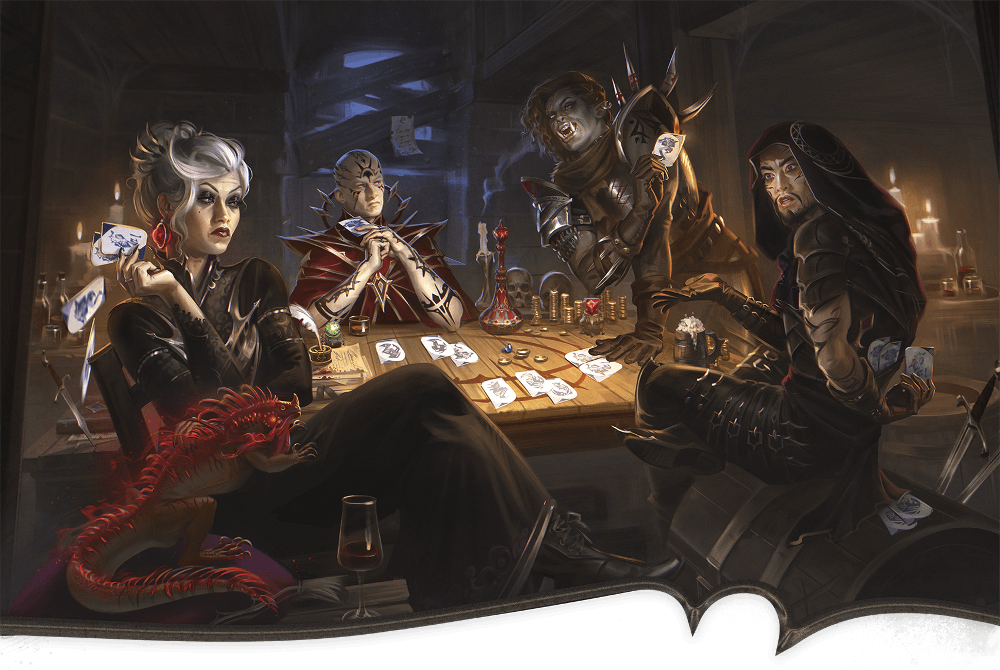

<!-- Notes MJ : contenu fourni par l’utilisateur, non destiné au partage public. -->

#### H3: Gambling Den

Katerina Ladon

From Left to Right: the Gamblers Belinda, Thellania Marr, Gilda, and Terk.

The door to this room is locked (see “[The Hooded Lantern Features](../chapter.md#TheHoodedLanternDoors)”).

Around a long table sit four people: a white-haired human woman in purple robes with a lizard sitting on her knee, a bearded human man wearing a heavy cloak, a brawny orc woman wearing heavy armor, and a human woman with a shaved head wearing the distinctive robes of a Red Wizard. The four are playing cards, placing money and magic items on the table as collateral.

These are the gamblers:

- **Belinda.** Belinda (Medium [Cultist Fanatic](https://www.dndbeyond.com/monsters/4904746-cultist-fanatic)) is a white-haired human woman.
- **Gilda.** Gilda (Medium [Assassin](https://www.dndbeyond.com/monsters/5194904-assassin)) is an orc woman.
- **Terk.** Terk (Medium [Assassin](https://www.dndbeyond.com/monsters/5194904-assassin)) is a human man.
- **Thellania Marr.** This human Red Wizard (Medium [Cultist Hierophant](https://www.dndbeyond.com/monsters/5194955-cultist-hierophant)) is the characters’ target.

The gamblers play a card game called three wizards, in which the highest-ranking hand after three rounds of play wins.

If Knudrek escorts the characters, the gamblers welcome them. Otherwise, a character can claim the bartender has allowed them to gamble. The character must take the [Influence](https://www.dndbeyond.com/sources/dnd/free-rules/rules-glossary#InfluenceAction) action and make a DC 16 Charisma ([Deception](https://www.dndbeyond.com/sources/dnd/free-rules/playing-the-game#Skills)) check. On a success, the gamblers welcome the characters into the game. On a failure, the gamblers begin combat.

If combat happens while Knudrek isn’t in this area, he hears the commotion and enters the fight at the beginning of the third round of combat, insisting the characters leave. All combatants fight to the death.

***Speaking with Thellania.*** If the characters want to speak with Thellania, she says one of them must win a game before she’ll talk to them. The gamblers tell the characters one person from their group can play at a time; the others must watch.

To win a game, a character must bet 400 GP or an Uncommon magic item and make three DC 12 Charisma ([Deception](https://www.dndbeyond.com/sources/dnd/free-rules/playing-the-game#Skills)) or Wisdom ([Insight](https://www.dndbeyond.com/sources/dnd/free-rules/playing-the-game#Skills)) checks. On three successes, the character wins back their collateral plus 1,600 GP. Thellania also agrees to speak with the characters in the barroom ([area H1](../chapter.md#H1Barroom)) or outside, as the characters choose. (She will not speak with them in the gambling den.) On a failure, she ignores the characters.

Each character may play one game. Afterward, Knudrek or the gamblers ask them to leave, but tell them if they want to play more, they can come back the next night before the game starts.

The gamblers stay in the tavern for another two hours. Thellania stays to gather her belongings, then leaves five minutes after the other gamblers.

***Neutralizing the Gambler.*** Thellania isn’t particularly loyal to Szass Tam. A character can take the [Influence](https://www.dndbeyond.com/sources/dnd/free-rules/rules-glossary#InfluenceAction) action to try to convince her to stop spying. The character makes a DC 15 Charisma ([Intimidation](https://www.dndbeyond.com/sources/dnd/free-rules/playing-the-game#Skills) or [Persuasion](https://www.dndbeyond.com/sources/dnd/free-rules/playing-the-game#Skills)) check; if they give Thellania a magic item that’s Rare or rarer, the check automatically succeeds.

On a success, Thellania promises to stop spying and keeps her word. If the characters press her, she agrees to leave town temporarily and allows the characters to escort her to the city gates as a guarantee. On a failure, Thellania begins combat.

***Treasure.*** Thellania wears a [Heward’s Handy Haversack](https://www.dndbeyond.com/magic-items/9228722-hewards-handy-haversack) with 500 GP within it.

Bets from previous rounds on the table include the following:

1,600 GP

[Efreeti Bottle](https://www.dndbeyond.com/magic-items/9228528-efreeti-bottle)

Two [Elemental Gems](https://www.dndbeyond.com/magic-items/9228536-elemental-gem) (emerald and red corundum)

***Development.*** If the characters kill Thellania or convince her to stop spying, Thellania is neutralized as a spy, and each character earns 4,100 XP.
