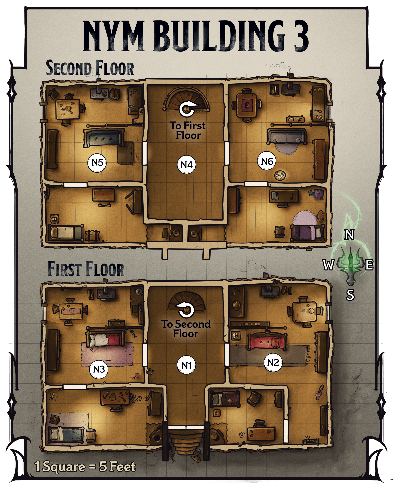

<!-- Notes MJ : contenu fourni par l’utilisateur, non destiné au partage public. -->

## Nym Building 3

Nym Building 3, a drab, two-story apartment building in Eltab’s Ward, is adjacent to the River Eltar. The building’s owner, Pryas Nym, owns several similar structures across the city. Of Nym’s holdings, this building lies in the city’s poorest neighborhood. He enjoys making nightly rounds to intimidate tenants and harass those whose rent is late.

### Nym Building 3 Features

The building has the following features.

#### Apartment Layout and Residents

Each apartment (areas [N2](../chapter.md#N2LowerEastern), [N3](../chapter.md#N3LowerWestern), [N5](../chapter.md#N5UpperWestern), and [N6](../chapter.md#N6UpperEastern)) contains a modest living space, kitchen, and bedroom.

The inhabitants are impoverished and have no belongings of value. Strangers terrify them, as any outsiders are likely to be Nym’s goons. Residents won’t answer the door if the characters knock.

#### Ceilings

The building’s ceilings are 10 feet high.

#### Doors

The building’s doors are made of wood. The front door is left unlocked. Doors to the apartments (areas [N2](../chapter.md#N2LowerEastern), [N3](../chapter.md#N3LowerWestern), [N5](../chapter.md#N5UpperWestern), and [N6](../chapter.md#N6UpperEastern)) are locked. The locks on the doors are Simple (1 action to pick) and of Inferior quality (DC 10).

#### Lighting

The building’s windows allow [Bright Light](https://www.dndbeyond.com/sources/dnd/free-rules/rules-glossary#BrightLight) into the apartments during the day. At night, there is [Dim Light](https://www.dndbeyond.com/sources/dnd/free-rules/rules-glossary#DimLight) if the residents are at home and awake (areas [N2](../chapter.md#N2LowerEastern) and [N3](../chapter.md#N3LowerWestern)) and [Darkness](https://www.dndbeyond.com/sources/dnd/free-rules/rules-glossary#Darkness) otherwise (areas [N5](../chapter.md#N5UpperWestern) and [N6](../chapter.md#N6UpperEastern)). Interior hallways (areas [N1](../chapter.md#N1Entryway) and [N4](../chapter.md#N4UpstairsHallway)) are lit with a few sconces that cast Dim Light in the area at all hours.

#### Walls

The walls between apartments are made of thin wood and plaster. Characters can hear loud noises coming from any area in the building.

#### Windows

The building’s windows are big enough for a Medium or smaller creature to fit through. Windows on the first floor stand 3 feet above the ground. Windows on the second floor are 15 feet above the ground. The windows are locked from the inside.

Characters within 5 feet of a window on the inside of the building can take the [Utilize](https://www.dndbeyond.com/sources/dnd/free-rules/rules-glossary#UtilizeAction) action to open the window. From the outside, a character can take the Utilize action to try to pick a window’s lock using [Thieves’ Tools](https://www.dndbeyond.com/equipment/495-thieves-tools), completing the task with a successful DC 15 Dexterity ([Sleight of Hand](https://www.dndbeyond.com/sources/dnd/free-rules/playing-the-game#Skills)) check.

### Nym Building 3 Locations

Gerralt Landman

Map 3.5: Nym Building 3 [View Player Version](https://media-stg.dndbeyond.com/compendium-images/aud/aqZhSuV5QislqWyN/map-03-05.nym-building-3-player.png)

The apartment building has two floors with similar floor plans.

The following locations are keyed to map 3.5. Descriptions assume the characters arrive in the evening, when Nym visits the building to harass the tenants. If the characters show up earlier, they eventually see Nym and his three associates enter the building (see area N1); resident Varrel Phor is inside his apartment ([area N6](../chapter.md#N6UpperEastern)).

#### N1: Entryway

Dim light flickers from sconces along the walls in this dingy, empty hallway.

This hall affords access to the first-floor apartments (areas [N2](../chapter.md#N2LowerEastern) and [N3](../chapter.md#N3LowerWestern)). A character who takes the [Study](https://www.dndbeyond.com/sources/dnd/free-rules/rules-glossary#StudyAction) action to listen carefully in the hall hears murmuring voices in the western apartment (area N3).

#### N2: Lower Eastern Apartment

Inside the eastern apartment on the first floor live the halfling couple Melda and Markus Fiddlestand (Small [Commoners](https://www.dndbeyond.com/monsters/5194951-commoner)). The Fiddlestands are eating a modest dinner of bread and boiled radishes after a long day laboring on a nearby construction site.

#### N3: Lower Western Apartment

Darvin Dorn and his teenage son Rufus (Medium [Commoners](https://www.dndbeyond.com/monsters/5194951-commoner)) are humans who rent the western first-floor apartment. They’re solving a crossword puzzle together after working their fruit stand all day.

#### N4: Upstairs Hallway

If the characters enter this area while Nym is present read or paraphrase the following text; otherwise, this hall is empty.

An angry shout rings throughout this hall: “You know what’ll happen if you’re late again!” Three muscled ruffians, one clad in heavy armor, taunt a whimpering man slumped at their feet. The speaker, one of the ruffians, is a bald man with a blond beard. A robed woman with horns leers nearby, her mouth twisted in a cruel smile.

The armored ruffian with the blond beard is the human Pryas Nym (Medium, Neutral Evil [Warrior Commander](https://www.dndbeyond.com/monsters/5195258-warrior-commander)), the characters’ target. The other ruffians are the humans Nora Nym and Horace Nym (Medium, Neutral Evil [Bandit Deceivers](https://www.dndbeyond.com/monsters/5194914-bandit-deceiver)), Pryas’s cousins. The horned woman, the tiefling Vareina (Medium, Neutral Evil [Mage](https://www.dndbeyond.com/monsters/4831023-mage)), works for Pryas. All four fight the characters if the characters interrupt their bullying.

The gang is accosting the human Varrel Phor (Medium [Commoner](https://www.dndbeyond.com/monsters/5194951-commoner)), who lives in the upper eastern apartment ([area N6](../chapter.md#N6UpperEastern)) and works as an apprentice for a nearby blacksmith. The gang threatens to injure Phor if he doesn’t pay his rent on time.

***Fighting the Landlord.*** Pryas Nym is a cruel and sycophantic man who’s loyal to Szass Tam. Nym fights to the death. If he dies, his cronies surrender; they don’t work for Szass Tam.

***Development.*** Killing Pryas Nym neutralizes him as a spy, and each character earns 4,100 XP. If the characters resurrect him, Nym fawns on them, promising to stop spying and even to leave town if the characters insist. He follows through with that promise.

#### N5: Upper Western Apartment

An orc woman named Feridine (Medium [Commoner](https://www.dndbeyond.com/monsters/5194951-commoner)) lives in the western apartment on the second floor. She is napping before her night shift as a bartender at a nearby tavern.

#### N6: Upper Eastern Apartment

The human Varrel Phor lives in the eastern apartment on the second floor. He is currently in the upper hall ([area N4](../chapter.md#N4UpstairsHallway)) enduring Nym’s bullying.
