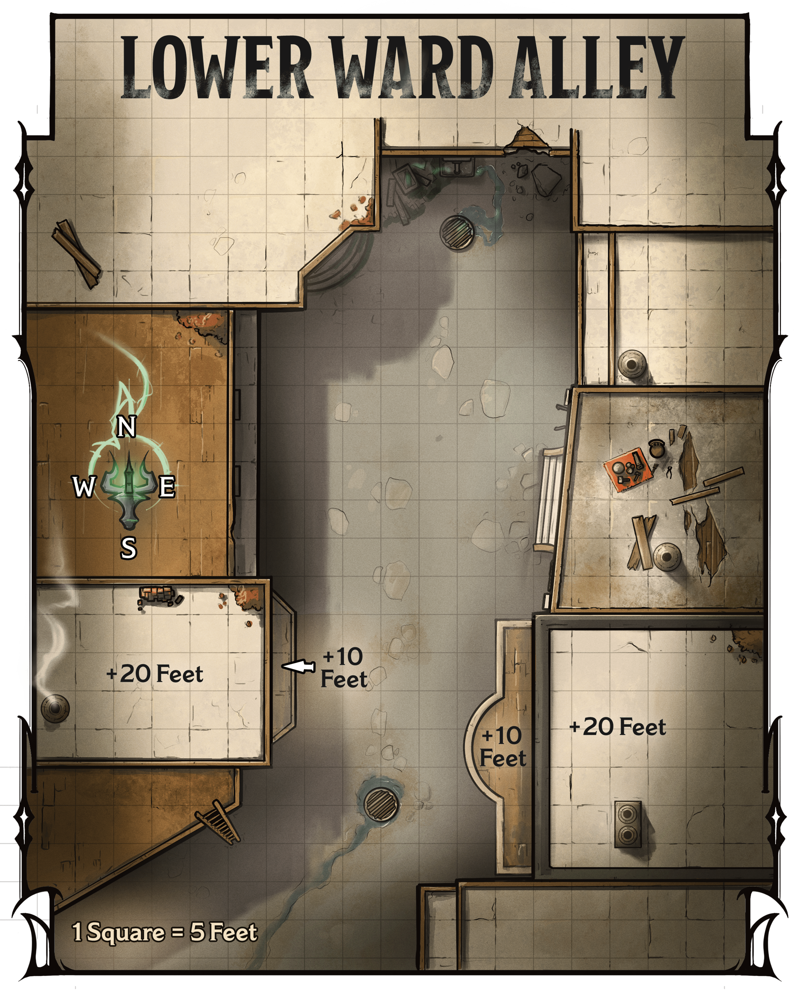

<!-- Notes MJ : contenu fourni par l’utilisateur, non destiné au partage public. -->

## Lower Ward Alley

When workers in smithies and shops in the Lower Ward depart at dusk, a local racketeer, Rathan Jur, commandeers an empty alley to meet with those he extorts. A cruel goliath man, he relishes violence.

The following sections assume the characters come to the alley during the evening. Jur doesn’t visit this area during the day.

Gerralt Landman

Map 3.6: Lower Ward Alley[View Player Version](../assets/maps/players/map-03-06.lower-ward-alley-player.png)

### Alley Features

The alley, shown on map 3.6, has the following features.

#### Balconies

Near the alley’s southern end, balconies to the east and west overlook the alley. The balconies are 10 feet above the ground.

#### Buildings

The buildings that flank the alley are made of wood and have flat roofs 20 feet above the ground.

#### Doors

The buildings’ doors are made of wood and locked. The locks are Simple (1 action to pick) and of Good quality (DC 15).

#### Ladder

A 20-foot-tall ladder that maintenance workers use during the day leans against the side of a building to the southwest.

#### Lighting

Sconces with [Continual Flame](https://www.dndbeyond.com/spells/2619065-continual-flame) spells cast on them shed [Dim Light](https://www.dndbeyond.com/sources/dnd/free-rules/rules-glossary#DimLight) throughout the alley at street level. The rooftops are in [Darkness](https://www.dndbeyond.com/sources/dnd/free-rules/rules-glossary#Darkness).

### Encountering Rathan Jur

If the characters arrive during the day, they see normal foot traffic come and go from nearby businesses, but Rathan Jur doesn’t appear.

Once the alley becomes deserted, the characters have about an hour to prepare for the confrontation. If they wait in the area for Jur to arrive, they see the goliath and two human associates walk to the center of the alley, followed shortly by a frightened orc man.

If the characters don’t confront the group immediately, read or paraphrase the following:

A bald, armored goliath man with a scimitar belted to his hip grins and pounds his fist into his palm. He jeers at an orc man wearing simple robes, saying, “You better pay up, Ruther. Accidents happen all the time. In fact, I feel like my fist is about to slip.” The goliath punches the orc. Two smug-looking human women standing beside the goliath burst into laughter.

The goliath is Rathan Jur (Medium, Neutral Evil [Bandit Crime Lord](https://www.dndbeyond.com/monsters/5194913-bandit-crime-lord)), and the humans are Rettene and Carla (Medium, Neutral Evil [Bandit Deceivers](https://www.dndbeyond.com/monsters/5194914-bandit-deceiver)). The three fight the characters if the characters interrupt their bullying.

The orc man (Medium [Commoner](https://www.dndbeyond.com/monsters/5194951-commoner)) is named Ruther. The punch reduces him to 3 HP. If the characters don’t intervene, Jur punches Ruther again, reducing him to 2 HP.

***Engaging with the Racketeer.*** Jur isn’t particularly loyal to Szass Tam, but threats alone won’t get him to agree to stop spying. But if the characters reduce him to 20 HP or fewer, he promises to leave town immediately. He keeps his word and allows the characters to escort him out of town as assurance.

***Development.*** If the characters kill Jur or convince him to leave town, they have neutralized him as a spy, and each character earns 4,100 XP.
