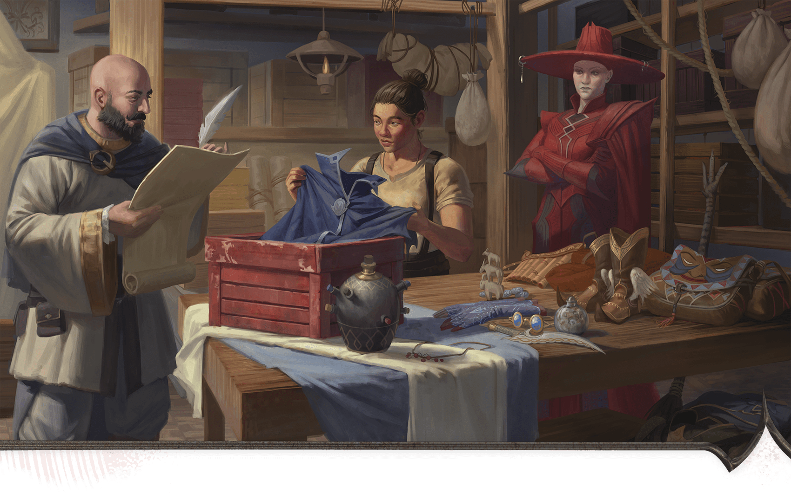
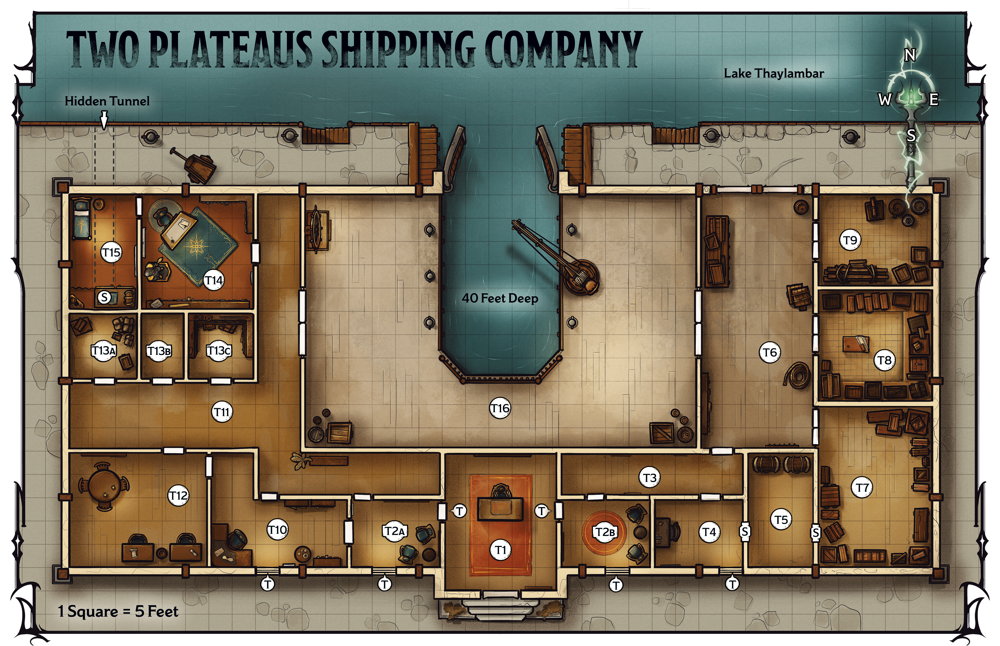

<!-- Notes MJ : contenu fourni par l’utilisateur, non destiné au partage public. -->

## Two Plateaus Shipping

The building that houses the Two Plateaus Shipping Company is both the company’s headquarters and Iskari’s base of operations, from which he sends Szass Tam information from the lich’s spy operations in the tharch of Eltabbar. The shipping company often deals with dangerous clients and expensive goods, so Iskari employs capable guards to discourage any agents sent to sabotage rivals’ shipments and burglars.

### The Messenger

The Messenger’s real name is Iskan Iskari. He is a [Rakshasa](https://www.dndbeyond.com/monsters/5195178-rakshasa) disguised as a human Thayan. He uses the [Disguise Self](https://www.dndbeyond.com/spells/2619102-disguise-self) spell to cloak his true form, appearing as a bald, broad-shouldered, broad-chested human with a dark beard. Undisguised, he resembles a humanoid tiger covered in pale fur with dark stripes. In any form, Iskari has a forked tongue, hinting at his true nature.

Iskari holds the keys to the locked trunks and drawers in the storeroom ([area T5](../chapter.md#T5SecretStoreroom)), the drawer in the break room ([area T12](../chapter.md#T12BreakRoom)), his office ([area T14](../chapter.md#T14IskarisOffice)), and his quarters ([area T15](../chapter.md#T15IskarisQuarters)). During the day, Iskari usually works in his office, although you can place him elsewhere in the building. At night, he sleeps in his quarters (area T15).

### Iskari’s Scam

Zuzanna Wuzyk

Iskan Iskari and an employee inventory a shipment of magic items for a Red Wizard client.

The workers and guards at Two Plateaus Shipping Company don’t know that Iskari has been stealing magic items from clients and selling them. Iskari doesn’t fear many of his clients—but he is afraid of Szass Tam. He carefully hides any evidence of his scam.

#### Securing Evidence

If the characters want to convince Iskari to work against Szass Tam, they must secure one or more pieces of evidence that prove Iskari has stolen from the lich. The characters recognize when something they find is evidence. They can find four pieces of evidence, which are in the following areas:

- **Area T5:** Stolen [Mantle of Spell Resistance](https://www.dndbeyond.com/magic-items/4673-mantle-of-spell-resistance)
- **Area T10:** Document listing items that were supposedly lost in transit
- **Area T12:** Receipt for stolen items sold to a fence
- **Area T14:** Stolen [Nine Lives Stealer (Longsword)](https://www.dndbeyond.com/magic-items/5124-nine-lives-stealer-longsword)

#### Blackmailing Iskari

When the characters interact with Iskari, a character can take the [Influence](https://www.dndbeyond.com/sources/dnd/free-rules/rules-glossary#InfluenceAction) action to try to convince him that they know about his scam and will inform Szass Tam unless Iskari cooperates. The character then makes a Charisma ([Persuasion](https://www.dndbeyond.com/sources/dnd/free-rules/playing-the-game#Skills)) check. The DC of that check depends on how many pieces of evidence the characters have when they confront Iskari, as noted in the Blackmailing Iskari table.

Although Iskari serves Szass Tam, he is greedy and self-centered. Iskari lies about stealing magic items unless the characters have three or more pieces of evidence or convince him to work against Szass Tam.

If the characters convince Iskari to work against Szass Tam, they must give him the instructions described in “[Dead Drops](../chapter.md#DeadDrops).”

#### Blackmailing Iskari

| Pieces of Evidence | DC |
| --- | --- |
| None | Impossible |
| 1 | 25 |
| 2 | 20 |
| 3 | 15 |
| 4 | 10 |

***Development.*** If the characters find three or more pieces of evidence, each character earns 4,700 XP.

### Shipping Company Features

Unless otherwise specified, the shipping company has the following features.

#### Ceilings

The building’s ceilings are 15 feet high. The loading dock ([area T16](../chapter.md#T16LoadingDock)) has no ceiling.

#### Doors

The doors in the shipping company are made of wood, and most are unlocked.

***Secret Doors.*** Unless otherwise noted, secret doors (marked with an *S* on the map; DC 18 to notice) blend in with the surrounding surfaces from the outside but are obvious from the inside. They’re unlocked and swing inward on hidden hinges. Iskari; shipping agents Alik Nal, Korla, and Cam; and the building’s guards know about the secret areas, but the company’s other employees don’t.

#### Lighting

Inside the building, lamps with [Continual Flame](https://www.dndbeyond.com/spells/2619065-continual-flame) spells cast on them emit [Bright Light](https://www.dndbeyond.com/sources/dnd/free-rules/rules-glossary#BrightLight). The loading dock is in Bright Light during the day.

#### Windows

The windows near the building’s front entrance are unlocked and large enough for a Medium or smaller creature to climb through.

***Window Traps.*** The windows are trapped from the outside with a wire that sends a jolt of electricity through intruders. The traps are denoted by a *T* on the map. A creature that touches the outside of a window gets shocked. The creature makes a DC 15 Constitution saving throw, taking 28 (8d6) Lightning damage on a failed save or half as much damage on a successful one.

***Detecting the Traps.*** A creature can take the [Search](https://www.dndbeyond.com/sources/dnd/free-rules/rules-glossary#SearchAction) action to inspect a window. They make a DC 18 Wisdom ([Perception](https://www.dndbeyond.com/sources/dnd/free-rules/playing-the-game#Skills)) check; on a success, the creature finds the wire. The traps are built into the window’s structure and can’t be disarmed, but once detected, the wire is easily avoided when climbing through a window.

### Shipping Company Locations

Gerralt Landman

Map 3.7: Two Plateaus Shipping Company [View Player Version](https://media-stg.dndbeyond.com/compendium-images/aud/aqZhSuV5QislqWyN/map-03-07.two-plateaus-shipping-company-player.png)

The following locations are keyed to map 3.7. The shipping company operates around the clock. If the characters visit during the day and return at night (or vice versa), the same number of staff members occupy each area. Except for Iskari, they are different individuals.

#### T1: Reception

The walls of this reception area are decorated with landscapes of Thay’s rocky plateaus. At a central desk sits a young human man with red hair and freckles. He greets you with a smile.

“Welcome to Two Plateaus Shipping Company! How can I help you today?”

The human receptionist is Thom (Medium [Noble](https://www.dndbeyond.com/monsters/5195145-noble)). If the characters fight Thom, he flees into area T2a, using his key to bypass the trap (see [area T2a–b](../chapter.md#ShippingCompanyT2ABWaiting)). In 2 minutes, Iskari and the guard from [area T7](../chapter.md#ShippingCompanyT7WarehouseA) arrive and confront the characters.

***Gaining Entry.*** As an [Influence](https://www.dndbeyond.com/sources/dnd/free-rules/rules-glossary#InfluenceAction) action, a character can try to convince Thom they need to go inside the building. The character then makes a DC 15 Charisma ([Deception](https://www.dndbeyond.com/sources/dnd/free-rules/playing-the-game#Skills) or [Persuasion](https://www.dndbeyond.com/sources/dnd/free-rules/playing-the-game#Skills)) check. On a successful check, Thom escorts the characters into a waiting room (area T2a), using a key that bypasses the trap on the door (see area [T2a–b](../chapter.md#ShippingCompanyT2ABWaiting)).

Thom tells them to wait while he summons a shipping agent. In 20 minutes, Alik Nal arrives from the shipping office ([area T10](../chapter.md#T10ShippingOffice)). If the characters request to meet with Iskari, Thom tells them it will be an hour before the owner is free; he never arrives.

On a failure, Thom demands the characters leave and flees into area T2a if they don’t.

***Traps.*** The locks on the doors to the east and west are trapped, as described below.

#### T2a–b: Waiting Rooms

The doors leading from reception ([area T1](../chapter.md#ShippingCompanyT1Reception)) to the waiting rooms are locked. The locks are Complex (1 minute to pick) and of Superior quality (DC 20).

The locks on the doors to the east and west are each outfitted with a poisoned needle trap, as described in the [Dungeon Master’s Guide](https://www.dndbeyond.com/sources/dnd/dmg-2024/dms-toolbox#PoisonedNeedle), except the Constitution saving throw is DC 15, and the Poison damage is 22 (4d10).

Comfortable armchairs are nestled against the walls, while doors lead to the lobby and farther into the building. Portraits of Red Wizards standing in powerful poses adorn the walls.

Clients wait here to speak with shipping agents.

***Treasure.*** The paintings depict powerful Red Wizards—allies of Szass Tam and Iskari. These four portraits by renowned Thayan artist Taryn Gill are worth 2,500 GP apiece.

#### T3: Southeast Hall

A narrow hall stretches about forty feet west to east, with two doors on the south wall and one on the northeast corner.

The sounds of crates being moved and packed in the nearby hall and warehouses (areas T6–T9) are audible here.

#### T4: Dummy Office

This office contains a small desk with drawers against the west wall. A door leads north.

Old shipping paperwork lies scattered atop the desk, but none seems recent. This office primarily serves as a buffer between the rest of the company and the secret storeroom (area T5).

***Secret Door.*** A secret door on the east wall opens into area T5. See “[Shipping Company Features](../chapter.md#ShippingCompanyFeatures)” for details on this door.

#### T5: Secret Storeroom

Two steamer trunks sit against the north wall. Doors lead east and west.

Iskari tells Alik Nal and the guards that items clients have forgotten are kept here, but in reality, he uses this space to store stolen goods. The doors lead to the dummy office ([area T4](../chapter.md#ShippingCompanyT4DummyOffice)) and a warehouse ([area T7](../chapter.md#ShippingCompanyT7WarehouseA)).

***Blackmail Evidence.*** The trunks are both locked. As a [Utilize](https://www.dndbeyond.com/sources/dnd/free-rules/rules-glossary#UtilizeAction) action, a character can try to pick a lock using [Thieves’ Tools](https://www.dndbeyond.com/equipment/495-thieves-tools), accomplishing the task with a successful DC 18 Dexterity ([Sleight of Hand](https://www.dndbeyond.com/sources/dnd/free-rules/playing-the-game#Skills)) check.

The west trunk holds twelve nonmagical cloaks. Underneath them is the [Mantle of Spell Resistance](https://www.dndbeyond.com/magic-items/4673-mantle-of-spell-resistance) mentioned in the document found in the shipping office (area T10).

The east trunk holds fourteen nonmagical cloaks plus a small purse with 50 GP inside.

#### T6: Northeast Hall

Double doors dot this hall’s east and west walls; another door stands in the southwest corner. Three human workers mill about. The hall is otherwise empty aside from a few wooden crates.

The three workers are the humans Xenk, Jera, and Lilah (Medium [Bandit Deceivers](https://www.dndbeyond.com/monsters/5194914-bandit-deceiver)).

The workers assume the characters are authorized to be here unless they look like obvious intruders. In that case, the workers fight the party, shouting for help from workers and guards in nearby warehouses (areas T7–T9). Those individuals arrive to join the fight at the beginning of the third round of combat.

#### T7: Warehouse A

This warehouse is filled with crates. Three goliath workers loiter, and an orc woman wearing studded leather armor guards the double door.

The three goliath workers—Jorah, Jumah, and Karis (Medium [Bandit Deceivers](https://www.dndbeyond.com/monsters/5194914-bandit-deceiver))—await word on when the next boat is scheduled to arrive in the loading dock ([area T16](../chapter.md#T16LoadingDock)). The guard is the orc Dora Brokenjaw (Medium [Bandit Crime Lord](https://www.dndbeyond.com/monsters/5194913-bandit-crime-lord)), who demands the characters leave when she notices them.

As an [Influence](https://www.dndbeyond.com/sources/dnd/free-rules/rules-glossary#InfluenceAction) action, a character can insist they’re authorized to be here. The character makes a DC 18 Charisma ([Deception](https://www.dndbeyond.com/sources/dnd/free-rules/playing-the-game#Skills)) check. On a success, the staff allows the characters to go about their business. On a failure, the guard begins combat and the workers flee. Should combat begin, the guards from areas T8 and T9 arrive at the end of the second round of combat.

***Crates.*** This room holds twenty-one crates. Ten crates contain 20 pounds of flour and are worth 50 CP apiece; another eleven contain 20 pounds of wheat and are worth 20 CP apiece.

***Secret Door.*** A secret door near the southeast corner leads to the storeroom [(area T5](../chapter.md#T5SecretStoreroom)). See “[Shipping Company Features](../chapter.md#ShippingCompanyFeatures)” for details on this door.

#### T8: Warehouse B

This warehouse is filled with crates. A human man wearing studded leather armor guards the double door.

The guard is the human Rian Jon (Medium [Assassin](https://www.dndbeyond.com/monsters/5194904-assassin)), who demands the characters leave when he notices them.

As an [Influence](https://www.dndbeyond.com/sources/dnd/free-rules/rules-glossary#InfluenceAction) action, a character can insist they’re authorized to be here. The character makes a DC 16 Charisma ([Deception](https://www.dndbeyond.com/sources/dnd/free-rules/playing-the-game#Skills)) check. On a success, the guard allows the characters to go about their business. On a failure, the guard begins combat. Should combat begin, the guards from areas T7 and T9 arrive at the end of the second round of combat.

***Crates.*** This warehouse holds twenty crates. Ten contain canvas textiles and are worth 10 GP apiece. Another ten contain cotton textiles and are worth 100 GP apiece.

#### T9: Warehouse C

This large warehouse is filled with barrels and crates. A tiefling woman wearing studded leather armor guards the double door in the west wall.

The guard is the tiefling Terra Senpher (Medium [Bandit Crime Lord](https://www.dndbeyond.com/monsters/5194913-bandit-crime-lord)), who demands the characters leave when she notices them.

As an [Influence](https://www.dndbeyond.com/sources/dnd/free-rules/rules-glossary#InfluenceAction) action, a character can insist they’re authorized to be here. The character makes a DC 18 Charisma ([Deception](https://www.dndbeyond.com/sources/dnd/free-rules/playing-the-game#Skills)) check. On a successful check, the guard allows the characters to go about their business. On a failure or if they’re caught stealing, the guard begins combat. Should combat begin, the guards from areas T7 and T8 arrive at the end of the second round of combat.

***Barrels and Crates.*** Ten barrels contain burlap and are worth 10 GP apiece; another ten crates contain linen textiles and are worth 100 GP apiece.

***Treasure.*** A crate in the southeast corner contains the following (all but [Walloping Ammunition](https://www.dndbeyond.com/magic-items/36839-walloping-ammunition) appear in appendix A):

[Sniper’s Bracelet](https://www.dndbeyond.com/magic-items/11914537-snipers-bracelet)

[Trick Weapon](https://www.dndbeyond.com/magic-items/11914593-trick-weapon)

Three pieces of Walloping Ammunition

[Wand of Enthralling](https://www.dndbeyond.com/magic-items/11914595-wand-of-enthralling)

#### T10: Shipping Office

An elf man wearing gray robes sits at this room’s desk, writing with a quill on a roll of parchment. A shelf full of ledgers sits against the south wall, and doors lead to the north, west, and east.

The elf man is Alik Nal (Medium [Mage](https://www.dndbeyond.com/monsters/4831023-mage)), a shipping agent. Nal is recording the details of a recent shipment.

Nal demands the characters leave if he notices them, barking that he’s too busy to speak with them. If they won’t leave, he fights them. Should combat begin here, the guards from areas T7–T9 join the fight at the end of the second round of combat.

As an [Influence](https://www.dndbeyond.com/sources/dnd/free-rules/rules-glossary#InfluenceAction) action, a character can try to convince Nal to leave the room or allow them to peruse the ledgers. The character then makes a DC 17 Charisma ([Deception](https://www.dndbeyond.com/sources/dnd/free-rules/playing-the-game#Skills) or [Persuasion](https://www.dndbeyond.com/sources/dnd/free-rules/playing-the-game#Skills)) check. On a success, Nal assents to the request. If he discovers the characters have deceived him, he fights them.

***Blackmail Evidence.*** Hidden among the ledgers on the shelf is a document listing magic items Iskari has reported to clients as lost:

[Broom of Flying](https://www.dndbeyond.com/magic-items/9228372-broom-of-flying)

[Helm of Comprehending Languages](https://www.dndbeyond.com/magic-items/4654-helm-of-comprehending-languages)

[Lantern of Revealing](https://www.dndbeyond.com/magic-items/9228811-lantern-of-revealing)

[Mantle of Spell Resistance](https://www.dndbeyond.com/magic-items/4673-mantle-of-spell-resistance)

[Nine Lives Stealer (Longsword)](https://www.dndbeyond.com/magic-items/5124-nine-lives-stealer-longsword)

Pair of [Sending Stones](https://www.dndbeyond.com/magic-items/9180147-sending-stones)

The words “fenced” appear next to the entries for the broom, helm, lantern, and *Sending Stones*.

Iskari has fenced all but the *Mantle of Spell Resistance* and the *Nine Lives Stealer (Longsword)*, which are in the secret storeroom ([area T5](../chapter.md#T5SecretStoreroom)) and his office ([area T14](../chapter.md#T14IskarisOffice)), respectively. If the characters have found either of these magic items, they realize those are the items mentioned in this list.

#### T11: West Hall

Plush carpet covers the floor of this hall, which is lined with seascapes showing the Thayan coast.

Iskari takes his most valued clients to his office ([area T14](../chapter.md#T14IskarisOffice)) through this hall.

#### T12: Break Room

This room’s table and chairs are spartan, its walls and floors undecorated. Two desks sit along the south wall; the one to the west has a drawer.

This area serves as a break room for the guards in the warehouses (areas T7–T9).

***Blackmail Evidence.*** The western desk’s drawer is locked. A character can take the [Utilize](https://www.dndbeyond.com/sources/dnd/free-rules/rules-glossary#UtilizeAction) action to try to pick the lock using [Thieves’ Tools](https://www.dndbeyond.com/equipment/495-thieves-tools), accomplishing the task with a successful DC 18 Dexterity ([Sleight of Hand](https://www.dndbeyond.com/sources/dnd/free-rules/playing-the-game#Skills)) check. Inside the drawer lies a handwritten receipt for the following items, sold for 200 GP apiece:

[Broom of Flying](https://www.dndbeyond.com/magic-items/9228372-broom-of-flying)

[Helm of Comprehending Languages](https://www.dndbeyond.com/magic-items/4654-helm-of-comprehending-languages)

[Lantern of Revealing](https://www.dndbeyond.com/magic-items/9228811-lantern-of-revealing)

Pair of [Sending Stones](https://www.dndbeyond.com/magic-items/9180147-sending-stones)

#### T13a-c: Small Storage Rooms

These rooms are used for storage.

***T13a.*** This room holds small shipments (see “[Treasure](../chapter.md#Treasure)”).

***T13b.*** This room is empty.

***T13c.*** The shelves in this room hold office and cleaning supplies, which have no value.

***Treasure.*** A character who searches area T13a finds several carefully packed crates full of glass vials and bottles; the boxes hold eight [Potion of Healings](https://www.dndbeyond.com/equipment/71-potion-of-healing) in total.

#### T14. Iskari’s Office

The door from the hallway into the office is locked. The lock is Complex (1 minute to pick) and of Superior quality (DC 20). On bypassing the door, read or paraphrase the following:

Sitting behind the heavy desk in this spacious office is a bearded, broad-shouldered man wearing a purple cloak and a scowl. A glass orb sits on the desk. Beside the desk looms a stone statue of a soldier. A bookshelf stands in the northeast corner.

Company owner and intel courier Iskan Iskari ([Rakshasa](https://www.dndbeyond.com/monsters/5195178-rakshasa)) sits here wearing his human disguise (see “[The Messenger](../chapter.md#TheMessenger)” earlier in this chapter). The statue ([Stone Golem](https://www.dndbeyond.com/monsters/4904850-stone-golem)) animates and fights the characters if combat begins in this room. Before the statue animates, a character must succeed on a DC 15 Intelligence ([Investigation](https://www.dndbeyond.com/sources/dnd/free-rules/playing-the-game#Skills)) check to discern its magical nature.

The characters can try to convince Iskari to work against Szass Tam as described in “[Blackmailing Iskari](../chapter.md#BlackmailingIskari)” earlier in this chapter. If the characters don’t try to talk to Iskari, when he realizes they are intruders, he and the golem begin combat. Iskari fights until reduced to 50 HP. He then attempts to flee into his quarters and through the trapdoor (see [area T15](../chapter.md#T15IskarisQuarters)).

***Blackmail Evidence.*** The desk’s bottom drawer is locked. A character can take the [Utilize](https://www.dndbeyond.com/sources/dnd/free-rules/rules-glossary#UtilizeAction) action to try to pick the lock using [Thieves’ Tools](https://www.dndbeyond.com/equipment/495-thieves-tools), accomplishing the task with a successful DC 18 Dexterity ([Sleight of Hand](https://www.dndbeyond.com/sources/dnd/free-rules/playing-the-game#Skills)) check. On a successful check, the drawer opens, revealing the [Nine Lives Stealer (Longsword)](https://www.dndbeyond.com/magic-items/5124-nine-lives-stealer-longsword) mentioned in the document found in the shipping office ([area T10](../chapter.md#T10ShippingOffice)). Iskari is debating whether to fence or keep this item.

***Intel.*** The drawer in the table to the south is locked. A character can take the [Utilize](https://www.dndbeyond.com/sources/dnd/free-rules/rules-glossary#UtilizeAction) action to try to pick the lock using [Thieves’ Tools](https://www.dndbeyond.com/equipment/495-thieves-tools), accomplishing the task with a successful DC 18 Dexterity ([Sleight of Hand](https://www.dndbeyond.com/sources/dnd/free-rules/playing-the-game#Skills)) check. Inside the drawer is a piece of folded parchment. When the characters read it, read or paraphrase the following:

When you unfold this parchment, you see the following written in Common in a halting hand:

“A militia of disgruntled former soldiers has formed in Pyarados. They hate all Red Wizards, especially Szass Tam. Their leader is Fallon, whose family members were Szass Tam’s enemies and were justly punished years ago. Fallon tries to rally the region against Szass Tam’s impending regency and needs to be dealt with.

“Place this note in the shipment marked for Zoltir Zith to ensure it reaches our esteemed regent.”

An agent of Szass Tam recently gave this note to Iskari, who intends to send it to the lich in an upcoming shipment bound for Thaymount. This note foreshadows the characters’ mission to recruit Fallon and the Pyarados militia in [chapter 4](../../chapter-04-peril-in-pyarados/chapter.md#ThirdAndFourthMissions).

***Treasure.*** The glass orb on the table is a [Driftglobe](https://www.dndbeyond.com/magic-items/9228521-driftglobe).

#### T15: Iskari’s Quarters

The door to this chamber is locked. The lock is Complex (1 minute to pick) and of Superior quality (DC 20).

This room contains a narrow bed. A large rug covers most of the floor. To the south is a closet.

***Secret Door.*** Underneath the trunk in the closet is a secret trapdoor that opens into a hidden tunnel. This trapdoor is marked with an *S* on the map. The tunnel leads out of the building and emerges just above Lake Thaylambar’s water level.

***Treasure.*** The closet contains a trunk, which is locked. A character can take the [Utilize](https://www.dndbeyond.com/sources/dnd/free-rules/rules-glossary#UtilizeAction) action to try to pick the lock using [Thieves’ Tools](https://www.dndbeyond.com/equipment/495-thieves-tools), accomplishing the task with a successful DC 18 Dexterity ([Sleight of Hand](https://www.dndbeyond.com/sources/dnd/free-rules/playing-the-game#Skills)) check. On a successful check, the trunk opens.

Inside the trunk are Iskari’s valuables:

2,500 GP in various coins

[Eyes of Deceit](https://www.dndbeyond.com/magic-items/11914526-eyes-of-deceit) (see appendix A)

[Gem of Brightness](https://www.dndbeyond.com/magic-items/9228652-gem-of-brightness)

[Gem of Seeing](https://www.dndbeyond.com/magic-items/9228653-gem-of-seeing)

[Keoghtom’s Ointment](https://www.dndbeyond.com/magic-items/9228809-keoghtoms-ointment)

#### T16: Loading Dock

Standing on this wooden loading dock are two gray-robed humans who gesture while speaking to an orc man wearing a black robe emblazoned with a fist-shaped symbol. The dock surrounds an empty boat slip, to the east of which sits a crane. A mechanism stands along the west wall. The slip’s doors are closed, making it inaccessible to passing boats. The area has no roof.

The robed humans are the shipping agents Korla and Cam (Medium [Mages](https://www.dndbeyond.com/monsters/4831023-mage)). They are showing the boat slip to a prospective client, the orc Grosh (Medium, Neutral Evil [Archpriest](https://www.dndbeyond.com/monsters/5194903-archpriest)), who worships Bane and owns a magic item business.

If they notice the characters, they’re incensed at the interruption. Grosh fights the characters while the agents flee to retrieve a guard. Should combat begin here, the guard from [area T9](../chapter.md#ShippingCompanyT9WarehouseC) arrives at the end of the second round of combat.

***Boat Slip.***The water here is 40 feet deep.

***Crane.*** The 10-foot-tall crane has a heavy hook block. A creature standing next to the crane can take the [Utilize](https://www.dndbeyond.com/sources/dnd/free-rules/rules-glossary#UtilizeAction) action to swing its hook block, knocking over any creatures in its path. Each creature standing next to the crane except the character swinging the hook block must succeed on a DC 15 Dexterity saving throw or take 7 (2d6) Bludgeoning damage and have the [Prone](https://www.dndbeyond.com/sources/dnd/free-rules/rules-glossary#ProneCondition) condition.

***Mechanism and Outer Doors.***The mechanism to the west controls the outer doors. A character standing next to the mechanism can take the [Utilize](https://www.dndbeyond.com/sources/dnd/free-rules/rules-glossary#UtilizeAction) action to open or close the doors. The doors and adjacent walls are 15 feet tall.
