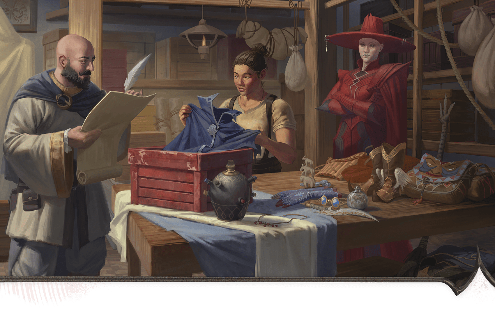

<!-- Notes MJ : contenu fourni par l’utilisateur, non destiné au partage public. -->

### Iskari’s Scam

Zuzanna Wuzyk

Iskan Iskari and an employee inventory a shipment of magic items for a Red Wizard client.

The workers and guards at Two Plateaus Shipping Company don’t know that Iskari has been stealing magic items from clients and selling them. Iskari doesn’t fear many of his clients—but he is afraid of Szass Tam. He carefully hides any evidence of his scam.

#### Securing Evidence

If the characters want to convince Iskari to work against Szass Tam, they must secure one or more pieces of evidence that prove Iskari has stolen from the lich. The characters recognize when something they find is evidence. They can find four pieces of evidence, which are in the following areas:

- **Area T5:** Stolen [Mantle of Spell Resistance](https://www.dndbeyond.com/magic-items/4673-mantle-of-spell-resistance)
- **Area T10:** Document listing items that were supposedly lost in transit
- **Area T12:** Receipt for stolen items sold to a fence
- **Area T14:** Stolen [Nine Lives Stealer (Longsword)](https://www.dndbeyond.com/magic-items/5124-nine-lives-stealer-longsword)

#### Blackmailing Iskari

When the characters interact with Iskari, a character can take the [Influence](https://www.dndbeyond.com/sources/dnd/free-rules/rules-glossary#InfluenceAction) action to try to convince him that they know about his scam and will inform Szass Tam unless Iskari cooperates. The character then makes a Charisma ([Persuasion](https://www.dndbeyond.com/sources/dnd/free-rules/playing-the-game#Skills)) check. The DC of that check depends on how many pieces of evidence the characters have when they confront Iskari, as noted in the Blackmailing Iskari table.

Although Iskari serves Szass Tam, he is greedy and self-centered. Iskari lies about stealing magic items unless the characters have three or more pieces of evidence or convince him to work against Szass Tam.

If the characters convince Iskari to work against Szass Tam, they must give him the instructions described in “[Dead Drops](../chapter.md#DeadDrops).”

#### Blackmailing Iskari

| Pieces of Evidence | DC |
| --- | --- |
| None | Impossible |
| 1 | 25 |
| 2 | 20 |
| 3 | 15 |
| 4 | 10 |

***Development.*** If the characters find three or more pieces of evidence, each character earns 4,700 XP.
