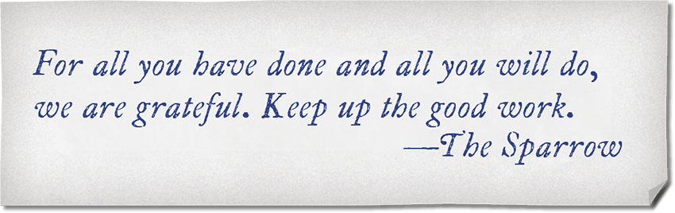

<!-- Notes MJ : contenu fourni par l’utilisateur, non destiné au partage public. -->

## Gift from the Sparrow

Handout: Gift Note

Sometime after the characters complete their first or second mission, Wrynn sends them a gift via an anonymous courier to express his thanks for the work they’ve done so far.

The details are up to you, but at your discretion, a parcel arrives where one or more characters stay. The parcel is a cherrywood box wrapped in black satin. The box is lined with purple velvet, on which sit a number of elegantly embroidered handkerchiefs equal to the number of characters. Ask each player their character’s favorite color; that’s the color of the handkerchief Wrynn has given them.

The box also contains a note. When the characters read the note, give the players a copy of the Gift Note handout.
