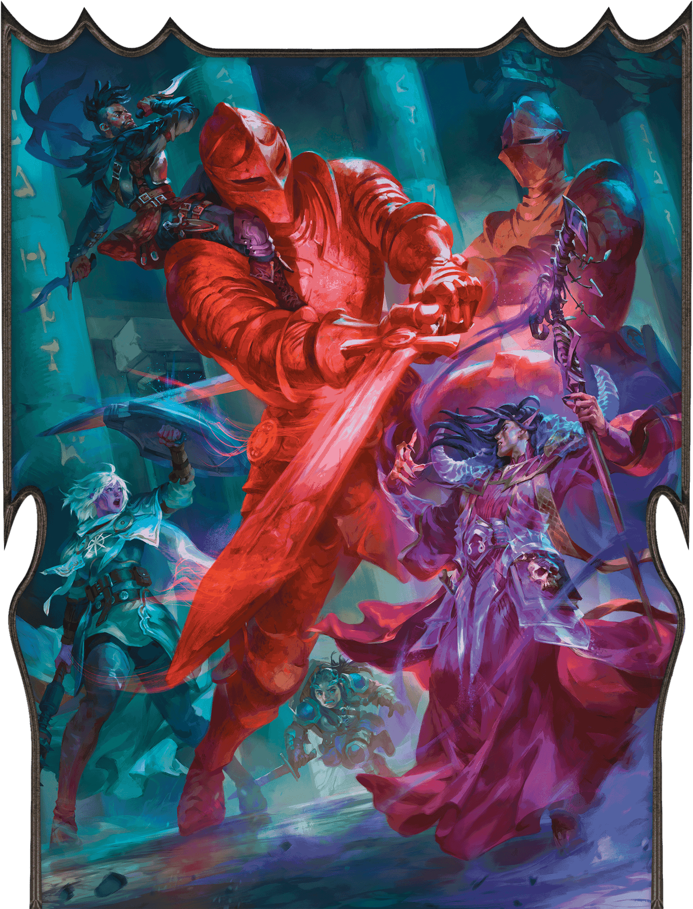
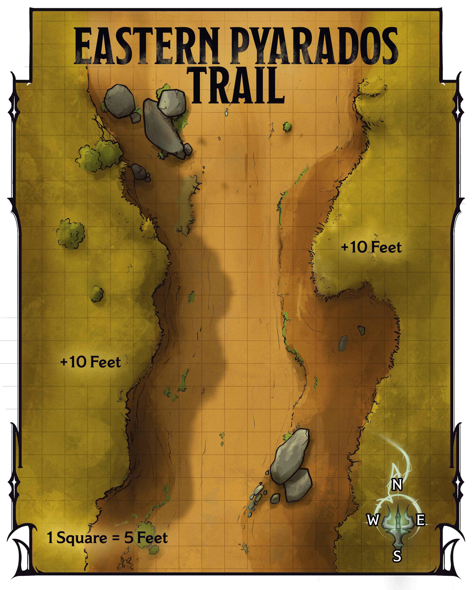
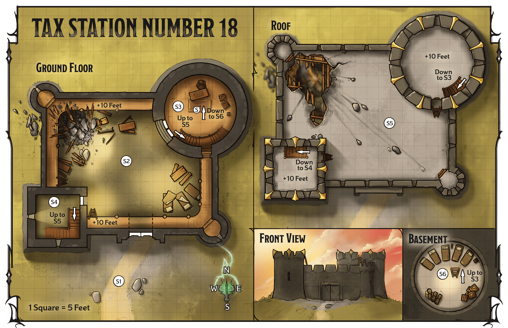
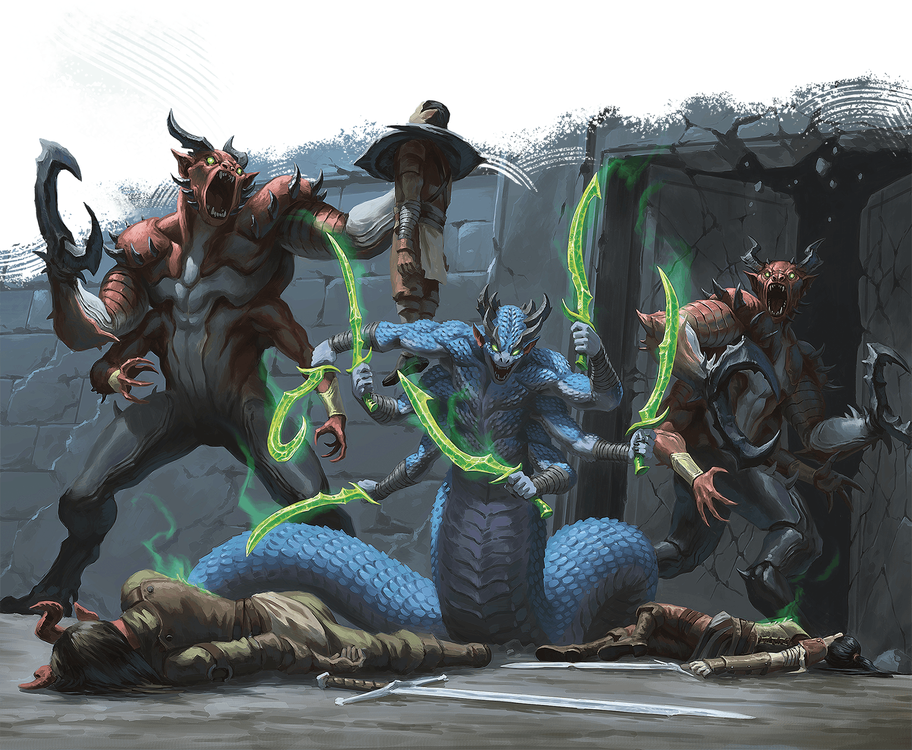
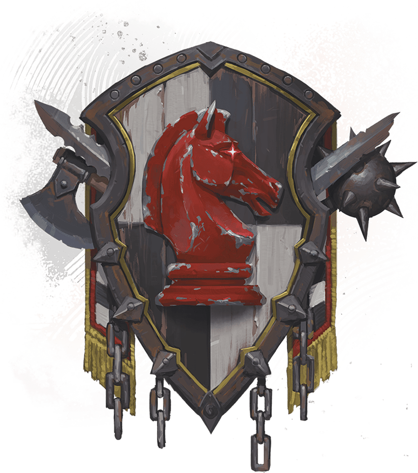
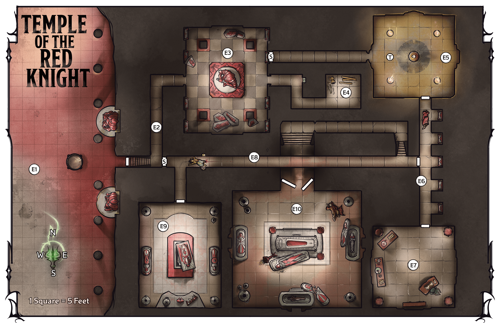
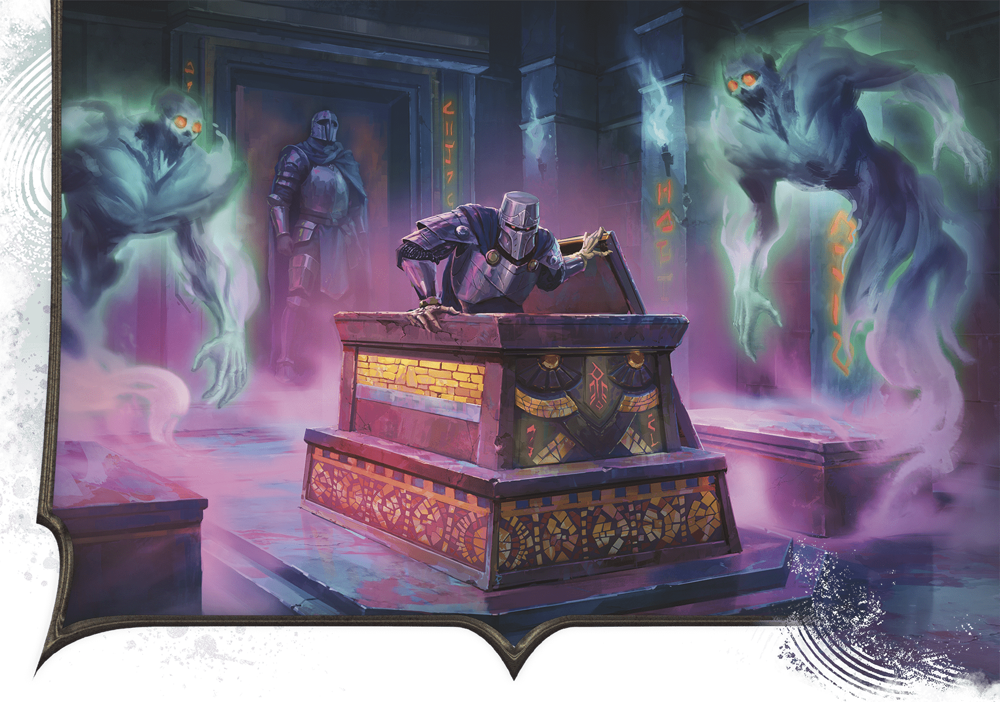
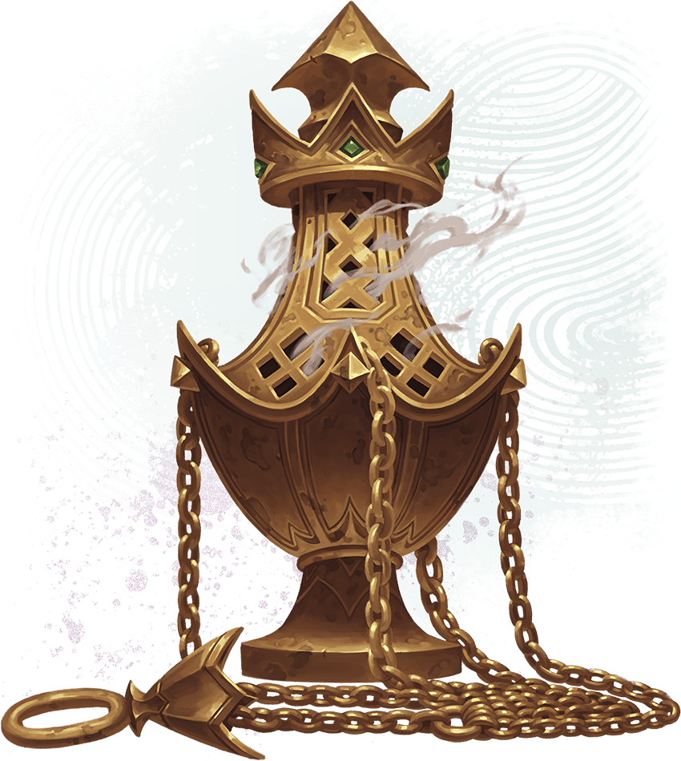

<!-- Notes MJ : contenu fourni par l’utilisateur, non destiné au partage public. -->

# Peril in Pyarados

Recruit soldiers and recover an ancient artifact.

Adventure   
for Level

13

Characters

Sessions

3-4

EILENE CHERIE

Heroes battle ancient guardians outside the Temple of the Red Knight.

## Key Plot Points

The following information is key to this chapter’s story:

- **Approach the Militia.** The characters travel to rural Pyarados in eastern Thay, where they must help a militia repel a demonic attack, then ask the militia to protect the region from Szass Tam’s hordes.
- **Retrieve the Censer.** The characters also must infiltrate a nearby ancient temple to the Red Knight and retrieve the [Spirit-Binding Censer](https://www.dndbeyond.com/magic-items/11914557-spirit-binding-censer), which can ensure [Szass Tam](https://www.dndbeyond.com/monsters/6719633-szass-tam) remains dead for one hundred years if they kill him.

## Preparation

Before running this chapter, prepare as follows:

- **Step 1.** Read the “[Running This Chapter](../chapter.md#RunningThisChapter)” section, including “[Character Advancement](../chapter.md#CharacterAdvancement).” Decide with your players which mission the characters will tackle first or run them in the order presented.
- **Step 2.** Familiarize yourself with the Key NPCs table below.
- **Step 3.** Bookmark the stat blocks below, which appear in the [Monster Manual](https://www.dndbeyond.com/sources/dnd/mm-2024) and on D&D Beyond unless otherwise noted. If a stat block appears in appendix B, an asterisk appears after its name:

[Abveku](https://www.dndbeyond.com/monsters/6719629-abveku)\*

[Archmage](https://www.dndbeyond.com/monsters/5194902-archmage)

[Berserker Commander](https://www.dndbeyond.com/monsters/5194924-berserker-commander)

[Centaur Trooper](https://www.dndbeyond.com/monsters/5194939-centaur-trooper)

[Commoner](https://www.dndbeyond.com/monsters/5194951-commoner)

[Death Knight](https://www.dndbeyond.com/monsters/5194963-death-knight)

[Demilich](https://www.dndbeyond.com/monsters/5194967-demilich)

[Flaming Skeleton](https://www.dndbeyond.com/monsters/5194996-flaming-skeleton)

[Ghast Gravecaller](https://www.dndbeyond.com/monsters/5195006-ghast-gravecaller)

[Glabrezu](https://www.dndbeyond.com/monsters/5195041-glabrezu)

[Horned Devil](https://www.dndbeyond.com/monsters/5195082-horned-devil)

[Iron Golem](https://www.dndbeyond.com/monsters/5195090-iron-golem)

[Mage](https://www.dndbeyond.com/monsters/4831023-mage)

[Mage Apprentice](https://www.dndbeyond.com/monsters/5195109-mage-apprentice)

[Marilith](https://www.dndbeyond.com/monsters/5195117-marilith)

[Mummy Lord](https://www.dndbeyond.com/monsters/5195134-mummy-lord)

[Rendelith](https://www.dndbeyond.com/monsters/6719631-rendelith)\*

[Spy Master](https://www.dndbeyond.com/monsters/5195216-spy-master)

[Stone Golem](https://www.dndbeyond.com/monsters/4904850-stone-golem)

[Warrior Commander](https://www.dndbeyond.com/monsters/5195258-warrior-commander)

[Warrior Veteran](https://www.dndbeyond.com/monsters/5195260-warrior-veteran)

[Wraith](https://www.dndbeyond.com/monsters/5174960-wraith)

[Xelnene Thrul](https://www.dndbeyond.com/monsters/6719634-xelnene-thrul)\*

#### Key NPCs

| Name | Role | Stat Block | Location |
| --- | --- | --- | --- |
| Ezkaar Softhoof, Tilda Ven, and Yaris | Militia members ambushed by demons | [Centaur Trooper](https://www.dndbeyond.com/monsters/5194939-centaur-trooper) and [Warrior Veterans](https://www.dndbeyond.com/monsters/5195260-warrior-veteran) (Medium, Neutral Good) | “[Eastern Pyarados Trail](../chapter.md#EasternPyaradosTrail)” |
| Fallon Nor | Human leader of the Pyarados militia | [Warrior Commander](https://www.dndbeyond.com/monsters/5195258-warrior-commander) (Medium, Neutral Good) | [S3](../chapter.md#S3AudienceChamber) |
| Garos | Goliath Thayan knight who serves Omina | [Berserker Commander](https://www.dndbeyond.com/monsters/5194924-berserker-commander) (Medium, Neutral Evil) | “[Eastern Pyarados Trail](../chapter.md#EasternPyaradosTrail)” |
| Kellen Toll, Merias, and Serafina | Human and tiefling militia members under attack by demons | [Warrior Veterans](https://www.dndbeyond.com/monsters/5195260-warrior-veteran) (Medium) | [S1](../chapter.md#S1Courtyard) |
| Nazemm | Dead human Red Wizard scholar | — | [E10](../chapter.md#E10TombCommander) |
| Omina | Human Red Wizard besieging the Pyarados militia’s base | [Mage](https://www.dndbeyond.com/monsters/4831023-mage) (Medium, Neutral Evil) | “[Eastern Pyarados Trail](../chapter.md#EasternPyaradosTrail)” |
| Valzaa | Human, only survivor of an undead attack in the ancient temple | [Mage Apprentice](https://www.dndbeyond.com/monsters/5195109-mage-apprentice) (Medium, Chaotic Good) | [E10](../chapter.md#E10TombCommander) |
| Wynston Wrynn | Human tailor and Zulkir Thrul’s spy master | [Spy Master](https://www.dndbeyond.com/monsters/5195216-spy-master) (Medium, Neutral Good) | “[Third and Fourth Missions](../chapter.md#ThirdAndFourthMissions)” |
| Xelnene Thrul | Human zulkir of evocation and Operation Deadfall leader | See [appendix B](https://www.dndbeyond.com/monsters/6719634-xelnene-thrul) | “[Third and Fourth Missions](../chapter.md#ThirdAndFourthMissions)” |

## Running This Chapter

This chapter takes place after the characters have completed their missions in Eltabbar.

### Character Advancement

The characters should be level 13 when this chapter begins. They should have enough XP to advance to level 14 before they embark on their second mission in this chapter. They should reach level 15 by the end of this chapter. If you’re using a method of level advancement that doesn’t rely on XP, the characters gain levels at those points.

## Returning to the Zulkir

When Wynston Wrynn summons the characters to the shop to meet with the zulkir, they find him busy writing receipts at the desk in the otherwise empty shop.

Wrynn ushers the characters into the secret office and whispers into a [Sending Stone](https://www.dndbeyond.com/magic-items/9180147-sending-stones). A few moments later, Zulkir Thrul arrives via the [Teleport](https://www.dndbeyond.com/spells/2619163-teleport) spell, undisguised. She casts the [Demiplane](https://www.dndbeyond.com/spells/2619088-demiplane) spell and escorts the group through the shadowy door that appears on the wall.

## Third and Fourth Missions

When the characters are ready, read or paraphrase the following:

“Operatives, you’ve done well disrupting the Hydra’s agents in Eltabbar,” Zulkir Thrul says. “It’s time to lay groundwork outside the city.

“Your next two missions are in the tharch of Pyarados. One is to secure an alliance with a militia, code-named the Bodyguards, that can greatly help our cause. The second is to retrieve a powerful magic item, code-named the Artifact, from an ancient temple of the Red Knight.

“Both objectives are near each other. You may accomplish these goals in whatever order you wish.

“The Hydra conducted experiments with foul magic in this area. His activities thinned the veil between planes, and reports indicate that fiends rampage throughout the area. Protect yourselves, and stay alert.

“Before you depart, please take this *Sending Stone*—then I’ll answer your questions.”

Before answering their questions, the zulkir hands the characters one of a pair of [Sending Stones](https://www.dndbeyond.com/magic-items/9180147-sending-stones). She asks them to give it to Fallon Nor, the militia’s leader, to report about any rising activity related to Szass Tam and his allies. Wrynn keeps the other stone. The zulkir instructs the characters to tell the militia only that they will communicate with a trusted associate called the Sparrow.

Thrul can provide the following information about both missions:

- **How Will We Get to Pyarados?** “You may find your own way there, or I can give you two [Spell Scrolls](https://www.dndbeyond.com/magic-items/9229085-spell-scroll) *of* [Teleport](https://www.dndbeyond.com/spells/2619163-teleport): one to transport you near your destination, and one to return you home. If you use the scrolls, however, you must teleport to where I describe and approach your missions on foot to avoid appearing hostile.” If the characters want the scrolls, the zulkir hands them over now.”
- **Where in Pyarados Are These Missions?** “The locations of both missions are a few miles from a fork in a rural trail branching east off the Minor Road. The militia is based in an old station called Tax Station Number 18; it lies about five miles south of the fork. The temple is five miles north of the fork and is built into the side of a sheer cliff.”

Thrul can provide the following information about the Bodyguards:

- **How Can We Convince the Bodyguards to Ally with Us?** “There is no need to lie to the Bodyguards. They hate the Hydra. Tell them you aim to defeat him, and that any information they provide will help that cause. Tell them that if you succeed, reinforcements from Eltabbar will come to help them, but they can’t be spared while the Hydra remains a threat. As usual, keep my name out of your discussions, but you may reveal that you have a powerful patron. Let them know they aren’t alone in their struggle, and I suspect they will want to help us.”
- **How Will They Help Operation Deadfall?** “The Bodyguards roam the region protecting the locals from monster attacks. Since the Hydra’s experiments here have attracted fiends and animated undead, his allies might arrive soon to marshal those menaces to overwhelm eastern Thay. We need them to tell us if that happens.”
- **What Can You Tell Us About the Bodyguards?** “[Pyarados’s tharchion](../../chapter-01-thay/chapter.md#CityOfPyarados) refuses to send its official army outside the tharch’s capital despite the many fiend and malefite attacks against Pyarados’s rural population in recent months. The Bodyguards are former soldiers who want to defend their neighbors against these attacks. Their leader is a former commander named Fallon Nor, whose family was killed here in Eltabbar years ago after speaking out against the Hydra. Nor’s hatred for the Hydra burns brightly, and I’m certain she’ll ally with us if you ask.”
- **Should We Expect Trouble at Their Base?** “Count on it. It’s no secret Fallon Nor hates the Hydra, and since the Hydra’s network is silencing his enemies, the Bodyguards are in danger. That, combined with the reports of roving fiends and malefites, means you could face significant threats near the base.”

The zulkir can provide the following information about the Artifact:

- **What Can You Tell Us About the Temple?** “The temple is ancient and notoriously deadly to treasure hunters; no explorers are known to have survived. I know little about the site, but it’s reputed to hold a powerful magic item that’s vital to our cause.”
- **Why Do We Need the Artifact?** “The Artifact is a mighty magical censer written about vaguely in the rarest history books. It was created by this area’s ancient people to protect themselves against otherworldly monsters. I believe the Artifact has the ability to trap the Hydra’s soul—not indefinitely, but at least long enough to give Thay a chance to prepare to resist his inevitable future schemes. If I’m correct, using the Artifact against the Hydra in your coming conflict is just as important as interrupting his ritual.”

After the zulkir answers the characters’ questions, she gives them directions to [Tax Station Number 18](../chapter.md#TaxStationNumber18) and to the [Temple of the Red Knight](../chapter.md#TempleOfTheRedKnight).

When the characters are ready to recruit the Bodyguards, see “Pyarados Militia.” When they are ready to seek the [Spirit-Binding Censer](https://www.dndbeyond.com/magic-items/11914557-spirit-binding-censer), see “[An Ancient Temple](../chapter.md#AnAncientTemple).”

## Pyarados Militia

The Bodyguards may be ragtag, but they are highly trained former soldiers. In recent weeks, they have patrolled eastern Pyarados, helping locals fend off demons and undead. Militia members don’t know Szass Tam’s plans, but they know something terrible is amiss.

### Militia’s Commander

The militia’s leader is Fallon Nor, a former commander in Pyarados’s military and human scion of a once-powerful noble family in Eltabbar. Thirty years ago, during Szass Tam’s regency, the Nors spoke against the lich’s cruelty. Enraged, Szass Tam unleashed a horde of undead on the family’s estate that killed dozens, including Nor’s parents. A housekeeper escaped with baby Fallon, who grew up in rural Pyarados with an adoptive family.

Brusque but kind, Nor hates the Red Wizards—and Szass Tam in particular. The other soldiers admire her bravery and trust her with their lives.

### Imminent Threat

Thrul is rightly worried about the militia’s safety. Right before the characters arrive, a Red Wizard traveled to Tax Station Number 18, intent on wiping out the militia to curry favor with Szass Tam. A human demonologist named Omina, this Red Wizard soon discovered that nearby marauding demons had slipped onto the Material Plane during Szass Tam’s previous experiments. Omina allied with the demons and launched an assault on the militia, along with her Thayan knight, the goliath Garos.

### Eastern Pyarados Trail

Once the characters come within a half mile of Tax Station Number 18, read or paraphrase the following:

Fifty feet down the trail, an armored human man and woman and a centaur woman block the trail, blades drawn. “Stop!” shouts one of the soldiers. “State your—”

His command becomes a pained shout as a seven-foot-tall, mantis-like monster leaps from behind a boulder near him and slices his shoulder with a clawed arm. Two clawed fiends ambush the other soldier, who screams in rage. The soldiers turn to face the monsters in battle.

Much farther down the trail, a flying woman in Red Wizard robes points and laughs before rushing toward the stone keep on the horizon. A warrior wearing spiked armor and bearing a greataxe flies at the wizard’s side.

Use map. 4.1 for this encounter.

Gerralt Landman, Brian Valeza

Map 4.1: Eastern Pyarados Trail [View Player Version](https://media-stg.dndbeyond.com/compendium-images/aud/aqZhSuV5QislqWyN/map-04-01.eastern-pyarados-trail-player.png)

The militia members are the humans Tilda Ven and Yaris (Medium, Neutral Good [Warrior Veterans](https://www.dndbeyond.com/monsters/5195260-warrior-veteran)) and the centaur woman Ezkaar Softhoof ([Centaur Trooper](https://www.dndbeyond.com/monsters/5194939-centaur-trooper)). The monsters are an [Abveku](https://www.dndbeyond.com/monsters/6719629-abveku) demon and two [Glabrezus](https://www.dndbeyond.com/monsters/5195041-glabrezu). If the characters don’t intervene, the demons kill Yaris and Tilda after 2 rounds of combat. The demons kill Ezkaar after the next round.

If the characters join the combat against the demons immediately, the demons focus on them in the fight. In this case, Yaris and Tilda are each reduced to 46 HP, and Ezkaar is unharmed.

The human Red Wizard is Omina (Medium, Neutral Evil [Mage](https://www.dndbeyond.com/monsters/4831023-mage)), who has cast the [Fly](https://www.dndbeyond.com/spells/2618909-fly) spell on herself. The goliath warrior with her is Garos (Medium, Neutral Evil [Berserker Commander](https://www.dndbeyond.com/monsters/5194924-berserker-commander)), Omina’s Thayan knight, on whom the wizard has cast the [Fly](https://www.dndbeyond.com/spells/2618909-fly) spell using a [Spell Scroll](https://www.dndbeyond.com/magic-items/9229085-spell-scroll). Omina and Garos are headed to the tax station’s battlements ([area S5](../chapter.md#S5Battlements)) to oversee the demons’ attack on the keep. When this combat begins, they are 160 feet away from the northernmost area depicted on map 4.1.

#### Development

If the characters save them, the militia members are grateful but worried about their compatriots. They run toward Tax Station Number 18, shouting for the characters to help them defend the keep against the Red Wizard and her knight.

## Tax Station Number 18

The militia’s keep was once a tax station where tharch officials collected tolls from miners headed from Pyarados city to the mines in the Sunrise Mountains’ foothills. Traffic has been sparse in recent years, though, so the tharchion closed the keep, and it has fallen into disrepair. The former tax station remained empty until the Pyarados militia formed and co-opted it.

The militia has been using the keep as a garrison, surviving off supplies donated by local miners. Recently, travelers the militia has saved from malefite attacks have stayed in the keep as they recovered from their ordeals.

### Approaching the Station

Read or paraphrase the following when the characters approach the station’s courtyard ([area S1](../chapter.md#S1Courtyard)):

Before you rises a squat fortress besieged by fiends. Near the fortress’s gate, two red-skinned abominations and a serpentine horror with six arms battle three outmatched soldiers struggling to stand their ground. On the battlements, a red-robed woman and armored knight survey the scene smugly, a serpentine monster by their side.

### Station Features

The station has the following features.

#### Ceilings

Inside the keep, the ceilings in areas S2 and S3 are 30 feet high, the ceiling in [area S4](../chapter.md#S4SouthwestTower) is 40 feet high, and the ceiling in the basement ([S6](../chapter.md#S6Basement)) is 15 feet high.

#### Lighting

During the day, [Bright Light](https://www.dndbeyond.com/sources/dnd/free-rules/rules-glossary#BrightLight) illuminates the keep’s interior. Sunlight streams through the partially collapsed roof, and light sconces illuminate interior rooms (areas [S3](../chapter.md#S3AudienceChamber), [S4](../chapter.md#S4SouthwestTower), and [S6](../chapter.md#S6Basement)).

#### Partially Collapsed Roof

Part of the roof over the keep’s interior ([area S2](../chapter.md#S2MainChamber)) has collapsed, leaving a pile of rubble.

### Station Locations

The following locations are keyed to map 4.2. Descriptions assume the characters aid the militia during the attacks described. If they don’t, in 10 minutes Omina, Garos, and the demons kill every member of the militia, as well as the locals hiding in the basement, then leave the area.

Gerralt Landman

Map 4.2: Tax Station Number 18 [View Player Version](https://media-stg.dndbeyond.com/compendium-images/aud/aqZhSuV5QislqWyN/map-04-02.tax-station-number-18-player.png)

#### S1: Courtyard

Two enormous, red-skinned fiends with two arms resembling a human’s and two more ending in massive claws are battling three soldiers. A six-armed, serpentine monster slavers nearby.

The monsters are two [Glabrezus](https://www.dndbeyond.com/monsters/5195041-glabrezu), which each have 100 HP remaining, and a [Marilith](https://www.dndbeyond.com/monsters/5195117-marilith), which has 150 HP remaining. If the characters intervene, the demons leave the soldiers alone and focus on fighting the characters. In this case, the soldiers (Medium [Warrior Veterans](https://www.dndbeyond.com/monsters/5195260-warrior-veteran)), are reduced to 49 HP and retreat down the trail. The stone doors to the station’s main chamber (area S2) are open.

***Development.*** The soldiers are Kellen Tol and Merias, both humans, and Serafina, a tiefling. If they survive the fight, they thank the characters and frantically beg them to help the militia members trapped inside the keep.

BRIAN VALEZA

If the characters don’t act quickly, demons murder the inhabitants of the tax station.

#### S2: Main Chamber

Chaos has erupted in this chamber, where desks and bunk beds have been smashed to kindling by the enormous quadrupedal monster pummeling the closed stone doors to the northeast. A smaller door stands in the southwest corner, and ten feet above, a gantry surrounds the room.

The monster is a [Rendelith](https://www.dndbeyond.com/monsters/6719631-rendelith). Areas with rubble in them are [Difficult Terrain](https://www.dndbeyond.com/sources/dnd/free-rules/rules-glossary#DifficultTerrain).

***Gantry.*** Ladders in the southwest corner, one on each side of the square tower, lead 10 feet up to the chamber’s gantry.

#### S3: Audience Chamber

The doors to this chamber are made of stone and locked. The lock is Simple (1 action to pick) and of Superior quality (DC 20). (See “Doors” in the [Dungeon Master’s Guide](https://www.dndbeyond.com/sources/dnd/dmg-2024/dms-toolbox#Doors).) In addition to the lock, the soldiers have barricaded the door with planks from smashed chairs; opening the door requires a successful DC 25 Strength check if the soldiers inside don’t remove the barricades. The soldiers agree to remove the barricades only if the characters shout through the door that the demons are dead. Otherwise, Fallon Nor (see below) refuses to let the characters inside the room or speak with them.

When the characters enter the room, read or paraphrase the following:

This sparse office is furnished with a threadbare rug and a desk. Standing before the desk is a harried-looking human woman with a greatsword. Four soldiers—two orcs and two goliaths—huddle against the northern wall. A staircase to the south leads upward.

***Meeting the Soldiers.*** The woman near the desk is the militia’s commander, Fallon Nor (Medium, Neutral Good [Warrior Commander](https://www.dndbeyond.com/monsters/5195258-warrior-commander)). The four soldiers are two orcs named Garth and Letta and two goliaths named Bram and Marta (Medium [Warrior Veterans](https://www.dndbeyond.com/monsters/5195260-warrior-veteran)).

***Commander Nor.*** Nor’s top priority is ensuring the militia’s members are safe. She won’t talk to the characters while any enemies still attack the fortress. See “[Concluding the Mission](../chapter.md#ConcludingTaxStationNumber18Mission)” for more about talking with Nor.

***Secret Trapdoor.*** A secret trapdoor (marked with an *S* on the map; DC 20 to notice) lies underneath the thin rug in the room’s center. The trapdoor leads to the basement ([area S6](../chapter.md#S6Basement)).

#### S4: Southwest Tower

A staircase winds upward, terminating in a door that leads to the roof.

The cramped staircase leads 30 feet upward.

#### S5: Battlements

A human woman in red robes with tattoos covering her face flies just above the battlements, surveying the chaos beneath her with a wicked smile. A goliath knight with his face similarly tattooed floats beside her, while a six-armed fiend stands on the roof, looking ready to leap through the hole into the areas below.

Omina (Medium, Neutral Evil [Mage](https://www.dndbeyond.com/monsters/4831023-mage)) and Garos (Medium, Neutral Evil [Berserker Commander](https://www.dndbeyond.com/monsters/5194924-berserker-commander)) survey the battles below. The demon is a [Marilith](https://www.dndbeyond.com/monsters/5195117-marilith).

These three fight the characters if the party enters this area. All three fight to the death; Omina shouts praise to Szass Tam through the entire fight, though Garos stays silent.

If the characters have defeated the monsters elsewhere in the keep, Omina, Garos, and the demon confront them and start combat.

#### S6: Basement

Cots are set up here alongside piles of food, water, and other survival supplies. Half a dozen disheveled, scared people huddle in groups, whispering fearfully.

The people here—six [Commoners](https://www.dndbeyond.com/monsters/5194951-commoner) of various species—have been staying at the station after malefites attacked them nearby.

If the characters defeat all the demons in the keep, these folk erupt in joy and herald the adventurers as saviors.

## Concluding the Mission

If all the militia members survive, Fallon Nor profusely thanks the characters. If any members die, she asks the characters to restore them to life. If the characters decline, Nor understands the characters’ reasons. She asks the characters to join her and the surviving militia members in a moment of respectful silence to honor the dead’s sacrifice.

If Nor and any other militia members survive the ordeal, Nor agrees to ally the militia with the characters against Szass Tam. She accepts the [Sending Stone](https://www.dndbeyond.com/magic-items/9180147-sending-stones) and agrees to report activity in the area related to Szass Tam and his allies. She is pleased to hear about the characters’ goal and promises to do anything she can to help take the lich down.

If no other militia members survive, Nor refuses to ally with the characters.

### Mission Reward

If the characters’ mission is successful, they receive one magic item from the list in “[Mission Rewards](../../chapter-03-operation-deadfall/chapter.md#DeadfallMissionRewards)” in chapter 3. Remind the characters to tell Wrynn which item they’ve chosen as their reward. For bringing Nor and the militia into the fold of Operation Deadfall, each character earns 5,400 XP.

## An Ancient Temple

When the Mulhorand empire ruled this region, it was inhabited by a warrior people. Their leader, a tiefling named Khamune, dreamed that the Red Knight promised to help his people win independence from the Mulhorandi if they followed her teachings.

Though worship of the Red Knight was almost unknown at the time, Khamune persuaded his people to worship her. He built a temple dedicated to her, declared himself her high commander, and led an uprising against Mulhorand using strategies the deity inspired.

Eventually, the Mulhorand empire crushed the uprising. Khamune fell in battle, and his followers entombed him and other honored dead in the temple along with magical treasures. They magically sealed the temple and scattered into the surrounding lands. Worship of the Red Knight then faded in the region.

### Trail to the Temple

As the characters travel to the temple, a horde of malefites confronts them on the trail.

Read or paraphrase the following:

A foul wind momentarily chills you to the bone. On the horizon, you see a black-armored knight marching toward you, eyes glowing a malevolent green. Around the knight shamble eight skeletons alight with bright-green flames.

Use [map 4.1](../chapter.md#Map0401EasternPyaradosTrailImg) from “Eastern Pyarados Trail” for this encounter.

A [Death Knight](https://www.dndbeyond.com/monsters/5194963-death-knight) and eight [Flaming Skeletons](https://www.dndbeyond.com/monsters/5194996-flaming-skeleton) fight the characters on sight.

#### Development

After the battle, a character can take the [Search](https://www.dndbeyond.com/sources/dnd/free-rules/rules-glossary#SearchAction) action to look for the malefites’ tracks. The character makes a DC 15 Wisdom ([Survival](https://www.dndbeyond.com/sources/dnd/free-rules/playing-the-game#Skills)) check. On a success, the character can follow the malefites’ trail, which leads three miles off the road the characters travel.

***Graveyard.*** The malefites’ tracks end at an overgrown graveyard with nine crumbling headstones. The largest headstone reads, “Here lies Greta Zann, champion of Pyarados, who fell to the Mulhorandi 978 DR.” The other headstones are illegible.

The graves are open and empty. A faint wisp of green energy glows at the bottom of each grave. A character can take the [Study](https://www.dndbeyond.com/sources/dnd/free-rules/rules-glossary#StudyAction) action to examine the graves and make a DC 15 Intelligence ([Arcana](https://www.dndbeyond.com/sources/dnd/free-rules/playing-the-game#Skills)) check. On a success, the character realizes that Szass Tam’s foul magic recently animated the corpses.

***Treasure.*** At the bottom of Zann’s grave is an [Oil of Sharpness](https://www.dndbeyond.com/magic-items/9228908-oil-of-sharpness) that she never had a chance to use.

***What’s Next?*** The characters can easily find their way back to the road that leads to the temple.

## Temple of the Red Knight

The Temple of the Red Knight in Pyarados is built into a sheer limestone cliff at the foot of the Sunrise Mountains.

### Lost Research Team

Although the outside of the temple suggests it’s abandoned, an eccentric Red Wizard archaeologist named Nazemm, a human from the city of Pyarados, recently entered the complex with a team of spellcasting academics to learn about this ancient group of Red Knight worshippers. The team decoded the temple’s entry requirements (see [area E1](../chapter.md#E1TempleEntrance)) and ventured inside, bypassing the building’s traps and locked doors.

Unfortunately for the academics, Nazemm accidentally invoked an ancient inscription meant to protect Khamune’s tomb ([area E10](../chapter.md#E10TombCommander)) from Mulhorandi robbers. The invocation awakened several undead within the complex, including Khamune.

Swatches Studio

The Red Knight’s Holy Symbol

These undead slew Nazemm and most of his team members. Their bodies lie scattered about the temple. The sole survivor, Valzaa, hides in a sarcophagus in Khamune’s tomb, desperately hoping to escape.

### Temple Features

The temple has the following features.

#### Ceilings

Interior ceilings in rooms are 30 feet high. Hallway ceilings (including areas [E2](../chapter.md#E2EntryTunnel), [E6](../chapter.md#E6EasternHallway), and [E8](../chapter.md#E8CentralHallway)) are 15 feet high.

#### Doors

The temple’s doors are made of stone. The door to the temple is locked (see [area E1](../chapter.md#E1TempleEntrance)). Interior doors are unlocked except for the door in the worship chamber ([area E5](../chapter.md#E5WorshipChamber)) that leads to the eastern hallway ([area E6](../chapter.md#E6EasternHallway)). (See “Doors” in the [Dungeon Master’s Guide](https://www.dndbeyond.com/sources/dnd/dmg-2024/dms-toolbox#Doors).)

***Secret Doors.*** Unless otherwise noted, secret doors (marked with an *S* on the map; DC 18 to notice) blend with the surrounding walls.

#### Lighting

The entire temple is in [Darkness](https://www.dndbeyond.com/sources/dnd/free-rules/rules-glossary#Darkness), except the worship chamber ([area E5](../chapter.md#E5WorshipChamber)), where torches shed [Dim Light](https://www.dndbeyond.com/sources/dnd/free-rules/rules-glossary#DimLight). Descriptions assume characters have a way to see in the dark.

#### Mummy Lord’s Lair

The Temple of the Red Knight is the lair of Khamune, who has risen as a mummy lord. The temple has the features of a mummy lord lair described in the [Monster Manual](https://www.dndbeyond.com/sources/dnd/mm-2024/monsters-m#MummyLordLairs).

### Temple Locations

Gerralt Landman

Map 4.3: Temple of the Red Knight [View Player Version](https://media-stg.dndbeyond.com/compendium-images/aud/aqZhSuV5QislqWyN/map-04-03.temple-of-the-red-knight-player.png)

The following locations are keyed to map 4.3.

#### E1: Temple Entrance

A five-foot-wide copper bowl on a marble base sits before this imposing temple facade, which consists of limestone pillars supporting a rock overhang extending from the sheer cliff. Beneath the overhang, a small door is recessed into the cliff. Flanking the bowl are two red granite statues of knights, their hands touching sheathed swords. Strange writing is carved into every inch of the pillars.

The temple’s entrance once welcomed the Red Knight’s faithful.

***Door.*** The door to the temple is locked from the outside. The lock is Complex (1 minute to pick) and of Superior quality (DC 20).

***Statues.*** The statues near the bowl are golems. One uses the [Iron Golem](https://www.dndbeyond.com/monsters/5195090-iron-golem) stat block, and the other uses the [Stone Golem](https://www.dndbeyond.com/monsters/4904850-stone-golem) stat block. The statues fight the characters if they try to open the door without performing the rite described below.

***Copper Bowl.*** The empty bowl’s marble base is carved with ancient writing meant to keep the temple sealed. Khamune’s people built a workaround into the seal, however, in case their descendants ever returned to reclaim the temple.

The writing’s language is similar to ancient Mulhorandi. A character who speaks Mulhorandi can translate the writing by taking the [Study](https://www.dndbeyond.com/sources/dnd/free-rules/rules-glossary#StudyAction) action and succeeding on a DC 18 Intelligence ([Investigation](https://www.dndbeyond.com/sources/dnd/free-rules/playing-the-game#Skills)) check.

The writing says, “Though we have failed, through strategy we may yet succeed. When you return, O children, offer the Crimson General a gift. Speak these words and pour any magical or sacred elixir into the bowl to achieve victory.”

***Performing the Rite.*** Anyone who learns the translation realizes it means that one must pour any magic potion or a flask of [Holy Water](https://www.dndbeyond.com/equipment/507-holy-water) into the bowl while speaking the translation aloud in any language. A character can do so as an action.

If a character performs the rite, the temple door unlocks and remains unlocked for 5 minutes. The door isn’t locked from the inside.

***The Pillars’ Writing.*** Consisting of unique arcane runes, the writing covering the pillars is magical and dates to the tomb’s construction. As a [Study](https://www.dndbeyond.com/sources/dnd/free-rules/rules-glossary#StudyAction) action, a character can examine the writing and make a DC 15 Intelligence ([Arcana](https://www.dndbeyond.com/sources/dnd/free-rules/playing-the-game#Skills) or [History](https://www.dndbeyond.com/sources/dnd/free-rules/playing-the-game#Skills)) check. On a success, the character determines that the writing invokes the temple’s ancient magic, which has prevented Szass Tam’s experiments from transforming the temple’s dead occupants into malefites.

#### E2: Entry Tunnel

Steep steps in this cramped tunnel lead downward, then the hall turns north.

This hallway leads deeper into the complex.

***Secret Door.*** A secret door at the first bend in the tunnel leads to the temple’s central hallway ([area E8](../chapter.md#E8CentralHallway)). See “[Temple Features](../chapter.md#TempleFeatures)” for details. Should the characters pass this secret door after exploring [area E3](../chapter.md#E3EntryChamber) and not finding the secret door there, they have [Advantage](https://www.dndbeyond.com/sources/dnd/free-rules/rules-glossary#Advantage) on finding the secret door in this hall.

#### E3: Entry Chamber

This chamber’s four pillars are covered in ancient writing, and murals adorn the walls. Eight upright sarcophagi stand against the walls, their lids scattered around the room. Within each sarcophagus is a motionless, desiccated body. On a central dais, a fifteen-foot-tall, red stone statue of a knight drawing her sword overlooks the area.

When a character steps onto the center dais, the eight [Ghast Gravecallers](https://www.dndbeyond.com/monsters/5195006-ghast-gravecaller) in the sarcophagi animate and fight the characters. These are lieutenants of Khamune who rose in undeath to defend the temple when the academics invoked the protective inscription in Khamune’s tomb ([area E10](../chapter.md#E10TombCommander)).

***Hidden Compartment.*** The base of the central statue contains a hidden compartment (DC 20 to notice). The compartment is locked. A character can take the [Utilize](https://www.dndbeyond.com/sources/dnd/free-rules/rules-glossary#UtilizeAction) action to try to pick the lock using [Thieves’ Tools](https://www.dndbeyond.com/equipment/495-thieves-tools), doing so with a successful DC 18 Dexterity ([Sleight of Hand](https://www.dndbeyond.com/sources/dnd/free-rules/playing-the-game#Skills)) check. The compartment contains a [Potion of Speed](https://www.dndbeyond.com/magic-items/9228939-potion-of-speed).

***Murals.*** The murals all show images of a knight in red armor standing tall above a force of smaller warriors. The knight leads a valiant charge against unarmored warriors led by a tall man in pharaonic garb.

***Pillars.*** A character who speaks Mulhorandi can translate the writing on the pillars by taking the [Study](https://www.dndbeyond.com/sources/dnd/free-rules/rules-glossary#StudyAction) action and succeeding on a DC 18 Intelligence ([History](https://www.dndbeyond.com/sources/dnd/free-rules/playing-the-game#Skills)) check.

The writing tells the story of the followers of “Khamune, the sacred high commander.” Characters who read the story learn the information about Khamune’s people in “[An Ancient Temple](../chapter.md#AnAncientTemple)” earlier in this chapter.

***Secret Door.*** A secret door in the northeastern wall behind a sarcophagus leads to the temple’s worship chamber (area [E5](../chapter.md#E5WorshipChamber)); see “[Temple Features](../chapter.md#TempleFeaturesDoors)” for details.

#### E4: Storage Chamber

This small chamber holds only shreds of rotted cloth and wood and other refuse.

This room once held sacks of grain and other supplies, but anything of interest here has rotted away.

#### E5: Worship Chamber

Murals of supplicants praying to a red-armored knight adorn these walls and the south door. Four pedestals hold lit torches, while a pedestal with a skull resting atop it is in the room’s center.

This was once a room where the Red Knight’s faithful meditated on battle strategies. When they sealed the temple, they installed a trap here to prevent intruders from moving farther inside.

***Dart Trap.*** There’s a pressure plate on this room’s floor, which is denoted by a *T* on the map. The pressure plate triggers a poisoned darts trap, as described in the [Dungeon Master’s Guide](https://www.dndbeyond.com/sources/dnd/dmg-2024/dms-toolbox#PoisonedDarts), except the Dexterity saving throw DC is 15, and each dart deals 14 (4d6) Poison damage.

***Locked Door Puzzle.*** The door to the hallway to the south ([area E6](../chapter.md#E6EasternHallway)) is locked. The lock is Complex (1 minute to pick) and of Superior quality (DC 20).

A character who takes the [Study](https://www.dndbeyond.com/sources/dnd/free-rules/rules-glossary#StudyAction) action to examine the door realizes the mural shows a magical way to unlock it. The mural depicts supplicants raising their hands in praise to the Red Knight. The supplicants stand in a line, and each but the one on the westernmost edge holds a torch.

If the characters take the torches from the nearby pedestals and stand in a formation that matches the mural, the door unlocks.

***Pedestals with Torches.*** Each pedestal holds a torch lit with a [Continual Flame](https://www.dndbeyond.com/spells/2619065-continual-flame) spell. A character can remove a torch easily (no action required).

***Secret Door.*** In the tunnel to the east, the door to [area E3](../chapter.md#E3EntryChamber) is plainly visible.

***Treasure.*** The skull on the central pedestal obscures a receptacle containing the following:

500 GP

[Elixir of Health](https://www.dndbeyond.com/magic-items/5351-elixir-of-health)

[Potion of Clairvoyance](https://www.dndbeyond.com/magic-items/4701-potion-of-clairvoyance)

[Potion of Longevity](https://www.dndbeyond.com/magic-items/5359-potion-of-longevity)

#### E6: Eastern Hallway

This long hallway runs from north to south. Five alcoves that hold sarcophagi punctuate the east side of the wall. Down the hall, the desiccated body of a robed figure lies slumped on the ground.

This hallway holds the sarcophagi of Khamune’s lieutenants. These lieutenants were not raised from the dead when Nazemm invoked the inscription in Khamune’s tomb ([area E10](../chapter.md#E10TombCommander)).

***Corpse.*** This hall holds the body of Ralpheen, a human apprentice of Nazemm. A character can take the [Search](https://www.dndbeyond.com/sources/dnd/free-rules/rules-glossary#SearchAction) action to examine Ralpheen’s wounds and make a DC 15 Wisdom ([Medicine](https://www.dndbeyond.com/sources/dnd/free-rules/playing-the-game#Skills)) check. On a success, the character determines that Necrotic damage killed him recently. (The undead mage in area E7 slew him.) If the characters can speak to Ralpheen, he tells them everything in “[Lost Research Team](../chapter.md#LostResearchTeam)” earlier in this chapter, except he doesn’t know Valzaa is still alive.

#### E7: Tomb of the Resting Wizard

This chamber appears to be a magical workshop. Two tables covered in rotting books, flaking scrolls, and strange implements stand along the west wall. A heavy desk sits in the southeast corner, and unlit braziers dot the room’s corners. A thick layer of dust covers everything.

A mage named Teketh who once served Khamune died here. Her skeleton was disturbed by Ralpheen, Nazemm’s apprentice (Ralpheen’s body lies in [area E6](../chapter.md#E6EasternHallway)). The skeleton crumbled to dust save for its skull, which animated (use the stat block of a [Demilich](https://www.dndbeyond.com/monsters/5194967-demilich), except Teketh has no lair and lacks the Undead Restoration trait). Teketh killed Ralpheen, then retreated here and now rests underneath the desk.

***Disturbing Teketh.*** If any character searches the desk in the room’s southeast corner, Teketh fights the characters, following them into other areas of the temple if necessary.

***Treasure.*** The following magic items lie scattered atop the tables in this room:

[Dark Shard Amulet](https://www.dndbeyond.com/magic-items/9228417-dark-shard-amulet)

[Figurine of Wondrous Power (silver raven)](https://www.dndbeyond.com/magic-items/9228621-figurine-of-wondrous-power)

[Ring of Spell Turning](https://www.dndbeyond.com/magic-items/9228969-ring-of-spell-turning)

[Spell Scroll](https://www.dndbeyond.com/magic-items/9229085-spell-scroll) *of* [Aura of Vitality](https://www.dndbeyond.com/spells/2618891-aura-of-vitality)

[Spell Scroll](https://www.dndbeyond.com/magic-items/9229085-spell-scroll) *of* [Magic Circle](https://www.dndbeyond.com/spells/2619018-magic-circle)

[Wand of Secrets](https://www.dndbeyond.com/magic-items/9229193-wand-of-secrets)

#### E8: Central Hallway

This long hallway stretches the length of the temple, east to west. A corridor near the east end leads north, while one near the west end leads south; just past it, the hallway ends at a door. A robed body lies crumpled near the west corridor.

This hallway runs east to west through the center of the temple. The eastern corridor leads to the tomb of the high commander ([area E10](../chapter.md#E10TombCommander)).

***Corpse.*** The central hall holds the body of Nadia, a human apprentice of Nazemm. A character can take the [Search](https://www.dndbeyond.com/sources/dnd/free-rules/rules-glossary#SearchAction) action to examine Nadia’s wounds and make a DC 15 Wisdom ([Medicine](https://www.dndbeyond.com/sources/dnd/free-rules/playing-the-game#Skills)) check. On a success, the character determines Nadia died recently after taking Slashing and Necrotic damage from a Melee weapon. (The undead general in [area E9](../chapter.md#E9GeneralsTomb) slew her.) If the characters can speak to Nadia, she tells them everything in “[Lost Research Team](../chapter.md#LostResearchTeam)” earlier in this chapter, except she doesn’t know Valzaa is still alive.

***Secret Door.*** The secret door to the entry tunnel ([area E2](../chapter.md#E2EntryTunnel)) is plainly visible from this side.

#### E9: General’s Tomb

SYLVAIN SARRAILH

An ancient general rises as a death knight to fight the characters.

Lines of ancient writing cover this chamber’s walls. On the far side of the room stands a suit of armor and a weapon rack holding two swords and a mace. A stone sarcophagus stands at the center of the chamber atop a five-foot-high platform; its lid has been pushed aside. Additional closed sarcophagi lie to the east and west.

This is the burial chamber of Khamune’s general, Mekuni. Now a [Death Knight](https://www.dndbeyond.com/monsters/5194963-death-knight), Mekuni lies in the central sarcophagus while her two loyal strategists lie in the flanking tombs. Mekuni killed Nadia, the apprentice in the central hallway ([area E8](../chapter.md#E8CentralHallway)), after the apprentice disturbed her rest; the general then returned to her sarcophagus.

When a creature moves more than 5 feet into the room, Mekuni rises to fight the characters, along with two [Wraiths](https://www.dndbeyond.com/monsters/5174960-wraith) that rise from the sarcophagi on either side of the room.

***Writing.*** A character who speaks Mulhorandi can translate the ancient writing on the wall by taking the [Study](https://www.dndbeyond.com/sources/dnd/free-rules/rules-glossary#StudyAction) action and succeeding on a DC 18 Intelligence ([History](https://www.dndbeyond.com/sources/dnd/free-rules/playing-the-game#Skills)) check.

The writing tells of the loyalty of a general named Mekuni, Khamune’s second in command. Mekuni and her strategists, Dalni and Hamsu, died defending Khamune from Mulhorandi assassins.

***Treasure.*** In each of this chamber’s corners sits an ivory jar emblazoned with the Red Knight’s symbol and worth 500 GP.

The following armor and weapons sit on the far side of the room:

[Adamantine Plate Mail](https://www.dndbeyond.com/magic-items/4852-adamantine-plate)

[Dancing Sword (Scimitar)](https://www.dndbeyond.com/magic-items/4867-dancing-scimitar)

[Flame Tongue (Longsword)](https://www.dndbeyond.com/magic-items/11854137-flame-tongue-longsword)

[Mace of Terror](https://www.dndbeyond.com/magic-items/9228835-mace-of-terror)

#### E10: Tomb of the High Commander

The tomb’s heavy stone doors hang open, revealing a large central sarcophagus on a raised dais. The sarcophagus’s lid, covered in ancient writing, has been pushed to the ground. Two open sarcophagi lie to the south and east, while a closed sarcophagus rests to the west. Murals and ancient script adorn the walls.

Lording over a slumped, red-robed body is a tiefling mummy with glowing red eyes and wearing ceremonial armor. Two desiccated warriors stand at attention next to the mummy.

The mummy is Khamune ([Mummy Lord](https://www.dndbeyond.com/monsters/5195134-mummy-lord)), the high commander of the Red Knight, who was interred here. The two warriors were Khamune’s personal guards. They each use the stat block of a [Berserker Commander](https://www.dndbeyond.com/monsters/5194924-berserker-commander), except their creature type is Undead. The creatures fight the characters on sight, following them into other parts of the temple if necessary.

***Corpse.*** The body is Nazemm, the Red Wizard and archaeologist who led the ill-fated expedition into the temple. Nazemm read aloud the writing inscribed on Khamune’s sarcophagus lid, which awakened many of the dead interred in the temple. If the characters can speak to Nazemm, he tells them everything in “[Lost Research Team](../chapter.md#LostResearchTeam)” earlier in this chapter, except he doesn’t know Valzaa is still alive.

***Hiding Apprentice.*** If the characters stand within 5 feet of the closed sarcophagus to the west, they hear whimpering. Inside the sarcophagus hides the only survivor of Nazemm’s research team: a human apprentice named Valzaa (Medium, Chaotic Good [Mage Apprentice](https://www.dndbeyond.com/monsters/5195109-mage-apprentice)). If the characters remove the lid, they find Valzaa hiding beside a dead guard who didn’t animate with the rest. Once she realizes the characters aren’t enemies, Valzaa begs them to escort her back to the city of Pyarados. She can tell the characters everything in “[Lost Research Team](../chapter.md#LostResearchTeam)” earlier in this chapter.

***Lid Inscription.*** The magic in the sarcophagus’s lid inscription is gone now that Nazemm accidentally activated it. A character who speaks Mulhorandi can translate the ancient inscription on the lid by taking the [Study](https://www.dndbeyond.com/sources/dnd/free-rules/rules-glossary#StudyAction) action and succeeding on a DC 18 Intelligence ([History](https://www.dndbeyond.com/sources/dnd/free-rules/playing-the-game#Skills)) check.

The inscription says, “Our high commander remains vigilant in death. The Red Knight shall visit horrors on those who disturb his peace.”

Alejandro Pacheco

Spirit-Binding Censer

***Murals and Writing.*** The chamber’s walls are covered in murals of a tiefling man wearing red armor, as well as lines of ancient writing. A character who speaks Mulhorandi can translate the writing on the wall by taking the Study action and succeeding on a DC 18 Intelligence ([History](https://www.dndbeyond.com/sources/dnd/free-rules/playing-the-game#Skills)) check.

The writing tells how Khamune served his people and the Red Knight and fought the Mulhorandi. He won numerous skirmishes before the empire crushed the uprising; each time, Khamune gave the spoils of these battles to his soldiers, never keeping any riches for himself.

***Treasure.*** In each of this chamber’s corners stands an ivory jar emblazoned with the Red Knight’s symbol and worth 500 GP.

Inside Khamune’s sarcophagus lies the [Spirit-Binding Censer](https://www.dndbeyond.com/magic-items/11914557-spirit-binding-censer) (see [appendix A](../../appendix-a-magic-item/chapter.md#SpiritBindingCenser)), the Artifact the characters seek.

## Concluding the Mission

The characters’ mission is successful if they retrieve the [Spirit-Binding Censer](https://www.dndbeyond.com/magic-items/11914557-spirit-binding-censer).

### Mission Reward

If the characters’ mission is successful, they receive one magic item from the list in “Mission Rewards” in [chapter 3](../../chapter-03-operation-deadfall/chapter.md#DeadfallMissionRewards). Remind the characters to tell Wrynn which item they’ve chosen as their reward. Additionally, each character earns 6,200 XP.

## Szass Tam’s Agents

If the characters haven’t remained discreet about their intent to defeat Szass Tam, the lich’s operatives track the characters down when they return to Eltabbar. You can skip this encounter if the characters have remained discreet. (See “[Importance of Secrecy](../../chapter-02-thay-in-danger/chapter.md#ImportanceOfSecrecy)” in chapter 2 for more about emphasizing discretion and guile.)

On the other hand, even if the characters have remained discreet, you might run this encounter if the characters failed either mission in chapter 2.

Use [map 3.6](../../chapter-03-operation-deadfall/chapter.md#Map0306lowerwardalley) for this encounter, though it takes place in the Lower Ward.

Read or paraphrase the following:

Three figures blink into existence in front of you: two humans with shaved, tattooed heads wearing red robes and a hulking, horned fiend with leathery wings and curving horns. The fiend chuckles in a deep, menacing tone while one of the humans points at you. “We know you stand against our liege,” she says. “Szass Tam will reward us handsomely for bringing him your heads!”

The humans are the lich’s operatives, siblings and Red Wizards named Onar and Parah Lang (Neutral Evil [Archmages](https://www.dndbeyond.com/monsters/5194902-archmage)), who are diabolists. Accompanying the Red Wizards is a [Horned Devil](https://www.dndbeyond.com/monsters/5195082-horned-devil) allied with their family. Onar cast the [Teleport](https://www.dndbeyond.com/spells/2619163-teleport) spell on the group to ambush the characters.

The siblings hope Szass Tam will hand them control of Eltabbar if they eliminate the characters. The Red Wizards and devil fight the characters to the death.
