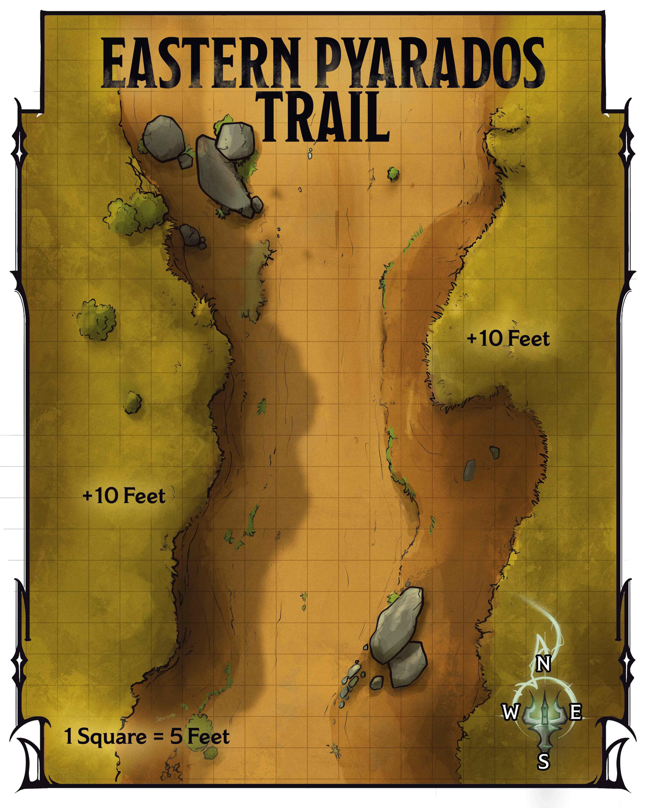

<!-- Notes MJ : contenu fourni par l’utilisateur, non destiné au partage public. -->

### Eastern Pyarados Trail

Once the characters come within a half mile of Tax Station Number 18, read or paraphrase the following:

Fifty feet down the trail, an armored human man and woman and a centaur woman block the trail, blades drawn. “Stop!” shouts one of the soldiers. “State your—”

His command becomes a pained shout as a seven-foot-tall, mantis-like monster leaps from behind a boulder near him and slices his shoulder with a clawed arm. Two clawed fiends ambush the other soldier, who screams in rage. The soldiers turn to face the monsters in battle.

Much farther down the trail, a flying woman in Red Wizard robes points and laughs before rushing toward the stone keep on the horizon. A warrior wearing spiked armor and bearing a greataxe flies at the wizard’s side.

Use map. 4.1 for this encounter.

Gerralt Landman, Brian Valeza

Map 4.1: Eastern Pyarados Trail [View Player Version](https://media-stg.dndbeyond.com/compendium-images/aud/aqZhSuV5QislqWyN/map-04-01.eastern-pyarados-trail-player.png)

The militia members are the humans Tilda Ven and Yaris (Medium, Neutral Good [Warrior Veterans](https://www.dndbeyond.com/monsters/5195260-warrior-veteran)) and the centaur woman Ezkaar Softhoof ([Centaur Trooper](https://www.dndbeyond.com/monsters/5194939-centaur-trooper)). The monsters are an [Abveku](https://www.dndbeyond.com/monsters/6719629-abveku) demon and two [Glabrezus](https://www.dndbeyond.com/monsters/5195041-glabrezu). If the characters don’t intervene, the demons kill Yaris and Tilda after 2 rounds of combat. The demons kill Ezkaar after the next round.

If the characters join the combat against the demons immediately, the demons focus on them in the fight. In this case, Yaris and Tilda are each reduced to 46 HP, and Ezkaar is unharmed.

The human Red Wizard is Omina (Medium, Neutral Evil [Mage](https://www.dndbeyond.com/monsters/4831023-mage)), who has cast the [Fly](https://www.dndbeyond.com/spells/2618909-fly) spell on herself. The goliath warrior with her is Garos (Medium, Neutral Evil [Berserker Commander](https://www.dndbeyond.com/monsters/5194924-berserker-commander)), Omina’s Thayan knight, on whom the wizard has cast the [Fly](https://www.dndbeyond.com/spells/2618909-fly) spell using a [Spell Scroll](https://www.dndbeyond.com/magic-items/9229085-spell-scroll). Omina and Garos are headed to the tax station’s battlements ([area S5](../chapter.md#S5Battlements)) to oversee the demons’ attack on the keep. When this combat begins, they are 160 feet away from the northernmost area depicted on map 4.1.

#### Development

If the characters save them, the militia members are grateful but worried about their compatriots. They run toward Tax Station Number 18, shouting for the characters to help them defend the keep against the Red Wizard and her knight.
