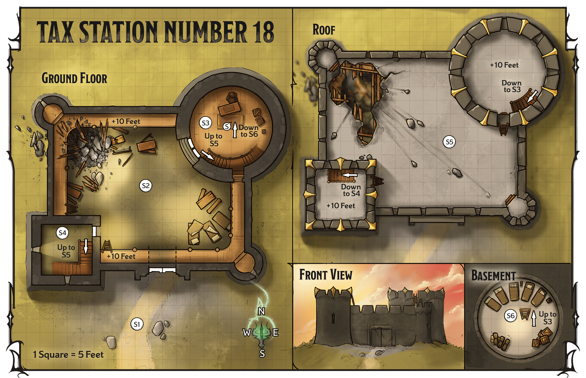
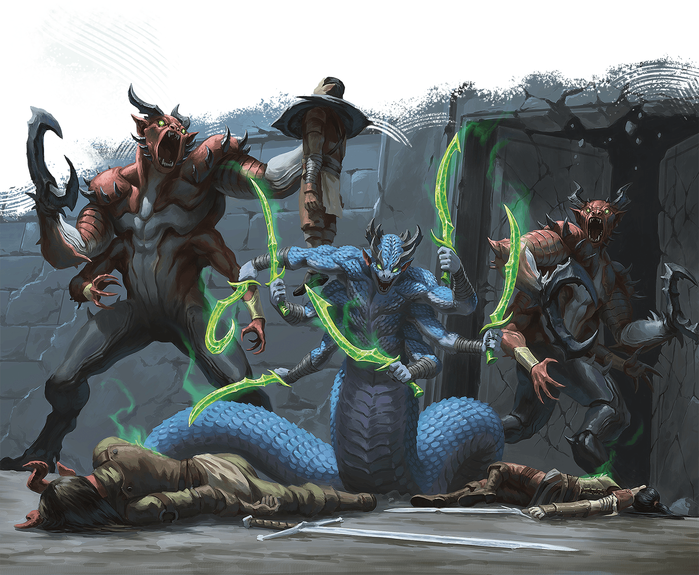

<!-- Notes MJ : contenu fourni par l’utilisateur, non destiné au partage public. -->

## Tax Station Number 18

The militia’s keep was once a tax station where tharch officials collected tolls from miners headed from Pyarados city to the mines in the Sunrise Mountains’ foothills. Traffic has been sparse in recent years, though, so the tharchion closed the keep, and it has fallen into disrepair. The former tax station remained empty until the Pyarados militia formed and co-opted it.

The militia has been using the keep as a garrison, surviving off supplies donated by local miners. Recently, travelers the militia has saved from malefite attacks have stayed in the keep as they recovered from their ordeals.

### Approaching the Station

Read or paraphrase the following when the characters approach the station’s courtyard ([area S1](../chapter.md#S1Courtyard)):

Before you rises a squat fortress besieged by fiends. Near the fortress’s gate, two red-skinned abominations and a serpentine horror with six arms battle three outmatched soldiers struggling to stand their ground. On the battlements, a red-robed woman and armored knight survey the scene smugly, a serpentine monster by their side.

### Station Features

The station has the following features.

#### Ceilings

Inside the keep, the ceilings in areas S2 and S3 are 30 feet high, the ceiling in [area S4](../chapter.md#S4SouthwestTower) is 40 feet high, and the ceiling in the basement ([S6](../chapter.md#S6Basement)) is 15 feet high.

#### Lighting

During the day, [Bright Light](https://www.dndbeyond.com/sources/dnd/free-rules/rules-glossary#BrightLight) illuminates the keep’s interior. Sunlight streams through the partially collapsed roof, and light sconces illuminate interior rooms (areas [S3](../chapter.md#S3AudienceChamber), [S4](../chapter.md#S4SouthwestTower), and [S6](../chapter.md#S6Basement)).

#### Partially Collapsed Roof

Part of the roof over the keep’s interior ([area S2](../chapter.md#S2MainChamber)) has collapsed, leaving a pile of rubble.

### Station Locations

The following locations are keyed to map 4.2. Descriptions assume the characters aid the militia during the attacks described. If they don’t, in 10 minutes Omina, Garos, and the demons kill every member of the militia, as well as the locals hiding in the basement, then leave the area.

Gerralt Landman

Map 4.2: Tax Station Number 18 [View Player Version](https://media-stg.dndbeyond.com/compendium-images/aud/aqZhSuV5QislqWyN/map-04-02.tax-station-number-18-player.png)

#### S1: Courtyard

Two enormous, red-skinned fiends with two arms resembling a human’s and two more ending in massive claws are battling three soldiers. A six-armed, serpentine monster slavers nearby.

The monsters are two [Glabrezus](https://www.dndbeyond.com/monsters/5195041-glabrezu), which each have 100 HP remaining, and a [Marilith](https://www.dndbeyond.com/monsters/5195117-marilith), which has 150 HP remaining. If the characters intervene, the demons leave the soldiers alone and focus on fighting the characters. In this case, the soldiers (Medium [Warrior Veterans](https://www.dndbeyond.com/monsters/5195260-warrior-veteran)), are reduced to 49 HP and retreat down the trail. The stone doors to the station’s main chamber (area S2) are open.

***Development.*** The soldiers are Kellen Tol and Merias, both humans, and Serafina, a tiefling. If they survive the fight, they thank the characters and frantically beg them to help the militia members trapped inside the keep.

BRIAN VALEZA

If the characters don’t act quickly, demons murder the inhabitants of the tax station.

#### S2: Main Chamber

Chaos has erupted in this chamber, where desks and bunk beds have been smashed to kindling by the enormous quadrupedal monster pummeling the closed stone doors to the northeast. A smaller door stands in the southwest corner, and ten feet above, a gantry surrounds the room.

The monster is a [Rendelith](https://www.dndbeyond.com/monsters/6719631-rendelith). Areas with rubble in them are [Difficult Terrain](https://www.dndbeyond.com/sources/dnd/free-rules/rules-glossary#DifficultTerrain).

***Gantry.*** Ladders in the southwest corner, one on each side of the square tower, lead 10 feet up to the chamber’s gantry.

#### S3: Audience Chamber

The doors to this chamber are made of stone and locked. The lock is Simple (1 action to pick) and of Superior quality (DC 20). (See “Doors” in the [Dungeon Master’s Guide](https://www.dndbeyond.com/sources/dnd/dmg-2024/dms-toolbox#Doors).) In addition to the lock, the soldiers have barricaded the door with planks from smashed chairs; opening the door requires a successful DC 25 Strength check if the soldiers inside don’t remove the barricades. The soldiers agree to remove the barricades only if the characters shout through the door that the demons are dead. Otherwise, Fallon Nor (see below) refuses to let the characters inside the room or speak with them.

When the characters enter the room, read or paraphrase the following:

This sparse office is furnished with a threadbare rug and a desk. Standing before the desk is a harried-looking human woman with a greatsword. Four soldiers—two orcs and two goliaths—huddle against the northern wall. A staircase to the south leads upward.

***Meeting the Soldiers.*** The woman near the desk is the militia’s commander, Fallon Nor (Medium, Neutral Good [Warrior Commander](https://www.dndbeyond.com/monsters/5195258-warrior-commander)). The four soldiers are two orcs named Garth and Letta and two goliaths named Bram and Marta (Medium [Warrior Veterans](https://www.dndbeyond.com/monsters/5195260-warrior-veteran)).

***Commander Nor.*** Nor’s top priority is ensuring the militia’s members are safe. She won’t talk to the characters while any enemies still attack the fortress. See “[Concluding the Mission](../chapter.md#ConcludingTaxStationNumber18Mission)” for more about talking with Nor.

***Secret Trapdoor.*** A secret trapdoor (marked with an *S* on the map; DC 20 to notice) lies underneath the thin rug in the room’s center. The trapdoor leads to the basement ([area S6](../chapter.md#S6Basement)).

#### S4: Southwest Tower

A staircase winds upward, terminating in a door that leads to the roof.

The cramped staircase leads 30 feet upward.

#### S5: Battlements

A human woman in red robes with tattoos covering her face flies just above the battlements, surveying the chaos beneath her with a wicked smile. A goliath knight with his face similarly tattooed floats beside her, while a six-armed fiend stands on the roof, looking ready to leap through the hole into the areas below.

Omina (Medium, Neutral Evil [Mage](https://www.dndbeyond.com/monsters/4831023-mage)) and Garos (Medium, Neutral Evil [Berserker Commander](https://www.dndbeyond.com/monsters/5194924-berserker-commander)) survey the battles below. The demon is a [Marilith](https://www.dndbeyond.com/monsters/5195117-marilith).

These three fight the characters if the party enters this area. All three fight to the death; Omina shouts praise to Szass Tam through the entire fight, though Garos stays silent.

If the characters have defeated the monsters elsewhere in the keep, Omina, Garos, and the demon confront them and start combat.

#### S6: Basement

Cots are set up here alongside piles of food, water, and other survival supplies. Half a dozen disheveled, scared people huddle in groups, whispering fearfully.

The people here—six [Commoners](https://www.dndbeyond.com/monsters/5194951-commoner) of various species—have been staying at the station after malefites attacked them nearby.

If the characters defeat all the demons in the keep, these folk erupt in joy and herald the adventurers as saviors.
